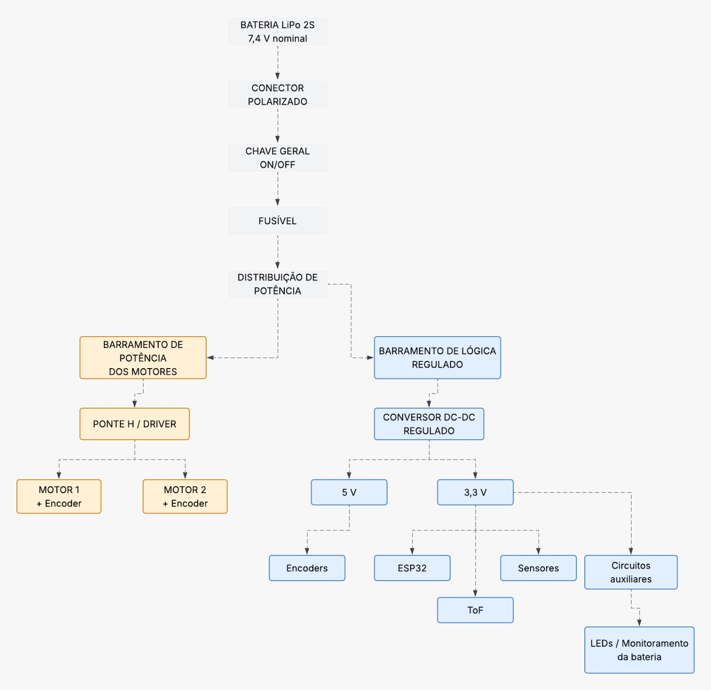
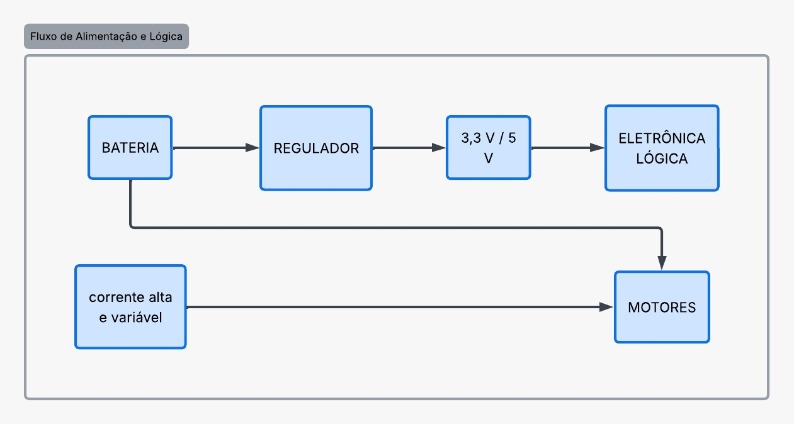
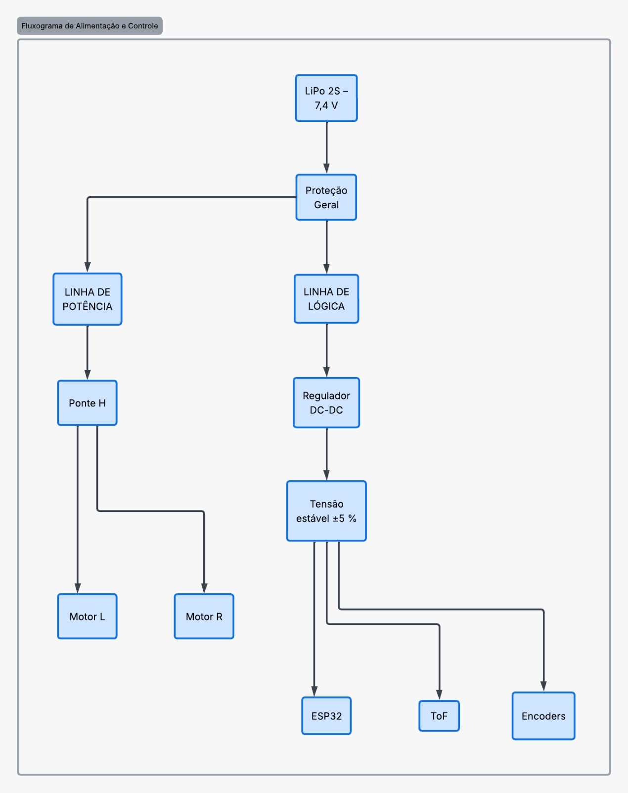

# Projeto Conceitual de Energia

## Dimensionamento Atualizado v2 — Bateria e Demanda Energética

**Projeto Integrador 1 — 2026.2**  
**Micromouse UnB — Grupo 1**  
**Documento de apoio à issue:** `[AP5] Dimensionamento da Bateria e Proteções #19 e [AP5] Diagrama de Distribuição de Potência #18 `

!!! note "Status do documento"
    Esta revisão incorpora a bateria selecionada **Leão LB1500LP2, LiPo 2S, 7,4 V, 1500 mAh e 30C**, além da comunicação ESP-NOW. Os consumos, as perdas e a autonomia permanecem estimativas de projeto a validar no protótipo; a seleção da bateria não representa, por si só, validação experimental do sistema completo.

---

## 1. Objetivo e escopo

Este documento consolida o **Dimensionamento Atualizado v2** do sistema de alimentação do **Micromouse UnB — Grupo 1**.

O objetivo desta etapa é:

- estimar a energia necessária para **30 minutos de navegação ativa**;
- comparar diferentes condições de consumo;
- comparar a demanda calculada com a bateria selecionada **Leão LB1500LP2, LiPo 2S de 1500 mAh**;
- estruturar conceitualmente a distribuição de energia entre os subsistemas;
- identificar as informações necessárias para o dimensionamento definitivo.

O dimensionamento apresentado nesta versão permanece conceitual quanto à demanda das cargas. A bateria já foi selecionada, mas os valores de corrente de motores, driver, microcontrolador, sensores e reguladores mantidos neste documento constituem **hipóteses preliminares de engenharia**, a confirmar com os componentes efetivamente utilizados.

Esses valores deverão ser posteriormente substituídos por dados provenientes dos respectivos *datasheets* e por medições experimentais realizadas no protótipo.

!!! important "Limites desta versão"
    Os dados da bateria selecionada são identificados separadamente das hipóteses de consumo. As estimativas de corrente e autonomia não substituem a verificação experimental, o dimensionamento das proteções e a avaliação da integração mecânica e elétrica.

    Esta revisão atualiza a seleção da bateria e a arquitetura de comunicação, preservando o estudo de demanda para 30 minutos de navegação.

---

## 2. Requisitos do projeto que orientam o cálculo

O dimensionamento energético foi estruturado considerando os requisitos previamente estabelecidos para o subsistema de Energia e suas interfaces com Eletrônica e Software.

| Requisito | Implicação para o sistema de Energia |
|---|---|
| **RNF-ENE01** | Requisito de autonomia operacional contínua mínima de **15 minutos**, com sensores e comunicação funcionando. Neste dimensionamento, adota-se um tempo mínimo considerado de **30 minutos**. |
| **RF-ENE02** | Realizar medição contínua da tensão do banco de baterias e disponibilizar essa informação para processamento e telemetria. |
| **RF-ENE03** | Proteger a bateria contra descarga profunda, com desligamento da tração em menos de **200 ms** após a detecção do limiar crítico. |
| **RF-ELE01 / RF-ELE02** | Alimentar o sistema de sensoriamento de paredes em três direções e a odometria independente das duas rodas motrizes. |
| **RF-SFT05** | Disponibilizar o nível/consumo da bateria como um dos parâmetros obrigatórios de telemetria. |

---

## 3. Premissas do Dimensionamento Atualizado v2

Para os cálculos, adotam-se os dados da bateria selecionada e as seguintes premissas de operação:

- bateria selecionada: **Leão Modelismo LB1500LP2, LiPo 2S**;
- capacidade nominal: **1500 mAh (1,5 Ah)**;
- tensão nominal do banco de baterias: **7,4 V**;
- energia nominal calculada: **11,1 Wh**;
- classificação de descarga informada: **30C**;
- massa informada pela equipe: **75 g**;
- dimensões informadas pela equipe: **70 mm de comprimento × 30 mm de largura × 17 mm de altura**;
- autonomia mínima considerada: **30 minutos**;
- tempo equivalente:

$$
t = 30\ min = 1800\ s = 0,5\ h
$$

- dois motores DC com encoder;
- uma ponte H capaz de controlar os dois motores;
- um microcontrolador da família **ESP32**, com comunicação **ESP-NOW** pelo rádio integrado;
- três sensores de distância do tipo **ToF**:
    - frontal;
    - lateral esquerdo;
    - lateral direito;
- dois encoders, um por roda motriz;
- indicadores visuais;
- circuito de monitoramento da bateria.

A telemetria é transmitida pelo ESP32 do robô via **ESP-NOW**, em 2,4 GHz, para um segundo ESP32 que atua como **gateway receptor na bancada**, conectado por USB ao computador. O envio ocorre a **1 Hz**, sem depender de roteador ou associação a uma rede Wi-Fi, conforme a [seção 6.1 do projeto conceitual de software](4.4%20-%20Projeto%20conceitual%20de%20software.md#61-visao-geral-da-arquitetura-de-comunicacao).

Os valores de corrente utilizados para motores, encoders, indicadores e circuito de monitoramento são estimativas preliminares e deverão ser revisados após a escolha dos componentes definitivos.

---

## 4. Modelo de cálculo energético

Para cada componente, a energia consumida durante uma execução de 30 minutos é estimada pela relação:

$$
E = V \cdot I \cdot t
$$

onde:

- $E$ = energia consumida, em joules (J);
- $V$ = tensão de operação, em volts (V);
- $I$ = corrente média, em ampères (A);
- $t$ = tempo de operação, em segundos (s).

A conversão da energia de joules para watt-hora é realizada por:

$$
E_{Wh} = \frac{E_J}{3600}
$$

Como os cálculos consideram uma execução de:

$$
t = 0,5\ h
$$

a potência média equivalente de cada cenário pode ser obtida por:

$$
P_{\text{média}} = \frac{E_{Wh}}{0,5}
$$

### 4.1 Energia nominal da bateria selecionada

A energia nominal da bateria é calculada a partir da tensão nominal e da capacidade:

$$
E_{\text{bat,nom}} = V_{\text{bat,nom}} \cdot C_{Ah} = 7,4 \cdot 1,5 = 11,1\ Wh
$$

Os **11,1 Wh** são uma estimativa da energia nominal armazenada, não uma medição da energia efetivamente utilizável até o corte de descarga. A energia entregue às cargas depende das condições de operação, da capacidade real, do limiar de subtensão e das perdas do sistema.

### 4.2 Modelo para estimar a autonomia

Mantendo a hipótese de acréscimo de 15% para perdas adotada na seção 7:

$$
P_{\text{bat,est}} = 1,15 \cdot P_{\text{cargas}}
$$

$$
t_{\text{est}}(min) = \frac{E_{\text{bat,nom}}}{P_{\text{bat,est}}} \cdot 60
$$

A margem adicional de engenharia de **30%** é utilizada no dimensionamento da capacidade para o tempo mínimo considerado de 30 minutos. Ela não é uma perda física nem uma carga adicional e, por isso, não é somada ao consumo nesta estimativa de autonomia. Os tempos obtidos pressupõem o uso da energia nominal da bateria e deverão ser substituídos ou confirmados por ensaio.

---

## 5. Três cenários de consumo adotados

Como as correntes das cargas ainda são tratadas como estimativas neste dimensionamento, mantêm-se três cenários de operação para avaliar sua influência na demanda energética. A seleção da bateria de 1500 mAh altera a energia disponível; ela não altera automaticamente as correntes assumidas para motores e eletrônica.

| Carga | Baixo | Nominal | Conservador |
|---|---:|---:|---:|
| Cada motor DC (6 V) | 0,30 A | 0,50 A | 0,80 A |
| ESP32 + rádio (ESP-NOW) (3,3 V) | 80 mA | 120 mA | 200 mA |
| Cada sensor ToF (2,8 V) | 12 mA | 19 mA | 25 mA |
| Cada encoder (5 V) | 5 mA | 10 mA | 20 mA |
| Driver ponte H — lógica (3,3 V) | 1,1 mA | 1,5 mA | 2,2 mA |
| LEDs/indicadores (3,3 V) | 10 mA | 20 mA | 40 mA |
| Monitor da bateria (7,4 V) | 0,5 mA | 1,0 mA | 2,0 mA |

!!! note "Consumo do ESP32 e do rádio integrado"
    A carga **ESP32 + rádio (ESP-NOW)** representa o microcontrolador embarcado com seu rádio integrado em operação; não corresponde à soma de um ESP32 com um módulo de rádio externo.

    Conforme o escopo da [issue #130](https://github.com/fcte-pi1/2026.2_PI1_Grupo1_Lui/issues/130), a atualização da nomenclatura preserva as estimativas preliminares de **80 mA**, **120 mA** e **200 mA**, bem como os cálculos derivados. Esses valores não constituem medições específicas do consumo com ESP-NOW e deverão ser revisados com dados do componente selecionado e ensaios no protótipo.

!!! tip "Interpretação dos cenários"
    **Baixo:** representa uma condição de operação leve.

    **Nominal:** constitui a principal referência utilizada no Dimensionamento Atualizado v2.

    **Conservador:** considera correntes superiores para reduzir o risco de subdimensionamento enquanto os componentes definitivos ainda não são conhecidos.

---

## 6. Cálculo energético por cenário

### 6.1 Cenário baixo

| Componente | V | I total (A) | t (s) | E (J) | E (Wh) |
|---|---:|---:|---:|---:|---:|
| 2 motores DC | 6,0 | 0,600 | 1800 | 6480,00 | 1,8000 |
| ESP32 + rádio (ESP-NOW) | 3,3 | 0,080 | 1800 | 475,20 | 0,1320 |
| 3 sensores ToF | 2,8 | 0,036 | 1800 | 181,44 | 0,0504 |
| 2 encoders | 5,0 | 0,010 | 1800 | 90,00 | 0,0250 |
| Driver ponte H — lógica | 3,3 | 0,0011 | 1800 | 6,53 | 0,0018 |
| LEDs/indicadores | 3,3 | 0,010 | 1800 | 59,40 | 0,0165 |
| Monitor da bateria | 7,4 | 0,0005 | 1800 | 6,66 | 0,0019 |

**Energia total:**

$$
E_{\text{baixo}} \approx 7299,23\ J
$$

ou:

$$
E_{\text{baixo}} \approx 2,028\ Wh
$$

A potência média correspondente é:

$$
P_{\text{baixo}} \approx 4,06\ W
$$

---

### 6.2 Cenário nominal

| Componente | V | I total (A) | t (s) | E (J) | E (Wh) |
|---|---:|---:|---:|---:|---:|
| 2 motores DC | 6,0 | 1,000 | 1800 | 10800,00 | 3,0000 |
| ESP32 + rádio (ESP-NOW) | 3,3 | 0,120 | 1800 | 712,80 | 0,1980 |
| 3 sensores ToF | 2,8 | 0,057 | 1800 | 287,28 | 0,0798 |
| 2 encoders | 5,0 | 0,020 | 1800 | 180,00 | 0,0500 |
| Driver ponte H — lógica | 3,3 | 0,0015 | 1800 | 8,91 | 0,0025 |
| LEDs/indicadores | 3,3 | 0,020 | 1800 | 118,80 | 0,0330 |
| Monitor da bateria | 7,4 | 0,0010 | 1800 | 13,32 | 0,0037 |

**Energia total:**

$$
E_{\text{nominal}} \approx 12121,11\ J
$$

ou:

$$
E_{\text{nominal}} \approx 3,367\ Wh
$$

A potência média correspondente é:

$$
P_{\text{nominal}} \approx 6,73\ W
$$

---

### 6.3 Cenário conservador

| Componente | V | I total (A) | t (s) | E (J) | E (Wh) |
|---|---:|---:|---:|---:|---:|
| 2 motores DC | 6,0 | 1,600 | 1800 | 17280,00 | 4,8000 |
| ESP32 + rádio (ESP-NOW) | 3,3 | 0,200 | 1800 | 1188,00 | 0,3300 |
| 3 sensores ToF | 2,8 | 0,075 | 1800 | 378,00 | 0,1050 |
| 2 encoders | 5,0 | 0,040 | 1800 | 360,00 | 0,1000 |
| Driver ponte H — lógica | 3,3 | 0,0022 | 1800 | 13,07 | 0,0036 |
| LEDs/indicadores | 3,3 | 0,040 | 1800 | 237,60 | 0,0660 |
| Monitor da bateria | 7,4 | 0,0020 | 1800 | 26,64 | 0,0074 |

**Energia total:**

$$
E_{\text{conservador}} \approx 19483,31\ J
$$

ou:

$$
E_{\text{conservador}} \approx 5,412\ Wh
$$

A potência média correspondente é:

$$
P_{\text{conservador}} \approx 10,82\ W
$$

No cenário nominal, os dois motores respondem por aproximadamente **89% da energia estimada**.

Esse resultado demonstra que a escolha dos motores e, principalmente, a corrente real durante a navegação constituem as variáveis de maior impacto no dimensionamento definitivo do sistema de Energia.

---

## 7. Perdas e margem de engenharia

A energia calculada diretamente nas cargas não considera todas as perdas presentes no sistema de alimentação.

Entre essas perdas estão:

- reguladores de tensão;
- conversores DC-DC;
- ponte H;
- trilhas da PCB;
- cabeamento;
- conectores;
- dispositivos de proteção.

Enquanto as perdas reais desses componentes não forem caracterizadas, o Dimensionamento Atualizado v2 mantém provisoriamente um acréscimo de **15%** sobre a energia das cargas para representar as perdas do sistema.

Após essa correção, é aplicada uma margem adicional de engenharia de **30%**, destinada a absorver as incertezas associadas aos componentes ainda não definidos.

!!! note "Margens adotadas"
    Os valores de **15% para perdas** e **30% para margem de engenharia** são hipóteses desta etapa conceitual.

    Eles deverão ser reavaliados no dimensionamento definitivo utilizando as eficiências reais dos conversores, do driver e dos demais componentes selecionados.

| Cenário | Energia nas cargas (Wh) | Após +15% de perdas (Wh) | Após +30% de margem (Wh) |
|---|---:|---:|---:|
| Baixo | 2,028 | 2,332 | 3,031 |
| Nominal | 3,367 | 3,872 | 5,034 |
| Conservador | 5,412 | 6,224 | 8,091 |

Para o cenário conservador:

$$
E_{\text{projeto}} \approx 8,091\ Wh
$$

---

## 8. Conversão para capacidade da bateria LiPo 2S

Considerando uma bateria LiPo 2S com tensão nominal de:

$$
V_{\text{bat}} = 7,4\ V
$$

a capacidade equivalente pode ser determinada por:

$$
C_{Ah} = \frac{E_{Wh}}{V_{\text{bat}}}
$$

Para converter o resultado para miliampère-hora:

$$
C_{mAh} = 1000 \cdot C_{Ah}
$$

Aplicando essa relação aos três cenários:

| Cenário | Energia de projeto (Wh) | Capacidade equivalente em 7,4 V |
|---|---:|---:|
| Baixo | 3,031 | ≈ 410 mAh |
| Nominal | 5,034 | ≈ 680 mAh |
| Conservador | 8,091 | ≈ 1093 mAh |

!!! important "Resultado-chave"
    O cenário conservador resulta em uma capacidade mínima preliminar de aproximadamente **1093 mAh**, já considerando as hipóteses de perdas e margem de engenharia.

    Esse valor é a **capacidade mínima estimada para a demanda adotada**, não a capacidade da bateria selecionada. A **Leão LB1500LP2 de 1500 mAh** supera esse mínimo sob as hipóteses deste dimensionamento; a autonomia e a compatibilidade do conjunto deverão ser verificadas no protótipo.

---

## 9. Bateria selecionada e comparação com o dimensionamento

A bateria selecionada pela equipe é a **Leão Modelismo LB1500LP2, LiPo 2S, 7,4 V, 1500 mAh e 30C**. Essa seleção substitui a faixa de estudo e a referência intermediária utilizadas na versão anterior.

### 9.1 Características e origem dos dados

| Parâmetro | Valor adotado | Origem / situação |
|---|---|---|
| Marca e modelo | Leão Modelismo LB1500LP2 | Identificação confirmada pela equipe; modelo também descrito na [página comercial](https://www.actionmodelismo.com.br/baterialipo7-4v2s1500mah30c60cplugtdeanautoaeronautiheliwltoyslb1500lp2) |
| Química | LiPo | Informado pela equipe e pela página comercial |
| Configuração | 2S — duas células em série | Informado pela equipe e pela página comercial |
| Tensão nominal | 7,4 V | Informado pela equipe e pela página comercial |
| Capacidade nominal | 1500 mAh (1,5 Ah) | Informado pela equipe e pela página comercial |
| Energia nominal | 11,1 Wh | Calculado: 7,4 V × 1,5 Ah |
| Classificação de descarga adotada | 30C | Informado pela equipe; não se adota a classificação de pico anunciada sem confirmação adicional |
| Corrente correspondente a 30C | 45 A | Calculado: 1,5 Ah × 30; valor associado à classificação declarada, não medido no projeto |
| Massa | 75 g | Informado pela equipe |
| Dimensões — comprimento × largura × altura | 70 × 30 × 17 mm | Informado pela equipe |
| Tensão máxima de carga de referência | 8,4 V | Referência geral para LiPo convencional 2S, a 4,2 V por célula; ver [instruções técnicas da Traxxas](https://traxxas.com/media/productattach/2970-3S/10/GKC20006-R00-LiPo-battery-fold-out-large%20-%20EN.pdf) |
| Conector principal | T-Deans anunciado para o modelo | Conferir o conector e a polaridade da unidade efetivamente utilizada |
| Conector de balanceamento | Não confirmado | Conferir na unidade utilizada |
| Carregador e corrente máxima de carga | Não informados / não confirmados | Identificar o equipamento e consultar a especificação aplicável à bateria |
| BMS ou proteção integrada | Não confirmado | Verificar na unidade e na documentação; não presumir sua presença |

!!! note "Rastreabilidade dos dados físicos"
    A página comercial consultada informa **70 g** e **70 × 30 × 16 mm**. Este documento adota os **75 g** e **70 × 30 × 17 mm** fornecidos pela equipe para a unidade do projeto. A diferença deve ser verificada na conferência dimensional e de massa; os valores informados pela equipe não são apresentados como dados de um datasheet oficial.

### 9.2 Comparação com a demanda de projeto

| Cenário | Energia de projeto para 30 min, com perdas e margem (Wh) | Capacidade mínima estimada em 7,4 V | Capacidade selecionada | Energia nominal selecionada |
|---|---:|---:|---:|---:|
| Baixo | 3,031 | ≈ 410 mAh | 1500 mAh | 11,1 Wh |
| Nominal | 5,034 | ≈ 680 mAh | 1500 mAh | 11,1 Wh |
| Conservador | 8,091 | ≈ 1093 mAh | 1500 mAh | 11,1 Wh |

A energia nominal da bateria selecionada corresponde a aproximadamente **1,37 vezes** a energia de projeto do cenário conservador para 30 minutos:

$$
\frac{E_{\text{bat,nom}}}{E_{\text{projeto,conservador}}} \approx \frac{11,1}{8,091} \approx 1,37
$$

Essa comparação indica reserva energética no modelo adotado. Não comprova, isoladamente, a capacidade real, a integração mecânica, a atuação das proteções ou o atendimento em pista.

### 9.3 Autonomia teórica por cenário

Aplicando o modelo da seção 4.2, com **15% de acréscimo para perdas**, sem tratar a margem de engenharia como consumo:

| Cenário | Potência média das cargas (W) | Potência estimada na bateria, com +15% (W) | Autonomia teórica com 11,1 Wh |
|---|---:|---:|---:|
| Baixo | 4,055 | 4,663 | ≈ 142,8 min |
| Nominal | 6,734 | 7,744 | ≈ 86,0 min |
| Conservador | 10,824 | 12,448 | ≈ 53,5 min |

Os cálculos usam os valores antes do arredondamento apresentado nas tabelas. Os três cenários superam teoricamente o tempo mínimo considerado de **30 minutos**, mas utilizam a energia nominal integral e correntes estimadas. A autonomia real depende do consumo durante o percurso, da energia utilizável até o corte, da capacidade efetiva e das perdas reais.

### 9.4 Integração ao robô

A montagem deverá considerar a massa informada de **75 g**, as dimensões de **70 × 30 × 17 mm**, a fixação no chassi, o acesso aos conectores e o espaço necessário para os cabos. O encaixe e a distribuição de massa deverão ser conferidos no conjunto montado.

---

## 10. Capacidade energética e capacidade de fornecimento de corrente

Os cálculos anteriores verificam a energia estimada para o requisito de autonomia. A capacidade de fornecer corrente também precisa ser compatível com partidas, acelerações, frenagens, reversões e eventual travamento dos motores.

A corrente correspondente à classificação de descarga é calculada por:

$$
I_{\text{descarga,declarada}} = C_{Ah} \cdot C_{\text{rating}}
$$

Para a bateria selecionada, com **1,5 Ah** e **30C**:

$$
I_{\text{descarga,declarada}} = 1,5 \cdot 30 = 45\ A
$$

Os **45 A** são um valor calculado a partir da capacidade nominal e da classificação de descarga informada. Não representam o consumo do robô nem uma corrente validada por ensaio no projeto. A corrente efetivamente solicitada depende das cargas e de suas condições de operação.

Não se adota neste dimensionamento uma corrente de pico de 60C: embora apareça em anúncios do modelo, sua duração e aplicabilidade à unidade utilizada não foram confirmadas.

!!! important "Dimensionamento das proteções e do caminho de potência"
    Os **45 A não definem a corrente do fusível** nem a corrente admissível da ponte H, dos fios, conectores ou trilhas. Cada elemento deverá ser dimensionado para a corrente de operação e os transitórios das cargas, respeitando os limites dos componentes efetivamente utilizados.

O C-rating mínimo exigido pelo robô deverá ser verificado a partir da corrente máxima solicitada à bateria, incluindo os cenários de partida e travamento dos motores e o consumo da eletrônica.

!!! warning "Validações pendentes"
    Confirmar as correntes de partida e stall dos motores e os limites dos reguladores, driver, conectores, condutores e trilhas. Esses dados são necessários para validar a compatibilidade da bateria selecionada e dimensionar o fusível e as demais proteções.

---

## 11. Arquitetura elétrica conceitual associada ao dimensionamento

!!! note "Limite do dimensionamento e alimentação do gateway"
    O dimensionamento da bateria considera as cargas embarcadas no robô, incluindo o ESP32 emissor e seu rádio integrado para comunicação ESP-NOW.

    O segundo ESP32, que atua como gateway receptor na bancada, é alimentado pela porta USB do computador e não integra a demanda da bateria do robô, conforme a [arquitetura de comunicação do documento 4.4](4.4%20-%20Projeto%20conceitual%20de%20software.md#61-visao-geral-da-arquitetura-de-comunicacao).

A arquitetura elétrica deverá separar a linha de potência destinada aos motores da alimentação utilizada pela eletrônica lógica e pelos sensores.

Essa separação tem como objetivo reduzir a propagação de:

- picos de corrente;
- ruído elétrico;
- transitórios de comutação;
- quedas temporárias de tensão;

para os circuitos mais sensíveis do robô.

A estrutura conceitual pode ser resumida da seguinte maneira:

```text
Leão LB1500LP2 — LiPo 2S — 7,4 V — 1500 mAh
          │
          ▼
Conector polarizado
          │
          ▼
Chave geral
          │
          ▼
Fusível
          │
          ▼
Distribuição de potência
          │
          ├──► Barramento de potência ──► Ponte H ──► Motores
          │
          └──► Barramento regulado ──► ESP32 + sensores + encoders
```

---

### 11.1 Arquitetura geral do sistema de alimentação

O diagrama a seguir apresenta o caminho conceitual completo da energia no Micromouse.

A bateria selecionada **Leão LB1500LP2, LiPo 2S de 7,4 V e 1500 mAh**, alimenta inicialmente os dispositivos gerais de conexão, seccionamento e proteção:

1. conector polarizado;
2. chave geral;
3. fusível.

Somente após essa etapa ocorre a distribuição da energia para os dois grandes grupos de cargas:

- **barramento de potência dos motores**;
- **barramento regulado de lógica e sensoriamento**.



<p align="center">
  <em>Figura 1 — Arquitetura conceitual detalhada do sistema de alimentação do Micromouse.</em>
</p>

<p align="center">
  <em>Fonte: elaboração da equipe do projeto Micromouse UnB — Grupo 1 (2026).</em>
</p>

!!! note "Tensões indicadas no diagrama"
    Os níveis intermediários de **5 V** e **3,3 V** apresentados são conceituais nesta etapa.

    A tensão nominal de **7,4 V** da LiPo 2S é mantida. Para verificar a compatibilidade dos componentes ligados à bateria e dos reguladores, considerar também **8,4 V** como tensão máxima de carga de referência da LiPo convencional 2S. Os níveis de **5 V** e **3,3 V** deverão ser confirmados com os componentes efetivamente utilizados.

---

### 11.2 Separação entre potência e lógica e imunidade a transitórios

Os motores representam a principal carga energética do sistema e apresentam comportamento elétrico altamente variável.

Durante eventos como:

**partida → aceleração → frenagem → mudança de sentido → eventual travamento**

podem ocorrer correntes significativamente superiores à corrente média de navegação.

Por esse motivo, a eletrônica lógica deverá utilizar uma alimentação regulada dedicada, enquanto os motores permanecem associados ao barramento de potência de corrente elevada e variável.



<p align="center">
  <em>Figura 2 — Separação conceitual entre alimentação lógica regulada e cargas de potência.</em>
</p>

<p align="center">
  <em>Fonte: elaboração da equipe do projeto Micromouse UnB — Grupo 1 (2026).</em>
</p>

Essa separação tem como objetivo reduzir a propagação dos transitórios produzidos pelos motores para o ESP32 e para os sensores.

No projeto definitivo deverão ser dimensionados:

1. **regulador dedicado para a eletrônica de controle**;
2. **capacitores de desacoplamento próximos aos circuitos integrados**;
3. **capacitor de maior capacidade próximo ao driver dos motores**;
4. **caminhos separados para correntes de potência e lógica**;
5. **retorno de corrente adequadamente organizado**;
6. **trilhas, conectores e condutores compatíveis com a corrente máxima prevista**.

O objetivo é manter a alimentação lógica dentro da tolerância estabelecida mesmo durante transitórios causados pelos motores.

---

### 11.3 Representação simplificada do fluxo de alimentação e controle

A representação seguinte sintetiza a arquitetura elétrica em dois ramos principais após a etapa de proteção geral.

No ramo de potência:

**proteção → linha de potência → ponte H → motores**

No ramo lógico:

**proteção → linha de lógica → regulador DC-DC → ESP32, sensores e encoders**



<p align="center">
  <em>Figura 3 — Fluxograma simplificado de alimentação, proteção e distribuição entre potência e lógica.</em>
</p>

<p align="center">
  <em>Fonte: elaboração da equipe do projeto Micromouse UnB — Grupo 1 (2026).</em>
</p>

Na representação, o bloco **Proteção Geral** sintetiza os dispositivos de proteção e seccionamento localizados antes da divisão entre os barramentos.

Os valores definitivos de:

- tensão;
- corrente;
- reguladores;
- proteções;
- condutores;

serão consolidados após a seleção dos dispositivos reais e a substituição das hipóteses desta versão por dados de *datasheet* e ensaios.

---

### 11.4 Monitoramento da bateria

A tensão da bateria **Leão LB1500LP2 de 7,4 V nominais** deverá ser monitorada pelo sistema embarcado. O circuito de medição deverá comportar a tensão máxima de carga de referência de **8,4 V**, correspondente a uma LiPo convencional 2S, e respeitar o limite de entrada do ADC ou do circuito de monitoramento escolhido. Essa referência geral consta nas [instruções técnicas da Traxxas](https://traxxas.com/media/productattach/2970-3S/10/GKC20006-R00-LiPo-battery-fold-out-large%20-%20EN.pdf); não substitui a documentação específica da unidade utilizada.

Entre as alternativas conceituais estão:

- divisor resistivo conectado ao ADC do microcontrolador;
- circuito integrado dedicado de monitoramento;
- sensor combinado de tensão e corrente.

O sistema deverá disponibilizar ao firmware informações suficientes para:

- medir a tensão da bateria;
- registrar o tempo de funcionamento;
- estimar o estado energético;
- alimentar a telemetria;
- identificar condição de subtensão;
- comandar o desligamento da tração quando necessário.

O mecanismo definitivo deverá atender ao requisito de desativação da tração em menos de **200 ms** após a identificação do limiar crítico de subtensão. A capacidade de **1500 mAh**, isoladamente, não define esse limiar: seu valor e a atuação do corte deverão ser confirmados conforme a especificação aplicável e os testes do projeto. A presença de BMS ou proteção integrada à bateria permanece não confirmada.

---

## 12. Dados necessários para o dimensionamento definitivo

Com a bateria **Leão LB1500LP2** selecionada, os dados conhecidos estão registrados na seção 9.1. Para consolidar o dimensionamento, ainda é necessário confirmar as características dos componentes utilizados e substituir as estimativas de consumo por dados de *datasheets* e medições.

A tabela abaixo relaciona as verificações que permanecem necessárias.

| Item | Informações necessárias |
|---|---|
| **Motores DC — prioridade máxima** | Modelo exato, tensão nominal, corrente sem carga, corrente nominal sob carga, corrente de *stall*, RPM, relação de redução e torque. |
| **Encoders** | Modelo ou identificação do encoder integrado, tensão de alimentação, tipo de saída e consumo. |
| **Driver / ponte H** | Modelo, tensão VM, tensão lógica, corrente contínua por canal, corrente de pico, RDS(on) ou queda de tensão e limites térmicos. |
| **Microcontrolador / placa** | Modelo exato da placa, incluindo a variante específica do ESP32 utilizada, e consumo do conjunto microcontrolador e rádio integrado durante a operação com ESP-NOW. |
| **Sensores de distância** | Modelo, quantidade e identificação se são sensores isolados ou módulos/*breakouts*. |
| **Outros sensores** | IMU, giroscópio, sensor de corrente/tensão ou qualquer sensor adicional. |
| **Reguladores / conversores** | Modelo, tensão de entrada, tensão de saída, corrente máxima e curva de eficiência. |
| **Bateria selecionada — Leão LB1500LP2** | Já informados: LiPo 2S, 7,4 V, 1500 mAh, 30C, 75 g e 70 × 30 × 17 mm. Confirmar os dados da unidade, o conector e a polaridade, a corrente máxima de carga, o conector de balanceamento, a capacidade efetiva e a energia utilizável até o corte. |
| **BMS / proteção** | Confirmar se há proteção integrada ou externa; se utilizada, identificar modelo, corrente máxima, limites de sobrecarga/subtensão e consumo próprio. Não presumir a existência de BMS. |
| **Monitoramento da bateria** | Divisor resistivo, CI monitor, sensor de corrente/tensão ou arquitetura escolhida. |
| **LEDs e buzzer** | Quantidade e corrente prevista de cada indicador ou atuador auxiliar. |
| **Módulos adicionais** | Memória, cartão SD, conversores de nível, display ou qualquer carga adicional efetivamente instalada no robô. A arquitetura ESP-NOW adotada utiliza o rádio integrado do ESP32 e não prevê um módulo de rádio separado no robô. |
| **Conectores e fiação** | Tipo de conector da bateria, bitola e comprimento aproximado dos condutores de potência. |
| **Fusível** | Dimensionar e validar a partir das correntes das cargas e dos limites de motores, driver, conectores e condutores; não adotar os 45 A da classificação da bateria como valor do fusível. |
| **Carregador e recarga** | Identificar o carregador, a corrente de carga permitida pela bateria e a configuração utilizada; medir o tempo real de recarga. Esses dados ainda não foram informados. |

### Ordem recomendada de definição dos componentes

A sequência abaixo representa a dependência técnica entre as definições dos componentes. Como a bateria já foi selecionada, sua compatibilidade deverá ser verificada à medida que os dados das cargas forem confirmados:

```text
MOTORES
   ↓
DRIVER
   ↓
PLACA ESP32
   ↓
SENSORES
   ↓
REGULADORES
   ↓
VALIDAÇÃO DA BATERIA SELECIONADA
```

Os **motores** possuem prioridade porque representam a principal parcela do consumo e determinam parte significativa das exigências de corrente do restante do sistema.

---

## 13. Síntese do Dimensionamento Atualizado v2

| Parâmetro | Resultado / situação |
|---|---|
| Autonomia mínima considerada | **30 min / 1800 s / 0,5 h** |
| Bateria selecionada | **Leão Modelismo LB1500LP2 — LiPo 2S** |
| Tensão nominal | **7,4 V** |
| Capacidade nominal | **1500 mAh / 1,5 Ah** |
| Energia nominal calculada da bateria | **11,1 Wh** |
| Classificação de descarga informada | **30C** |
| Corrente correspondente à classificação declarada | **45 A**, calculados; não são o consumo do robô nem o valor do fusível |
| Massa informada pela equipe | **75 g** |
| Dimensões informadas — comprimento × largura × altura | **70 × 30 × 17 mm** |
| Comunicação embarcada | **ESP-NOW pelo rádio integrado do ESP32; gateway alimentado por USB na bancada** |
| Energia — cenário baixo para 30 min | **2,028 Wh** antes das margens |
| Energia — cenário nominal para 30 min | **3,367 Wh** antes das margens |
| Energia — cenário conservador para 30 min | **5,412 Wh** antes das margens |
| Hipótese de perdas | **+15%** |
| Margem adicional de engenharia para dimensionamento | **+30% após as perdas** |
| Energia conservadora de projeto para 30 min | **≈ 8,091 Wh** |
| Capacidade mínima estimada no cenário conservador | **≈ 1093 mAh** |
| Relação entre energia nominal disponível e demanda conservadora de projeto | **≈ 1,37 vezes** |
| Autonomia teórica nominal | **≈ 86,0 min**, com +15% para perdas e uso da energia nominal integral |
| Autonomia teórica no cenário conservador | **≈ 53,5 min**, nas mesmas hipóteses |
| Principais validações pendentes | **Consumo real, energia utilizável, autonomia, correntes transitórias, proteções, conexões e integração mecânica** |

---

## 14. Conclusão

Esta revisão registra a seleção da bateria **Leão Modelismo LB1500LP2, LiPo 2S, 7,4 V, 1500 mAh e 30C**, com energia nominal calculada de **11,1 Wh**, massa informada de **75 g** e dimensões informadas de **70 × 30 × 17 mm**. Também alinha a comunicação embarcada à arquitetura **ESP-NOW com gateway USB na bancada**, cujo consumo não integra a bateria do robô.

Mantendo as hipóteses de consumo, o acréscimo de 15% para perdas e a margem de engenharia de 30%, a necessidade energética conservadora para **30 minutos** passa a ser de aproximadamente **8,091 Wh**, equivalente a uma capacidade mínima de **1093 mAh** em 7,4 V.

A bateria selecionada possui capacidade superior a esse mínimo e energia nominal correspondente a aproximadamente **1,37 vezes** a demanda conservadora de projeto. No modelo de autonomia, com 15% de acréscimo para perdas e utilização da energia nominal integral, obtêm-se cerca de **86,0 minutos** no cenário nominal e **53,5 minutos** no cenário conservador.

Esses resultados indicam atendimento teórico ao requisito de autonomia nas condições modeladas. A autonomia real e a compatibilidade elétrica e mecânica ainda deverão ser confirmadas no protótipo; a seleção da bateria não transforma as estimativas de consumo em medições.

A classificação informada de **30C** corresponde ao cálculo de **45 A**, mas não substitui a verificação das correntes das cargas nem define os limites do driver, fios, conectores, trilhas ou fusível.

Para consolidar o dimensionamento, deverão ser verificados:

- consumo real do conjunto e autonomia até o limiar de corte adotado;
- capacidade efetiva e energia utilizável da bateria;
- correntes de partida e stall dos motores;
- limites e perdas dos reguladores e do driver;
- conectores, polaridade, condutores e trilhas;
- fusível e proteções contra sobrecorrente e subtensão;
- presença ou ausência de BMS ou proteção integrada;
- fixação, espaço disponível e distribuição de massa no chassi;
- carregador, corrente de carga permitida e tempo real de recarga.

O documento passa, portanto, a avaliar uma bateria selecionada, mantendo explícitas as hipóteses e as validações que ainda faltam para o dimensionamento definitivo.

---

## 15. Referências e origem dos dados

- **Documento de Requisitos do Projeto — Micromouse (PI1 2026.2 — Grupo 1)**.
- **Termo de Abertura do Projeto (TAP) — Micromouse UnB — Grupo 1**.
- **Issue `[AP5] Dimensionamento da Bateria e Proteções #19`**.
- **Issue `[AP5] Diagrama de Distribuição de Potência #18`**.
- **Arquivo `4.2 - Projeto conceitual de energia.md`**.
- **[4.4 — Projeto conceitual de software, seção 6.1 — Visão Geral da Arquitetura de Comunicação](4.4%20-%20Projeto%20conceitual%20de%20software.md#61-visao-geral-da-arquitetura-de-comunicacao)**.
- **[Issue #130 — EAP 4.1.1: Alinhar o 4.2 com a comunicação ESP-NOW](https://github.com/fcte-pi1/2026.2_PI1_Grupo1_Lui/issues/130)**.
- **[Página comercial da Leão LB1500LP2 — Action Modelismo](https://www.actionmodelismo.com.br/baterialipo7-4v2s1500mah30c60cplugtdeanautoaeronautiheliwltoyslb1500lp2)**. Fonte comercial para identificação e características anunciadas; não equivale a um datasheet oficial. Divergências de massa e dimensões estão registradas na seção 9.1.
- **Dados fornecidos pela equipe do projeto para a unidade selecionada:** modelo Leão LB1500LP2; LiPo 2S; 1500 mAh; 7,4 V; 30C; 75 g; comprimento de 70 mm, largura de 30 mm e altura de 17 mm.
- **[Instruções técnicas de baterias LiPo — Traxxas](https://traxxas.com/media/productattach/2970-3S/10/GKC20006-R00-LiPo-battery-fold-out-large%20-%20EN.pdf)**. Referência geral para o limite de 4,2 V por célula da LiPo convencional e para o cálculo da corrente a partir do C-rating; não substitui a documentação específica da Leão.
