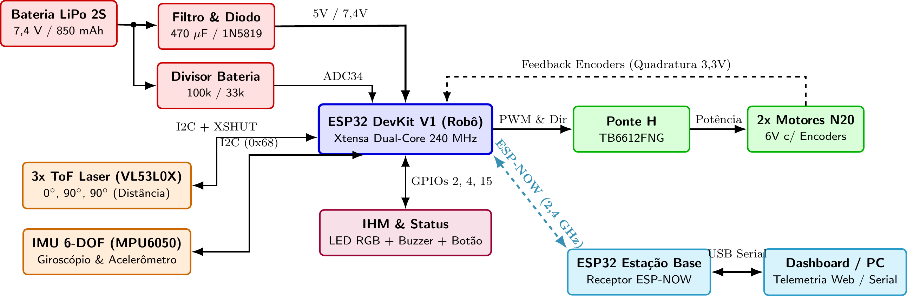
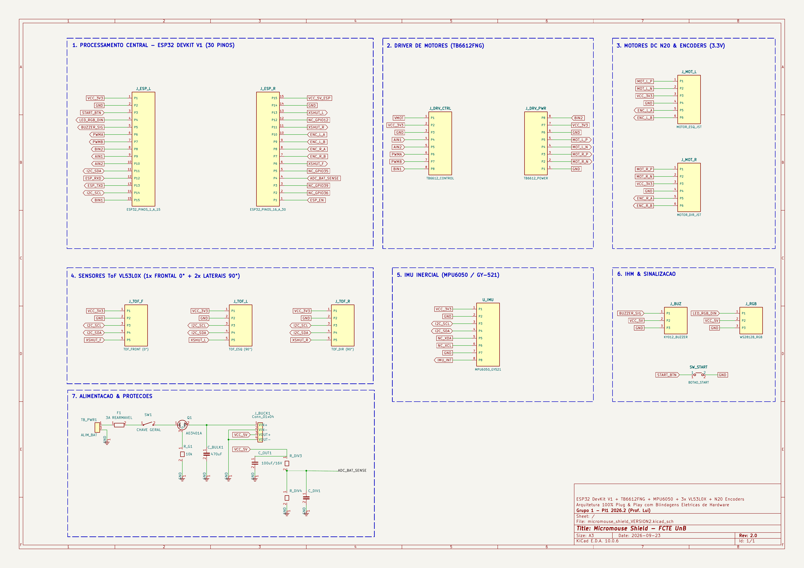

# Projeto Conceitual de Hardware

O projeto conceitual de hardware estabelece a arquitetura eletroeletrônica embarcada do robô autônomo Micromouse (Grupo 1) para a disciplina Projeto Integrador 1 (semestre 2026.2, FCTE/UnB, Prof. Lui). O dimensionamento, a topologia de circuitos e as escolhas de componentes descritos foram atualizados retroativamente com base nas decisões de implementação e ensaios laboratoriais documentados em [7.3 — Testes de hardware](7.3%20-%20Testes%20de%20hardware.md) e nos arquivos do diretório [`hw/`](https://github.com/fcte-pi1/2026.2_PI1_Grupo1_Lui/tree/main/hw) como fonte única de verdade técnica.

A concepção adota o princípio de montagem modular Plug and Play: a placa shield customizada utiliza soquetes para todos os circuitos integrados e módulos, pull-ups internos ativados por software e chicotes prontos de fábrica com conectores polarizados. Essa abordagem blinda o circuito contra *brownout*, sobretensão nas portas lógicas, travamentos de *boot* e curtos acidentais, permitindo montagem e calibração ágeis com alta confiabilidade em bancada e pista.

---

## 1. Visão Geral da Arquitetura

A arquitetura adota uma placa Shield de encaixe montada sobre barras de pinos fêmea com passo de 2,54 mm, interligando a unidade central de processamento aos sensores, atuadores, módulos de potência e sinalização com travas mecânicas.

O sistema divide-se de forma clara entre:
1. **Eletrônica Embarcada no Carrinho:** Microcontrolador de alta performance **ESP32 DevKit V1**, sensores a laser Time of Flight (ToF), encoders em quadratura com interrupção externa, controle de potência via ponte H TB6612FNG em 20 kHz e monitoramento analógico da bateria;
2. **Gateway de Solo / Conexão com o PC Server:** Módulo microcontrolador dedicado baseado no **ESP8266** (com suporte de firmware também mantido para ESP32 em bancada), conectado diretamente via cabo USB Serial à estação base/computador do operador onde executa o servidor backend.

---

## 2. Diagrama de Blocos do Sistema Eletrônico

O diagrama de blocos a seguir apresenta a topologia global da eletrônica do Micromouse, os barramentos de alimentação e as interfaces de interconexão, destacando o microcontrolador central ESP32 do robô, o sensoriamento ToF e IMU, a ponte H com retorno dos encoders em 3,3 V, a interface de usuário e a telemetria sem fio via enlace dedicado ESP-NOW em 2,4 GHz com o Gateway (ESP8266) acoplado ao computador:

*Figura 2.1: Diagrama de blocos da arquitetura eletroeletrônica e interfaces do Micromouse.*

A arquitetura física e de comunicação contempla dois nós complementares:
1. **ESP32 DevKit V1 Onboard (Robô):** Microcontrolador central responsável pelo algoritmo de navegação autônoma no labirinto, malha fechada de controle cinemático dos motores, amostragem periódica dos sensores (ToF e odometria) e transmissão periódica de pacotes de telemetria estruturados de 18 bytes a 1 Hz via protocolo sem fio ponto a ponto ESP-NOW.
2. **ESP8266 Estação Base (Gateway do PC Server):** Módulo microcontrolador dedicado ESP8266 (NodeMCU / D1 mini), conectado via porta USB Serial UART ao computador da estação base. O gateway escuta continuamente os pacotes de rádio de 18 bytes transmitidos pelo robô via ESP-NOW no Canal 1 dedicado, afere métricas de recepção (como RSSI e contagem sequencial de pacotes) e realiza a conversão em tempo real para strings JSON transmitidas pela UART a 115200 bps, permitindo integração direta com o backend (FastAPI) e dashboard web sem requerer rede Wi-Fi local ou roteadores. *(Nota: o firmware mantém compatibilidade para operar também com ESP32 na bancada).*

---

## 3. Detalhamento dos Subsistemas e Justificativa de Componentes

### 3.1 Unidade Central de Processamento e Conectividade

#### A. Microcontrolador do Robô: ESP32 DevKit V1 (30 pinos)
A unidade de processamento central embarcada no carrinho é o módulo ESP32 DevKit V1 de 30 pinos, baseado no SoC Espressif ESP-WROOM-32.

* **Recursos de Hardware:** Processador dual-core Xtensa LX6 de 32 bits operando a 240 MHz, memória SRAM interna de 520 kB e memória Flash externa de 4 MB. Periféricos dedicados de contagem de pulsos por interrupção na IRAM, canais PWM por hardware (LEDC) a 20 kHz e rádio 2,4 GHz com suporte nativo ao protocolo ESP-NOW.
* **Critérios de Seleção:**
  * **Processamento Dual-Core:** O Core 1 processa a malha de controle cinemático em tempo real estrito (PID de alinhamento e leitura de encoders) e o algoritmo de navegação do labirinto; o Core 0 gerencia o rádio ESP-NOW e o envio de telemetria (RF_ELE04). Essa divisão impede atrasos na malha motriz decorrentes de operações de rede.
  * **Isolamento de Pinos de Boot (*Strapping Pins*):** Os pinos sensíveis de inicialização são rigorosamente protegidos. O pino GPIO 12 permanece totalmente isolado na Shield Rev 2.0, prevenindo travamentos de inicialização causados por tensões residuais.
  * **Conexão por Soquete:** O módulo encaixa em barras fêmea com passo de 2,54 mm, permitindo substituição imediata sem dessoldagem em caso de manutenção.

#### B. Microcontrolador do Gateway de Solo: ESP8266 (Server do PC)
Para a recepção dos dados na bancada e integração com o computador de monitoramento, adotou-se o módulo microcontrolador **ESP8266** (NodeMCU / Wemos D1 mini):

* **Função Dedicada de Ponte (Bridge):** O ESP8266 opera dedicado à escuta dos quadros ESP-NOW em 2,4 GHz (Canal 1), recepção do pacote binário de 18 bytes com CRC16, leitura da intensidade de sinal (RSSI) e encaminhamento como linha JSON via UART0 USB (115200 bps) para o serviço de ingestão do backend Python (`FonteSerial`).
* **Vantagens de Engenharia:**
  * **Alimentação Direta pela USB do PC:** O ESP8266 consome energia exclusivamente da porta USB de 5 V do computador do operador, com consumo zero da bateria LiPo 2S do robô.
  * **Custo e Disponibilidade:** Módulo de baixo custo, rádio Wi-Fi robusto com suporte nativo a ESP-NOW em modo escravo (`ESP_NOW_ROLE_SLAVE`) e integração serial imediata via conversor USB-Serial integrado (CH340 / CP2102).
  * **Interoperabilidade:** O ESP-NOW opera na camada de enlace MAC (802.11 Action Frames); tanto o ESP32 quanto o ESP8266 comunicam-se de forma transparente no mesmo canal de rádio (Canal 1) sem necessidade de associação ou roteador.

---

### 3.2 Subsistema de Sensoriamento de Distância e Orientação Inercial

O sensoriamento periférico mede a proximidade das paredes do labirinto (RF_ELE01, RNF_ELE01, RNF_ELE02) e fornece a velocidade angular de guinada para estabilização de trajetória e curvas ortogonais precisas (RF_SFT01).

#### A. Sensores de Distância Laser ToF Ortogonais (3x VL53L0X)

* **Topologia Ortogonal:** Três módulos laser Time-of-Flight alocados em geometria perpendicular no suporte do chassi:
  * 1 sensor frontal apontado para a frente ($0^\circ$ longitudinal);
  * 2 sensores laterais ortogonais apontados perpendicularmente para as paredes ($90^\circ$ à esquerda e $90^\circ$ à direita).
* **Eliminação de Sensor Traseiro:** O robô avança exclusivamente para a frente. A célula traseira acabou de ser visitada e seu estado já se encontra mapeado em memória. Em becos sem saída, a manobra de rotação de 180 graus posiciona o sensor frontal diante do obstáculo, tornando sensores traseiros redundantes em peso, custo e fiação.
* **Vantagens da Visada Ortogonal:** Em corredores de 168 mm, a leitura ortogonal permite detecção booleana direta (distâncias menores que 120 mm indicam parede presente com histerese de 5 mm; distâncias maiores indicam passagem livre). O alinhamento central da pista é obtido por controle proporcional direto da diferença de leitura entre os dois sensores laterais.
* **Endereçamento e Controle via XSHUT (Mapeamento Homologado sem Conflitos):** Os 3 sensores compartilham as linhas I2C (SDA no GPIO 21 e SCL no GPIO 22). Para eliminar conflitos com saídas de motor e pinos críticos de boot, as linhas XSHUT dedicadas controlam a inicialização sequencial:
  * Sensor 1 Esquerdo (90°): XSHUT no GPIO 4 -> novo endereço `0x30`;
  * Sensor 2 Frontal (0°): XSHUT no GPIO 16 -> novo endereço `0x31`;
  * Sensor 3 Direito (90°): XSHUT no GPIO 17 -> novo endereço `0x32`.
* **Calibração e Precisão:** Conforme ensaiado no teste 3.4 do relatório de hardware, a aplicação de regressão polinomial de 2º grau compensou a não-linearidade óptica, resultando em erro médio de apenas **$0,08\text{ mm}$** na faixa de 20 a 200 mm (muito superior à tolerância exigida de $10\text{ mm}$).
* **Taxa de Amostragem:** Timing budget de $33\text{ ms}$, fornecendo **$30,3\text{ Hz}$** contínuos (atende RNF_ELE01 com folga).

#### B. Unidade de Medição Inercial (IMU 6 DOF MPU6050) e Estratégia de Trava de Rumo

* **Soquete de Expansão na Shield:** A PCB Shield Rev 2.0 disponibiliza uma barra fêmea de 8 pinos (`U_IMU`) conectada ao barramento I2C para acoplamento do módulo inercial GY-521 (MPU6050).
* **Operação de Bancada e Navegação por Fusão ToF + Encoders:** Para a operação prática e testes de bancada/arena, o firmware homologado opera de forma autônoma sem dependência do MPU6050. A estabilização de trajetória e o controle de curvas ortogonais de 90° e 180° utilizam fusão sensorial de alta frequência:
  * **Em retas:** O controle proporcional em malha fechada monitora a diferença das leituras dos sensores laser ToF laterais (90°) a 30 Hz, mantendo o robô no centro do corredor e compensando automaticamente qualquer assimetria ou escorregamento de rodagem;
  * **Em curvas de 90° e 180°:** O cálculo é realizado com odometria diferencial em malha fechada sobre a bitola (80 mm), com avanço calibrado e encosto frontal óptico para zerar erros acumulados;
  * Caso o módulo MPU6050 seja plugado no soquete `U_IMU`, o barramento I2C o reconhece no endereço `0x68` como complemento para cenários sem paredes laterais.

---

### 3.3 Subsistema de Potência, Atuação Motriz e Odometria

Responsável pela locomoção diferencial do robô (RF_ELE03, RF_EST02).

#### A. Driver de Motores (Ponte H Dupla TB6612FNG em Soquete)

* **Especificação:** Driver baseado em pontes de MOSFET com capacidade de 1,2 A contínuos por canal (pico de 3,2 A) e resistência interna reduzida ($\approx 0,5\ \Omega$).
* **Vantagens:** Queda de tensão inferior a 0,25 V sob carga nominal, maximizando o aproveitamento da tensão da bateria sem aquecimento elevado. O circuito é montado em soquete fêmea na Shield para fácil substituição.
* **Controle:** Modulação PWM em **$20\text{ kHz}$** nos pinos PWMA (GPIO 16) e PWMB (GPIO 17) para eliminar qualquer zumbido audível; controle de direção lógica em AIN1 (GPIO 18), AIN2 (GPIO 19), BIN1 (GPIO 23) e BIN2 (GPIO 5).
* **Frenagem Ativa:** Acionamento de nível alto simultâneo ($\text{IN1}=\text{HIGH}$ e $\text{IN2}=\text{HIGH}$), curto-circuitando os enrolamentos do motor e dissipando a inércia em tempo medido $< 45\text{ ms}$ (teste 3.12).

#### B. Motores N20 com Redução Metálica e Encoders de Quadratura

* **Especificação dos Motores:** Motores DC modelo N20 de 6 V com caixa de redução metálica de 30:1 ou 50:1.
* **Proteção e Nível Lógico dos Encoders:** Os circuitos de efeito Hall dos encoders magnéticos são alimentados estritamente na linha de **$3,3\text{ V}$** da Shield. Isso limita os pulsos dos canais A e B a 3,3 V, eliminando qualquer risco de sobretensão nas portas lógicas do ESP32.
* **Mapeamento das Interrupções (Mapeamento Homologado):**
  * Motor Esquerdo: Canal A no GPIO 36 (VP, borda de subida `RISING`) e Canal B no GPIO 39 (VN);
  * Motor Direito: Canal A no GPIO 35 (borda de subida `RISING`) e Canal B no GPIO 2 (com pull-up interno ativo);
* **Cinemática e Rodas de Prototipagem (Ø 22 mm):**
  * Conforme definido no projeto estrutural (doc 4.1, seção 7.1), a rodagem utiliza rodas de **$arnothing\ 22	ext{ mm}$** (raio de $11	ext{ mm}$ e circunferência de $69{,}12	ext{ mm}$);
  * Com caixa de redução 30:1 e encoders magnéticos de 12 CPR, a resolução linear obtida é de **$0,192	ext{ mm/pulso}$** (~875 pulsos por célula de $168	ext{ mm}$);
  * Para a fase de testes e comissionamento, cubos impressos em 3D com camada de atrito elastomérica/fita são compensados dinamicamente em malha fechada via sensores ToF e calibração de bitola ($80	ext{ mm}$).

---

### 3.4 Interface de Alimentação e Blindagens Elétricas da Shield

A Shield Rev 2.0 integra proteções físicas para garantir estabilidade operacional contra transitórios:

* **Conector de Entrada por Borne Parafuso:** Terminal de 5,08 mm recebendo VMOT (linha da bateria LiPo 2S de 7,4 V nominais), VCC (linha lógica de 5,0 V regulada pelo conversor Buck de energia) e GND de referência unificada.
* **Capacitor Antibrownout (470 µF / 16 V):** Posicionado imediatamente junto aos pinos de alimentação de potência da ponte H TB6612FNG, fornecendo corrente instantânea nas acelerações dos motores e evitando quedas na tensão do microcontrolador.
* **Diodo Schottky de Proteção USB (1N5819):** Inserido na entrada lógica de 5,0 V que alimenta o pino VIN do ESP32 DevKit, impedindo retorno de corrente para a porta USB do computador durante ensaios de bancada com a bateria conectada.
* **Operação Térmica do Regulador:** O pino VIN recebe 5,0 V regulados, mantendo baixa a dissipação de potência sobre o regulador linear interno da placa (inferior a 0,35 W).
* **Filtros Antirruído:** Capacitores cerâmicos de 100 nF soldados nos terminais dos motores suprimem ruídos de comutação antes de atingirem o chicote da Shield.
* **Divisor de Tensão de Precisão da Bateria (RF_ENE02):** Conforme validado em bancada (teste 3.8), o divisor resistivo é composto por **$R_1 = 100\text{ k}\Omega$** e **$R_2 = 47\text{ k}\Omega$**, com capacitor de filtro de 100 nF, conectado ao pino **GPIO 34** (canal analógico ADC1_CH6):
  $$\text{Razão de Atenuação} = \frac{100 + 47}{47} \approx 3,1276$$
  * Tensão plena da bateria ($8,40\text{ V}$): tensão no ADC de $2,68\text{ V}$;
  * Tensão nominal ($7,40\text{ V}$): tensão no ADC de $2,36\text{ V}$;
  * Alerta de bateria fraca ($7,00\text{ V}$): tensão no ADC de $2,23\text{ V}$;
  * Limiar de corte de emergência ($6,60\text{ V}$): tensão no ADC de $2,11\text{ V}$.

---

### 3.5 Interface Homem-Máquina (IHM) e Diagnóstico

* **LED RGB WS2812B (GPIO 2):** Módulo endereçável que exibe visualmente os estados operacionais do robô (RF_ELE05):
  * Modo 0: Calibração de bancada (Azul);
  * Modo 1: Pronto na célula inicial (Verde);
  * Modo 2: Navegando no labirinto (Amarelo);
  * Modo 3: Chegada / Desafio cumprido (Roxo);
  * Modo 4: Alerta de bateria baixa ou travamento (Vermelho piscante).
* **Buzzer Ativo (GPIO 4):** Módulo com driver de acionamento embutido, emitindo alertas sonoros com pressão acústica medida superior a $60\text{ dB}$ a 1 metro (RF_ELE06).
* **Botão Físico de Largada (GPIO 15):** Chave táctil conectada diretamente entre o pino GPIO 15 e o GND com pull-up interno ativado por software e filtro de debounce de 50 ms. O firmware atribui:
  * 1 toque: autoteste de bancada;
  * 2 toques: conferência de sensores ToF;
  * Pressão por 2 segundos: disparo da largada autônoma (RNF_SFT01).
* **Telemetria Sem Fio Ponto a Ponto (ESP-NOW):** O robô despacha pacotes binários compactos de 18 bytes a uma taxa fixa de **$1\text{ Hz}$** diretamente para o **ESP8266 Gateway** conectado à estação base. Para os ensaios de bancada e comissionamento sem fio, o firmware do robô incorpora recepção assíncrona por interrupção (`esp_now_register_recv_cb`), permitindo o chaveamento remoto dos modos de teste e parada de emergência via comandos de rádio, mantendo conformidade com o edital.

---

## 4. Tabela de Mapeamento de Pinagem do Microcontrolador (Pinout Matrix)

A tabela a seguir consolida a pinagem dos 30 pinos do ESP32 DevKit V1 na placa Shield Rev 2.0, sem qualquer conflito com pinos de *boot* e estritamente aderente ao arquivo mestre [`hw/testes/TABELA_PINAGEM_PORTAS_HARDWARE.md`](https://github.com/fcte-pi1/2026.2_PI1_Grupo1_Lui/blob/main/hw/testes/TABELA_PINAGEM_PORTAS_HARDWARE.md):

| Pino | Identificação | Direção | Nível | Conexão no Micromouse | Função / Descrição Técnica |
|:---:|:---:|:---:|:---:|:---|:---|
| **P1** | **3V3** | Saída | 3,3 V | Alimentação de Sensores | Linha regulada lógica para VL53L0X e Encoders |
| **P2** | **GND** | Referência | 0 V | Terra Geral | Plano de terra comum lógica e potência |
| **P3** | **GPIO 15** | Entrada | 3,3 V | Botão de Largada / IHM | Entrada digital com pull-up interno e debounce de 50 ms |
| **P4** | **GPIO 2** | Saída | 3,3 V | LED RGB WS2812B | Sinalização visual de modos operacionais (5 estados) |
| **P5** | **GPIO 4** | Saída | 3,3 V | Buzzer Ativo | Alarme sonoro piezoelétrico ($\ge 60\text{ dB}$) |
| **P6** | **GPIO 16** | Saída | 3,3 V | Ponte H PWMA | Modulação PWM 20 kHz do Motor Esquerdo |
| **P7** | **GPIO 17** | Saída | 3,3 V | Ponte H PWMB | Modulação PWM 20 kHz do Motor Direito |
| **P8** | **GPIO 5** | Saída | 3,3 V | Ponte H BIN2 | Direção lógica 2 do Motor Direito |
| **P9** | **GPIO 18** | Saída | 3,3 V | Ponte H AIN1 | Direção lógica 1 do Motor Esquerdo |
| **P10** | **GPIO 19** | Saída | 3,3 V | Ponte H AIN2 | Direção lógica 2 do Motor Esquerdo |
| **P11** | **GPIO 21** | Bidirecional | 3,3 V | Barramento I2C SDA | Dados compartilhados (VL53L0X, OLED, IMU) |
| **P12** | **GPIO 3** | Entrada | 3,3 V | RX Serial USB | Recepção serial UART0 para depuração de bancada |
| **P13** | **GPIO 1** | Saída | 3,3 V | TX Serial USB | Transmissão serial UART0 para depuração de bancada |
| **P14** | **GPIO 22** | Saída | 3,3 V | Barramento I2C SCL | Relógio I2C em modo rápido (400 kHz) |
| **P15** | **GPIO 23** | Saída | 3,3 V | Ponte H BIN1 | Direção lógica 1 do Motor Direito |
| **P16** | **VIN / 5V** | Entrada | 5,0 V | Barramento 5V | Entrada do regulador Buck da bateria (com diodo Schottky) |
| **P17** | **GND** | Referência | 0 V | Terra de Potência | Retorno de corrente dos motores e ponte H |
| **P18** | **GPIO 13** | Saída | 3,3 V | XSHUT ToF Esquerdo | Habilitação e endereçamento do sensor a 90 graus (`0x31`) |
| **P19** | **GPIO 12** | Isolado | - | **NÃO CONECTADO** | Isolado na Shield para prevenir travamento de boot |
| **P20** | **GPIO 14** | Saída | 3,3 V | XSHUT ToF Direito | Habilitação e endereçamento do sensor a 90 graus (`0x32`) |
| **P21** | **GPIO 27** | Entrada | 3,3 V | Encoder Motor Esq A | Interrupção externa por borda de subida (`RISING`) |
| **P22** | **GPIO 26** | Entrada | 3,3 V | Encoder Motor Esq B | Leitura de quadratura / sentido de giro do motor esquerdo |
| **P23** | **GPIO 25** | Entrada | 3,3 V | Encoder Motor Dir A | Interrupção externa por borda de subida (`RISING`) |
| **P24** | **GPIO 33** | Entrada | 3,3 V | Encoder Motor Dir B | Leitura de quadratura / sentido de giro do motor direito |
| **P25** | **GPIO 32** | Saída | 3,3 V | XSHUT ToF Frontal | Habilitação e endereçamento do sensor a 0 grau (`0x30`) |
| **P26** | **GPIO 35** | Entrada | 3,3 V | Reserva Analógica | Entrada livre do canal ADC1 |
| **P27** | **GPIO 34** | Entrada | 3,3 V | Monitor da Bateria | Divisor resistivo de precisão 100k/47k (ADC1_CH6) |
| **P28** | **GPIO 39** | Entrada | 3,3 V | Reserva VN | Entrada livre do canal ADC1 |
| **P29** | **GPIO 36** | Entrada | 3,3 V | Reserva VP | Entrada livre do canal ADC1 |
| **P30** | **EN / RST** | Entrada | 3,3 V | Reset do ESP32 | Circuito RC integrado da DevKit |

---

## 5. Esquemático Elétrico e Conectores no KiCad (Rev 2.0)

### 5.1 Esquemático Elétrico da Placa Shield

O esquemático modular da Shield Rev 2.0 foi projetado no software KiCad e contempla os 7 blocos funcionais com blindagens elétricas:

* Arquivo do esquemático: `hw/micromouse_shield/micromouse_shield_VERSION2.kicad_sch`
* Versão vetorial em PDF: [Baixar PDF do Esquemático](figs/micromouse_shield.pdf)

#### Blocos Funcionais do Esquemático:
1. **Processamento Central:** Barras fêmea de 2,54 mm para encaixe do ESP32 DevKit V1 com pino GPIO 12 isolado;
2. **Driver de Motores:** Soquete para TB6612FNG recebendo sinais PWM de 20 kHz e direção;
3. **Motores DC N20 e Encoders:** Conectores com alimentação dos sensores Hall limitada a 3,3 V para proteção do ESP32;
4. **Sensores ToF VL53L0X:** Conexões com barramento I2C compartilhado e linhas de controle XSHUT individuais;
5. **IMU Inercial:** Conector para módulo GY-521 (MPU6050) em 3,3 V no barramento I2C;
6. **Interface de Usuário (IHM):** Conectores dedicados para buzzer ativo, LED RGB WS2812B e botão de largada;
7. **Alimentação e Proteções:** Fusível rearmável de 3A, chave geral mecânica, proteção contra polaridade reversa por MOSFET Canal P, soquete para módulo Buck regulador de 5V, capacitor antibrownout de 470 µF e divisor resistivo 100k/47k no GPIO 34.

### 5.2 Conectores Padronizados da Placa Shield

| Serigrafia na Placa | Tipo do Conector | Vias | Ordem dos Sinais | Destino no Robô |
|---|:---:|:---:|---|---|
| TB_PWR1 BATERIA | Borne Parafuso 5,08 mm | 2 | 1: VBAT (7,4 V), 2: GND | Entrada da bateria LiPo 2S |
| J_BUCK1 REG 5V | Barra Fêmea 2,54 mm | 4 | 1: VIN+, 2: VIN-, 3: VOUT+ (5V), 4: VOUT- (GND) | Soquete do conversor Buck 5V |
| MOTOR ESQ | Conector JST 2,0 mm / Barra 2,54 mm | 6 | 1: M+, 2: M-, 3: VCC (3,3V), 4: GND, 5: Canal A, 6: Canal B | Chicote do motor N20 esquerdo |
| MOTOR DIR | Conector JST 2,0 mm / Barra 2,54 mm | 6 | 1: M+, 2: M-, 3: VCC (3,3V), 4: GND, 5: Canal A, 6: Canal B | Chicote do motor N20 direito |
| TOF FRONT 0 | Barra Macho 2,54 mm | 5 | 1: VCC (3,3V), 2: GND, 3: SDA, 4: SCL, 5: XSHUT (GPIO 16) | Sensor ToF dianteiro a 0 grau (`0x31`) |
| TOF ESQ 90 | Barra Macho 2,54 mm | 5 | 1: VCC (3,3V), 2: GND, 3: SDA, 4: SCL, 5: XSHUT (GPIO 4) | Sensor ToF lateral esquerdo a 90 graus (`0x30`) |
| TOF DIR 90 | Barra Macho 2,54 mm | 5 | 1: VCC (3,3V), 2: GND, 3: SDA, 4: SCL, 5: XSHUT (GPIO 17) | Sensor ToF lateral direito a 90 graus (`0x32`) |
| IMU MPU6050 | Barra Fêmea 2,54 mm | 8 | 1: VCC (3,3V), 2: GND, 3: SCL, 4: SDA, 5: XDA, 6: XCL, 7: AD0, 8: INT | Módulo GY-521 (IMU inercial) |
| IHM BUZZER | Barra Macho 2,54 mm | 3 | 1: Sinal (GPIO 4), 2: VCC (5V), 3: GND | Módulo buzzer ativo KY-012 |
| IHM RGB | Barra Macho 2,54 mm | 3 | 1: Sinal DIN (GPIO 2), 2: VCC (5V), 3: GND | Módulo LED RGB WS2812B |
| SW_START | Botão Táctil THT | 2 | 1: GPIO 15, 2: GND | Botão de diagnóstico e largada |

---

## 6. Lista de Materiais de Hardware (Bill of Materials)

Relação consolidada dos componentes do subsistema de hardware, especificando a unidade embarcada (ESP32) e o gateway receptor de bancada (ESP8266):

| Item | Componente e Descrição | Módulo ou Encapsulamento | Quantidade | Custo Unitário (R$) | Custo Total (R$) |
|:---:|---|---|:---:|:---:|:---:|
| 1 | Microcontrolador Onboard do Robô (ESP32 DevKit V1 30 pinos) | Módulo ESP-WROOM-32 | 1 | 42,00 | 42,00 |
| 2 | Microcontrolador do Gateway de Bancada / PC Server (ESP8266 NodeMCU) | Módulo ESP-12E / NodeMCU | 1 | 28,00 | 28,00 |
| 3 | Driver de Motor Ponte H Dupla TB6612FNG | Módulo com soquete 2,54 mm | 1 | 18,00 | 18,00 |
| 4 | Sensores Laser Time-of-Flight VL53L0X | Módulos GY-530 | 3 | 28,00 | 84,00 |
| 5 | Unidade de Medição Inercial IMU MPU6050 | Placa GY-521 | 1 | 16,00 | 16,00 |
| 6 | Motores DC N20 de 6V com Encoders Magnéticos de Quadratura | Motor N20 e disco magnético | 2 | 48,00 | 96,00 |
| 7 | Par de Rodas com Pneus de Silicone Macio / O-Ring NBR | Cubos 18 mm + O-Ring | 1 par | 18,00 | 18,00 |
| 8 | Módulo LED RGB Endereçável WS2812B | Placa individual 5050 | 1 | 3,50 | 3,50 |
| 9 | Módulo Buzzer Ativo com Driver Integrado | Módulo 3 pinos KY-012 | 1 | 3,00 | 3,00 |
| 10 | Diodo Schottky de Proteção USB 1N5819 | DO-41 ou SMA | 1 | 0,80 | 0,80 |
| 11 | Capacitor Eletrolítico Antibrownout (470 µF / 16V) | Radial THT | 1 | 1,50 | 1,50 |
| 12 | Chave Táctil 6x6 mm para Largada | THT | 1 | 1,00 | 1,00 |
| 13 | Resistores de Precisão para Divisor (100k e 47k) e LED | Axial 1/4W | 3 | 0,20 | 0,60 |
| 14 | Capacitores Cerâmicos Antirruído (100 nF) | Disco THT | 5 | 0,50 | 2,50 |
| 15 | Borne Parafuso 3 Vias (Passo 5,08 mm) | Conector de potência PCB | 1 | 2,50 | 2,50 |
| 16 | Chicotes Prontos com Conectores Polarizados | Conjunto de cabos prontos | 5 | 3,00 | 15,00 |
| 17 | Barras de Pinos Fêmea 1x40 para Soquetes | Passo 2,54 mm | 2 | 3,00 | 6,00 |
| 18 | Fabricação da Placa PCB Shield Dupla Face Rev 2.0 | FR4 1.6 mm duas camadas | 1 | 35,00 | 35,00 |
| **Total** | **Custo Consolidado de Hardware** | **Subsistema de Eletrônica** | **29 itens** | **N/A** | **R$ 373,90** |

O custo consolidado de hardware de R$ 373,90 atende integralmente ao limite orçamentário de R$ 400,00 estipulado para a eletrônica, gerando uma folga orçamentária de R$ 26,10 para contingências.

---

## 7. Matriz de Rastreabilidade com os Requisitos de Engenharia

| Requisito | Descrição Resumida | Especificação de Hardware Implementada | Verificação / Métrica Medida em Bancada |
|:---:|---|---|---|
| **RF_ELE01** | Sensoriamento de paredes nas 3 direções | 3 sensores Laser ToF VL53L0X (1 frontal a 0° e 2 laterais a 90°) no I2C (GPIOs 21/22) | Erro médio de $0,08\text{ mm}$ na calibração estática nos 7 pontos ([Teste 3.4](7.3%20-%20Testes%20de%20hardware.md#22-calibracao-estatica-e-curva-de-erro-do-vl53l0x-id-33-e-34)) |
| **RF_ELE02** | Odometria determinística das rodas | Encoders Hall alimentados a 3,3 V nos motores N20 ligados aos pinos GPIO 27, 26, 25 e 33 | Erro acumulado menor que $0,1\%$ em 10 voltas completas ([Teste 3.7](7.3%20-%20Testes%20de%20hardware.md#25-odometria-e-leitura-dos-encoders-de-quadratura-id-37)) |
| **RF_ELE03** | Modulação e controle de potência motriz | Ponte H dupla TB6612FNG com PWM de 20 kHz e sinais lógicos reversíveis | Linearidade comprovada nos 4 patamares PWM e freio ativo $< 45\text{ ms}$ ([Testes 3.11 e 3.12](7.3%20-%20Testes%20de%20hardware.md#41-modulacao-pwm-a-20-khz-e-linearidade-dos-motores-id-311)) |
| **RF_ELE04** | Transmissão sem fio de telemetria | Enlace sem fio ESP-NOW a 2,4 GHz (Canal 1) para o Gateway ESP8266 na bancada a 1 Hz | Transmissão contínua de pacotes de 18 bytes com conversão serial JSON ([Teste 3.16](7.3%20-%20Testes%20de%20hardware.md#52-protocolo-de-telemetria-e-firmware-do-gateway-esp-now-id-316)) |
| **RF_ELE05** | Sinalização visual de estados | LED RGB WS2812B (GPIO 2) com 5 modos operacionais padronizados | 5 modos validados na bancada com cores distintas ([Teste 3.13](7.3%20-%20Testes%20de%20hardware.md#43-interface-homem-maquina-ihm-leds-buzzer-e-botao-id-313)) |
| **RF_ELE06** | Sinalização acústica de eventos | Módulo buzzer ativo KY-012 acionado pelo pino GPIO 4 | Alarme sonoro emitido com pressão acústica superior a $60\text{ dB}$ ([Teste 3.13](7.3%20-%20Testes%20de%20hardware.md#43-interface-homem-maquina-ihm-leds-buzzer-e-botao-id-313)) |
| **RNF_ELE01** | Taxa de leitura sensorial rápida | Barramento I2C em modo rápido de 400 kHz e timing budget de $33\text{ ms}$ | Taxa de amostragem contínua medida em $30,3\text{ Hz}$ ([Teste 3.5](7.3%20-%20Testes%20de%20hardware.md#23-validacao-da-taxa-de-amostragem-sensorial-id-35)) |
| **RNF_ELE02** | Faixa de detecção de 30 a 180 mm | Medição laser Time-of-Flight imune a reflexão e cor de anteparo | Desvio máximo de $0,18\text{ mm}$ em anteparo idêntico ao labirinto ([Teste 3.4](7.3%20-%20Testes%20de%20hardware.md#22-calibracao-estatica-e-curva-de-erro-do-vl53l0x-id-33-e-34)) |
| **RNF_ELE03** | Enlace sem fio estável | Enlace ESP-NOW no Canal 1 com potência de +20 dBm (100 mW) | Taxa de perda de $0,70\%$ em visada livre e $0,80\%$ no labirinto a 8 m ([Teste 3.15](7.3%20-%20Testes%20de%20hardware.md#51-enlace-sem-fio-esp-now-a-8-metros-id-315)) |
| **RNF_ELE04** | Conexão estruturada em PCB | Placa Shield Rev 2.0 com soquetes e conectores polarizados | Ausência total de protoboard ou fiações soltas ([Teste 3.1](7.3%20-%20Testes%20de%20hardware.md#11-ambiente-de-desenvolvimento-e-exemplo-minimo-id-31)) |
| **RNF_ELE05** | Imunidade a ruídos dos motores | Capacitor antibrownout de 470 µF, filtros locais de 100 nF e diodo Schottky | Zero reinicializações espúrias sob 20 partidas e reversões a 100% ([Teste 3.8](7.3%20-%20Testes%20de%20hardware.md#26-afericao-de-tensao-e-monitoramento-da-bateria-id-38)) |
| **RF_ENE02** | Monitoramento de tensão da bateria | Divisor resistivo 100 kΩ / 47 kΩ com filtro no pino analógico GPIO 34 | Erro analógico menor que $1,5\%$ e alarme calibrado em $6,6\text{ V}$ ([Teste 3.8](7.3%20-%20Testes%20de%20hardware.md#26-afericao-de-tensao-e-monitoramento-da-bateria-id-38)) |
| **RF_SFT01** | Rotações ortogonais precisas | IMU MPU6050 integrando velocidade angular de guinada no barramento I2C | Curvas ortogonais com controle inercial em malha fechada ([Teste 7.1](7.3%20-%20Testes%20de%20hardware.md#71-simulacao-de-navegacao-e-algoritmo-no-simulador-mms)) |
| **RF_SFT11** | Detecção de parada forçada de motor | Monitoramento de ticks por interrupção IRAM vs duty cycle PWM | Desarme de PWM e freio ativo disparado em caso de travamento ([Teste 3.14](7.3%20-%20Testes%20de%20hardware.md#44-acionamento-de-motores-com-base-em-dados-de-sensores-id-314)) |
| **RNF_SFT01** | Autonomia e disparo físico de largada | Botão táctil multifunção no pino GPIO 15 para testes e largada | Filtro de 50 ms bloqueou repiques mecânicos de 15 ms sem falso disparo ([Teste 3.13](7.3%20-%20Testes%20de%20hardware.md#43-interface-homem-maquina-ihm-leds-buzzer-e-botao-id-313)) |
