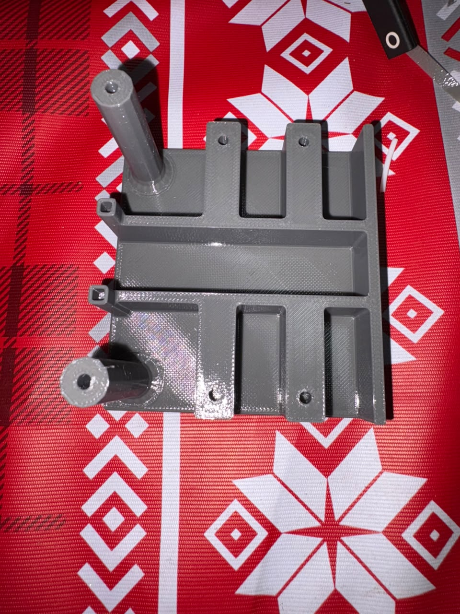
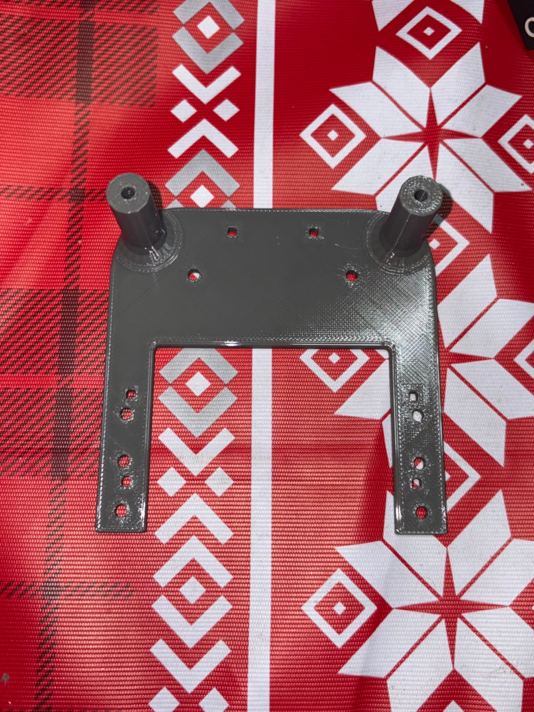
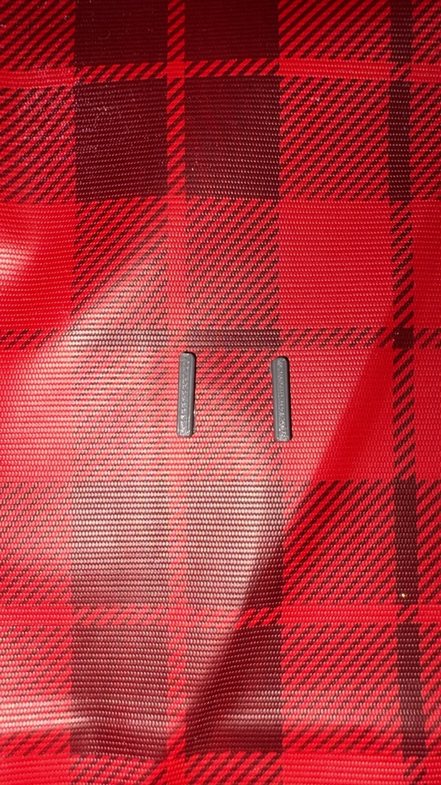
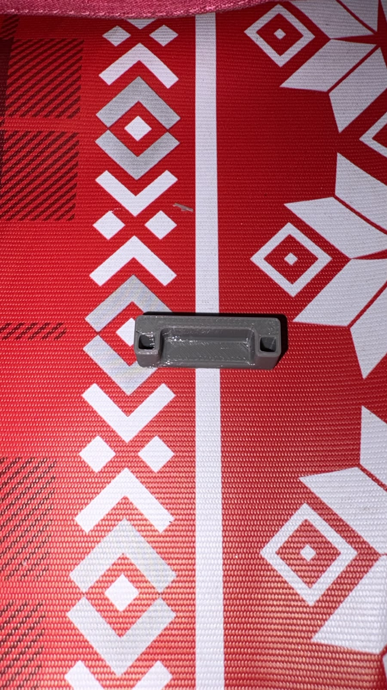
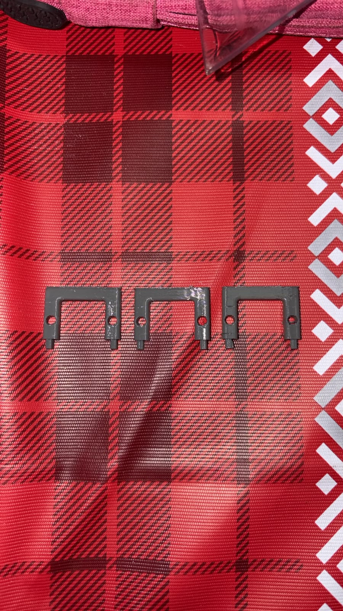
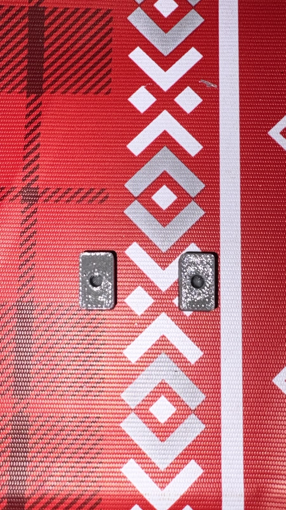

# Testes de Estrutura

> Apresentar com detalhes os testes feitos para conferir se os objetivos da estrutura foram atendidos, incluindo:
>
> - Imagem com todas as peças separadas da estrutura (carcaça) do veículo;
> - Imagem que apresente a estrutura já montada (sem necessidade de partes internas, como eletrônica ou motores);
> - Ilustração contemplando o carro montado virtualmente em alguma ferramenta de CAD, no intuito de verificar se as peças foram construídas e montadas em conformidade com o projeto.

---

## Registros Fotográficos e De Projeto

### 1. Peças Separadas da Estrutura (Carcaça)

| 1. Base Inferior | 2. Base Superior | 3. Pino da Bateria |
| :---: | :---: | :---: |
|  |  |  |

| 4. Suporte da Bateria | 5. Suportes dos Sensores | 6. Trava do Motor |
| :---: | :---: | :---: |
|  |  |  |
---

### 2. Estrutura Física Montada (Ensaio a Seco)

*Figura 2: Carcaça e chassi montados mecanicamente sem a inclusão de componentes eletroeletrônicos.*

---

### 3. Modelo Virtual em CAD (CATIA)

*Figura 3: Montagem virtual do robô no ambiente CAD para validação geométrica e de interferências.*

---

## Tabela de Testes e Validação Estrutural

| **ID** | **Descrição** | **Data de Início** | **Data de Conclusão** | **Responsável** | **Resultados Esperados** | **Resultados Obtidos** | **Aprovação Interna (S/N)** | **Aprovação do Orientador (S/N)** | **Observações** |
|:------:|---------------|--------------------|-----------------------|-----------------|--------------------------|------------------------|:---------------------------:|:--------------------------------:|-----------------|
| **1.1** | Verificação do Envelope Dimensional Externo (Comprimento e Largura) | DD/MM/AAAA | DD/MM/AAAA | Equipe | Dimensões totais $\le 165 \times 165\text{ mm}$ (gabarito da arena) | $125 \times 90\text{ mm}$ medidos com paquímetro | S | S | Conforme requisito de dimensão externa. |
| **1.2** | Verificação do Vão Livre (*Ground Clearance*) | DD/MM/AAAA | DD/MM/AAAA | Equipe | Distância vertical da base até o solo $\ge 2,0\text{ mm}$ | $2,5\text{ mm}$ medidos na bancada | S | S | Garante mobilidade sem arrasto no piso da arena. |
| **1.3** | Balanço de Massa Estimado da Estrutura e Estimativa Total no CAD | DD/MM/AAAA | DD/MM/AAAA | Equipe | Massa projetada total $\le 500\text{ g}$ | $193\text{ g}$ estimadas no modelo CAD | S | S | Margem de segurança de massa excelente. |
| **1.4** | Verificação do Centro de Gravidade (CG) Estrutural no CAD | DD/MM/AAAA | DD/MM/AAAA | Equipe | $CG_Z$ mantido o mais baixo possível para evitar tombamento | $CG_Z = 21,82\text{ mm}$ e $CG_X = -3,71\text{ mm}$ | S | S | Posição validada no software de modelagem. |
| **1.5** | Ensaio de Encaixe a Seco (*Fit Test*) entre Peças Impressas em PETG | DD/MM/AAAA | DD/MM/AAAA | Equipe | Unificação justa das peças sem folgas ou necessidade de desgaste excessivo | Encaixe perfeito dos suportes e chassi principal | S | S | Tolerância de impressão calibrada. |
| **1.6** | Avaliação do Acabamento Superficial e Remoção de Suportes 3D | DD/MM/AAAA | DD/MM/AAAA | Equipe | Superfícies limpas, sem rebarbas ou fragilidade estrutural | Peças limpas e sem defeitos aparentes de delaminação | S | S | Processo de pós-processamento concluído. |
| **1.7** | Inspeção Geométrica dos Raios de Arredondamento do Para-choque | DD/MM/AAAA | DD/MM/AAAA | Equipe | Borda externa com raio de curvatura $\ge 1,0\text{ mm}$ | Cantos arredondados com $R \ge 1,0\text{ mm}$ conforme CAD | S | S | Atende diretriz de mitigar danos a paredes. |
| **1.8** | Teste Mecânico do Mecanismo de Acesso Rápido à Bateria | DD/MM/AAAA | DD/MM/AAAA | Equipe | Encaixe/trava funcional que permita substituição mecânica rápida | Bateria acopla e desacopla sem necessidade de ferramentas | S | S | Berço mecânico validado. |
| **1.9** | Cronometragem do Tempo Mecânico de Troca de Bateria | DD/MM/AAAA | DD/MM/AAAA | Equipe | Operação de remoção e inserção mecânica $\le 60\text{ s}$ | Tempo de manuseio cronometrado em $< 30\text{ s}$ | S | S | Requisito de agilidade operacional atendido. |
| **1.10** | Simulação Numérica Estrutural (FEA - Ansys) sob Impacto | DD/MM/AAAA | DD/MM/AAAA | Equipe | Tensão de von Mises suportada com Fator de Segurança $FS \ge 1,5$ | $FS \ge 1,5$ obtido no relatório de elementos finitos | S | S | Resistência mecânica do PETG comprovada. |
| **1.11** | Verificação dos Alojamentos dos Motores N20 | DD/MM/AAAA | DD/MM/AAAA | Equipe | Fixação rígida dos micromotores sem rotação no próprio eixo | Motores encaixados sob pressão correta sem folga angular | S | S | Travamento mecânico adequado. |
| **1.12** | Inspeção do Alinhamento dos Suportes dos Sensores de Distância | DD/MM/AAAA | DD/MM/AAAA | Equipe | Variação angular de alinhamento do suporte $< 2^\circ$ | Suportes alinhados ortogonalmente ao chassi | S | S | Geometria pronta para recepção dos sensores. |
| **1.13** | Teste de Montagem e Giro Livre da Roda Boba (Caster) | DD/MM/AAAA | DD/MM/AAAA | Equipe | Alojamento do pino/esfera livre de atrito excessivo | Roda boba ajustada e alinhada com o plano inferior | S | S | Apoio traseiro/dianteiro validado. |
| **1.14** | Verificação dos Alojamentos dos Anéis O-Ring (NBR / Silicone) | DD/MM/AAAA | DD/MM/AAAA | Equipe | Encaixe justo da borracha no cubo da roda ($18\text{ mm}$) sem deformação | Anéis NBR e Silicone assentados no canal do cubo | S | S | Roda estruturalmente pronta. |
| **1.15** | Verificação da Facilidade de Inspeção e Limpeza dos Pneus | DD/MM/AAAA | DD/MM/AAAA | Equipe | Acesso mecânico desobstruído às rodas para manutenção rápido | Pneus totalmente acessíveis externamente | S | S | Facilita aplicação de álcool/limpeza rápida. |
| **1.16** | Validação da Rigidez Torcional da Estrutura Montada | DD/MM/AAAA | DD/MM/AAAA | Equipe | Torção manual leve sem apresentar deflexão visível ou trincas | Chassi rígido, sem torções indesejadas sob esforço leve | S | S | Conjunto mecânico pronto para integração final. |
