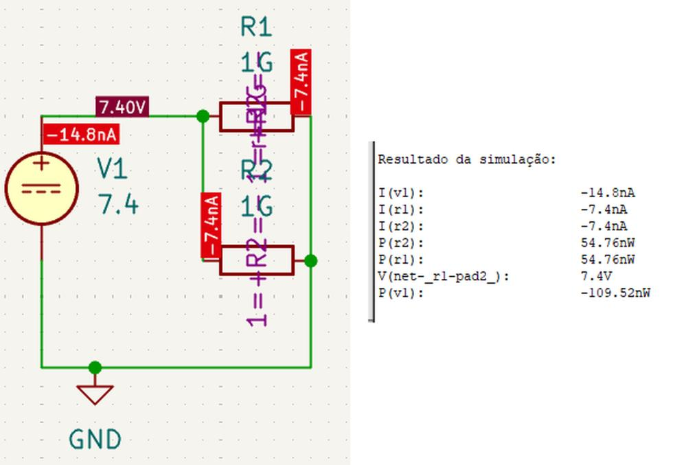
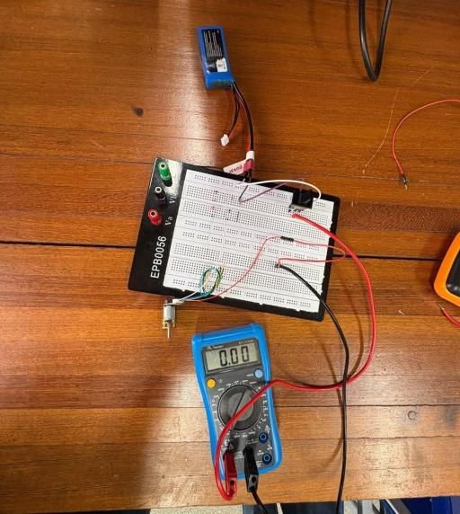
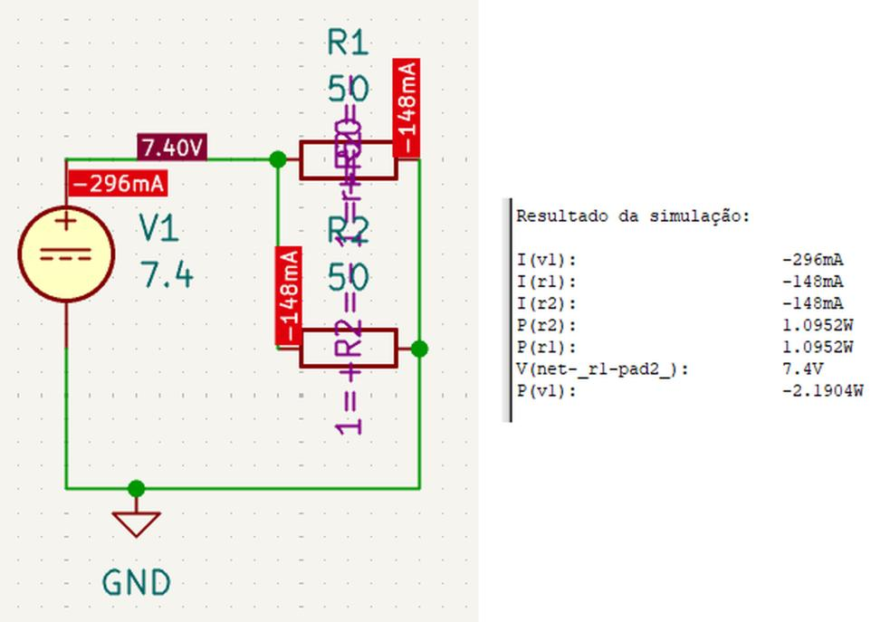
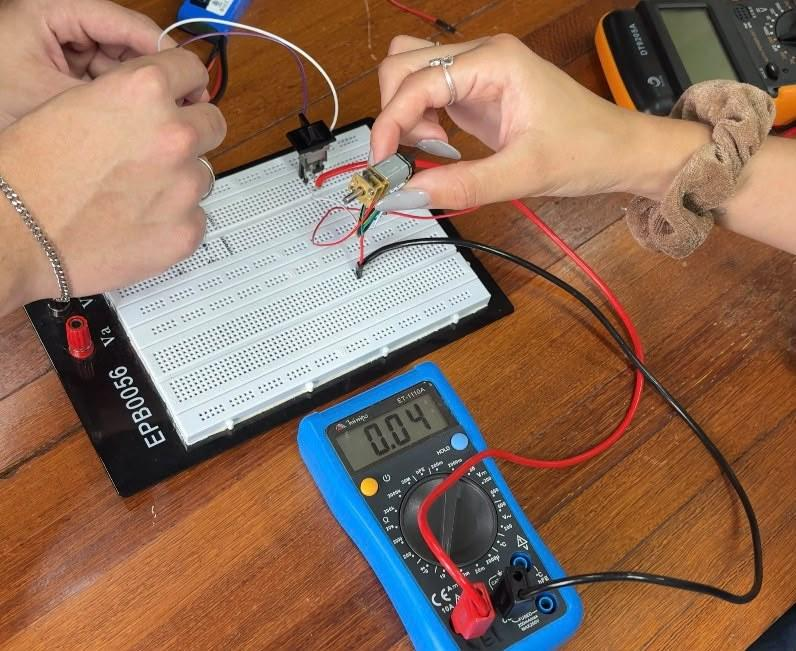
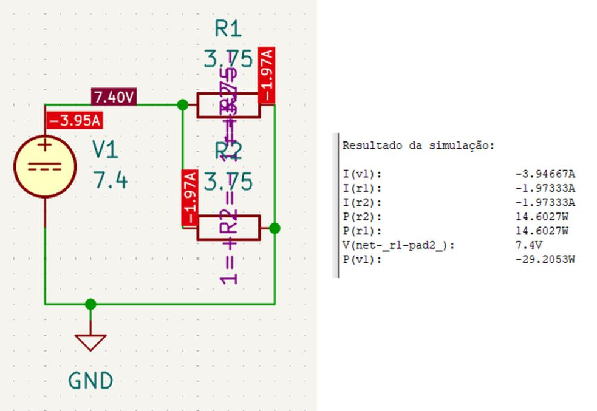
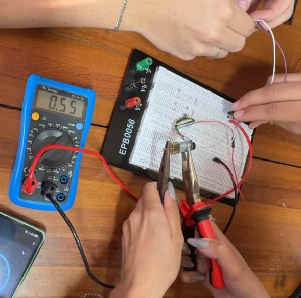
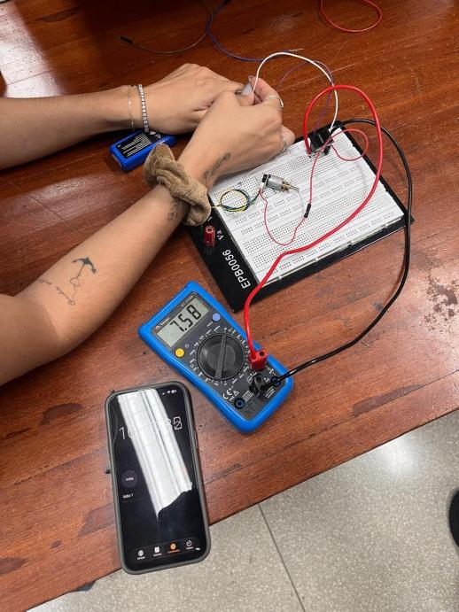
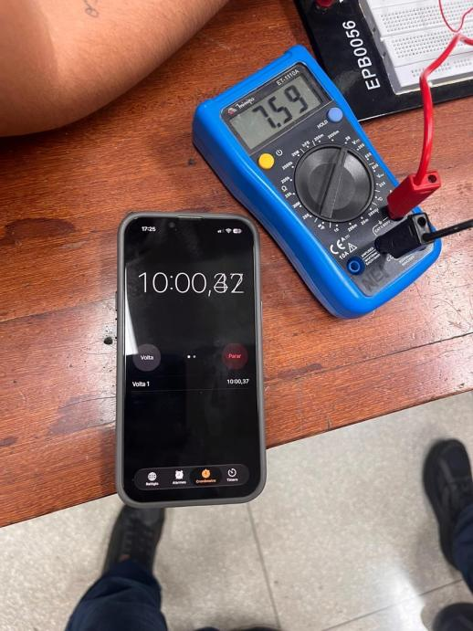

# Testes de Energia

!!! quote "Roteiro de Testes de Energia (PI1 2026.2)"
    Relatório das simulações e dos ensaios de bancada do subsistema de energia do robô **Micromouse (Grupo 1)** para a disciplina Projeto Integrador 1 (semestre 2026.2, FCTE/UnB, Prof. Lui). O foco é o consumo de corrente do subsistema de tração (dois motores DC alimentados por uma bateria LiPo 2S de $1500\text{ mAh}$) e a autonomia do robô. O documento cobre quatro blocos:

    1. **Metodologia:** materiais, modelagem dos motores no KiCad e equações usadas.
    2. **Consumo de corrente da tração:** simulação no KiCad e medição em bancada com os motores parados, em movimento livre e travados (*stall*).
    3. **Descarga contínua e autonomia:** corrente total estimada do robô completo e autonomia frente ao requisito RNF-ENE01.
    4. **Comportamento térmico:** aquecimento dos motores, da ponte H, da bateria e do cabeamento durante os ensaios.

    Atividades da EAP: [#132 — Teste de carga, autonomia e proteção (EAP 4.7.1)](https://github.com/fcte-pi1/2026.2_PI1_Grupo1_Lui/issues/132) e [#133 — Escrita do relatório 7.2 (EAP 4.7.2)](https://github.com/fcte-pi1/2026.2_PI1_Grupo1_Lui/issues/133).

---

## Painel Geral de Ensaios de Energia

A tabela abaixo reúne os testes de energia do projeto. O identificador de cada teste (**ID**) leva direto para o detalhamento da seção correspondente, com links para os requisitos e para as evidências.

| ID | Requisito | Descrição do Teste | Período | Responsáveis | Resultados Esperados | Resultados Obtidos | Aprovação | Evidência |
|:---:|:---:|---|:---:|:---:|---|---|:---:|:---:|
| [**2.1**](#21-motores-parados-id-21) | [RNF-ENE01](2%20-%20Requisitos.md#requisitos-nao-funcionais-rnf-energia) | Corrente da tração com os motores parados (ponte H em corte) | 19/10 a 21/10/2026 | Lucas Oliveira Rafaela Trajano Lucas Peixoto Antônio Lucas | Corrente praticamente nula no subsistema de tração. | Simulação: $14,8\text{ nA}$ ($\approx 0\text{ A}$). Bancada: $0,00\text{ A}$. | :white_check_mark: | [Figuras 2.1 e 2.2](#21-motores-parados-id-21) |
| [**2.2**](#22-motores-em-movimento-livre-id-22) | [RNF-ENE01](2%20-%20Requisitos.md#requisitos-nao-funcionais-rnf-energia) | Corrente da tração com os motores em movimento livre (sem carga) | 19/10 a 21/10/2026 | Lucas Oliveira Rafaela Trajano Lucas Peixoto Antônio Lucas | Corrente próxima do dado do fabricante ($120\text{ mA}$ por motor a $6\text{ V}$). | Simulação: $296\text{ mA}$ totais. Bancada: $80\text{ mA}$ totais ($40\text{ mA}$ por motor). | :white_check_mark: | [Figuras 2.3 e 2.4](#22-motores-em-movimento-livre-id-22) |
| [**2.3**](#23-motores-travados-em-stall-id-23) | [RNF-ENE03](2%20-%20Requisitos.md#requisitos-nao-funcionais-rnf-energia) | Corrente de travamento (*stall*) com o eixo dos motores bloqueado | 19/10 a 21/10/2026 | Lucas Oliveira Rafaela Trajano Lucas Peixoto Antônio Lucas | Pico de corrente conhecido e suportado pela ponte H e pela proteção. | Simulação: $3,95\text{ A}$ totais. Bancada: $1,10\text{ A}$ totais ($0,55\text{ A}$ por motor). | :white_check_mark: | [Figuras 2.5 e 2.6](#23-motores-travados-em-stall-id-23) |
| [**2.4**](#31-descarga-continua-e-calculo-da-autonomia-id-24) | [RNF-ENE01](2%20-%20Requisitos.md#requisitos-nao-funcionais-rnf-energia) | Descarga contínua e cálculo da autonomia do robô completo | 19/10 a 21/10/2026 | Lucas Oliveira Rafaela Trajano Lucas Peixoto Antônio Lucas | Autonomia $\ge 15\text{ min}$ (RNF-ENE01) e $\ge 30\text{ min}$ para os três labirintos da apresentação final. | Corrente total estimada de $230\text{ mA}$; autonomia teórica de $\approx 391\text{ min}$ (6,5 h). | :white_check_mark: | [Figuras 3.1 e 3.2](#31-descarga-continua-e-calculo-da-autonomia-id-24) |
| [**2.5**](#41-inspecao-termica-dos-componentes-criticos-id-25) | [RNF-ENE03](2%20-%20Requisitos.md#requisitos-nao-funcionais-rnf-energia) | Inspeção térmica dos motores, da ponte H, da bateria e do cabeamento | 19/10 a 21/10/2026 | Lucas Oliveira Rafaela Trajano Lucas Peixoto Antônio Lucas | Nenhum componente com aquecimento capaz de causar dano. | Motor aquece em *stall* sem danificar o chassi; ponte H, bateria e fios sem aquecimento relevante. | :white_check_mark: | [Seção 4.1](#41-inspecao-termica-dos-componentes-criticos-id-25) |

!!! note "Testes de energia registrados no relatório de hardware"
    A medição da tensão da bateria pelo ADC (RF-ENE02) e a estabilidade das linhas de $3,3\text{ V}$ e $5,0\text{ V}$ sob carga dos motores (RNF-ENE02) foram ensaiadas junto com a eletrônica e estão documentadas no [teste 3.8 do relatório de hardware](7.3%20-%20Testes%20de%20hardware.md#26-afericao-de-tensao-e-monitoramento-da-bateria-id-38). A [matriz de rastreabilidade](#6-matriz-de-rastreabilidade-dos-requisitos-de-energia) ao final reúne todos os requisitos de energia.

---

## 1. Metodologia

### 1.1 Contexto e Objetivos

No Projeto Integrador 1, o robô precisa concluir três labirintos, com até 10 minutos cada, na apresentação final. Por isso, é preciso confirmar que o subsistema de energia sustenta esse tempo de funcionamento. Conhecer o consumo dos motores em cada condição de operação também é a base para dimensionar a bateria, a ponte H e as proteções do circuito.

Objetivos dos ensaios:

1. Simular no KiCad as correntes dos motores nas condições parado, em movimento e travado;
2. Medir em bancada as correntes nas mesmas três condições;
3. Comparar os valores simulados e medidos e explicar as diferenças;
4. Estimar a corrente contínua total do robô completo e a sua autonomia;
5. Observar o comportamento térmico dos componentes críticos do subsistema de energia.

### 1.2 Materiais e Ferramentas

* **Bateria LiPo 2S de $1500\text{ mAh}$:** tensão de $7,60\text{ V}$ no início dos ensaios (nas simulações, adotou-se $7,4\text{ V}$ nominais);
* **Dois motores DC:** corrente de *stall* de $1,6\text{ A}$ e corrente sem carga de $120\text{ mA}$, ambas a $6\text{ V}$ e por motor (dados do fabricante);
* **Protoboard** EPB0056;
* **Multímetro digital** e **cronômetro**;
* **Software KiCad**, para a simulação dos circuitos.

### 1.3 Modelagem e Procedimento

Na simulação, cada motor foi representado por um resistor ligado em paralelo à fonte $V_1 = 7,4\text{ V}$. Assim, a corrente total fornecida pela bateria é a soma das correntes dos dois ramos. A resistência adotada em cada condição foi:

| Condição | Resistência por motor | Origem do valor |
|:---|:---:|:---|
| **Parados** | $1\text{ G}\Omega$ | Circuito em corte (chaves ou ponte H abertas) |
| **Movimento livre** | $50\ \Omega$ | $6\text{ V} \div 0,12\text{ A}$ (corrente sem carga) |
| **Travados (*stall*)** | $3,75\ \Omega$ | $6\text{ V} \div 1,6\text{ A}$ (corrente de *stall*) |

Na bancada, a corrente foi medida com o multímetro nas mesmas três condições: motores parados, girando livremente e com o eixo travado mecanicamente.

### 1.4 Equações Utilizadas

Lei de Ohm e resistência equivalente do motor:

$$I = \frac{V}{R} \qquad\qquad R = \frac{V}{I}$$

Corrente total do robô e autonomia da bateria:

$$I_{\text{total}} = I_{\text{tração}} + I_{\text{eletrônica}} \qquad\qquad \text{Autonomia (min)} = \frac{C}{I_{\text{total}}} \times 60$$

Onde $I$ é a corrente (A ou mA), $V$ a tensão (V), $R$ a resistência ($\Omega$) e $C$ a capacidade da bateria (mAh). O fator 60 converte horas em minutos. Com esses dados, a corrente de *stall* a $7,4\text{ V}$ fica em $7,4 \div 3,75 \approx 1,97\text{ A}$ por motor.

[↑ Voltar ao Painel Geral de Testes](#painel-geral-de-ensaios-de-energia)

---

## 2. Consumo de Corrente do Subsistema de Tração

Para cada condição de operação, são apresentados o resultado da simulação e o da medição em bancada, seguidos da comparação.

### 2.1 Motores Parados (ID 2.1)

!!! info "Ficha do Teste"
    * **Requisito associado:** [RNF-ENE01 (Autonomia Operacional Contínua)](2%20-%20Requisitos.md#requisitos-nao-funcionais-rnf-energia)
    * **Responsáveis:** Lucas Oliveira, Rafaela Trajano, Lucas Peixoto e Antônio Lucas
    * **Período:** 19/10/2026 a 21/10/2026
    * **Atividade da EAP:** [#132 — Teste de carga, autonomia e proteção](https://github.com/fcte-pi1/2026.2_PI1_Grupo1_Lui/issues/132)

#### Simulação no KiCad

Com os dois motores modelados como resistores de $1\text{ G}\Omega$ (ponte H em corte), a fonte fornece $-14,8\text{ nA}$, ou seja, $7,4\text{ nA}$ em cada ramo ($7,4\text{ V} \div 1\text{ G}\Omega$). O sinal negativo é apenas o sentido convencional que o simulador adota para a corrente fornecida pela fonte.

Para o funcionamento do micromouse, esse valor é nulo na prática. O simulador não mostra exatamente $0\text{ A}$ porque calcula o valor exato da corrente que atravessa a resistência de $1\text{ G}\Omega$.

*Figura 2.1: Esquemático e resultado da simulação com os motores parados.*

#### Ensaio em bancada

A medição prática confirmou **$0,00\text{ A}$** no subsistema de tração.

{ width="480" }
*Figura 2.2: Bancada com os motores parados; o multímetro indica 0,00 A.*

!!! success "Resultado do Teste 2.1"
    Simulação ($\approx 0\text{ A}$) e bancada ($0,00\text{ A}$) coincidem. No robô montado, o consumo parado não será nulo: o ESP32, os sensores e a ponte H em *standby* continuam drenando corrente da bateria. Esse consumo está incluído na estimativa da eletrônica usada no [cálculo da autonomia](#31-descarga-continua-e-calculo-da-autonomia-id-24).

[↑ Voltar ao Painel Geral de Testes](#painel-geral-de-ensaios-de-energia)

---

### 2.2 Motores em Movimento Livre (ID 2.2)

!!! info "Ficha do Teste"
    * **Requisito associado:** [RNF-ENE01 (Autonomia Operacional Contínua)](2%20-%20Requisitos.md#requisitos-nao-funcionais-rnf-energia)
    * **Responsáveis:** Lucas Oliveira, Rafaela Trajano, Lucas Peixoto e Antônio Lucas
    * **Período:** 19/10/2026 a 21/10/2026
    * **Atividade da EAP:** [#132 — Teste de carga, autonomia e proteção](https://github.com/fcte-pi1/2026.2_PI1_Grupo1_Lui/issues/132)

#### Simulação no KiCad

Com $7,4\text{ V}$ aplicados a dois resistores de $50\ \Omega$ em paralelo, a simulação fornece **$148\text{ mA}$ por motor**, ou **$296\text{ mA}$ totais** fornecidos pela bateria.

*Figura 2.3: Esquemático e resultado da simulação com os motores em movimento livre.*

Esse valor corresponde ao motor girando livremente no ar. Com a autonomia calculada só para a tração simulada, temos:

$$\text{Autonomia simulada} = \frac{1500}{296} \times 60 \approx 304\text{ min}$$

Na pista, o peso do robô, o atrito das rodas e das engrenagens e o consumo da eletrônica farão a bateria durar menos, mas ainda com ampla margem em relação ao necessário.

#### Ensaio em bancada

O multímetro indicou **$40\text{ mA}$ por motor**, ou **$80\text{ mA}$ totais**, bem abaixo dos $148\text{ mA}$ por motor previstos na simulação.

{ width="480" }
*Figura 2.4: Bancada com um motor girando livremente; o multímetro indica 0,04 A.*

!!! success "Resultado do Teste 2.2"
    O consumo real em movimento livre ($80\text{ mA}$ para os dois motores) foi menor que o simulado e que o cenário baixo do [projeto conceitual de energia](4.2%20-%20Projeto%20conceitual%20de%20energia.md#5-tres-cenarios-de-consumo-adotados) ($0,30\text{ A}$ por motor). Esse valor é o **limiar mínimo de tração**: no labirinto, o peso do chassi, o atrito dos pneus com o piso e as curvas exigirão mais torque, e a corrente real deve subir em direção ao valor simulado.

[↑ Voltar ao Painel Geral de Testes](#painel-geral-de-ensaios-de-energia)

---

### 2.3 Motores Travados em Stall (ID 2.3)

!!! info "Ficha do Teste"
    * **Requisito associado:** [RNF-ENE03 (Proteção por Sobrecorrente)](2%20-%20Requisitos.md#requisitos-nao-funcionais-rnf-energia)
    * **Responsáveis:** Lucas Oliveira, Rafaela Trajano, Lucas Peixoto e Antônio Lucas
    * **Período:** 19/10/2026 a 21/10/2026
    * **Atividade da EAP:** [#132 — Teste de carga, autonomia e proteção](https://github.com/fcte-pi1/2026.2_PI1_Grupo1_Lui/issues/132)

#### Simulação no KiCad

Com a resistência interna de $3,75\ \Omega$ por motor, a corrente de *stall* simulada a $7,4\text{ V}$ é de **$1,97\text{ A}$ por motor**, ou cerca de **$3,95\text{ A}$ totais** fornecidos pela bateria.

*Figura 2.5: Esquemático e resultado da simulação com os motores travados.*

#### Ensaio em bancada

Com o eixo bloqueado mecanicamente, o multímetro registrou **$0,55\text{ A}$ por motor**, ou **$1,10\text{ A}$ totais**.

{ width="480" }
*Figura 2.6: Eixo do motor travado com alicate; o multímetro indica 0,55 A.*

O valor medido foi menor que o simulado por três motivos que o modelo ideal do KiCad não considera:

1. **Resistência de contato:** fios finos, conexões temporárias na protoboard e as pontas de prova do multímetro somam resistência em série ao circuito, limitando a corrente;
2. **Resistência interna real:** o enrolamento deste lote de motores pode ter resistência maior que os $3,75\ \Omega$ calculados a partir do datasheet;
3. **Tensão sob carga:** no pico de corrente, a tensão da bateria cai momentaneamente abaixo dos $7,60\text{ V}$, o que reduz o próprio pico.

!!! success "Resultado do Teste 2.3"
    O pico real de travamento ($1,10\text{ A}$ totais, $0,55\text{ A}$ por motor) fica abaixo do limite contínuo de $1,2\text{ A}$ por canal da ponte H TB6612FNG. Assim, a ponte H e o circuito de proteção suportam sem danos o caso em que o robô colide e trava contra uma parede do labirinto.

!!! warning "Pendente: corte do PWM por travamento"
    O firmware monitora os encoders e, ao detectar uma roda parada com a tração acionada, zera o PWM enviado à ponte H, que deixa de conduzir corrente para os motores. Esse corte deve ocorrer em até $1,2\text{ s}$ após o travamento e será validado no robô montado, nos [testes de integração](7.5%20-%20Testes%20de%20integração.md).

[↑ Voltar ao Painel Geral de Testes](#painel-geral-de-ensaios-de-energia)

---

### 2.4 Comparação entre Simulação e Bancada

| Cenário | Resistência por motor | Corrente por motor | Corrente total (bateria) | Potência total |
|:---|:---:|:---:|:---:|:---:|
| **Parado** | $1\text{ G}\Omega$ | $7,4\text{ nA}$ | $14,8\text{ nA}$ ($\approx 0\text{ A}$) | $109,52\text{ nW}$ |
| **Em movimento** | $50\ \Omega$ | $148\text{ mA}$ | $296\text{ mA}$ | $2,1904\text{ W}$ |
| **Travado (*stall*)** | $3,75\ \Omega$ | $1,97\text{ A}$ | $3,95\text{ A}$ | $29,2053\text{ W}$ |

*Tabela 2.1: Resultados das simulações no KiCad (fonte de 7,4 V).*

| Cenário | Simulação (1 motor) | Simulação (2 motores) | Bancada (1 motor) | Bancada (2 motores) |
|:---|:---:|:---:|:---:|:---:|
| **Parado** | $\approx 0\text{ A}$ | $\approx 0\text{ A}$ | $0,00\text{ A}$ | $0,00\text{ A}$ |
| **Em movimento** | $0,148\text{ A}$ | $0,296\text{ A}$ | $0,04\text{ A}$ | $0,08\text{ A}$ |
| **Travado (*stall*)** | $1,97\text{ A}$ | $3,95\text{ A}$ | $0,55\text{ A}$ | $1,10\text{ A}$ |

*Tabela 2.2: Correntes simuladas e medidas nas três condições de operação.*

Os valores medidos coincidiram com a simulação com os motores parados e ficaram abaixo dela em movimento e em travamento. Para dimensionar o circuito de proteção, a simulação é, portanto, a estimativa mais conservadora.

[↑ Voltar ao Painel Geral de Testes](#painel-geral-de-ensaios-de-energia)

---

## 3. Descarga Contínua e Autonomia

### 3.1 Descarga Contínua e Cálculo da Autonomia (ID 2.4)

!!! info "Ficha do Teste"
    * **Requisito associado:** [RNF-ENE01 (Autonomia Operacional Contínua)](2%20-%20Requisitos.md#requisitos-nao-funcionais-rnf-energia) (mínimo de $15\text{ min}$ em navegação ativa)
    * **Responsáveis:** Lucas Oliveira, Rafaela Trajano, Lucas Peixoto e Antônio Lucas
    * **Período:** 19/10/2026 a 21/10/2026
    * **Atividade da EAP:** [#132 — Teste de carga, autonomia e proteção](https://github.com/fcte-pi1/2026.2_PI1_Grupo1_Lui/issues/132)
    * **Referência de dimensionamento:** [4.2 — Projeto conceitual de energia](4.2%20-%20Projeto%20conceitual%20de%20energia.md)

O teste de descarga contínua foi feito na bancada com o multímetro monitorando a tensão da bateria e um cronômetro marcando o tempo de operação. Após cerca de 10 minutos de ensaio, a bateria se manteve em $7,58\text{ V}$ a $7,59\text{ V}$.

{ width="48%" }
{ width="48%" }
*Figura 3.1 (esquerda): Montagem em bancada, com o multímetro indicando 7,58 V. Figura 3.2 (direita): Cronômetro em 10:00,37 e multímetro indicando 7,59 V.*

A corrente contínua do robô completo soma o valor medido dos motores a uma estimativa da eletrônica embarcada:

| Parcela | Corrente | Origem |
|:---|:---:|:---|
| Subsistema de tração | $80\text{ mA}$ | Medido em bancada (dois motores a $40\text{ mA}$ em movimento livre, [teste 2.2](#22-motores-em-movimento-livre-id-22)) |
| Controle e sensores | $150\text{ mA}$ | Estimado: ESP32 ativo, sensores ToF, encoders e corrente de repouso da ponte H |
| **Total** | **$230\text{ mA}$** | |

Aplicando a equação da autonomia:

$$\text{Autonomia} = \frac{1500\text{ mAh}}{230\text{ mA}} \times 60 \approx 391\text{ min} \approx 6,5\text{ h}$$

Para verificar se a conclusão depende da estimativa de $150\text{ mA}$ da eletrônica, a autonomia foi recalculada com os cenários de consumo do [projeto conceitual de energia](4.2%20-%20Projeto%20conceitual%20de%20energia.md#5-tres-cenarios-de-consumo-adotados) (ESP32, três sensores ToF, dois encoders, lógica da ponte H, LEDs e monitor da bateria):

| Cenário | Tração | Eletrônica | Corrente total | Autonomia teórica |
|:---|:---:|:---:|:---:|:---:|
| **Base deste relatório** | $80\text{ mA}$ (movimento livre) | $150\text{ mA}$ (estimativa) | $230\text{ mA}$ | $\approx 391\text{ min}$ |
| **Eletrônica nominal do 4.2** | $80\text{ mA}$ (movimento livre) | $\approx 220\text{ mA}$ | $\approx 300\text{ mA}$ | $\approx 300\text{ min}$ |
| **Pior caso** | $1,10\text{ A}$ (dois motores em *stall*) | $\approx 359\text{ mA}$ (conservador) | $\approx 1,46\text{ A}$ | $\approx 62\text{ min}$ |

!!! success "Resultado do Teste 2.4"
    A autonomia teórica de **$391\text{ min}$** supera com folga o mínimo de **$15\text{ min}$** do RNF-ENE01 e também os **$30\text{ min}$** dos três labirintos da apresentação final (até 10 minutos cada), sem precisar recarregar ou trocar a bateria entre eles. Mesmo no pior caso, com os dois motores travados o tempo todo e a eletrônica no cenário conservador, a bateria duraria cerca de $62\text{ min}$.

!!! warning "Estimativa a substituir por medição"
    Os $150\text{ mA}$ da eletrônica são uma estimativa. O próximo passo é medir o consumo real da eletrônica no robô completo e repetir o cálculo da autonomia com esse valor.

[↑ Voltar ao Painel Geral de Testes](#painel-geral-de-ensaios-de-energia)

---

## 4. Comportamento Térmico

### 4.1 Inspeção Térmica dos Componentes Críticos (ID 2.5)

!!! info "Ficha do Teste"
    * **Requisito associado:** [RNF-ENE03 (Proteção por Sobrecorrente)](2%20-%20Requisitos.md#requisitos-nao-funcionais-rnf-energia)
    * **Responsáveis:** Lucas Oliveira, Rafaela Trajano, Lucas Peixoto e Antônio Lucas
    * **Período:** 19/10/2026 a 21/10/2026
    * **Atividade da EAP:** [EAP 4.7 — Testes de Energia](https://github.com/fcte-pi1/2026.2_PI1_Grupo1_Lui/issues/110)

Durante os ensaios, foi observado o aquecimento dos componentes críticos do subsistema de energia:

| Componente | Condição observada | Situação |
|:---|:---|:---:|
| **Motores DC** | No ensaio com o eixo travado, a carcaça esquentou rapidamente, mas não a ponto de danificar o chassi ou as peças do robô caso ele fique travado no labirinto. | :white_check_mark: Adequado |
| **Ponte H (TB6612FNG)** | O circuito integrado manteve a temperatura dentro do normal. | :white_check_mark: Adequado |
| **Bateria LiPo e cabeamento** | No teste de descarga contínua, a bateria e os fios não esquentaram, o que indica taxa de descarga (fator C) dentro do limite. | :white_check_mark: Adequado |

!!! success "Resultado do Teste 2.5"
    Nenhum componente apresentou aquecimento capaz de causar dano. O ponto de maior atenção é o motor em *stall*, situação que o corte do PWM por travamento (validado nos testes de integração) vai limitar a no máximo $1,2\text{ s}$.

[↑ Voltar ao Painel Geral de Testes](#painel-geral-de-ensaios-de-energia)

---

## 5. Conclusão e Próximas Etapas

As simulações e os ensaios em bancada caracterizaram o consumo de corrente da tração do micromouse nas três condições de operação:

* **Parados:** a simulação previu $\approx 0\text{ A}$ e a bancada confirmou $0,00\text{ A}$;
* **Movimento livre:** a simulação indicou $0,296\text{ A}$ para os dois motores e a bancada registrou $0,08\text{ A}$;
* **Travados:** a simulação indicou $3,95\text{ A}$ e a bancada $1,10\text{ A}$. A diferença vem da resistência de contato, da resistência interna real dos motores e da queda de tensão da bateria sob carga.

Com corrente contínua estimada de $230\text{ mA}$ para o robô completo, a autonomia teórica é de $391\text{ min}$, muito acima do requisito, mesmo considerando o aumento de consumo esperado no labirinto. O comportamento térmico dos motores, da ponte H e da bateria foi adequado.

Próximas etapas:

1. Validar no robô montado o corte do PWM em até $1,2\text{ s}$ após o travamento ([testes de integração](7.5%20-%20Testes%20de%20integração.md));
2. Medir o consumo real da eletrônica embarcada para substituir a estimativa de $150\text{ mA}$;
3. Ensaiar a proteção por sobrecorrente (fusível), o corte por subtensão e a chave geral (ver a matriz abaixo).

[↑ Voltar ao Painel Geral de Testes](#painel-geral-de-ensaios-de-energia)

---

## 6. Matriz de Rastreabilidade dos Requisitos de Energia

A tabela relaciona cada requisito de energia com o teste que o cobre e a métrica obtida. Os requisitos ainda sem ensaio aparecem como pendentes.

| Requisito | Descrição | ID de Teste | Ensaio e Métrica Obtida | Status |
|:---|:---|:---:|:---|:---:|
| [**RF-ENE01**](2%20-%20Requisitos.md#requisitos-funcionais-rf-energia) | Conversão e distribuição de potência em barramentos de tração e de lógica | [**3.8** (hardware)](7.3%20-%20Testes%20de%20hardware.md#26-afericao-de-tensao-e-monitoramento-da-bateria-id-38) | Linhas de $3,3\text{ V}$ e $5,0\text{ V}$ estáveis com os motores em operação. | :white_check_mark: Conforme |
| [**RF-ENE02**](2%20-%20Requisitos.md#requisitos-funcionais-rf-energia) | Medição contínua da tensão da bateria em formato digital | [**3.8** (hardware)](7.3%20-%20Testes%20de%20hardware.md#26-afericao-de-tensao-e-monitoramento-da-bateria-id-38) | Divisor 100k/47k no ADC1_CH6 com erro menor que $1,5\%$. | :white_check_mark: Conforme |
| [**RF-ENE03**](2%20-%20Requisitos.md#requisitos-funcionais-rf-energia) | Corte automático dos motores por subtensão em menos de $200\text{ ms}$ | — | Ainda não ensaiado em bancada. | :hourglass_flowing_sand: Pendente |
| [**RF-ENE04**](2%20-%20Requisitos.md#requisitos-funcionais-rf-energia) | Chave geral mecânica com corte para $0\text{ mA}$ | — | Ainda não ensaiado em bancada. | :hourglass_flowing_sand: Pendente |
| [**RNF-ENE01**](2%20-%20Requisitos.md#requisitos-nao-funcionais-rnf-energia) | Autonomia mínima de $15\text{ min}$ em navegação ativa | [**2.1**](#21-motores-parados-id-21) [**2.2**](#22-motores-em-movimento-livre-id-22) [**2.4**](#31-descarga-continua-e-calculo-da-autonomia-id-24) | Autonomia teórica de $\approx 391\text{ min}$ com $230\text{ mA}$ totais ($\approx 62\text{ min}$ no pior caso). | :white_check_mark: Conforme |
| [**RNF-ENE02**](2%20-%20Requisitos.md#requisitos-nao-funcionais-rnf-energia) | Tensão lógica dentro de $\pm 5\%$ sob transitórios dos motores | [**3.8** (hardware)](7.3%20-%20Testes%20de%20hardware.md#26-afericao-de-tensao-e-monitoramento-da-bateria-id-38) | Linhas de $3,3\text{ V}$ e $5,0\text{ V}$ na faixa de $\pm 5\%$ em partidas e reversões. | :white_check_mark: Conforme |
| [**RNF-ENE03**](2%20-%20Requisitos.md#requisitos-nao-funcionais-rnf-energia) | Proteção por sobrecorrente (fusível) atuando em menos de $500\text{ ms}$ | [**2.3**](#23-motores-travados-em-stall-id-23) [**2.5**](#41-inspecao-termica-dos-componentes-criticos-id-25) | Corrente de *stall* medida ($1,10\text{ A}$) e sem aquecimento danoso; atuação do fusível ainda não ensaiada. | :warning: Parcial |
| [**RNF-ENE04**](2%20-%20Requisitos.md#requisitos-nao-funcionais-rnf-energia) | Conector da bateria com polaridade à prova de inversão | — | Ainda não ensaiado em bancada. | :hourglass_flowing_sand: Pendente |
| [**RNF-ENE05**](2%20-%20Requisitos.md#requisitos-nao-funcionais-rnf-energia) | Recarga completa da bateria em menos de $90\text{ min}$ | — | Ainda não ensaiado em bancada. | :hourglass_flowing_sand: Pendente |

[↑ Voltar ao Painel Geral de Testes](#painel-geral-de-ensaios-de-energia)
