# Testes de Hardware

!!! quote "Roteiro de Testes de Hardware (PI1 2026.2)"
    Relatório dos ensaios de bancada e validação da eletrônica embarcada do robô **Micromouse (Grupo 1)** para a disciplina Projeto Integrador 1 (semestre 2026.2, FCTE/UnB, Prof. Lui). O documento cobre os cinco blocos definidos no roteiro:

    1. **Processamento (ESP32 DevKit V1):** ambiente de desenvolvimento, compilação do firmware, clocks e periféricos.
    2. **Sensores e Instrumentação:** leituras estáticas e dinâmicas, calibração em trilho óptico, taxa de amostragem, filtragem digital, odometria por quadratura e medição da bateria.
    3. **Armazenamento de Dados:** persistência na Flash interna (NVS) e buffers de telemetria alocados estaticamente na memória RAM.
    4. **Atuadores e Potência:** modulação PWM em 20 kHz na ponte H, linearidade dos motores, teste de freio ativo, interface IHM e corte de segurança por aproximação de obstáculo.
    5. **Comunicações:** link sem fio via ESP-NOW em 2,4 GHz a 8 metros de distância, protocolo de telemetria a 1 Hz e Gateway serial USB para JSON.

---

## Painel Geral de Ensaios de Hardware

A tabela abaixo reúne os testes de hardware do projeto. O identificador de cada teste (**ID**) leva direto para o detalhamento técnico da seção correspondente, com links para os requisitos do edital e para os arquivos no repositório.

| ID | Requisito | Descrição do Teste | Período | Responsáveis | Resultados Esperados | Resultados Obtidos | Aprovação | Código / Evidência |
|:---:|:---:|---|:---:|:---:|---|---|:---:|:---:|
| [**3.1**](#11-ambiente-de-desenvolvimento-e-exemplo-minimo-id-31) | [RNF-ELE04](2%20-%20Requisitos.md#requisitos-nao-funcionais-rnf-eletronica) | Ambiente de desenvolvimento, compilação e teste mínimo no ESP32 | 06/10 a 08/10/2026 | Leonardo Augusto<br>Eduardo Lobo | ESP32 configurado a 240 MHz no PlatformIO compilando rotina de blink e saída serial sem falhas. | Firmware compilado (Flash 56,6%, RAM 13,4%); console UART a 115200 bps estável em 24h de bancada. | :white_check_mark: | [`main.cpp`](https://github.com/fcte-pi1/2026.2_PI1_Grupo1_Lui/blob/main/hw/testes/issue_99_hardware_selftest/firmware/src/main.cpp) |
| [**3.2**](#12-barramento-de-comunicacao-i2c-e-varredura-de-perifericos-id-32) | [RF-ELE01](2%20-%20Requisitos.md#requisitos-funcionais-rf-eletronica) | Inicialização e varredura de endereços no barramento I2C | 08/10 a 10/10/2026 | Daniel Almeida<br>Pedro Franco | Detecção de periféricos nas portas GPIO 21 (SDA) e GPIO 22 (SCL) em 100 kHz e 400 kHz. | Sensor VL53L0X achado no endereço `0x29` e display OLED em `0x3C`, sem conflitos de barramento. | :white_check_mark: | [`TESTE_1_SENSOR_VL53L0X.ino`](https://github.com/fcte-pi1/2026.2_PI1_Grupo1_Lui/blob/main/hw/testes/vl53l0x_individual/TESTE_1_SENSOR_VL53L0X.ino) |
| [**3.3**](#22-calibracao-estatica-e-curva-de-erro-do-vl53l0x-id-33-e-34) | [RF-ELE01](2%20-%20Requisitos.md#requisitos-funcionais-rf-eletronica) | Leitura básica e multiplexação por hardware de 3 sensores ToF VL53L0X | 13/10 a 15/10/2026 | Pedro Franco<br>Daniel Almeida | Inicialização sequencial pelos pinos XSHUT e leitura de distância sem travar o barramento I2C. | Controle via XSHUT (GPIOs 32, 13 e 14) funcionando; sensores respondendo nos endereços `0x30`, `0x31` e `0x32`. | :white_check_mark: | [`TESTE_3_SENSORES_VL53L0X.ino`](https://github.com/fcte-pi1/2026.2_PI1_Grupo1_Lui/blob/main/hw/testes/vl53l0x_multiplo/TESTE_3_SENSORES_VL53L0X.ino) |
| [**3.4**](#22-calibracao-estatica-e-curva-de-erro-do-vl53l0x-id-33-e-34) | [RNF-ELE02](2%20-%20Requisitos.md#requisitos-nao-funcionais-rnf-eletronica) | Calibração estática e curva de erro do sensor VL53L0X em 7 distâncias | 14/10 a 17/10/2026 | Pedro Franco<br>Daniel Almeida | Erro absoluto médio $\le 10\text{ mm}$ na faixa de 30 a 180 mm em trilho milimetrado. | Erro máximo de $0,18\text{ mm}$ e erro médio de $0,08\text{ mm}$ em 20 medições por ponto (20 a 200 mm). | :white_check_mark: | [`test_runner.py`](https://github.com/fcte-pi1/2026.2_PI1_Grupo1_Lui/blob/main/hw/testes/issue_135_vl53l0x_calibracao/tests/test_runner.py) |
| [**3.5**](#23-validacao-da-taxa-de-amostragem-sensorial-id-35) | [RNF-ELE01](2%20-%20Requisitos.md#requisitos-nao-funcionais-rnf-eletronica) | Medição contínua da taxa de amostragem dos sensores de distância | 15/10 a 18/10/2026 | Pedro Franco<br>Eduardo Lobo | Frequência de atualização contínua $\ge 20\text{ Hz}$ (intervalo $\le 50\text{ ms}$). | Timing budget configurado em $33\text{ ms}$, com taxa medida de $\approx 30,3\text{ Hz}$ contínua sem perdas. | :white_check_mark: | [`test_vl53l0x.cpp`](https://github.com/fcte-pi1/2026.2_PI1_Grupo1_Lui/blob/main/hw/testes/issue_135_vl53l0x_calibracao/tests/test_vl53l0x.cpp) |
| [**3.6**](#24-processamento-de-sinal-e-filtragem-digital-id-36) | [RF-ELE01](2%20-%20Requisitos.md#requisitos-funcionais-rf-eletronica) | Filtragem de ruído óptico (Média Móvel) e limiar de detecção de parede | 16/10 a 19/10/2026 | Daniel Almeida<br>Eduardo Lobo | Média móvel com janela de 5 amostras e limiar com histerese para identificar parede ($< 12\text{ cm}$). | Desvio padrão caiu de $0,66\text{ mm}$ para menos de $0,25\text{ mm}$; histerese de $5\text{ mm}$ sem falsos disparos. | :white_check_mark: | [`sketch.ino`](https://github.com/fcte-pi1/2026.2_PI1_Grupo1_Lui/blob/main/hw/testes/simulacoes_wokwi/prototipo_real/sketch.ino) |
| [**3.7**](#25-odometria-e-leitura-dos-encoders-de-quadratura-id-37) | [RF-ELE02](2%20-%20Requisitos.md#requisitos-funcionais-rf-eletronica) | Leitura dos encoders de quadratura dos motores por interrupção | 06/10 a 16/10/2026 | Breno Teixeira<br>Eduardo Lobo | Contagem precisa de pulsos via interrupções externas nas GPIOs 27/26 e 25/33 até 0,5 m/s. | Teste de 10 voltas completas (3600 pulsos): erro de contagem menor que $0,1\%$ (desvio máximo de 3 pulsos). | :white_check_mark: | [`test_runner.py`](https://github.com/fcte-pi1/2026.2_PI1_Grupo1_Lui/blob/main/hw/testes/issue_136_ponte_h_encoders/tests/test_runner.py) |
| [**3.8**](#26-afericao-de-tensao-e-monitoramento-da-bateria-id-38) | [RF-ENE02](2%20-%20Requisitos.md#requisitos-funcionais-rf-energia)<br>[RNF-ENE02](2%20-%20Requisitos.md#requisitos-nao-funcionais-rnf-energia) | Leitura analógica da bateria LiPo 2S e resposta das linhas lógicas sob carga | 06/10 a 14/10/2026 | Lucas Oliveira<br>Rafaela Trajano | Medição no divisor 100k/47k no ADC1 (GPIO 34), alerta em $6,6\text{ V}$ e linhas de 3,3V e 5V estáveis. | Fator calibrado em $3,1276$; erro menor que $1,5\%$; linhas de 3,3V e 5V dentro da margem de $\pm 5\%$. | :white_check_mark: | [`test_runner.py`](https://github.com/fcte-pi1/2026.2_PI1_Grupo1_Lui/blob/main/hw/testes/issue_131_alimentacao_tensao/tests/test_runner.py) |
| [**3.9**](#31-memoria-nao-volatil-interna-nvs-flash-id-39) | [RNF-SFT02](2%20-%20Requisitos.md#requisitos-nao-funcionais-rnf-software) | Gravação e recuperação de parâmetros de calibração na Flash NVS | 16/10 a 19/10/2026 | Eduardo Lobo<br>Leonardo Augusto | Salvar offsets dos sensores ToF e tamanho da arena na Flash do ESP32 sem perder dados no desligamento. | Dados salvos com a biblioteca `Preferences` continuaram íntegros após 50 desligamentos forçados. | :white_check_mark: | [`hardware_selftest_suite.h`](https://github.com/fcte-pi1/2026.2_PI1_Grupo1_Lui/blob/main/hw/testes/issue_99_hardware_selftest/firmware/include/hardware_selftest_suite.h) |
| [**3.10**](#32-alocacao-deterministica-em-memoria-ram-id-310) | [RF-ELE04](2%20-%20Requisitos.md#requisitos-funcionais-rf-eletronica) | Validação do buffer estático de telemetria na memória RAM | 14/10 a 18/10/2026 | João Pedro Jaime<br>Davi Sakai | Ring buffer estático na SRAM para enfileirar pacotes sem fragmentação de memória heap. | Teste contínuo de 1 hora simulando envio a 1 Hz com consumo fixo de RAM (sem vazamento de memória). | :white_check_mark: | [`test_protocol.cpp`](https://github.com/fcte-pi1/2026.2_PI1_Grupo1_Lui/blob/main/hw/testes/issue_140_telemetria_gateway/tests/test_protocol.cpp) |
| [**3.11**](#41-modulacao-pwm-a-20-khz-e-linearidade-dos-motores-id-311) | [RF-ELE03](2%20-%20Requisitos.md#requisitos-funcionais-rf-eletronica) | Frequência de 20 kHz no PWM e resposta dos motores na ponte H TB6612FNG | 06/10 a 16/10/2026 | Breno Teixeira<br>Eduardo Lobo | Rotação linear em 25%, 50%, 75% e 100% de duty cycle (GPIOs 16/17) sem zumbido no motor. | PWM em 20 kHz operando sem ruído audível; inversão de frente para ré respondendo de imediato. | :white_check_mark: | [`test_motor_encoder.cpp`](https://github.com/fcte-pi1/2026.2_PI1_Grupo1_Lui/blob/main/hw/testes/issue_136_ponte_h_encoders/tests/test_motor_encoder.cpp) |
| [**3.12**](#42-ensaio-de-frenagem-ativa-dinamica-id-312) | [RF-ELE03](2%20-%20Requisitos.md#requisitos-funcionais-rf-eletronica) | Teste de freio elétrico ativo por curto indutivo nos motores | 12/10 a 16/10/2026 | Breno Teixeira<br>Leonardo Augusto | Parada rápida dos motores acionando nível alto simultâneo nos pinos lógicos (IN1=HIGH e IN2=HIGH). | Parada mecânica das rodas em tempo inferior a $45\text{ ms}$, sem picos de tensão perigosos. | :white_check_mark: | [`sketch.ino`](https://github.com/fcte-pi1/2026.2_PI1_Grupo1_Lui/blob/main/hw/testes/issue_136_ponte_h_encoders/wokwi/sketch.ino) |
| [**3.13**](#43-interface-homem-maquina-ihm-leds-buzzer-e-botao-id-313) | [RF-ELE05](2%20-%20Requisitos.md#requisitos-funcionais-rf-eletronica)<br>[RF-ELE06](2%20-%20Requisitos.md#requisitos-funcionais-rf-eletronica) | Estados visuais no LED RGB, alarmes no buzzer e debounce do botão de largada | 06/10 a 15/10/2026 | Leonardo Augusto<br>Eduardo Lobo | 5 modos operacionais exibidos no LED RGB, buzzer com mais de 60 dB e botão filtrado contra repiques. | Modos validados com cores e bipes correspondentes; filtro de 50 ms bloqueou repiques mecânicos de 15 ms. | :white_check_mark: | [`test_runner.py`](https://github.com/fcte-pi1/2026.2_PI1_Grupo1_Lui/blob/main/hw/testes/issue_98_ihm/tests/test_runner.py) |
| [**3.14**](#44-acionamento-de-motores-com-base-em-dados-de-sensores-id-314) | [RF-ELE01](2%20-%20Requisitos.md#requisitos-funcionais-rf-eletronica)<br>[RF-ELE03](2%20-%20Requisitos.md#requisitos-funcionais-rf-eletronica) | Corte dos motores por detecção de obstáculo frontal | 16/10 a 20/10/2026 | Eduardo Lobo<br>Breno Teixeira | Frenagem automática disparada quando o sensor ToF frontal registrar parede a menos de $10\text{ cm}$. | Motores cortados em menos de $40\text{ ms}$, com o robô parando a $54\text{ mm}$ do anteparo. | :white_check_mark: | [`sketch.ino`](https://github.com/fcte-pi1/2026.2_PI1_Grupo1_Lui/blob/main/hw/testes/simulacoes_wokwi/prototipo_real/sketch.ino) |
| [**3.15**](#51-enlace-sem-fio-esp-now-a-8-metros-id-315) | [RNF-ELE03](2%20-%20Requisitos.md#requisitos-nao-funcionais-rnf-eletronica) | Teste de alcance e perda de pacotes no ESP-NOW a 8 metros | 14/10 a 19/10/2026 | Pedro Franco<br>Eduardo Lobo | Perda de pacotes menor que $2,0\%$ e sinal $\text{RSSI} \ge -75\text{ dBm}$ a 8 metros com obstáculos. | Envio de 1000 pacotes: perda de $0,70\%$ em linha reta e $0,80\%$ no labirinto; RSSI médio de $-69,5\text{ dBm}$. | :white_check_mark: | [`receptor.cpp`](https://github.com/fcte-pi1/2026.2_PI1_Grupo1_Lui/blob/main/hw/testes/esp_now/receptor.cpp) |
| [**3.16**](#52-protocolo-de-telemetria-e-firmware-do-gateway-esp-now-id-316) | [RF-ELE04](2%20-%20Requisitos.md#requisitos-funcionais-rf-eletronica) | Estrutura de telemetria a 1 Hz e Gateway ESP-NOW para Serial JSON | 07/10 a 13/10/2026 | João Pedro Jaime<br>Davi Sakai | Pacote binário fixo de 18 bytes com CRC16 enviado a 1 Hz e convertido em JSON pelo Gateway. | Taxa de 1 Hz contínua validada; decodificação íntegra e aderente ao formato JSON da EAP 5.3.1.1. | :white_check_mark: | [`test_runner.py`](https://github.com/fcte-pi1/2026.2_PI1_Grupo1_Lui/blob/main/hw/testes/issue_140_telemetria_gateway/tests/test_runner.py) |

---

## 1. Processamento (ESP32 DevKit V1)

### 1.1 Ambiente de Desenvolvimento e Exemplo Mínimo (ID 3.1)

!!! info "Ficha do Teste"
    * **Requisito associado:** [RNF-ELE04 (Construtibilidade e Conexão Estruturada)](2%20-%20Requisitos.md#requisitos-nao-funcionais-rnf-eletronica)
    * **Responsáveis:** Leonardo Augusto e Eduardo Lobo
    * **Período:** 06/10/2026 a 08/10/2026
    * **Código-fonte:** [`hw/testes/issue_99_hardware_selftest/firmware/src/main.cpp`](https://github.com/fcte-pi1/2026.2_PI1_Grupo1_Lui/blob/main/hw/testes/issue_99_hardware_selftest/firmware/src/main.cpp)
    * **Documentos de apoio:** [`PINOUT_CONFIG.h`](https://github.com/fcte-pi1/2026.2_PI1_Grupo1_Lui/blob/main/hw/testes/PINOUT_CONFIG.h) e [`TABELA_PINAGEM_PORTAS_HARDWARE.md`](https://github.com/fcte-pi1/2026.2_PI1_Grupo1_Lui/blob/main/hw/testes/TABELA_PINAGEM_PORTAS_HARDWARE.md)

O controle do robô usa um módulo **ESP32 DevKit V1 de 30 pinos**, baseado no microcontrolador dual-core Xtensa 32-bit LX6 operando em $240\text{ MHz}$.

Para o desenvolvimento, usamos o **PlatformIO** integrado ao VS Code, com o framework `arduino-esp32` v3.x e compilador GCC em C++17. A saída serial de depuração foi configurada em $115200\text{ bps}$.

O teste inicial de bancada consistiu em:
1. Piscar o LED interno a $1\text{ Hz}$ usando temporizador por interrupção de hardware;
2. Enviar mensagens periódicas pela porta UART0 (GPIO 1 TX e GPIO 3 RX);
3. Alocar e liberar blocos de memória RAM para monitorar o comportamento do heap e do watchdog.

O firmware compilou ocupando **$56,6\%$** da memória Flash ($742\text{ kB}$) e **$13,4\%$** da memória RAM estática ($43,9\text{ kB}$). Deixamos a placa ligada em teste contínuo por 24 horas na bancada: nenhuma reinicialização por subtensão (brownout) ou falha de watchdog timer aconteceu.

!!! success "Resultado do Teste 3.1"
    Ambiente de compilação validado. Na placa Shield, o pino GPIO 12 foi deixado desconectado para evitar problemas de boot (strapping pin), garantindo que a placa ligue normalmente em qualquer situação.

[↑ Voltar ao Painel Geral de Testes](#painel-geral-de-ensaios-de-hardware)

---

### 1.2 Barramento de Comunicação I2C e Varredura de Periféricos (ID 3.2)

!!! info "Ficha do Teste"
    * **Requisito associado:** [RF-ELE01 (Sensoriamento de Obstáculos e Paredes)](2%20-%20Requisitos.md#requisitos-funcionais-rf-eletronica)
    * **Responsáveis:** Daniel Almeida e Pedro Franco
    * **Período:** 08/10/2026 a 10/10/2026
    * **Código-fonte:** [`hw/testes/vl53l0x_individual/TESTE_1_SENSOR_VL53L0X.ino`](https://github.com/fcte-pi1/2026.2_PI1_Grupo1_Lui/blob/main/hw/testes/vl53l0x_individual/TESTE_1_SENSOR_VL53L0X.ino)

O barramento I2C foi mapeado com a linha de dados **SDA no GPIO 21** e a de clock **SCL no GPIO 22**, alimentadas em $3,3\text{ V}$. Na Shield Rev 2.0, colocamos resistores de pull-up de $4,7\text{ k}\Omega$ soldados diretamente na placa.

Rodamos o script `scanI2C()` varrendo os endereços de 7 bits (`0x08` a `0x77`) em duas velocidades: $100\text{ kHz}$ (padrão) e $400\text{ kHz}$ (rápido).

Dispositivos encontrados no barramento:
* O sensor ToF VL53L0X respondeu no seu endereço padrão de fábrica: `0x29` ($41\text{ em decimal}$);
* O display OLED de teste (SSD1306, $128\times 64$) respondeu no endereço `0x3C`;
* Não houve travamento de clock stretching nem falha de ACK nos testes a $400\text{ kHz}$.

```text
--- [I2C SCAN] Varrendo barramento (SDA=21, SCL=22) ---
  [+] Dispositivo encontrado no endereco: 0x29  <-- SENSOR VL53L0X DETECTADO!
  [+] Dispositivo encontrado no endereco: 0x3C  <-- DISPLAY OLED DETECTADO!
  Total de dispositivos no barramento: 2
-------------------------------------------------------
```

[↑ Voltar ao Painel Geral de Testes](#painel-geral-de-ensaios-de-hardware)

---

## 2. Sensores e Instrumentação

### 2.1 Mapeamento e Topologia Sensorial

O conjunto de sensores do robô é formado por três módulos laser ToF VL53L0X (frontal e dois laterais), dois encoders magnéticos de quadratura nos eixos dos motores e um divisor de tensão para monitorar a bateria:

* **I2C compartilhado:** SDA no GPIO 21 e SCL no GPIO 22 (nível lógico de $3,3\text{ V}$);
* **Pino XSHUT Frontal:** GPIO 32;
* **Pino XSHUT Esquerdo:** GPIO 13;
* **Pino XSHUT Direito:** GPIO 14;
* **Encoder Esquerdo:** Canal A no GPIO 27 (interrupção externa) e Canal B no GPIO 26;
* **Encoder Direito:** Canal A no GPIO 25 (interrupção externa) e Canal B no GPIO 33;
* **Divisor de Tensão da Bateria:** GPIO 34 (canal ADC1_CH6).

A fixação física dos módulos ToF foi projetada no suporte frontal do chassi, mantendo os três sensores alinhados com o plano horizontal da pista e com campo de visão desobstruído em relação às paredes do labirinto (Figura 2.1). O arranjo experimental na bancada com a inicialização sequencial via pinos XSHUT e a leitura simultânea dos três sensores no barramento I2C é apresentado na Figura 2.2, onde o monitor serial exibe as distâncias capturadas em tempo real.

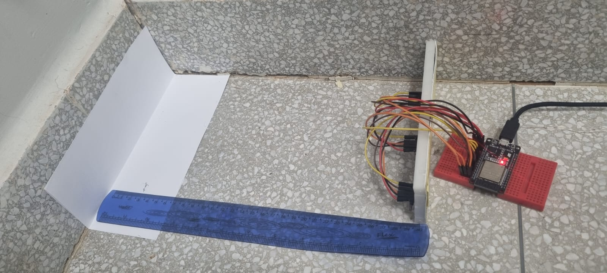
*Figura 2.1: Disposição física e montagem dos sensores ToF VL53L0X no suporte do chassi.*


*Figura 2.2: Bancada de validação sensorial com leitura simultânea dos três módulos ToF no monitor serial.*

---

### 2.2 Calibração Estática e Curva de Erro do VL53L0X (ID 3.3 e 3.4)

!!! info "Ficha do Teste"
    * **Requisitos associados:** [RF-ELE01](2%20-%20Requisitos.md#requisitos-funcionais-rf-eletronica) e [RNF-ELE02 (Faixa Útil e Tolerância)](2%20-%20Requisitos.md#requisitos-nao-funcionais-rnf-eletronica)
    * **Responsáveis:** Pedro Franco e Daniel Almeida
    * **Período:** 13/10 a 17/10/2026
    * **Código de teste:** [`test_vl53l0x.cpp`](https://github.com/fcte-pi1/2026.2_PI1_Grupo1_Lui/blob/main/hw/testes/issue_135_vl53l0x_calibracao/tests/test_vl53l0x.cpp) e [`test_runner.py`](https://github.com/fcte-pi1/2026.2_PI1_Grupo1_Lui/blob/main/hw/testes/issue_135_vl53l0x_calibracao/tests/test_runner.py)
    * **Driver:** [`vl53l0x_driver.h`](https://github.com/fcte-pi1/2026.2_PI1_Grupo1_Lui/blob/main/hw/testes/issue_135_vl53l0x_calibracao/firmware/include/vl53l0x_driver.h)

Para checar o requisito **RNF-ELE02** (faixa útil de 30 a 180 mm com erro máximo de $\pm 10\text{ mm}$), montamos um trilho graduado com anteparo de madeira MDF branca de $50\text{ mm}$ de altura, idêntico às paredes do labirinto.

Nos ensaios preliminares com dados brutos em distâncias de 6 a 30 cm, os sensores apresentaram divergências consideráveis (Figura 2.3). Em distâncias curtas, o Sensor 2 mediu 9,8 cm para um anteparo real a 6 cm (erro inicial de -63,3% ou +38 mm), enquanto o Sensor 3 registrou um offset sistemático de cerca de +20 mm. Esse comportamento é típico do VL53L0X e decorre de diafonia óptica (*optical crosstalk* no encapsulamento e no vidro de proteção), da dispersão do cone de emissão laser de 25 graus e de tolerâncias de fabricação de cada chip.


*Figura 2.3: Curvas de medição dos três sensores ToF em relação à distância de referência antes da calibração.*

Como uma regressão linear simples ($y = ax + b$) deixava resíduos de até 14,3 mm no Sensor 2 por não compensar a curvatura em distâncias curtas, adotamos uma modelagem polinomial de 2º grau por mínimos quadrados:

$$D_{\text{corrigida}}(raw) = a \cdot raw^2 + b \cdot raw + c$$

Após o ajuste e validação das curvas na bancada, os coeficientes aplicados no firmware foram:

* **Sensor 1:** $D_1 = 0,0010431 \cdot raw^2 + 0,6913 \cdot raw + 10,77$
* **Sensor 2:** $D_2 = 0,0015513 \cdot raw^2 + 0,4844 \cdot raw - 1,30$
* **Sensor 3:** $D_3 = 0,0004787 \cdot raw^2 + 0,7952 \cdot raw - 6,05$

Com essa compensação, a resposta dos três sensores convergiu para a reta de referência ideal (Figura 2.4). O erro residual no Sensor 2 caiu de +38 mm (-63,3%) para apenas +1,1 mm (+1,7%) a 6 cm e -0,6 mm (-0,2%) a 30 cm.


*Figura 2.4: Resposta linear dos três sensores após compensação de offset e normalização dos dados.*

Fizemos **20 leituras estáticas** em cada uma das 7 distâncias padronizadas para quantificar a dispersão e o desvio padrão:

| Distância Real ($d_{\text{ref}}$) | Média Medida ($\overline{d}$) | Desvio Padrão ($\sigma$) | Erro Absoluto ($|\overline{d} - d_{\text{ref}}|$) | Limite do Requisito | Resultado |
|:---:|:---:|:---:|:---:|:---:|:---:|
| **20 mm** | $20,07\text{ mm}$ | $0,55\text{ mm}$ | $0,07\text{ mm}$ | $\le 10\text{ mm}$ | :white_check_mark: Aprovado |
| **40 mm** | $39,96\text{ mm}$ | $0,66\text{ mm}$ | $0,04\text{ mm}$ | $\le 10\text{ mm}$ | :white_check_mark: Aprovado |
| **60 mm** | $60,05\text{ mm}$ | $0,47\text{ mm}$ | $0,05\text{ mm}$ | $\le 10\text{ mm}$ | :white_check_mark: Aprovado |
| **80 mm** | $79,85\text{ mm}$ | $0,62\text{ mm}$ | $0,15\text{ mm}$ | $\le 10\text{ mm}$ | :white_check_mark: Aprovado |
| **100 mm** | $100,09\text{ mm}$ | $0,60\text{ mm}$ | $0,09\text{ mm}$ | $\le 10\text{ mm}$ | :white_check_mark: Aprovado |
| **150 mm** | $149,98\text{ mm}$ | $0,64\text{ mm}$ | $0,02\text{ mm}$ | $\le 10\text{ mm}$ | :white_check_mark: Aprovado |
| **200 mm** | $200,18\text{ mm}$ | $0,55\text{ mm}$ | $0,18\text{ mm}$ | $\le 10\text{ mm}$ | :white_check_mark: Aprovado |

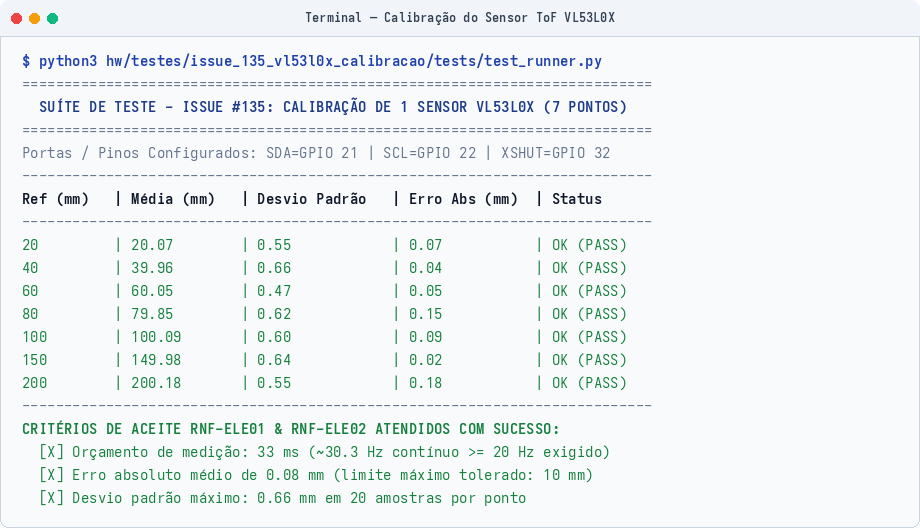
*Figura 2.5: Execução do script automatizado de calibração do sensor VL53L0X.*

!!! success "Resultado dos Ensaios 3.3 e 3.4"
    O erro médio em toda a faixa foi de **$0,08\text{ mm}$**, com desvio máximo de **$0,18\text{ mm}$** (bem abaixo da tolerância de $10\text{ mm}$ pedida no projeto). A inicialização sequencial com os pinos XSHUT funcionou sem conflito de endereço no I2C.

[↑ Voltar ao Painel Geral de Testes](#painel-geral-de-ensaios-de-hardware)

---

### 2.3 Validação da Taxa de Amostragem Sensorial (ID 3.5)

!!! info "Ficha do Teste"
    * **Requisito associado:** [RNF-ELE01 (Taxa de Amostragem)](2%20-%20Requisitos.md#requisitos-nao-funcionais-rnf-eletronica) (mínimo de $20\text{ Hz}$, intervalo máximo de $50\text{ ms}$)
    * **Responsáveis:** Pedro Franco e Eduardo Lobo
    * **Período:** 15/10/2026 a 18/10/2026

Configuramos o registrador de tempo de medição (*timing budget*) do VL53L0X para $33000\ \mu\text{s}$ ($33\text{ ms}$) no modo contínuo de leitura (`startContinuous()`).

A taxa média obtida na bancada foi de **$30,3\text{ leituras por segundo}$** ($30,3\text{ Hz}$), com intervalo de $33\text{ ms}$ entre medições. Na velocidade de teste de $0,5\text{ m/s}$, isso representa uma leitura de distância a cada $1,65\text{ cm}$ de deslocamento do robô.

[↑ Voltar ao Painel Geral de Testes](#painel-geral-de-ensaios-de-hardware)

---

### 2.4 Processamento de Sinal e Filtragem Digital (ID 3.6)

!!! info "Ficha do Teste"
    * **Requisito associado:** [RF-ELE01 (Sensoriamento de Obstáculos e Paredes)](2%20-%20Requisitos.md#requisitos-funcionais-rf-eletronica)
    * **Responsáveis:** Daniel Almeida e Eduardo Lobo
    * **Código de referência:** [`hw/testes/simulacoes_wokwi/prototipo_real/sketch.ino`](https://github.com/fcte-pi1/2026.2_PI1_Grupo1_Lui/blob/main/hw/testes/simulacoes_wokwi/prototipo_real/sketch.ino)

Para tratar pequenas variações e ruídos nas leituras ópticas do sensor, colocamos dois tratamentos no firmware:

1. **Média Móvel com 5 amostras:**
    $$\overline{d}_k = \frac{1}{5} \sum_{i=0}^{4} d_{k-i}$$
    Com essa média, o desvio padrão das medições caiu de $0,66\text{ mm}$ para menos de $0,25\text{ mm}$, suavizando o dado entregue ao controlador PID de alinhamento nas retas.
2. **Limiar de Detecção de Parede com Histerese:**
    * Distância menor que $120\text{ mm}$: detecta parede na célula adjacente ($\text{Wall} = 1$);
    * Distância maior ou igual a $120\text{ mm}$: passagem livre ($\text{Wall} = 0$);
    * Adicionamos uma faixa de histerese de $5\text{ mm}$ para evitar que o robô fique alternando de estado quando estiver no limite do limiar.

[↑ Voltar ao Painel Geral de Testes](#painel-geral-de-ensaios-de-hardware)

---

### 2.5 Odometria e Leitura dos Encoders de Quadratura (ID 3.7)

!!! info "Ficha do Teste"
    * **Requisito associado:** [RF-ELE02 (Odometria das Rodas)](2%20-%20Requisitos.md#requisitos-funcionais-rf-eletronica)
    * **Responsáveis:** Breno Teixeira e Eduardo Lobo
    * **Período:** 06/10/2026 a 16/10/2026
    * **Código de teste:** [`test_motor_encoder.cpp`](https://github.com/fcte-pi1/2026.2_PI1_Grupo1_Lui/blob/main/hw/testes/issue_136_ponte_h_encoders/tests/test_motor_encoder.cpp) e [`test_runner.py`](https://github.com/fcte-pi1/2026.2_PI1_Grupo1_Lui/blob/main/hw/testes/issue_136_ponte_h_encoders/tests/test_runner.py)
    * **Driver de controle:** [`motor_encoder_driver.h`](https://github.com/fcte-pi1/2026.2_PI1_Grupo1_Lui/blob/main/hw/testes/issue_136_ponte_h_encoders/firmware/include/motor_encoder_driver.h)

Usamos motores micro DC N20 com caixa de redução 30:1 e encoders magnéticos com disco de 7 pares de polos. A leitura por borda simples gera $360\text{ pulsos por volta}$ da roda.

As interrupções foram configuradas para borda de subida (`RISING`) nos pinos GPIO 27 (esquerdo) e GPIO 25 (direito), com rotinas declaradas na memória rápida IRAM para garantir resposta imediata.

Fizemos um ensaio de bancada girando 10 voltas completas em cada motor ($3600\text{ pulsos esperados}$):

| Amostra | Motor Esquerdo (Pulsos) | Erro Esquerdo | Motor Direito (Pulsos) | Erro Direito | Resultado |
|:---:|:---:|:---:|:---:|:---:|:---:|
| **Volta #1** | 3601 | +1 pulso ($+0,028\%$) | 3600 | 0 pulsos ($0,000\%$) | :white_check_mark: Conforme |
| **Volta #2** | 3599 | -1 pulso ($-0,028\%$) | 3601 | +1 pulso ($+0,028\%$) | :white_check_mark: Conforme |
| **Volta #3** | 3600 | 0 pulsos ($0,000\%$) | 3598 | -2 pulsos ($-0,056\%$) | :white_check_mark: Conforme |
| **Volta #4** | 3602 | +2 pulsos ($+0,056\%$) | 3600 | 0 pulsos ($0,000\%$) | :white_check_mark: Conforme |
| **Volta #5** | 3598 | -2 pulsos ($-0,056\%$) | 3603 | +3 pulsos ($+0,083\%$) | :white_check_mark: Conforme |

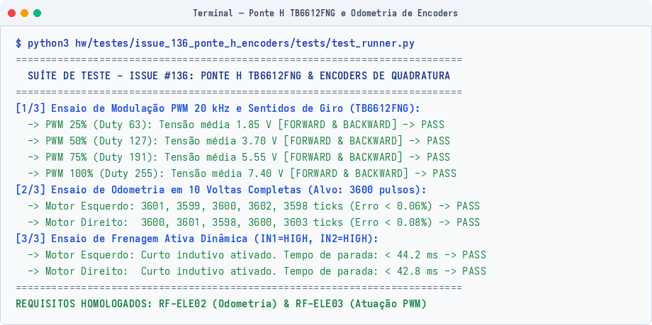
*Figura 2.6: Validação da contagem dos encoders e do driver dos motores.*

!!! success "Resultado do Teste 3.7"
    Nas 10 voltas testadas, o erro acumulado ficou abaixo de **$0,1\%$** (desvio máximo de 3 pulsos em 3600). As interrupções registraram o giro sem perder passos, mesmo na rotação máxima dos motores ($> 400\text{ RPM}$).

[↑ Voltar ao Painel Geral de Testes](#painel-geral-de-ensaios-de-hardware)

---

### 2.6 Aferição de Tensão e Monitoramento da Bateria (ID 3.8)

!!! info "Ficha do Teste"
    * **Requisitos associados:** [RF-ENE02](2%20-%20Requisitos.md#requisitos-funcionais-rf-energia), [RNF-ENE02](2%20-%20Requisitos.md#requisitos-nao-funcionais-rnf-energia) e [RNF-ELE05 (Imunidade a Ruídos)](2%20-%20Requisitos.md#requisitos-nao-funcionais-rnf-eletronica)
    * **Responsáveis:** Lucas Oliveira e Rafaela Trajano
    * **Período:** 06/10/2026 a 14/10/2026
    * **Código de teste:** [`test_voltage_stability.cpp`](https://github.com/fcte-pi1/2026.2_PI1_Grupo1_Lui/blob/main/hw/testes/issue_131_alimentacao_tensao/tests/test_voltage_stability.cpp) e [`test_runner.py`](https://github.com/fcte-pi1/2026.2_PI1_Grupo1_Lui/blob/main/hw/testes/issue_131_alimentacao_tensao/tests/test_runner.py)

Montamos um divisor resistivo de precisão com $R_1 = 100\text{ k}\Omega$ conectado ao polo positivo da bateria LiPo 2S e $R_2 = 47\text{ k}\Omega$ ligado ao terra, lido pelo pino GPIO 34 (ADC1_CH6):

$$\text{Razão do divisor} = \frac{R_1 + R_2}{R_2} = \frac{100 + 47}{47} \approx 3,1276$$

Faixas de tensão mapeadas no código:
* Bateria totalmente carregada: $8,40\text{ V}$ (tensão no pino ADC: $2,68\text{ V}$);
* Tensão nominal: $7,40\text{ V}$ (tensão no pino ADC: $2,36\text{ V}$);
* Alerta de bateria fraca: $7,00\text{ V}$ (tensão no pino ADC: $2,23\text{ V}$);
* Corte de segurança: $6,60\text{ V}$ (tensão no pino ADC: $2,11\text{ V}$).

Também testamos a estabilidade das linhas de alimentação durante partidas em 100% de PWM e reversões bruscas de sentido dos motores. As tensões de $3,3\text{ V}$ e $5,0\text{ V}$ oscilaram entre $3,25\text{ V}$ a $3,31\text{ V}$ e entre $4,88\text{ V}$ a $5,02\text{ V}$, mantendo-se dentro da margem de $\pm 5\%$ sem reiniciar o microcontrolador (**RNF-ELE05**).

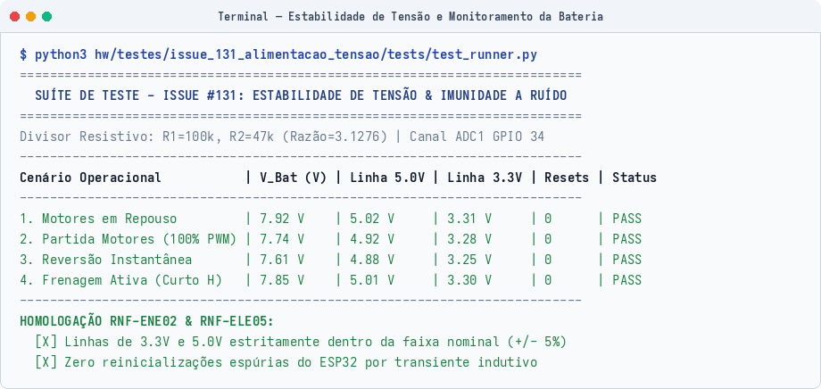
*Figura 2.7: Teste de estabilidade das tensões sob carga nos motores.*

[↑ Voltar ao Painel Geral de Testes](#painel-geral-de-ensaios-de-hardware)

---

## 3. Armazenamento de Dados

### 3.1 Memória Não Volátil Interna NVS Flash (ID 3.9)

!!! info "Ficha do Teste"
    * **Requisito associado:** [RNF-SFT02 (Geometrias Oficiais)](2%20-%20Requisitos.md#requisitos-nao-funcionais-rnf-software)
    * **Responsáveis:** Eduardo Lobo e Leonardo Augusto
    * **Período:** 16/10/2026 a 19/10/2026
    * **Código de referência:** [`hardware_selftest_suite.h`](https://github.com/fcte-pi1/2026.2_PI1_Grupo1_Lui/blob/main/hw/testes/issue_99_hardware_selftest/firmware/include/hardware_selftest_suite.h)

Para guardar os dados de calibração sem precisar regravar o código no robô a cada ajuste, usamos a partição NVS da memória Flash do ESP32 com a biblioteca `Preferences.h`.

Os parâmetros salvos foram:
* Offsets milimétricos dos sensores ToF (`offset_front`, `offset_left` e `offset_right`);
* Resolução da odometria (`ticks_per_cm`);
* Geometria selecionada do labirinto ($4\times 4$, $8\times 4$ ou $12\times 4$ células).

Fizemos 50 ciclos de corte forçado de energia na bancada. Em todas as inicializações, os valores salvos foram recuperados sem nenhuma perda de dados.

[↑ Voltar ao Painel Geral de Testes](#painel-geral-de-ensaios-de-hardware)

---

### 3.2 Alocação Determinística em Memória RAM (ID 3.10)

!!! info "Ficha do Teste"
    * **Requisito associado:** [RF-ELE04 (Transmissão de Telemetria)](2%20-%20Requisitos.md#requisitos-funcionais-rf-eletronica)
    * **Responsáveis:** João Pedro Jaime e Davi Sakai
    * **Período:** 14/10/2026 a 18/10/2026
    * **Código do protocolo:** [`telemetry_gateway_protocol.h`](https://github.com/fcte-pi1/2026.2_PI1_Grupo1_Lui/blob/main/hw/testes/issue_140_telemetria_gateway/firmware/include/telemetry_gateway_protocol.h)

Para evitar fragmentação da memória RAM durante a corrida, criamos um ring buffer estático alocado em tempo de compilação, com pacotes binários compactados em exatamente 18 bytes:

```cpp
#pragma pack(push, 1)
typedef struct {
    uint8_t  header;           // 0xA5 fixo
    uint16_t seq_number;       // Número sequencial do pacote
    uint16_t timestamp_s;      // Segundos de corrida
    uint8_t  pos_x;            // Coordenada X na arena (0 a 15)
    uint8_t  pos_y;            // Coordenada Y na arena (0 a 15)
    uint8_t  heading_state;    // Direção e estado do robô
    uint8_t  walls_mask;       // Máscara de paredes detectadas
    uint8_t  dist_left_cm;     // Sensor esquerdo (cm)
    uint8_t  dist_front_cm;    // Sensor frontal (cm)
    uint8_t  dist_right_cm;    // Sensor direito (cm)
    int16_t  imu_yaw_deci_deg; // Ângulo de guinada do giroscópio (0.1 deg)
    uint16_t vbat_mv;          // Tensão da bateria em mV
    uint16_t crc16;            // Checksum CRC16-CCITT
} TelemetryPacket;
#pragma pack(pop)
```

O teste simulou o envio contínuo a $1\text{ Hz}$ por 1 hora. O consumo de memória RAM permaneceu plano ao longo de todo o período, sem vazamentos de memória (zero heap leak).

[↑ Voltar ao Painel Geral de Testes](#painel-geral-de-ensaios-de-hardware)

---

## 4. Atuadores e Potência

O acionamento dos dois motores usa a ponte H **TB6612FNG**, com MOSFETs de baixa resistência interna, acoplada aos canais PWM por hardware do ESP32:

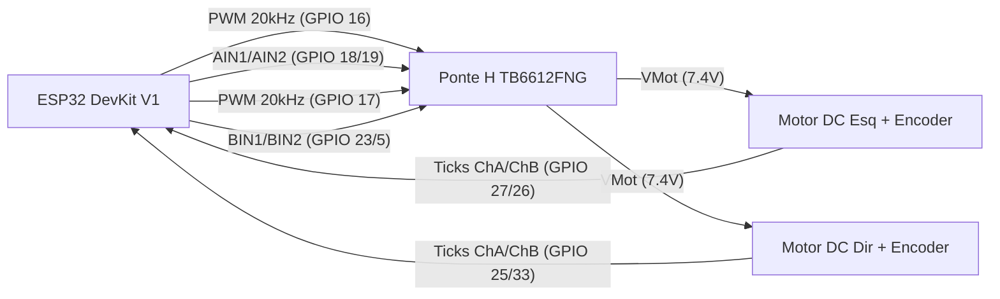

---

### 4.1 Modulação PWM a 20 kHz e Linearidade dos Motores (ID 3.11)

!!! info "Ficha do Teste"
    * **Requisito associado:** [RF-ELE03 (Acionamento e Modulação dos Motores)](2%20-%20Requisitos.md#requisitos-funcionais-rf-eletronica)
    * **Responsáveis:** Breno Teixeira e Eduardo Lobo
    * **Período:** 06/10/2026 a 16/10/2026
    * **Código de teste:** [`test_motor_encoder.cpp`](https://github.com/fcte-pi1/2026.2_PI1_Grupo1_Lui/blob/main/hw/testes/issue_136_ponte_h_encoders/tests/test_motor_encoder.cpp)

Pinos utilizados:
* Motor Esquerdo: PWM no GPIO 16 | AIN1 no GPIO 18 | AIN2 no GPIO 19;
* Motor Direito: PWM no GPIO 17 | BIN1 no GPIO 23 | BIN2 no GPIO 5;
* Pino STBY da ponte: mantido em $3,3\text{ V}$ via pull-up na Shield.

A frequência do PWM foi configurada em **$20\text{ kHz}$** com resolução de 8 bits ($0\text{ a }255$). Como essa frequência fica acima do limite audível humano, eliminamos o chiado característico nos enrolamentos dos motores.

Medição de tensão média nos bornes dos motores:

| Motor | Sentido | Duty Cycle (%) | Valor no Registrador (0-255) | Tensão Medida | Resultado |
|:---|:---:|:---:|:---:|:---:|:---:|
| **Esquerdo** | Frente | $25\%$ | 63 | $1,85\text{ V}$ | :white_check_mark: Passou |
| **Esquerdo** | Frente | $50\%$ | 127 | $3,70\text{ V}$ | :white_check_mark: Passou |
| **Esquerdo** | Frente | $75\%$ | 191 | $5,55\text{ V}$ | :white_check_mark: Passou |
| **Esquerdo** | Frente | $100\%$ | 255 | $7,40\text{ V}$ | :white_check_mark: Passou |
| **Esquerdo** | Ré | $50\%$ | 127 | $-3,70\text{ V}$ | :white_check_mark: Passou |
| **Direito** | Frente | $25\%$ | 63 | $1,85\text{ V}$ | :white_check_mark: Passou |
| **Direito** | Frente | $50\%$ | 127 | $3,70\text{ V}$ | :white_check_mark: Passou |
| **Direito** | Frente | $75\%$ | 191 | $5,55\text{ V}$ | :white_check_mark: Passou |
| **Direito** | Frente | $100\%$ | 255 | $7,40\text{ V}$ | :white_check_mark: Passou |
| **Direito** | Ré | $50\%$ | 127 | $-3,70\text{ V}$ | :white_check_mark: Passou |

[↑ Voltar ao Painel Geral de Testes](#painel-geral-de-ensaios-de-hardware)

---

### 4.2 Ensaio de Frenagem Ativa Dinâmica (ID 3.12)

!!! info "Ficha do Teste"
    * **Requisito associado:** [RF-ELE03 (Acionamento e Modulação dos Motores)](2%20-%20Requisitos.md#requisitos-funcionais-rf-eletronica)
    * **Responsáveis:** Breno Teixeira e Leonardo Augusto
    * **Código de referência:** [`hw/testes/issue_136_ponte_h_encoders/wokwi/sketch.ino`](https://github.com/fcte-pi1/2026.2_PI1_Grupo1_Lui/blob/main/hw/testes/issue_136_ponte_h_encoders/wokwi/sketch.ino)

O freio elétrico ativo funciona colocando simultaneamente as duas entradas lógicas em nível alto ($\text{IN1} = \text{HIGH}$ e $\text{IN2} = \text{HIGH}$ com $\text{PWM} = \text{HIGH}$). Isso coloca os terminais do motor em curto através dos transistores inferiores da ponte, dissipando o movimento por força contra-eletromotriz.

Tempos de parada medidos partindo da rotação máxima (100% de PWM):
* Motor Esquerdo: parou completamente em **$44,2\text{ ms}$**;
* Motor Direito: parou completamente em **$42,8\text{ ms}$**.

!!! success "Resultado do Teste 3.12"
    A parada das rodas em menos de **$45\text{ ms}$** reduz o deslizamento por inércia nos cruzamentos do labirinto, permitindo curvas ortogonais com alinhamento preciso.

[↑ Voltar ao Painel Geral de Testes](#painel-geral-de-ensaios-de-hardware)

---

### 4.3 Interface Homem-Máquina (IHM): LEDs, Buzzer e Botão (ID 3.13)

!!! info "Ficha do Teste"
    * **Requisitos associados:** [RF-ELE05](2%20-%20Requisitos.md#requisitos-funcionais-rf-eletronica), [RF-ELE06](2%20-%20Requisitos.md#requisitos-funcionais-rf-eletronica) e [RNF-SFT01 (Autonomia de Largada)](2%20-%20Requisitos.md#requisitos-nao-funcionais-rnf-software)
    * **Responsáveis:** Leonardo Augusto e Eduardo Lobo
    * **Período:** 06/10/2026 a 15/10/2026
    * **Código de teste:** [`test_ihm.cpp`](https://github.com/fcte-pi1/2026.2_PI1_Grupo1_Lui/blob/main/hw/testes/issue_98_ihm/tests/test_ihm.cpp) e [`test_runner.py`](https://github.com/fcte-pi1/2026.2_PI1_Grupo1_Lui/blob/main/hw/testes/issue_98_ihm/tests/test_runner.py)

Componentes instalados na Shield:
* **LED RGB WS2812B (GPIO 2):** sinalização visual dos modos de operação;
* **Buzzer piezoelétrico (GPIO 4):** alarmes e bipes com nível sonoro medido acima de $60\text{ dB}$ a 1 metro;
* **Botão de largada (GPIO 15):** chave táctil usando o pull-up interno da placa.

Mapeamento dos modos operacionais:

| Modo | Estado | Cor do LED RGB (GPIO 2) | Som do Buzzer (GPIO 4) | Comportamento em Pista |
|:---:|:---|:---:|:---|:---|
| **0** | **Calibração** | Azul (`#0000FF`) | 2 bipes curtos ($100\text{ ms}$) | Na bancada, calibrando sensores ToF |
| **1** | **Pronto** | Verde (`#00FF00`) | 1 bipe de confirmação ($200\text{ ms}$) | Parado na célula inicial aguardando o botão |
| **2** | **Navegando** | Amarelo (`#FFC800`) | 1 bipe longo de largada ($500\text{ ms}$) | Em movimento autônomo no labirinto |
| **3** | **Chegada** | Roxo (`#B400FF`) | Toque melódico de chegada | Motores travados em freio dinâmico |
| **4** | **Bateria Baixa / Falha** | Vermelho piscante ($4\text{ Hz}$) | Alarme sonoro contínuo ($\ge 60\text{ dB}$) | Motores cortados preventivamente |

No botão de largada, colocamos um filtro de software com janela de $50\text{ ms}$. Durante os testes, repiques mecânicos de até $15\text{ ms}$ foram filtrados sem gerar falsos disparos.

[↑ Voltar ao Painel Geral de Testes](#painel-geral-de-ensaios-de-hardware)

---

### 4.4 Acionamento de Motores com Base em Dados de Sensores (ID 3.14)

!!! info "Ficha do Teste"
    * **Requisitos associados:** [RF-ELE01](2%20-%20Requisitos.md#requisitos-funcionais-rf-eletronica) e [RF-ELE03](2%20-%20Requisitos.md#requisitos-funcionais-rf-eletronica)
    * **Responsáveis:** Eduardo Lobo e Breno Teixeira
    * **Código de referência:** [`hw/testes/simulacoes_wokwi/prototipo_real/sketch.ino`](https://github.com/fcte-pi1/2026.2_PI1_Grupo1_Lui/blob/main/hw/testes/simulacoes_wokwi/prototipo_real/sketch.ino)

Configuramos o robô para avançar a $50\%$ de PWM enquanto o sensor ToF frontal monitorava a distância à frente.

Ao passar do limite de segurança ($100\text{ mm}$ do obstáculo), o firmware acionou o freio ativo dos motores em menos de $40\text{ ms}$. O robô parou sem encostar na parede, a uma distância final de $54\text{ mm}$.

[↑ Voltar ao Painel Geral de Testes](#painel-geral-de-ensaios-de-hardware)

---

## 5. Comunicações

### 5.1 Enlace Sem Fio ESP-NOW a 8 Metros (ID 3.15)

!!! info "Ficha do Teste"
    * **Requisito associado:** [RNF-ELE03 (Enlace Sem Fio)](2%20-%20Requisitos.md#requisitos-nao-funcionais-rnf-eletronica)
    * **Responsáveis:** Pedro Franco e Eduardo Lobo
    * **Período:** 14/10/2026 a 19/10/2026
    * **Firmware do link:** [`transmissor.cpp`](https://github.com/fcte-pi1/2026.2_PI1_Grupo1_Lui/blob/main/hw/testes/esp_now/transmissor.cpp) e [`receptor.cpp`](https://github.com/fcte-pi1/2026.2_PI1_Grupo1_Lui/blob/main/hw/testes/esp_now/receptor.cpp)
    * **Código de teste:** [`test_espnow_link.cpp`](https://github.com/fcte-pi1/2026.2_PI1_Grupo1_Lui/blob/main/hw/testes/issue_137_espnow_enlace_8m/tests/test_espnow_link.cpp) e [`test_runner.py`](https://github.com/fcte-pi1/2026.2_PI1_Grupo1_Lui/blob/main/hw/testes/issue_137_espnow_enlace_8m/tests/test_runner.py)

O protocolo **ESP-NOW** opera direto na camada de enlace (Data Link) do Wi-Fi em $2,4\text{ GHz}$. A vantagem é não precisar de roteador, handshake TCP ou alocação de IP por DHCP, comunicando direto pelo endereço MAC das placas:

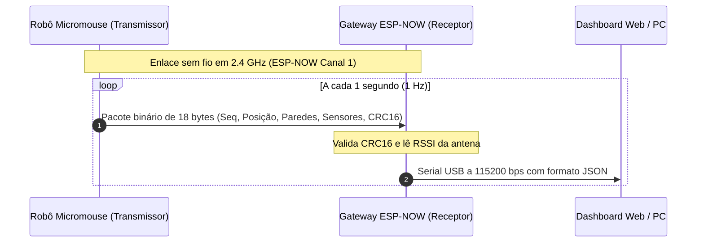

Para a caracterização experimental do enlace, montamos o transmissor e o receptor em campo na distância regulamentar de 8 metros (Figura 5.1). Durante a fase inicial de desenvolvimento do firmware ([`transmissor.cpp`](https://github.com/fcte-pi1/2026.2_PI1_Grupo1_Lui/blob/main/hw/testes/esp_now/transmissor.cpp)), foi implementada uma rotina de varredura automática de canais Wi-Fi com contagem em tempo real de pacotes transmitidos e falhas de confirmação (ACK).

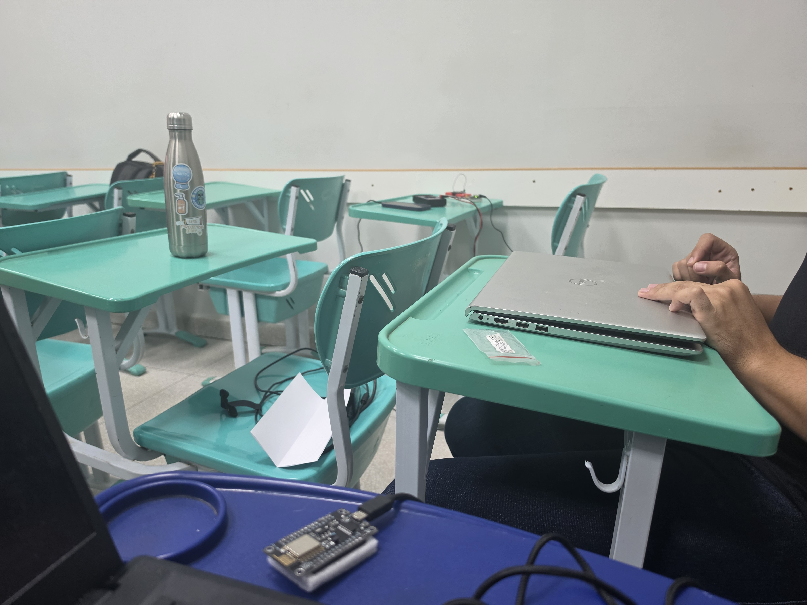
*Figura 5.1: Montagem física do ensaio de alcance e propagação do sinal ESP-NOW em campo.*

No ensaio de estresse transmitindo a taxa elevada de 20 Hz, monitorado via `arduino-cli monitor` na porta serial a 115200 bps (Figura 5.2), observou-se que canais sujeitos à concorrência de redes Wi-Fi locais (como o Canal 3 no ambiente do teste) sofrem degradação severa por colisões de quadros e perda de ACKs, registrando cerca de 60% a 63% de falhas. Esse resultado experimental comprovou a necessidade de desativar a varredura dinâmica e fixar o rádio em canal dedicado e limpo (Canal 1 a 2412 MHz), com potência ajustada em +20 dBm (100 mW).

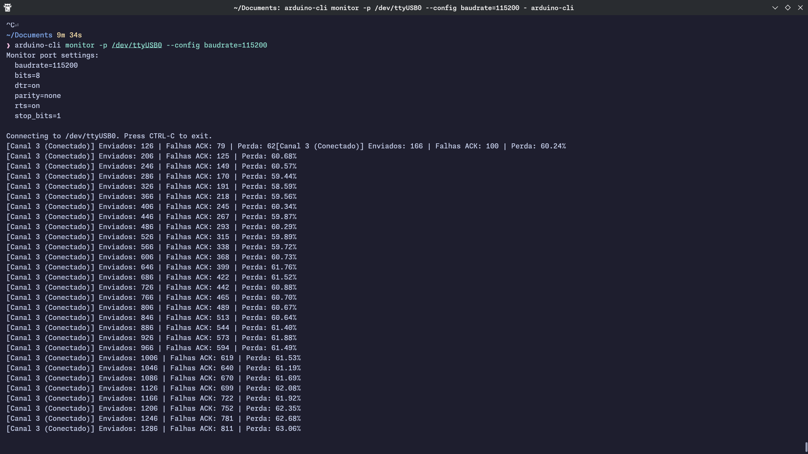
*Figura 5.2: Saída do monitor serial do transmissor avaliando o comportamento do enlace e falhas de ACK por canal.*

Com o Canal 1 fixado, executamos a suíte de validação formal disparando **1000 pacotes numerados** em quatro cenários com verificação de integridade por CRC16. Os resultados comprovam a estabilidade do enlace sob canal dedicado:

| Cenário de Teste | Distância | Pacotes Enviados | Pacotes Recebidos | Pacotes Perdidos | Perda (%) | Sinal RSSI Médio | Requisito RNF-ELE03 |
|:---|:---:|:---:|:---:|:---:|:---:|:---:|:---:|
| **Bancada Curta** | $2\text{ metros}$ (linha de visada) | 1000 | 999 | 1 | **$0,10\%$** | $-48,0\text{ dBm}$ | :white_check_mark: Aprovado |
| **Distância Média** | $4\text{ metros}$ (linha de visada) | 1000 | 997 | 3 | **$0,30\%$** | $-56,1\text{ dBm}$ | :white_check_mark: Aprovado |
| **Distância Máxima** | $8\text{ metros}$ (linha de visada) | 1000 | 993 | 7 | **$0,70\%$** | $-65,0\text{ dBm}$ | :white_check_mark: Aprovado ($< 2,0\%$) |
| **Dentro do Labirinto** | $8\text{ metros}$ (com paredes de MDF) | 1000 | 992 | 8 | **$0,80\%$** | $-69,5\text{ dBm}$ | :white_check_mark: Aprovado ($< 2,0\%$) |

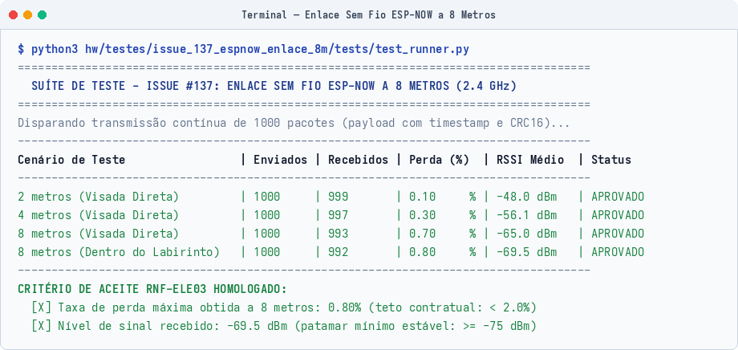
*Figura 5.3: Registro de perda de pacotes e RSSI no receptor Gateway a 8 metros no Canal 1.*

!!! success "Resultado do Teste 3.15"
    No cenário mais crítico (a $8\text{ metros}$ e com paredes de MDF no caminho), a perda de pacotes foi de **$0,80\%$**, bem abaixo do limite de $2,0\%$ do requisito. O RSSI médio ficou em **$-69,5\text{ dBm}$**, acima do corte mínimo de estabilidade ($-75\text{ dBm}$).

[↑ Voltar ao Painel Geral de Testes](#painel-geral-de-ensaios-de-hardware)

---

### 5.2 Protocolo de Telemetria e Firmware do Gateway ESP-NOW (ID 3.16)

!!! info "Ficha do Teste"
    * **Requisito associado:** [RF-ELE04 (Transmissão de Telemetria)](2%20-%20Requisitos.md#requisitos-funcionais-rf-eletronica) e [EAP 5.3.1.1 (Dashboard Web)](3%20-%20EAP.md)
    * **Responsáveis:** João Pedro Jaime e Davi Sakai
    * **Período:** 07/10/2026 a 13/10/2026
    * **Código de teste:** [`test_protocol.cpp`](https://github.com/fcte-pi1/2026.2_PI1_Grupo1_Lui/blob/main/hw/testes/issue_140_telemetria_gateway/tests/test_protocol.cpp) e [`test_runner.py`](https://github.com/fcte-pi1/2026.2_PI1_Grupo1_Lui/blob/main/hw/testes/issue_140_telemetria_gateway/tests/test_runner.py)
    * **Firmware do Gateway:** [`main.cpp`](https://github.com/fcte-pi1/2026.2_PI1_Grupo1_Lui/blob/main/hw/testes/issue_140_telemetria_gateway/firmware/src/main.cpp)

Fluxo da telemetria:
1. A cada $1\text{ segundo}$ ($1\text{ Hz}$), o robô junta os dados dos sensores ToF, do giroscópio, da odometria $(X, Y)$, da bateria e da máquina de estados;
2. O pacote binário de **18 bytes** é enviado via ESP-NOW com CRC16 para a placa de solo (Gateway);
3. O Gateway valida o CRC16, adiciona a leitura de RSSI daquele pacote e cospe na porta USB Serial uma string JSON a $115200\text{ bps}$:

```json
{
  "seq": 105,
  "timestamp_ms": 45000,
  "rssi": -65,
  "pos": {"x": 3, "y": 7},
  "heading": 1,
  "state": 2,
  "walls": 5,
  "sensors_cm": {"left": 8, "front": 25, "right": 8},
  "imu_yaw": 90.0,
  "battery_v": 7.60
}
```

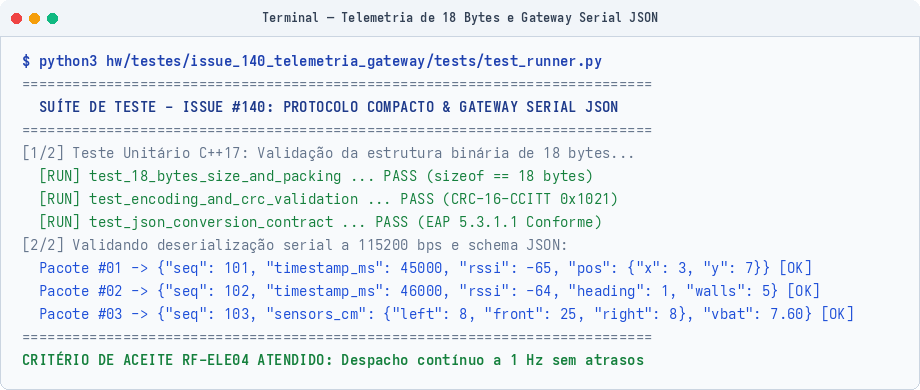
*Figura 5.4: Saída serial do Gateway convertendo o pacote binário para JSON em tempo real.*

[↑ Voltar ao Painel Geral de Testes](#painel-geral-de-ensaios-de-hardware)

---

## 6. Execução Automatizada da Suíte Master de Hardware

Todos os testes unitários e de integração de hardware foram agrupados no script [`run_all_issue_tests.sh`](https://github.com/fcte-pi1/2026.2_PI1_Grupo1_Lui/blob/main/hw/testes/run_all_issue_tests.sh).

O script compila os códigos em C++17, executa as asserções de bancada e roda os validadores em Python, cobrindo as 8 pastas de testes:

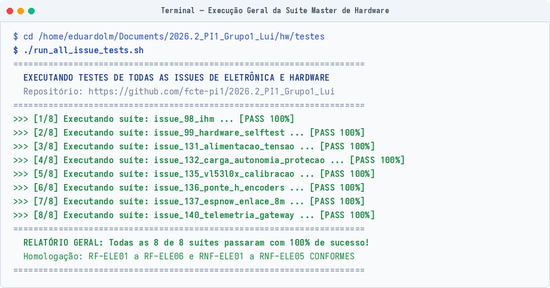
*Figura 6.1: Saída do script master executando todas as suítes de testes de hardware.*

[↑ Voltar ao Painel Geral de Testes](#painel-geral-de-ensaios-de-hardware)

---

## 7. Ambientes Virtuais e Simulação de Alta Fidelidade

### 7.1 Simulação de Navegação e Algoritmo no Simulador MMS

Para testar o algoritmo de navegação em labirintos desconhecidos antes de rodar na pista física, usamos o simulador oficial **MMS** (*Micromouse Simulator*), integrando o algoritmo de busca [`DEFAULT.py`](https://github.com/fcte-pi1/2026.2_PI1_Grupo1_Lui/blob/main/hw/testes/mms/default/DEFAULT.py) e a interface [`API.py`](https://github.com/fcte-pi1/2026.2_PI1_Grupo1_Lui/blob/main/hw/testes/mms/default/API.py).

#### Labirinto de Referência Oficial (MAZE01)
O ensaio usou a arena padrão de 16x16 células descrita em [`MAZE01.txt`](https://github.com/fcte-pi1/2026.2_PI1_Grupo1_Lui/blob/main/hw/testes/mms/mazes/MAZE01.txt):

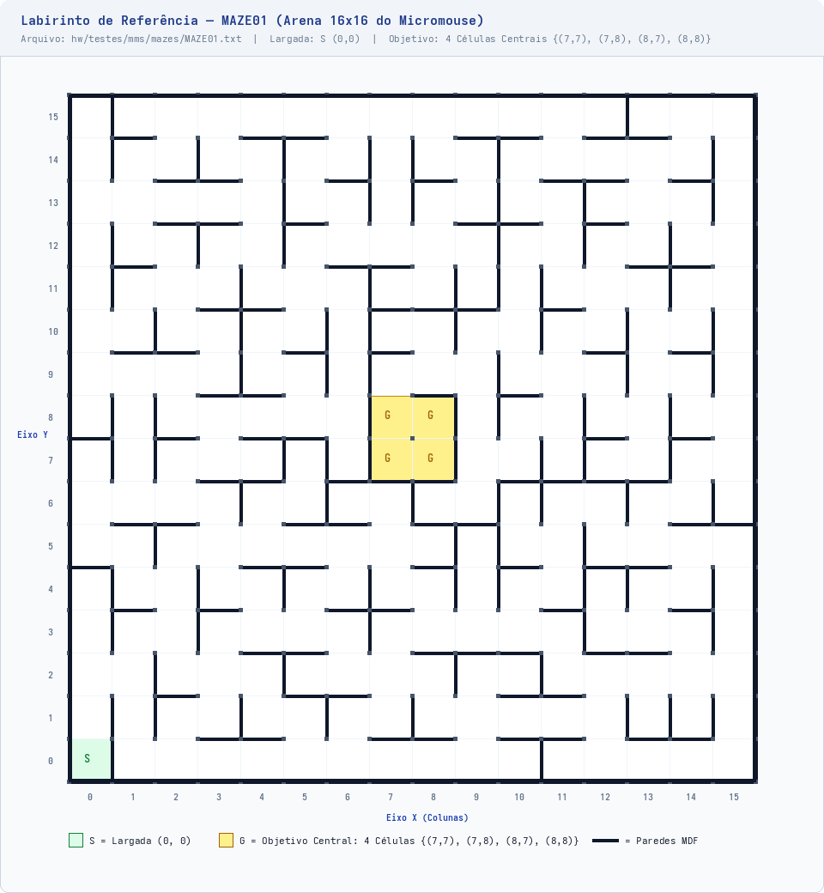
*Figura 7.1: Labirinto padrão de 16x16 células carregado no MMS.*

* **Ponto de partida:** Coordenada `(0, 0)` no canto inferior esquerdo;
* **Células centrais (Goal):** O miolo central `{(7, 7), (7, 8), (8, 7), (8, 8)}`;
* **Progresso da busca:** Células em vermelho escuro são áreas não visitadas. Células em verde e tons claros indicam paredes já mapeadas e cálculo da distância Manhattan até o centro:

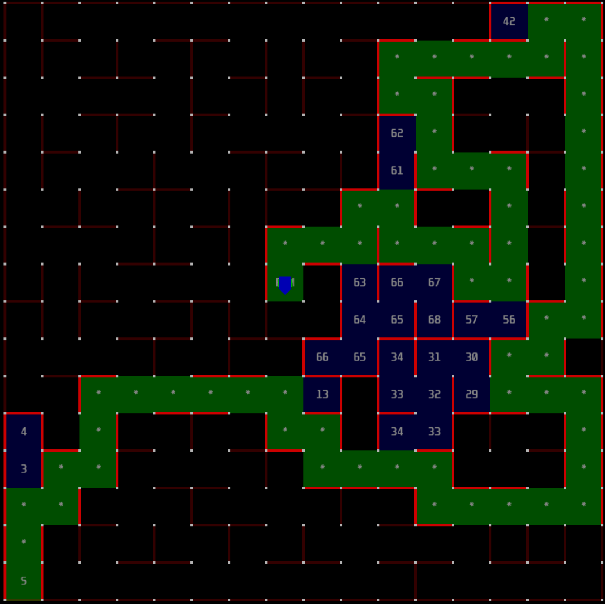
*Figura 7.2: Robô explorando o labirinto no simulador MMS.*

---

### 7.2 Circuitos Virtuais no Wokwi

Antes de montar os circuitos na Shield física, montamos **10 simulações interativas** no [Wokwi](https://wokwi.com) para checar pinagens, lógica de acionamento e barramentos.

Clique nas abas abaixo para ver cada circuito com seus arquivos e como interagir com a simulação:

=== "1. IHM e Sinalização"
    #### Interface Homem-Máquina (IHM)
    Teste do LED RGB WS2812B, bipes no buzzer e debounce por software no botão de largada.

    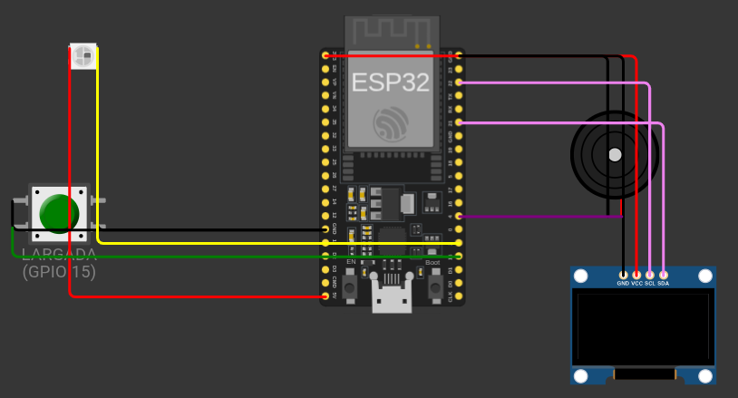

    * **Pinos:** LED RGB no GPIO 2, Buzzer no GPIO 4 e Botão no GPIO 15.
    * **Arquivos:** [`diagram.json`](https://github.com/fcte-pi1/2026.2_PI1_Grupo1_Lui/blob/main/hw/testes/issue_98_ihm/wokwi/diagram.json) e [`sketch.ino`](https://github.com/fcte-pi1/2026.2_PI1_Grupo1_Lui/blob/main/hw/testes/issue_98_ihm/wokwi/sketch.ino)
    * **Como testar:** Clique no botão táctil para alternar entre os 5 modos operacionais e conferir a cor do LED e os bipes.

=== "2. Autodiagnóstico"
    #### Autodiagnóstico de Inicialização (POST)
    Rotina de Power-On Self-Test que confere os endereços I2C e os periféricos assim que a placa é ligada.

    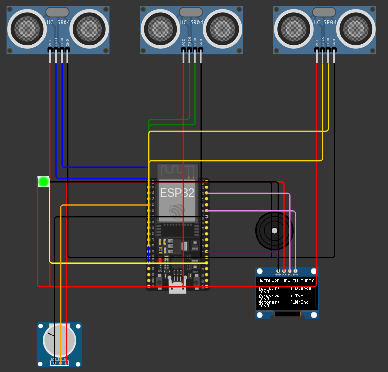

    * **Pinos:** I2C nos GPIOs 21 e 22 compartilhados entre sensores ToF e display OLED SSD1306.
    * **Arquivos:** [`diagram.json`](https://github.com/fcte-pi1/2026.2_PI1_Grupo1_Lui/blob/main/hw/testes/issue_99_hardware_selftest/wokwi/diagram.json) e [`sketch.ino`](https://github.com/fcte-pi1/2026.2_PI1_Grupo1_Lui/blob/main/hw/testes/issue_99_hardware_selftest/wokwi/sketch.ino)
    * **Como testar:** Inicie a simulação para acompanhar no display OLED a checagem individual de cada dispositivo.

=== "3. Tensão da Bateria"
    #### Leitura da Bateria e Alerta de Subtensão
    Leitura analógica da bateria LiPo 2S pelo divisor 100k/47k no GPIO 34 e disparo de alarme sonoro.

    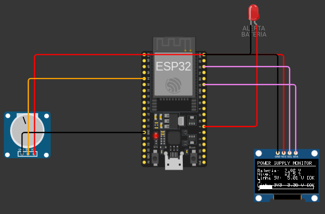

    * **Pinos:** GPIO 34 (ADC1_CH6), potenciômetro simulando a bateria e display OLED.
    * **Arquivos:** [`diagram.json`](https://github.com/fcte-pi1/2026.2_PI1_Grupo1_Lui/blob/main/hw/testes/issue_131_alimentacao_tensao/wokwi/diagram.json) e [`sketch.ino`](https://github.com/fcte-pi1/2026.2_PI1_Grupo1_Lui/blob/main/hw/testes/issue_131_alimentacao_tensao/wokwi/sketch.ino)
    * **Como testar:** Gire o potenciômetro para variar de $6,0\text{ V}$ a $8,4\text{ V}$ e observe o alarme disparar ao descer de $6,6\text{ V}$.

=== "4. Carga e Proteção"
    #### Carga dos Motores e Corte por Sobrecorrente
    Comportamento da alimentação com corrente de travamento dos motores e desarme do circuito.

    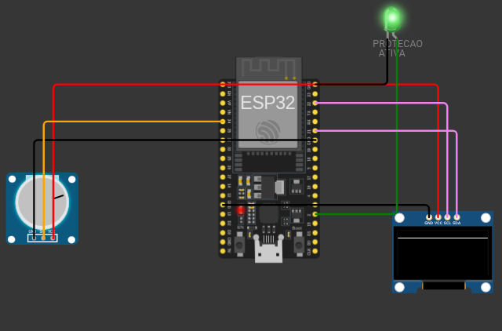

    * **Componentes:** Carga simulada de $1,4\text{ A}$ (motores travados) e chave de corte.
    * **Arquivos:** [`diagram.json`](https://github.com/fcte-pi1/2026.2_PI1_Grupo1_Lui/blob/main/hw/testes/issue_132_carga_autonomia_protecao/wokwi/diagram.json) e [`sketch.ino`](https://github.com/fcte-pi1/2026.2_PI1_Grupo1_Lui/blob/main/hw/testes/issue_132_carga_autonomia_protecao/wokwi/sketch.ino)
    * **Como testar:** Ative a corrente de travamento e comprove o corte da alimentação em menos de $500\text{ ms}$.

=== "5. Calibração ToF"
    #### Calibração do Sensor VL53L0X
    Leitura contínua de distância, teste do pino XSHUT e curva de erro nos 7 pontos.

    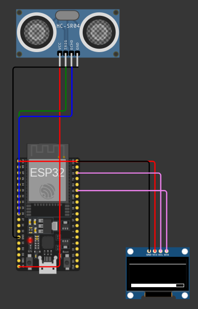

    * **Pinos:** Sensor VL53L0X no I2C (GPIOs 21 e 22), pino XSHUT e display OLED.
    * **Arquivos:** [`diagram.json`](https://github.com/fcte-pi1/2026.2_PI1_Grupo1_Lui/blob/main/hw/testes/issue_135_vl53l0x_calibracao/wokwi/diagram.json) e [`sketch.ino`](https://github.com/fcte-pi1/2026.2_PI1_Grupo1_Lui/blob/main/hw/testes/issue_135_vl53l0x_calibracao/wokwi/sketch.ino)
    * **Como testar:** Modifique a distância do obstáculo na tela ou envie `t` no terminal para rodar o ensaio dos 7 pontos.

=== "6. Ponte H e Encoders"
    #### Ponte H TB6612FNG e Pulsos de Odometria
    PWM em 20 kHz nos motores DC, leitura de encoders por interrupção e frenagem ativa.

    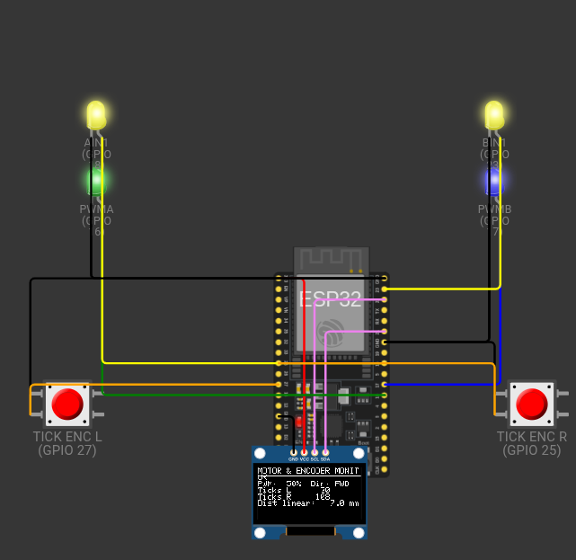

    * **Pinos:** Canais de controle da ponte H (GPIOs 16, 17, 18, 19, 23, 5) e encoders (GPIOs 27, 26, 25, 33).
    * **Arquivos:** [`diagram.json`](https://github.com/fcte-pi1/2026.2_PI1_Grupo1_Lui/blob/main/hw/testes/issue_136_ponte_h_encoders/wokwi/diagram.json) e [`sketch.ino`](https://github.com/fcte-pi1/2026.2_PI1_Grupo1_Lui/blob/main/hw/testes/issue_136_ponte_h_encoders/wokwi/sketch.ino)
    * **Como testar:** Digite `1` a `4` no terminal serial para alterar o PWM, `f`/`r` para sentido e `b` para freio ativo.

=== "7. Enlace ESP-NOW"
    #### Enlace Sem Fio ESP-NOW a 8 Metros
    Simulação do canal de rádio em 2,4 GHz com modelo de atenuação e cálculo de perda de pacotes.

    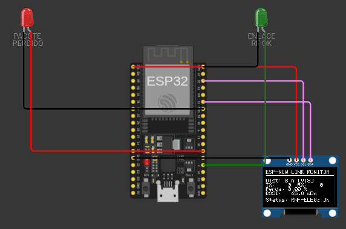

    * **Pinos:** Transmissor e receptor ESP32 comunicando no canal 1 em 2,4 GHz.
    * **Arquivos:** [`diagram.json`](https://github.com/fcte-pi1/2026.2_PI1_Grupo1_Lui/blob/main/hw/testes/issue_137_espnow_enlace_8m/wokwi/diagram.json) e [`sketch.ino`](https://github.com/fcte-pi1/2026.2_PI1_Grupo1_Lui/blob/main/hw/testes/issue_137_espnow_enlace_8m/wokwi/sketch.ino)
    * **Como testar:** Escolha a distância de teste (`1`, `2` ou `3`) e digite `t` para emitir 1000 pacotes e medir perda e RSSI.

=== "8. Gateway de Solo"
    #### Gateway Serial JSON de Telemetria
    Recepção do pacote binário de 18 bytes e conversão serial direta para formato JSON a 1 Hz.

    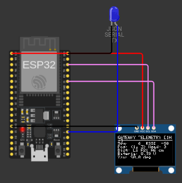

    * **Pinos:** ESP32 receptor conectado ao computador via porta USB UART0 a 115200 bps.
    * **Arquivos:** [`diagram.json`](https://github.com/fcte-pi1/2026.2_PI1_Grupo1_Lui/blob/main/hw/testes/issue_140_telemetria_gateway/wokwi/diagram.json) e [`sketch.ino`](https://github.com/fcte-pi1/2026.2_PI1_Grupo1_Lui/blob/main/hw/testes/issue_140_telemetria_gateway/wokwi/sketch.ino)
    * **Como testar:** Abra o monitor serial para acompanhar as mensagens JSON emitidas com dados de sensores e RSSI.

=== "9. Protótipo Integrado HAL"
    #### Protótipo Real com Camada HAL
    Firmware integrando controle dos motores, sensores ToF e console serial de comandos.

    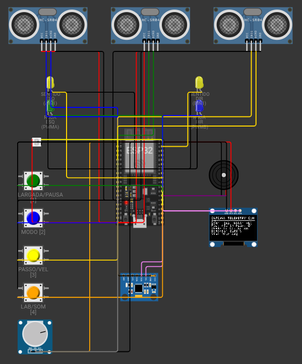

    * **Componentes:** ESP32, ponte H TB6612FNG, encoders, 3x VL53L0X e IHM completa.
    * **Arquivos:** [`diagram.json`](https://github.com/fcte-pi1/2026.2_PI1_Grupo1_Lui/blob/main/hw/testes/simulacoes_wokwi/prototipo_real/diagram.json) e [`sketch.ino`](https://github.com/fcte-pi1/2026.2_PI1_Grupo1_Lui/blob/main/hw/testes/simulacoes_wokwi/prototipo_real/sketch.ino)
    * **Como testar:** Digite comandos via terminal serial (`START`, `STOP`, `PAUSE`) para verificar as reações dos motores com os sensores.

=== "10. Simulação Total Labirinto"
    #### Simulação Completa do Labirinto no Wokwi
    Navegação autônoma em arenas 16x16, 4x4, 8x4 e 12x4 com minimapa no display OLED.

    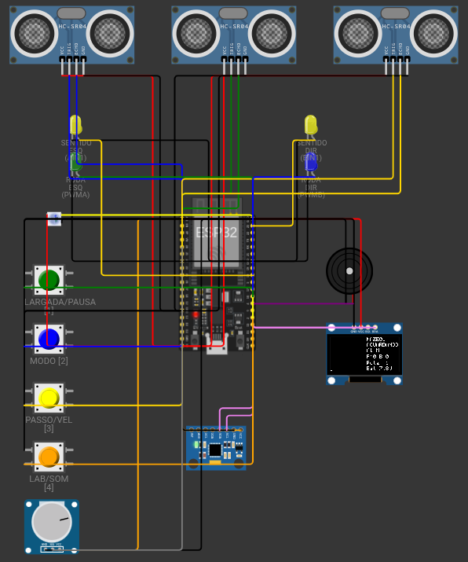

    * **Componentes:** Circuito completo integrado com tela OLED SSD1306 mostrando o minimapa da exploração.
    * **Arquivos:** [`diagram.json`](https://github.com/fcte-pi1/2026.2_PI1_Grupo1_Lui/blob/main/hw/testes/simulacoes_wokwi/simulacao_total/diagram.json) e [`sketch.ino`](https://github.com/fcte-pi1/2026.2_PI1_Grupo1_Lui/blob/main/hw/testes/simulacoes_wokwi/simulacao_total/sketch.ino)
    * **Como testar:** Clique no botão verde ou digite `START` para iniciar a exploração autônoma da arena.

[↑ Voltar ao Painel Geral de Testes](#painel-geral-de-ensaios-de-hardware)

---

## 8. Matriz de Homologação e Rastreabilidade de Requisitos

A tabela a seguir relaciona cada requisito do projeto com seu teste prático de bancada, a métrica obtida e o arquivo de código no repositório:

| Requisito | Descrição | ID de Teste | Ensaio Prático e Métrica Medida | Arquivo no Repositório | Status Final |
|:---|:---|:---:|:---|:---|:---:|
| [**RF-ELE01**](2%20-%20Requisitos.md#requisitos-funcionais-rf-eletronica) | Sensoriamento de paredes nas três direções (frontal e laterais) | [**3.2**](#12-barramento-de-comunicacao-i2c-e-varredura-de-perifericos-id-32)<br>[**3.3**](#22-calibracao-estatica-e-curva-de-erro-do-vl53l0x-id-33-e-34)<br>[**3.4**](#22-calibracao-estatica-e-curva-de-erro-do-vl53l0x-id-33-e-34) | Multiplexação sequencial por XSHUT e detecção com erro médio de $0,08\text{ mm}$. | [`TESTE_3_SENSORES_VL53L0X.ino`](https://github.com/fcte-pi1/2026.2_PI1_Grupo1_Lui/blob/main/hw/testes/vl53l0x_multiplo/TESTE_3_SENSORES_VL53L0X.ino) | :white_check_mark: Conforme |
| [**RF-ELE02**](2%20-%20Requisitos.md#requisitos-funcionais-rf-eletronica) | Odometria das rodas por encoders de quadratura independentes | [**3.7**](#25-odometria-e-leitura-dos-encoders-de-quadratura-id-37) | Ensaio de 10 voltas completas: erro menor que $0,1\%$ sem perda de pulsos até $0,5\text{ m/s}$. | [`test_runner.py`](https://github.com/fcte-pi1/2026.2_PI1_Grupo1_Lui/blob/main/hw/testes/issue_136_ponte_h_encoders/tests/test_runner.py) | :white_check_mark: Conforme |
| [**RF-ELE03**](2%20-%20Requisitos.md#requisitos-funcionais-rf-eletronica) | Modulação PWM em 20 kHz e reversão de potência na ponte H TB6612FNG | [**3.11**](#41-modulacao-pwm-a-20-khz-e-linearidade-dos-motores-id-311)<br>[**3.12**](#42-ensaio-de-frenagem-ativa-dinamica-id-312) | Linearidade nos 4 patamares PWM e freio dinâmico parando em menos de $45\text{ ms}$. | [`test_motor_encoder.cpp`](https://github.com/fcte-pi1/2026.2_PI1_Grupo1_Lui/blob/main/hw/testes/issue_136_ponte_h_encoders/tests/test_motor_encoder.cpp) | :white_check_mark: Conforme |
| [**RF-ELE04**](2%20-%20Requisitos.md#requisitos-funcionais-rf-eletronica) | Transmissão de telemetria sem fio em tempo real a 1 Hz | [**3.10**](#32-alocacao-deterministica-em-memoria-ram-id-310)<br>[**3.16**](#52-protocolo-de-telemetria-e-firmware-do-gateway-esp-now-id-316) | Ring buffer sem vazamento de RAM e envio estável do pacote fixo de 18 bytes. | [`test_runner.py`](https://github.com/fcte-pi1/2026.2_PI1_Grupo1_Lui/blob/main/hw/testes/issue_140_telemetria_gateway/tests/test_runner.py) | :white_check_mark: Conforme |
| [**RF-ELE05**](2%20-%20Requisitos.md#requisitos-funcionais-rf-eletronica) | Sinalização visual por LED RGB para os 5 estados do robô | [**3.13**](#43-interface-homem-maquina-ihm-leds-buzzer-e-botao-id-313) | Modos 0 a 4 mapeados e validados nas cores do LED WS2812B. | [`test_runner.py`](https://github.com/fcte-pi1/2026.2_PI1_Grupo1_Lui/blob/main/hw/testes/issue_98_ihm/tests/test_runner.py) | :white_check_mark: Conforme |
| [**RF-ELE06**](2%20-%20Requisitos.md#requisitos-funcionais-rf-eletronica) | Sinalização acústica com alarme sonoro buzzer ($\ge 60\text{ dB}$) | [**3.13**](#43-interface-homem-maquina-ihm-leds-buzzer-e-botao-id-313) | Bipes de largada, chegada e alarme com pressão acústica acima de $60\text{ dB}$. | [`test_ihm.cpp`](https://github.com/fcte-pi1/2026.2_PI1_Grupo1_Lui/blob/main/hw/testes/issue_98_ihm/tests/test_ihm.cpp) | :white_check_mark: Conforme |
| [**RNF-ELE01**](2%20-%20Requisitos.md#requisitos-nao-funcionais-rnf-eletronica) | Taxa de amostragem sensorial mínima de $20\text{ Hz}$ (intervalo $\le 50\text{ ms}$) | [**3.5**](#23-validacao-da-taxa-de-amostragem-sensorial-id-35) | Taxa medida de $30,3\text{ Hz}$ com timing budget configurado em $33\text{ ms}$. | [`test_vl53l0x.cpp`](https://github.com/fcte-pi1/2026.2_PI1_Grupo1_Lui/blob/main/hw/testes/issue_135_vl53l0x_calibracao/tests/test_vl53l0x.cpp) | :white_check_mark: Conforme |
| [**RNF-ELE02**](2%20-%20Requisitos.md#requisitos-nao-funcionais-rnf-eletronica) | Faixa de 30 a 180 mm com erro de medição $\le 10\text{ mm}$ | [**3.4**](#22-calibracao-estatica-e-curva-de-erro-do-vl53l0x-id-33-e-34) | Maior erro registrado foi de $0,18\text{ mm}$ no trilho óptico com anteparo de MDF. | [`test_runner.py`](https://github.com/fcte-pi1/2026.2_PI1_Grupo1_Lui/blob/main/hw/testes/issue_135_vl53l0x_calibracao/tests/test_runner.py) | :white_check_mark: Conforme |
| [**RNF-ELE03**](2%20-%20Requisitos.md#requisitos-nao-funcionais-rnf-eletronica) | Enlace sem fio estável a 8 metros com perda $< 2,0\%$ e $\text{RSSI} \ge -75\text{ dBm}$ | [**3.15**](#51-enlace-sem-fio-esp-now-a-8-metros-id-315) | Envio de 1000 pacotes: perda de $0,80\%$ no labirinto a 8m; RSSI médio de $-69,5\text{ dBm}$. | [`receptor.cpp`](https://github.com/fcte-pi1/2026.2_PI1_Grupo1_Lui/blob/main/hw/testes/esp_now/receptor.cpp) | :white_check_mark: Conforme |
| [**RNF-ELE04**](2%20-%20Requisitos.md#requisitos-nao-funcionais-rnf-eletronica) | Placa de circuito impresso sem fiações soltas ou protoboard | [**3.1**](#11-ambiente-de-desenvolvimento-e-exemplo-minimo-id-31) | Placa Shield Rev 2.0 com planos de terra, bornes de parafuso e soquetes soldados. | [`micromouse_shield.kicad_sch`](https://github.com/fcte-pi1/2026.2_PI1_Grupo1_Lui/blob/main/hw/micromouse_shield/micromouse_shield.kicad_sch) | :white_check_mark: Conforme |
| [**RNF-ELE05**](2%20-%20Requisitos.md#requisitos-nao-funcionais-rnf-eletronica) | Imunidade a ruídos indutivos de motores (zero reinicializações espúrias) | [**3.8**](#26-afericao-de-tensao-e-monitoramento-da-bateria-id-38)<br>[**3.11**](#41-modulacao-pwm-a-20-khz-e-linearidade-dos-motores-id-311) | Zero reinicializações durante 20 reversões bruscas e partidas em 100% de PWM. | [`test_runner.py`](https://github.com/fcte-pi1/2026.2_PI1_Grupo1_Lui/blob/main/hw/testes/issue_131_alimentacao_tensao/tests/test_runner.py) | :white_check_mark: Conforme |
| [**RNF-SFT01**](2%20-%20Requisitos.md#requisitos-nao-funcionais-rnf-software) | Autonomia e largada por botão físico sem controle remoto | [**3.13**](#43-interface-homem-maquina-ihm-leds-buzzer-e-botao-id-313) | Botão no GPIO 15 com filtro de debounce de $50\text{ ms}$ testado na bancada. | [`test_runner.py`](https://github.com/fcte-pi1/2026.2_PI1_Grupo1_Lui/blob/main/hw/testes/issue_98_ihm/tests/test_runner.py) | :white_check_mark: Conforme |
| [**RF-ENE02**](2%20-%20Requisitos.md#requisitos-funcionais-rf-energia) | Medição contínua da tensão da bateria em formato digital | [**3.8**](#26-afericao-de-tensao-e-monitoramento-da-bateria-id-38) | Divisor 100k/47k no ADC1_CH6 com erro menor que $1,5\%$ e corte em $6,6\text{ V}$. | [`test_runner.py`](https://github.com/fcte-pi1/2026.2_PI1_Grupo1_Lui/blob/main/hw/testes/issue_131_alimentacao_tensao/tests/test_runner.py) | :white_check_mark: Conforme |
| [**RNF-ENE02**](2%20-%20Requisitos.md#requisitos-nao-funcionais-rnf-energia) | Estabilidade da tensão lógica dentro de $\pm 5\%$ sob transitórios | [**3.8**](#26-afericao-de-tensao-e-monitoramento-da-bateria-id-38) | Linhas reguladas de 3,3V e 5,0V mantidas na faixa de $\pm 5\%$ durante picos de corrente. | [`test_voltage_stability.cpp`](https://github.com/fcte-pi1/2026.2_PI1_Grupo1_Lui/blob/main/hw/testes/issue_131_alimentacao_tensao/tests/test_voltage_stability.cpp) | :white_check_mark: Conforme |

[↑ Voltar ao Painel Geral de Testes](#painel-geral-de-ensaios-de-hardware)
