# Testes de Software
## Testes de _software_

> Apresentar com detalhes os testes feitos para conferir se os objetivos do *software* foram atendidos.
>
> - Listar as histórias de usuários e seus respectivos protótipos  implementadas.
> - Associar as histórias de usuários e os casos de testes funcionais implementados.
> - Enviar o print da execução dos suítes de testes automatizados em nível:
>   - Unitário e integração, com cobertura de código-fonte de pelo menos 80%;
>   - Sistema, do tipo funcional (end-to-end E2E).
>
> **Observações:**
>
> 1. Em relação ao *backlog* do produto, será considerado como referência aquele descrito no primeiro ponto de controle, contemplando as correções e *feedbacks* da-os professora(e)s. O ideal seria a real atualização entre o planejado X realizado.
> 2. Os testes mencionados nesta subseção dizem respeito aos testes de *software*. O Roteiro de testes funcionais, entregue no primeiro ponto de controle deve ser corrigido a partir do apontamento da-os professora(e)s. Além disso, ele deve guiar a execução dos testes E2E automatizados. O conjunto de casos de testes funcionais documentados devem estar coerentes com a automação via interface gráfica de entrada de dados.
>
> Exemplos de ferramentas de teste funcionais E2E:
>
> - Selenium
> - Cypress
> - Playwright
>
> Exemplos de ferramentas de testes em nível unitário e integração:
>
> - Jest
> - unittest
> - pytest
> - tox
> - gTest
> - Catch2

Este documento consolida os testes de *software* do Grupo 1 no segundo ponto de controle. Ele cobre os três elementos de *software* do produto, conforme a arquitetura do [Projeto conceitual de software](https://github.com/fcte-pi1/2026.2_PI1_Grupo1_Lui/blob/main/docs/4.4%20-%20Projeto%20conceitual%20de%20software.md) (doc 4.4):

- **Firmware**, embarcado no ESP32 do robô e no ESP32 de bancada (gateway), testado com Unity no ambiente nativo do PlatformIO;
- **Backend**, em Python com FastAPI, testado com pytest;
- **Frontend**, em React, testado com Vitest nos níveis unitário e de integração e com Playwright no nível de sistema (E2E).

Os testes, a cobertura e os prints foram medidos em **25/10/2026**, sobre o *commit* `85fa9d1` da branch `main`, que inclui todos os PRs mesclados até essa data, entre eles os testes E2E ([#176](https://github.com/fcte-pi1/2026.2_PI1_Grupo1_Lui/pull/176)). A correção de instabilidade dos testes E2E ([PR #177](https://github.com/fcte-pi1/2026.2_PI1_Grupo1_Lui/pull/177)) foi mesclada depois dessa medição, e o resultado dela no CI (Frontend CI #22) está na seção 4. A situação das histórias de usuário foi conferida no GitHub na mesma data. A verificação automática das 9 combinações do simulador (seção 5) foi feita em 17/10/2026, durante o PR #165, e está registrada na descrição dele. As evidências estão em [`docs/evidencias/5.3.2.2`](https://github.com/fcte-pi1/2026.2_PI1_Grupo1_Lui/tree/main/docs/evidencias/5.3.2.2) (cobertura, CI e painel) e em [`docs/evidencias/5.3.2.1`](https://github.com/fcte-pi1/2026.2_PI1_Grupo1_Lui/tree/main/docs/evidencias/5.3.2.1) (testes E2E).

---

### 1. Histórias de usuário implementadas e protótipos

O *backlog* de referência é o da seção 3 do doc 4.4 (19 histórias de usuário, HU-01 a HU-19). A situação de cada HU considera os critérios de aceitação da própria HU, e não apenas o estado da issue:

- **Concluída:** os critérios de aceitação foram atendidos e a issue foi fechada após a revisão do PR.
- **Aguardando validação no robô:** o código e os testes foram mesclados na `main`, mas algum critério de aceitação só pode ser comprovado com o robô montado (seção 7).
- **Aguardando integração com a API do histórico:** o código e os testes foram mesclados na `main`, mas a funcionalidade só opera com dados reais quando existirem a persistência das corridas (HU-12) e a API do histórico ([#142](https://github.com/fcte-pi1/2026.2_PI1_Grupo1_Lui/issues/142)).
- **Pendente:** ainda não implementada.

| HU | História | Épico | Situação | Issue | PR(s) | Protótipo |
|:---|:---|:---|:---|:---|:---|:---|
| HU-01 | Manter o robô centralizado nas retas | RF-SFT01 | Aguardando validação no robô | [#32](https://github.com/fcte-pi1/2026.2_PI1_Grupo1_Lui/issues/32) | [#167](https://github.com/fcte-pi1/2026.2_PI1_Grupo1_Lui/pull/167) | - |
| HU-02 | Executar curvas de 90 graus com precisão | RF-SFT01 | Aguardando validação no robô | [#33](https://github.com/fcte-pi1/2026.2_PI1_Grupo1_Lui/issues/33) | [#175](https://github.com/fcte-pi1/2026.2_PI1_Grupo1_Lui/pull/175) | - |
| HU-03 | Registrar as paredes de cada célula visitada | RF-SFT02 | Concluída | [#35](https://github.com/fcte-pi1/2026.2_PI1_Grupo1_Lui/issues/35) | [#161](https://github.com/fcte-pi1/2026.2_PI1_Grupo1_Lui/pull/161) | - |
| HU-04 | Selecionar a geometria da pista antes da largada | RF-SFT02 | Concluída | [#36](https://github.com/fcte-pi1/2026.2_PI1_Grupo1_Lui/issues/36) | [#156](https://github.com/fcte-pi1/2026.2_PI1_Grupo1_Lui/pull/156) | - |
| HU-05 | Dar a largada por botão físico | RF-SFT03 | Concluída | [#38](https://github.com/fcte-pi1/2026.2_PI1_Grupo1_Lui/issues/38) | [#162](https://github.com/fcte-pi1/2026.2_PI1_Grupo1_Lui/pull/162) | [Painel em espera](https://github.com/fcte-pi1/2026.2_PI1_Grupo1_Lui/blob/main/docs/figs/dashboard-4x4-parado.png) |
| HU-06 | Decidir o caminho de forma autônoma | RF-SFT03 | Aguardando validação no robô | [#39](https://github.com/fcte-pi1/2026.2_PI1_Grupo1_Lui/issues/39) | [#168](https://github.com/fcte-pi1/2026.2_PI1_Grupo1_Lui/pull/168) | - |
| HU-07 | Parar automaticamente ao chegar no objetivo | RF-SFT04 | Aguardando validação no robô | [#41](https://github.com/fcte-pi1/2026.2_PI1_Grupo1_Lui/issues/41) | [#164](https://github.com/fcte-pi1/2026.2_PI1_Grupo1_Lui/pull/164), [#165](https://github.com/fcte-pi1/2026.2_PI1_Grupo1_Lui/pull/165) | - |
| HU-08 | Transmitir os dados da prova a cada segundo | RF-SFT05 | Aguardando validação no robô | [#43](https://github.com/fcte-pi1/2026.2_PI1_Grupo1_Lui/issues/43) | [#159](https://github.com/fcte-pi1/2026.2_PI1_Grupo1_Lui/pull/159), [#170](https://github.com/fcte-pi1/2026.2_PI1_Grupo1_Lui/pull/170) | - |
| HU-09 | Ser avisado quando a conexão com o robô cair | RF-SFT05 | Pendente | [#44](https://github.com/fcte-pi1/2026.2_PI1_Grupo1_Lui/issues/44) | - | - |
| HU-10 | Visualizar o mapa do labirinto em tempo real | RF-SFT06 | Concluída | [#46](https://github.com/fcte-pi1/2026.2_PI1_Grupo1_Lui/issues/46) | [#158](https://github.com/fcte-pi1/2026.2_PI1_Grupo1_Lui/pull/158), [#165](https://github.com/fcte-pi1/2026.2_PI1_Grupo1_Lui/pull/165) | [4x4](https://github.com/fcte-pi1/2026.2_PI1_Grupo1_Lui/blob/main/docs/figs/dashboard-4x4.png), [8x4](https://github.com/fcte-pi1/2026.2_PI1_Grupo1_Lui/blob/main/docs/figs/dashboard-8x4.png), [12x4](https://github.com/fcte-pi1/2026.2_PI1_Grupo1_Lui/blob/main/docs/figs/dashboard-12x4.png) |
| HU-11 | Acompanhar os indicadores da prova | RF-SFT06 | Concluída | [#47](https://github.com/fcte-pi1/2026.2_PI1_Grupo1_Lui/issues/47) | [#157](https://github.com/fcte-pi1/2026.2_PI1_Grupo1_Lui/pull/157), [#165](https://github.com/fcte-pi1/2026.2_PI1_Grupo1_Lui/pull/165) | [4x4](https://github.com/fcte-pi1/2026.2_PI1_Grupo1_Lui/blob/main/docs/figs/dashboard-4x4.png) |
| HU-12 | Salvar automaticamente cada corrida | RF-SFT07 | Pendente | [#49](https://github.com/fcte-pi1/2026.2_PI1_Grupo1_Lui/issues/49) | - | - |
| HU-13 | Filtrar as corridas anteriores | RF-SFT08 | Aguardando integração com a API do histórico | [#51](https://github.com/fcte-pi1/2026.2_PI1_Grupo1_Lui/issues/51) | [#169](https://github.com/fcte-pi1/2026.2_PI1_Grupo1_Lui/pull/169) | [Histórico](https://github.com/fcte-pi1/2026.2_PI1_Grupo1_Lui/blob/main/docs/figs/prototipoHistoricoCorrida.png) |
| HU-14 | Rever o trajeto de uma corrida passada | RF-SFT08 | Aguardando integração com a API do histórico | [#52](https://github.com/fcte-pi1/2026.2_PI1_Grupo1_Lui/issues/52) | [#172](https://github.com/fcte-pi1/2026.2_PI1_Grupo1_Lui/pull/172) | [Histórico](https://github.com/fcte-pi1/2026.2_PI1_Grupo1_Lui/blob/main/docs/figs/prototipoHistoricoCorrida.png) |
| HU-15 | Calcular a rota mais curta após a exploração | RF-SFT09 | Pendente | [#54](https://github.com/fcte-pi1/2026.2_PI1_Grupo1_Lui/issues/54) | - | - |
| HU-16 | Executar o speed run | RF-SFT09 | Pendente | [#55](https://github.com/fcte-pi1/2026.2_PI1_Grupo1_Lui/issues/55) | - | - |
| HU-17 | Fazer curvas em movimento contínuo no speed run | RF-SFT10 | Pendente | [#57](https://github.com/fcte-pi1/2026.2_PI1_Grupo1_Lui/issues/57) | - | - |
| HU-18 | Cortar os motores quando as rodas travarem | RF-SFT11 | Aguardando validação no robô | [#59](https://github.com/fcte-pi1/2026.2_PI1_Grupo1_Lui/issues/59) | [#173](https://github.com/fcte-pi1/2026.2_PI1_Grupo1_Lui/pull/173) | - |
| HU-19 | Ver no painel que o robô travou | RF-SFT11 | Aguardando validação no robô | [#60](https://github.com/fcte-pi1/2026.2_PI1_Grupo1_Lui/issues/60) | [#174](https://github.com/fcte-pi1/2026.2_PI1_Grupo1_Lui/pull/174) | [Painel](https://github.com/fcte-pi1/2026.2_PI1_Grupo1_Lui/blob/main/docs/figs/dashboard-4x4.png) |

**Resumo:** 5 HUs concluídas, 7 aguardando validação no robô, 2 aguardando integração com a API do histórico e 5 pendentes. Em 25/10/2026, as issues da HU-01 (#32) e da HU-13 (#51) foram reabertas, com comentário no GitHub, para refletir os critérios de aceitação que ainda dependem do robô e da API do histórico, respectivamente.

Observações sobre as HUs que não estão concluídas:

- **HU-01:** o controle proporcional e derivativo (`ControleReta`) está implementado e testado com um modelo do robô. O critério de 3 células com desvio menor que 15 mm depende do robô montado.
- **HU-02:** o controle de curvas (`ControleCurva`) gira o robô no próprio eixo até um alvo absoluto, medido pelo IMU, com os encoders como conferência e alternativa. Nas simulações em malha fechada, o maior erro angular acumulado foi de cerca de 1,4°, contra o limite de 3°. O critério precisa ser comprovado no robô, e o procedimento físico ainda precisa ser definido (seção 6).
- **HU-06:** o navegador (exploração com planejamento em largura) está no `main.cpp` e alimenta posição, orientação e paredes da telemetria. Faltam os *drivers* reais de sensores e motores, que implementam as interfaces `SensoresParedes` e `ExecutorMovimento`, e o teste em pista.
- **HU-07:** o módulo `ParadaObjetivo` e o congelamento do cronômetro estão prontos e testados, mas ainda não são chamados no laço principal.
- **HU-08:** a telemetria a 1 Hz, a bateria lida pelo divisor no GPIO 34 e a velocidade média estão no firmware. Faltam a medição do enlace com o robô em movimento e a calibração da leitura da bateria.
- **HU-13 e HU-14:** os filtros por geometria e data e a reprodução de uma corrida (mapa final, barra de tempo, estatísticas e métricas comparativas) estão no frontend e operam sobre a lista de corridas recebida pelos componentes. Sem a persistência (HU-12) e a API do histórico (#142), o painel exibe apenas as corridas da sessão.
- **HU-18:** o `DetectorTravamento` acompanha os pulsos de cada roda separadamente e confirma o travamento após 1000 ms sem pulsos com tração ativa. O `MonitorTravamento`, executado a cada 50 ms, corta a tração, congela o cronômetro e sinaliza o estado TRAVADO, o que leva o corte a ocorrer entre 1000 e 1050 ms após o bloqueio. Os módulos ainda não são chamados no laço principal e dependem do *driver* dos encoders.
- **HU-19:** o painel mostra o status "Travado" em destaque, com ícone de alerta e a mensagem "Corte de tração por travamento das rodas", e registra a tentativa no histórico da sessão. A exibição é verificada por teste E2E (seção 4); a HU depende da HU-18 no robô para ser comprovada com um travamento real.

**Protótipos.** Os protótipos citados na tabela são os da seção 3.2 do doc 4.4, reproduzidos abaixo para comparação com o painel implementado, capturado com o simulador na seção 5.

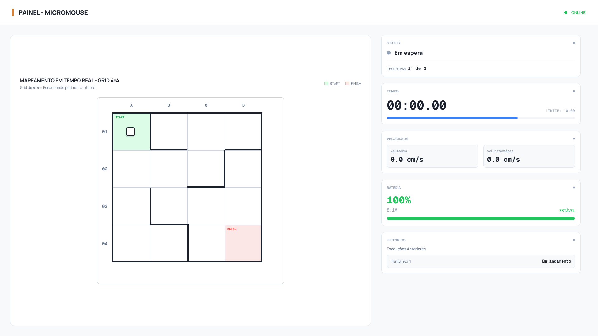

*Protótipo do painel de monitoramento em espera na largada, pista 4x4 (HU-05).*

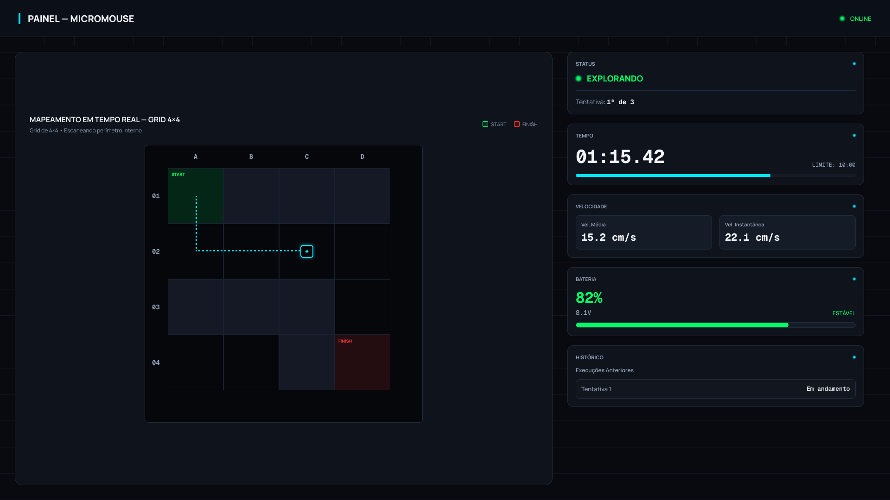

*Protótipo do painel de monitoramento durante a exploração da pista 4x4, com mapa, indicadores e status (HU-10, HU-11 e HU-19).*

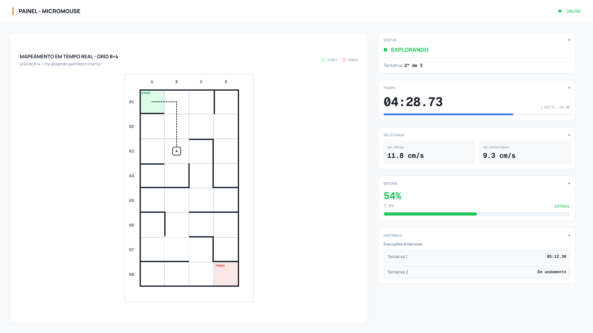

*Protótipo do painel de monitoramento na pista 8x4 (HU-10).*

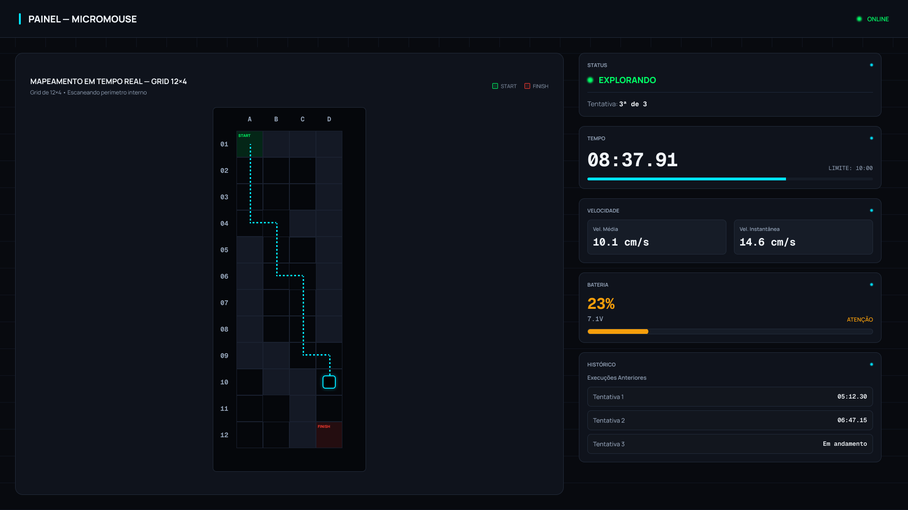

*Protótipo do painel de monitoramento na pista 12x4 (HU-10).*

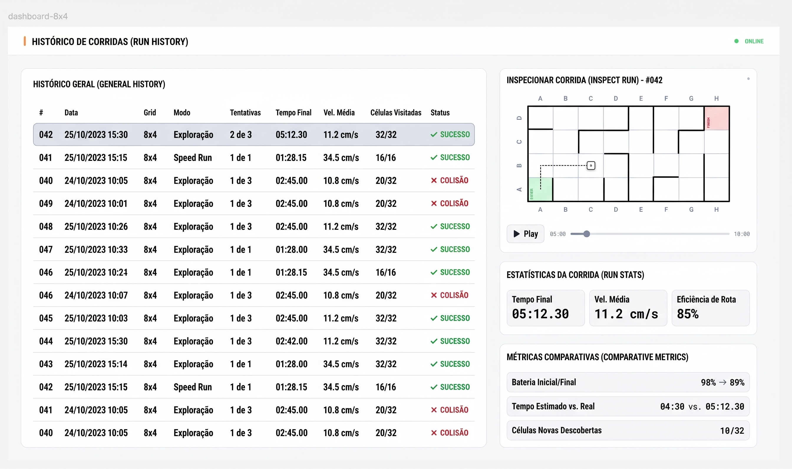

*Protótipo da tela de histórico de corridas, com filtros, inspeção, reprodução e estatísticas (HU-13 e HU-14).*


*Painel implementado ao fim de uma corrida completa na pista 4x4, com o simulador, para comparação com o protótipo da pista 4x4.*

---

### 2. Associação entre histórias de usuário, casos de teste e automação

A tabela relaciona cada caso de teste funcional da seção 7 do doc 4.4 às HUs e aos testes automatizados que o cobrem. O número entre parênteses é a quantidade de casos da suíte. A coluna "Situação" usa quatro categorias:

- **Automatizado e passando:** a lógica de *software* do caso é verificada por testes unitários ou de integração, todos aprovados.
- **Automatizado em E2E:** o comportamento é verificado pela interface gráfica do painel, com o backend alimentado pelo simulador (seção 4).
- **Validado em simulação:** o comportamento foi exercitado de ponta a ponta com o simulador (seção 5), sem o robô.
- **Depende do robô (AP18):** o critério de aceitação só pode ser medido com o robô montado, os *drivers* e a calibração (seção 7).

Um mesmo CT pode combinar as categorias: a lógica já validada e a medição física pendente.

| CT | Caso de teste | HUs | Testes automatizados (arquivo / suíte) | Situação |
|:---|:---|:---|:---|:---|
| CT-01 | Centralização do robô em reta | HU-01 | Firmware: `robo/test/test_controle` (29), incluindo `test_tres_celulas_em_reta_ficam_abaixo_de_15_mm_de_desvio` e `test_trecho_sem_parede_lateral_mantem_o_rumo_pelo_imu` | Automatizado e passando (modelo do controle); medição física na AP18 |
| CT-02 | Precisão das rotações de 90° | HU-02 | Firmware: `test_curva` (33), incluindo `test_uma_curva_de_90_graus_fica_dentro_de_3_graus`, `test_24_curvas_seguidas_nao_acumulam_erro` e `test_sem_imu_os_encoders_fecham_a_curva_dentro_de_3_graus` | Automatizado e passando (modelo do robô em malha fechada); medição física na AP18 |
| CT-03 | Fidelidade do mapeamento nas três geometrias | HU-03, RNF-SFT02 | Firmware: `test_mapa` (22), incluindo `test_percurso_simulado_reproduz_a_pista_4x4`; `test_direcao` (8); `test_navegador` (35), com cenários 4x4, 8x4 e 12x4. Backend: `tests/test_simulador_robo.py` (21). Frontend: `servicos/painelTelemetria.test.js` (24) e `servicos/labirinto.test.js` (29) | Validado em simulação; pista física na AP18 |
| CT-04 | Seleção da geometria antes da largada | HU-04 | Firmware: `test_mapa` (troca de geometria) e `test_botao` (17), incluindo `test_um_dois_e_tres_toques_na_mesma_janela`. Frontend: `painelTelemetria.test.js` (`recomeça ao trocar de geometria`). E2E: grade com as dimensões de cada geometria, nos três testes do CT-09 | Automatizado em E2E (painel); botão real na AP18 |
| CT-05 | Largada e navegação autônoma | HU-05, HU-06, RNF-SFT01 | Firmware: `test_botao` (17), incluindo `test_largada_so_acontece_ao_soltar_depois_de_2_s`; `test_cronometro` (14); `test_navegador` (35), incluindo `test_navegacao_depende_somente_de_leituras_internas` | Automatizado e passando; corrida física na AP18 |
| CT-06 | Parada automática no objetivo | HU-07 | Firmware: `test_parada_objetivo` (16), incluindo `test_latencia_de_software_abaixo_de_200ms` e `test_parada_congela_o_cronometro_real_na_chegada`; `test_cronometro` (14). E2E: status "Concluído" com o robô na chegada, nos três testes do CT-09 | Automatizado e passando; integração no laço e medição física na AP18 |
| CT-07 | Transmissão da telemetria a 1 Hz | HU-08 | Firmware: `test_telemetria` (21), `test_bateria` (8), `test_velocidade_media` (6), `gateway/test/test_bridge` (6). Backend: `tests/test_modelos_telemetria.py` (94), `tests/test_ingestao_serial.py` (18). E2E: tempo, bateria e velocidade exibidos no painel, nos três testes do CT-09 | Automatizado e passando; enlace de 60 s com o robô na AP18 |
| CT-08 | Aviso de perda de conexão | HU-09 | Backend: cenário `perda_conexao` do simulador em `tests/test_simulador_gerador.py` (31). Frontend: reconexão em `servicos/telemetriaWs.test.js` (19). E2E: indicador DESCONECTADO com o backend derrubado e CONECTADO quando ele volta | Indicador de conexão do painel automatizado em E2E; o aviso "Conexão RF perdida" (HU-09) ainda não existe |
| CT-09 | Painel sincronizado com a pista | HU-10, HU-11, RNF-SFT03 | Frontend: `painelTelemetria.test.js` (24), `telemetriaWs.test.js` (19), `labirinto.test.js` (29), `componentes/Labirinto.test.jsx` (7), `formatacao.test.js` (11). Backend: `tests/test_api_telemetria_ws.py` (6), `tests/test_ingestao_ponta_a_ponta.py` (9). E2E: corrida completa nas três geometrias e recomeço do mapa a cada corrida | Automatizado em E2E; latência física na AP18 |
| CT-10 | Persistência de corridas concluídas e interrompidas | HU-12 | Nenhum | Pendente (HU-12) |
| CT-11 | Filtragem do histórico | HU-13, RNF-SFT04 | Frontend: `servicos/historicoFiltros.test.js` (13), incluindo o teste de 500 registros; `componentes/HistoricoCorridas.test.jsx` (7) | Automatizado e passando sobre dados em memória; com banco, pendente (HU-12 e #142) |
| CT-12 | Reprodução de corrida passada | HU-14 | Frontend: `servicos/replayCorrida.test.js` (12), incluindo a montagem dos quadros, a busca por instante e o cálculo das estatísticas com 600 leituras; `componentes/ReplayCorrida.test.jsx` (3) | Automatizado e passando sobre dados em memória; com banco, pendente (HU-12 e #142) |
| CT-13 | Speed run mais rápido que a exploração | HU-15, HU-16 | Nenhum | Pendente; depende do robô (AP18) |
| CT-14 | Curva em movimento contínuo | HU-17 | Nenhum | Pendente; depende do robô (AP18) |
| CT-15 | Corte de tração por travamento | HU-18, HU-19 | Firmware: `test_travamento` (13), incluindo `test_monitor_corta_em_no_maximo_1200ms_com_verificacao_a_cada_50ms` e `test_dispara_quando_apenas_roda_esquerda_trava`. Frontend: `componentes/IndicadorStatus.test.jsx` (7), `painelTelemetria.test.js` (registro da tentativa encerrada por TRAVADO), `formatacao.test.js`. Backend: cenário `travado` do simulador. E2E: "Travado" em destaque no cenário `travado` | Detecção e corte automatizados e passando; exibição no painel automatizada em E2E; medição física na AP18 |

---

### 3. Testes unitários e de integração com cobertura

Os testes rodam localmente e no GitHub Actions a cada PR que altera a pasta correspondente (workflows `firmware-ci.yml`, `backend-ci.yml` e `frontend-ci.yml`). Em cada workflow, a tabela de cobertura é publicada no resumo da execução e o relatório HTML fica nos artefatos.

**Resumo das medições em 25/10/2026:**

| Parte | Ferramenta | Testes | Linhas | Funções | Ramos | Situação frente aos 80% |
|:---|:---|---:|---:|---:|---:|:---|
| Firmware do robô | Unity + gcovr | 222 (12 suítes) | 96,9% | 98,1% | 91,4% | Atende |
| Firmware do gateway | Unity + gcovr | 6 (1 suíte) | 97,4% | 100,0% | 76,8% | Atende em linhas e funções; ramos abaixo (ver 3.1) |
| Backend | pytest + pytest-cov | 222 | 99,7% (*statements*) | - | 98,9% | Atende |
| Frontend | Vitest + v8 | 132 (10 arquivos) | 89,5% | 76,8% | 86,4% | Atende em linhas e ramos; arquivos abaixo (ver 3.3) |

Todos os 582 testes unitários e de integração foram aprovados. Em relação à medição de 21/10/2026, entraram 46 testes no firmware do robô (HU-02 e HU-18) e 25 no frontend (HU-14 e HU-19).

#### 3.1 Firmware (robô e gateway)

Os testes rodam no ambiente `native` do PlatformIO, compilado com `--coverage`, sem o ESP32. A lógica foi separada do hardware em cabeçalhos testáveis, e os arquivos que dependem do Arduino ou do rádio (`main.cpp`, `RadioTelemetria.cpp`, `Bateria.cpp` e `gateway/src/main.cpp`) não são compilados no ambiente nativo. Por isso esses arquivos não aparecem no relatório; eles são verificados pelo *build* para o ESP32 no CI.

| Suíte (robô) | Testes | Suíte (robô) | Testes |
|:---|---:|:---|---:|
| `test_bateria` | 8 | `test_mapa` | 22 |
| `test_botao` | 17 | `test_navegador` | 35 |
| `test_controle` | 29 | `test_parada_objetivo` | 16 |
| `test_cronometro` | 14 | `test_telemetria` | 21 |
| `test_curva` | 33 | `test_travamento` | 13 |
| `test_direcao` | 8 | `test_velocidade_media` | 6 |

| Arquivo | Linhas | Funções | Ramos |
|:---|---:|---:|---:|
| `lib/telemetria/src/TelemetriaCodec.h` | 86,6% (71/82) | 100% | 77,8% |
| `lib/telemetria/src/TelemetriaJson.h` | 100% | 100% | 98,0% |
| `lib/telemetria/src/TemporizadorPeriodico.h` | 100% | 100% | 100% |
| `robo/src/botao/Botao.h` | 100% | 100% | 95,5% |
| `robo/src/controle/ControleCurva.h` | 100% | 100% | 100% |
| `robo/src/controle/ControleReta.h` | 100% | 100% | 100% |
| `robo/src/cronometro/Cronometro.h` | 100% | 100% | 100% |
| `robo/src/mapa/Direcao.h` | 87,9% (29/33) | 100% | 85,2% |
| `robo/src/mapa/Mapa.h` | 100% | 100% | 95,2% |
| `robo/src/navegacao/InterfacesNavegacao.h` | 100% | 100% | - |
| `robo/src/navegacao/Navegador.h` | 96,2% (153/159) | 100% | 83,9% |
| `robo/src/navegacao/VelocidadeMedia.h` | 100% | 100% | 100% |
| `robo/src/parada/AdaptadorCronometro.h` | 100% | 100% | - |
| `robo/src/parada/ParadaObjetivo.h` | 100% | 100% | 100% |
| `robo/src/seguranca/DetectorTravamento.h` | 100% | 100% | 100% |
| `robo/src/seguranca/MonitorTravamento.h` | 93,5% (43/46) | 85,0% (17/20) | 93,8% |
| `robo/src/sensores/BateriaConversao.h` | 100% | 100% | 100% |

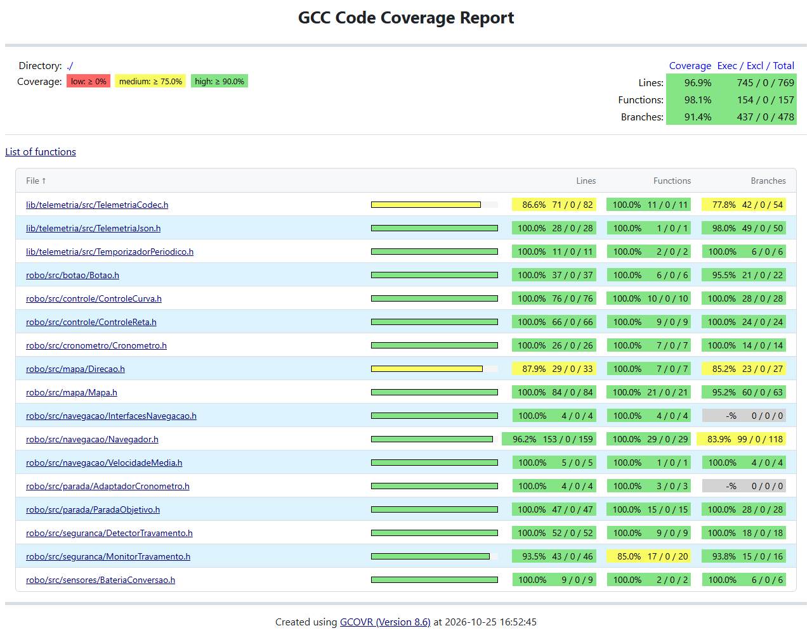

*Cobertura do firmware do robô (gcovr).*

As três funções e as três linhas não cobertas de `MonitorTravamento.h` são as implementações padrão dos métodos virtuais da interface `IFontePulsos`, que os testes substituem por uma fonte de pulsos própria. As linhas restantes de `Direcao.h` são os `return` defensivos após os `switch`, que nunca são alcançados.

No gateway, a suíte `test_bridge` (6 testes) cobre a ponte entre o quadro ESP-NOW e a linha JSON: 97,4% das linhas (114/117) e 100% das funções (17/17). A cobertura de ramos (76,8%, 76/99) fica abaixo de 80% por causa do `TelemetriaCodec.h` (57,1% dos ramos), cujas validações campo a campo são testadas na suíte `test_telemetria` do robô, que compartilha a mesma biblioteca e alcança 77,8% dos ramos nesse arquivo.

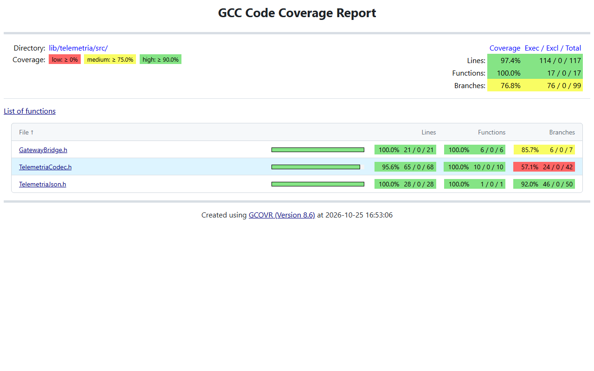

*Cobertura do firmware do gateway (gcovr).*

Para reproduzir, em `src/firmware` (troque `robo` por `gateway` para o gateway):

```bash
pio test -d robo -e native
gcovr --root . --filter lib/ --filter robo/src/ --exclude-throw-branches --exclude-unreachable-branches --html-details cobertura/index.html robo/.pio/build/native
```

#### 3.2 Backend

Os 222 testes cobrem o *schema* da telemetria (`TelemetriaMensagem`), o WebSocket `/ws/telemetria`, as fontes de telemetria (serial e simulador), a configuração e o simulador de corridas (pistas, robô virtual e gerador). Os testes de integração incluem um *gateway* emulado por *socket* local, lido pelo pyserial real, e um cliente WebSocket que recebe a corrida do simulador através da aplicação FastAPI completa. O backend não teve alterações de código desde a medição de 21/10/2026, e os números se mantiveram.

| Arquivo de teste | Testes | Arquivo de teste | Testes |
|:---|---:|:---|---:|
| `test_api_saude.py` | 1 | `test_modelos_telemetria.py` | 94 |
| `test_api_telemetria_ws.py` | 6 | `test_simulador_gerador.py` | 31 |
| `test_config.py` | 13 | `test_simulador_pistas.py` | 22 |
| `test_ingestao_ponta_a_ponta.py` | 9 | `test_simulador_robo.py` | 21 |
| `test_ingestao_serial.py` | 18 | `test_ingestao_simulador.py` | 7 |

A cobertura é de 99,7% das instruções (629/631) e 98,9% dos ramos (176/178), com relatório total de 99%. As duas instruções não cobertas são a chamada `sys.exit(main())` do `__main__` do simulador e uma verificação defensiva do *flood fill* do robô virtual.

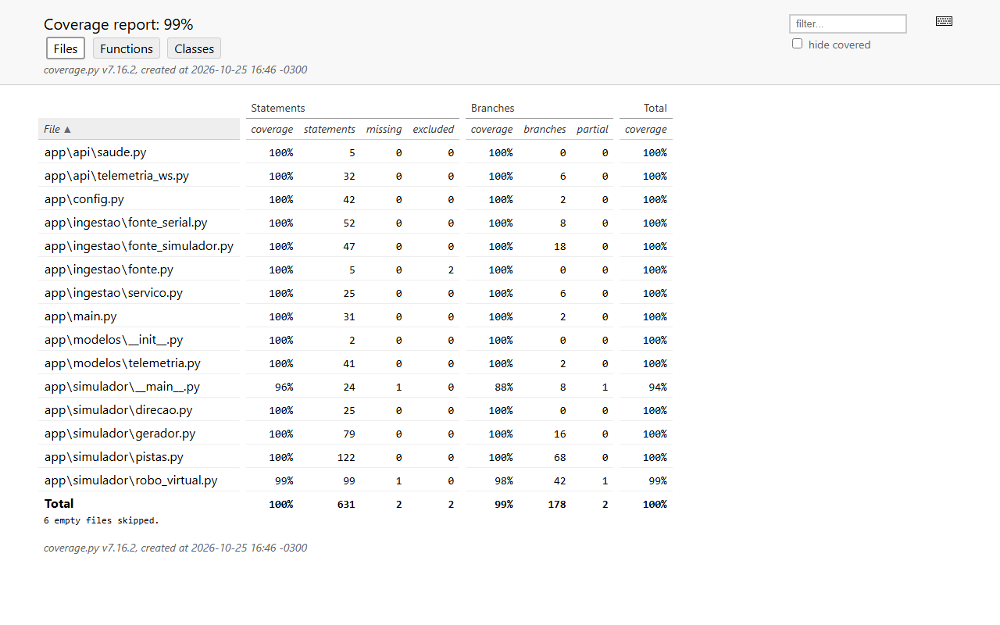

*Cobertura do backend (pytest-cov).*

Para reproduzir, em `src/backend` (no PowerShell; no Linux, com o ambiente ativado, `pytest --cov=app`):

```powershell
.\.venv\Scripts\python -m pytest --cov=app --cov-report=term-missing --cov-report=html
```

#### 3.3 Frontend

Os 132 testes cobrem os serviços (formatação, mapa do labirinto, estado do painel, cliente WebSocket, filtros do histórico e reprodução de corridas) e os componentes `Labirinto`, `IndicadorStatus`, `HistoricoCorridas` e `ReplayCorrida`. No total, 89,5% das linhas (1687/1885), 86,4% dos ramos (370/428) e 76,8% das funções (43/56).

| Arquivo de teste | Testes | Arquivo de teste | Testes |
|:---|---:|:---|---:|
| `servicos/formatacao.test.js` | 11 | `servicos/telemetriaWs.test.js` | 19 |
| `servicos/historicoFiltros.test.js` | 13 | `componentes/HistoricoCorridas.test.jsx` | 7 |
| `servicos/labirinto.test.js` | 29 | `componentes/IndicadorStatus.test.jsx` | 7 |
| `servicos/painelTelemetria.test.js` | 24 | `componentes/Labirinto.test.jsx` | 7 |
| `servicos/replayCorrida.test.js` | 12 | `componentes/ReplayCorrida.test.jsx` | 3 |

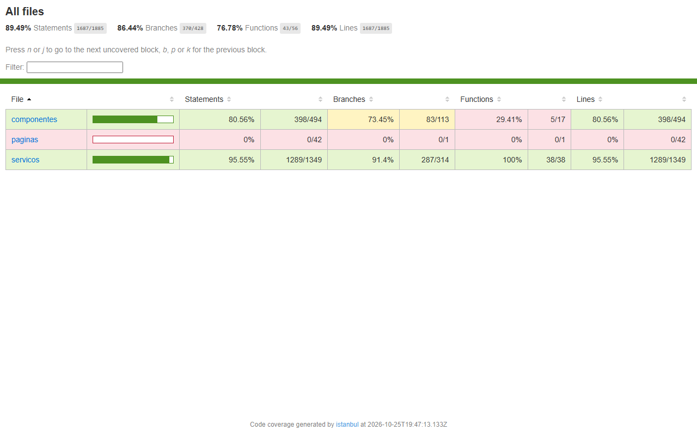

*Cobertura do frontend por pasta (Vitest).*

Os serviços, onde fica a lógica do painel, têm 95,6% das linhas, 91,4% dos ramos e 100% das funções. **Ficam abaixo de 80%:**

- **`paginas/Painel.jsx` e os componentes `IndicadorBateria`, `IndicadorTempo` e `IndicadorVelocidade` (0% no Vitest).** Eles só montam a tela a partir de dados já tratados pelos serviços testados: o estado do painel vem de `reduzirTelemetria` e os rótulos de `formatacao.js`, ambos com 100%. Esses componentes são exercitados pelos testes E2E da seção 4, que conferem na tela o tempo, a bateria, a velocidade e o estado da conexão; a cobertura dos E2E não entra nesta medição.
- **`HistoricoCorridas.jsx`:** 87,4% das linhas, mas 22,2% das funções e 51,0% dos ramos, porque os testes renderizam o componente no servidor e não acionam os controles de filtro. A lógica dos filtros é testada em `historicoFiltros.js` (94,1% das linhas).
- **`ReplayCorrida.jsx`:** 83,3% das linhas e 90% dos ramos, mas 33,3% das funções, pelo mesmo motivo: os controles de reprodução (iniciar, pausar e mover a barra de tempo) não são acionados. A lógica da reprodução é testada em `replayCorrida.js` (100% das linhas).

Em relação a 21/10/2026, o `IndicadorStatus.jsx` passou de 0% para 100%, com os testes da HU-19.

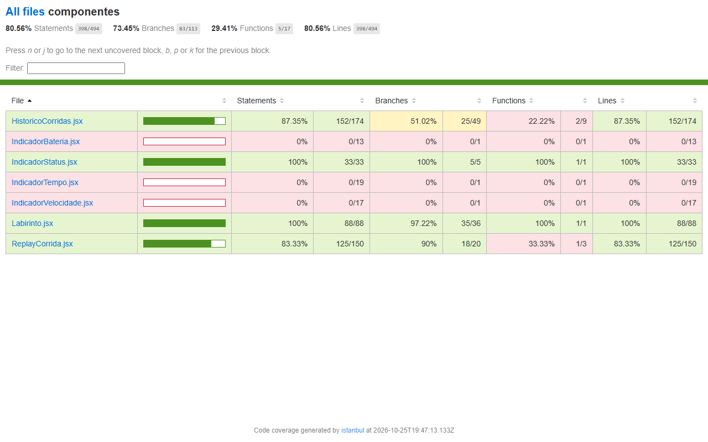

*Cobertura dos componentes do frontend (Vitest).*

Para reproduzir, em `src/frontend`:

```bash
npx vitest run --coverage
```

#### 3.4 Integração contínua

As últimas execuções dos três workflows na `main` foram aprovadas. Os prints abaixo foram feitos sem login no GitHub, e por isso mostram o resultado, os *jobs* e os artefatos publicados, mas não a tabela de cobertura do resumo, que o GitHub exibe só para usuários autenticados.

| Workflow | Execução | *Commit* | Resultado |
|:---|:---|:---|:---|
| Firmware CI | [#26](https://github.com/fcte-pi1/2026.2_PI1_Grupo1_Lui/actions/runs/39844820829) | `5935627` (PR #173) | Aprovado: robô e gateway, testes nativos e *build* ESP32 |
| Backend CI | [#10](https://github.com/fcte-pi1/2026.2_PI1_Grupo1_Lui/actions/runs/39643734644) | `4f9570d` (PR #171) | Aprovado |
| Frontend CI | [#19](https://github.com/fcte-pi1/2026.2_PI1_Grupo1_Lui/actions/runs/40227473811) | `85fa9d1` (PR #176) | Aprovado: lint, testes com cobertura e *build* (20 s) e testes E2E (3 min 5 s) |

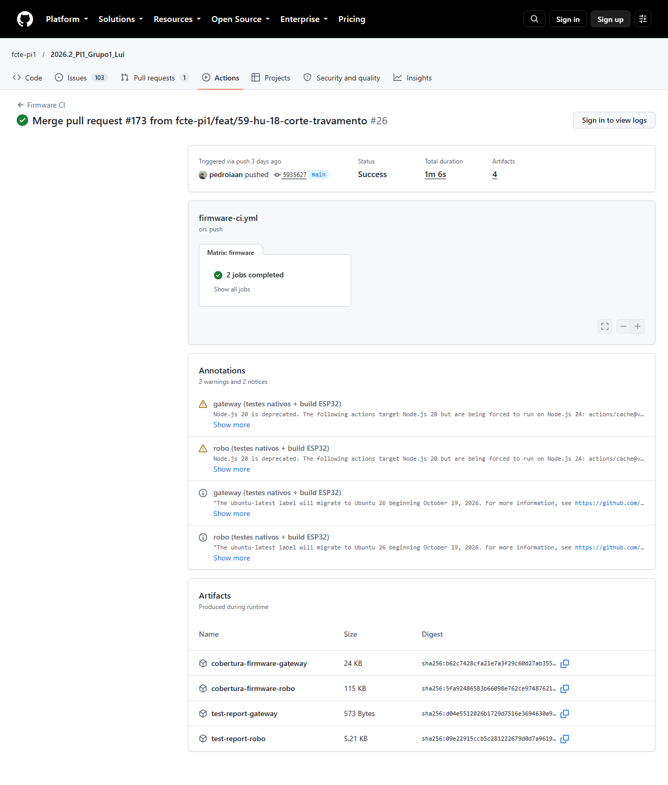

*Execução do Firmware CI.*

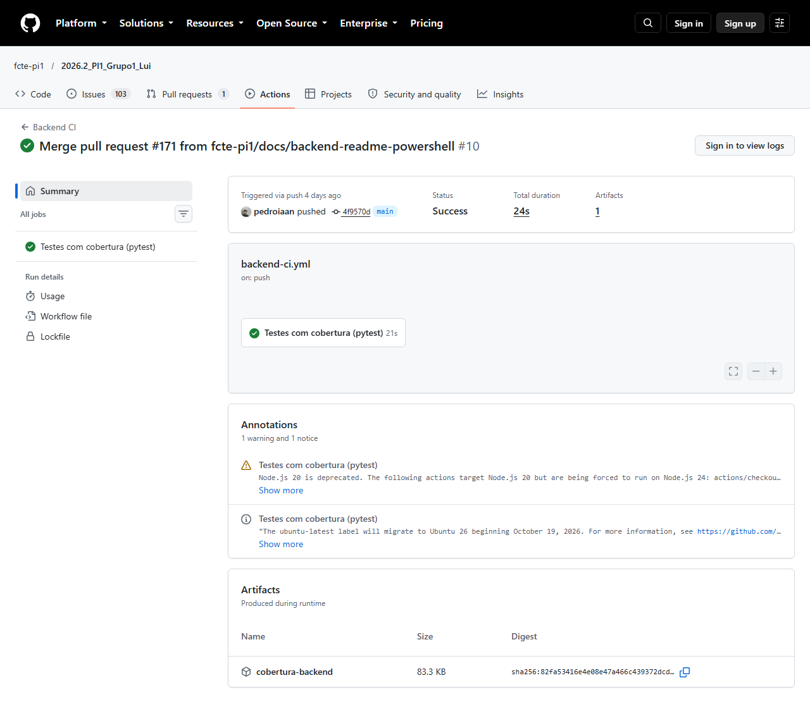

*Execução do Backend CI.*

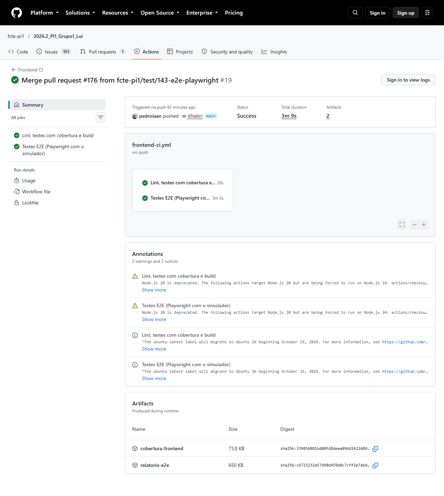

*Execução do Frontend CI.*

---

### 4. Testes E2E (sistema, funcionais)

Os testes E2E foram entregues na issue [#143](https://github.com/fcte-pi1/2026.2_PI1_Grupo1_Lui/issues/143) (PR [#176](https://github.com/fcte-pi1/2026.2_PI1_Grupo1_Lui/pull/176), mesclado em 25/10/2026). Eles usam o **Playwright** com o Chromium e exercitam o painel pela interface gráfica, como o operador o vê, seguindo os casos de teste do roteiro.

**Arquitetura.** O Playwright sobe o servidor do Vite com o painel. Cada teste sobe o seu próprio backend com o simulador de corridas (seção 5), numa porta livre e com velocidade acelerada, de modo que cada teste acompanha uma corrida inteira desde a largada, os testes rodam em paralelo e o teste do CT-08 pode derrubar o backend e subi-lo de novo. O código do painel não foi alterado para os testes; foram acrescentados apenas atributos `data-testid` aos indicadores de tempo, velocidade e bateria. Os testes estão em `src/frontend/e2e/` e rodam no job "Testes E2E (Playwright com o simulador)" do Frontend CI, em todo PR que altera `src/frontend` ou `src/backend`, com o relatório HTML publicado no artefato `relatorio-e2e`.

| Teste | Caso de teste | O que é verificado |
|:---|:---|:---|
| Corrida completa em 4x4 | CT-09, com CT-04, CT-06 e CT-07 parciais | O painel conecta (CONECTADO); a grade tem as dimensões da geometria; o robô passa por pelo menos 4 posições e o rastro cresce durante a corrida; o status termina em "Concluído" com o robô na chegada; tempo, bateria (% e V) e velocidade aparecem no painel |
| Corrida completa em 8x4 | CT-09, com CT-04, CT-06 e CT-07 parciais | Idem, com chegada em D8 |
| Corrida completa em 12x4 | CT-09, com CT-04, CT-06 e CT-07 parciais | Idem, com chegada em D12 |
| Travamento | CT-15 (exibição) | No cenário `travado`, o painel passa de "Explorando" para "Travado", com destaque de alerta, ícone e a mensagem "Corte de tração por travamento das rodas" |
| Queda do backend | CT-08 (parcial) | Com a corrida em andamento, o backend é derrubado e o indicador vai para DESCONECTADO, mantendo o último estado na tela; o backend sobe de novo e o indicador volta para CONECTADO |
| Recomeço do mapa | CT-09 | Com o simulador repetindo a corrida, a Tentativa 2 começa com o mapa limpo e o robô em A1, e termina com o mesmo rastro da primeira |

**Resultados.**

- **CI, na `main`, com a versão inicial dos testes (Frontend CI [#19](https://github.com/fcte-pi1/2026.2_PI1_Grupo1_Lui/actions/runs/40227473811), *commit* `85fa9d1`, PR #176):** 6 testes, 6 aprovados, em 36,5 s de execução; o *job* completo, com a instalação do Python, do Node e do Chromium, levou 3 min 5 s.
- **Instabilidade encontrada e corrigida:** ao repetir os testes localmente, em 25/10/2026, com 6 *workers* em paralelo e a máquina carregada, foram encontradas falhas intermitentes nos testes do CT-09, do CT-15 e do recomeço do mapa (por exemplo, 3 falhas em 18 execuções com `--repeat-each=3`). A causa estava nos testes, e não no painel: o Playwright amostrava a posição do robô e o status em intervalos de cerca de 100 ms e, sob carga, perdia passos de corridas que duram menos de 3 s. A correção registra o percurso dentro da própria página, com um `MutationObserver`, e foi mesclada na `main` em 25/10/2026 pelo PR [#177](https://github.com/fcte-pi1/2026.2_PI1_Grupo1_Lui/pull/177). Com a correção, foram executadas duas rodadas de 30 execuções (`--repeat-each=5`), todas aprovadas, e as mutações introduzidas de propósito no painel (ignorar os pacotes de exploração e desligar o recomeço do mapa) foram detectadas pelos testes.
- **CI, na `main`, com a correção (Frontend CI [#22](https://github.com/fcte-pi1/2026.2_PI1_Grupo1_Lui/actions/runs/40231573589), *commit* `302b10e`, PR #177):** 6 testes, 6 aprovados, em 35,4 s de execução; o *job* completo levou 1 min 16 s.

O relatório HTML abaixo é de uma execução local com a correção do PR #177: 6 testes, 6 aprovados, em 32,1 s.

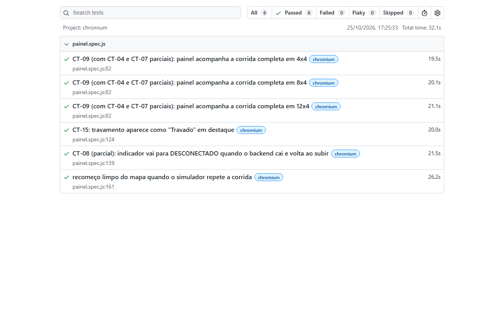

*Relatório HTML do Playwright: os 6 testes E2E aprovados, com o tempo de cada um.*

**Evidências.** Os prints abaixo foram gerados pelo próprio Playwright durante os testes, com `npm run test:e2e:evidencias`, na versão do PR #176. O vídeo da corrida completa na pista 12x4 está em [`ct09-12x4.webm`](https://github.com/fcte-pi1/2026.2_PI1_Grupo1_Lui/blob/main/docs/evidencias/5.3.2.1/ct09-12x4.webm), e todos os arquivos estão na pasta [`docs/evidencias/5.3.2.1`](https://github.com/fcte-pi1/2026.2_PI1_Grupo1_Lui/tree/main/docs/evidencias/5.3.2.1).

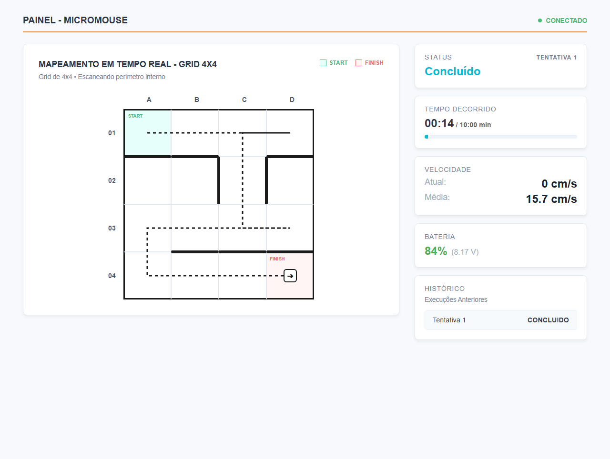

*CT-09, pista 4x4: corrida concluída, com o robô na chegada (D4), as paredes e o rastro desenhados e o indicador CONECTADO.*

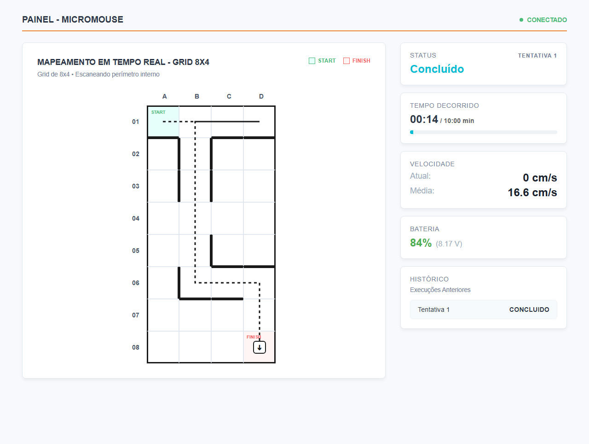

*CT-09, pista 8x4: corrida concluída, com o robô na chegada (D8).*

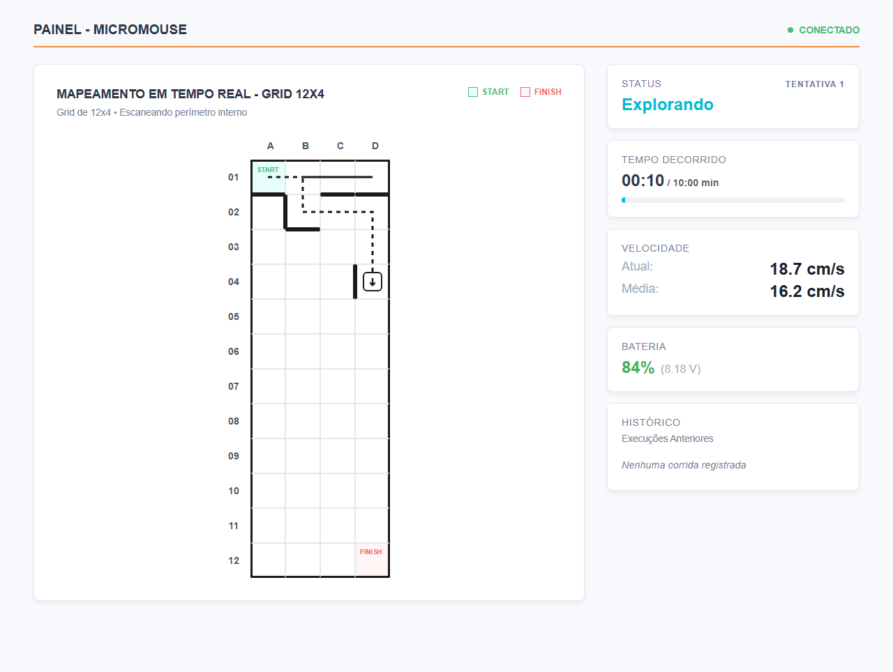

*CT-09, pista 12x4, durante a exploração: o mapa é desenhado à medida que o robô avança, com o status "Explorando".*


*CT-09, pista 12x4: corrida concluída, com o robô na chegada (D12).*


*CT-15, cenário travado na pista 8x4: status "Travado" em destaque, com ícone de alerta, a mensagem de corte de tração e a tentativa registrada no histórico.*

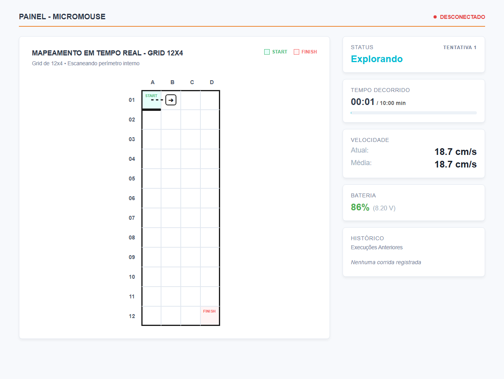

*CT-08, backend derrubado durante a corrida: indicador DESCONECTADO, com o último estado recebido mantido na tela.*

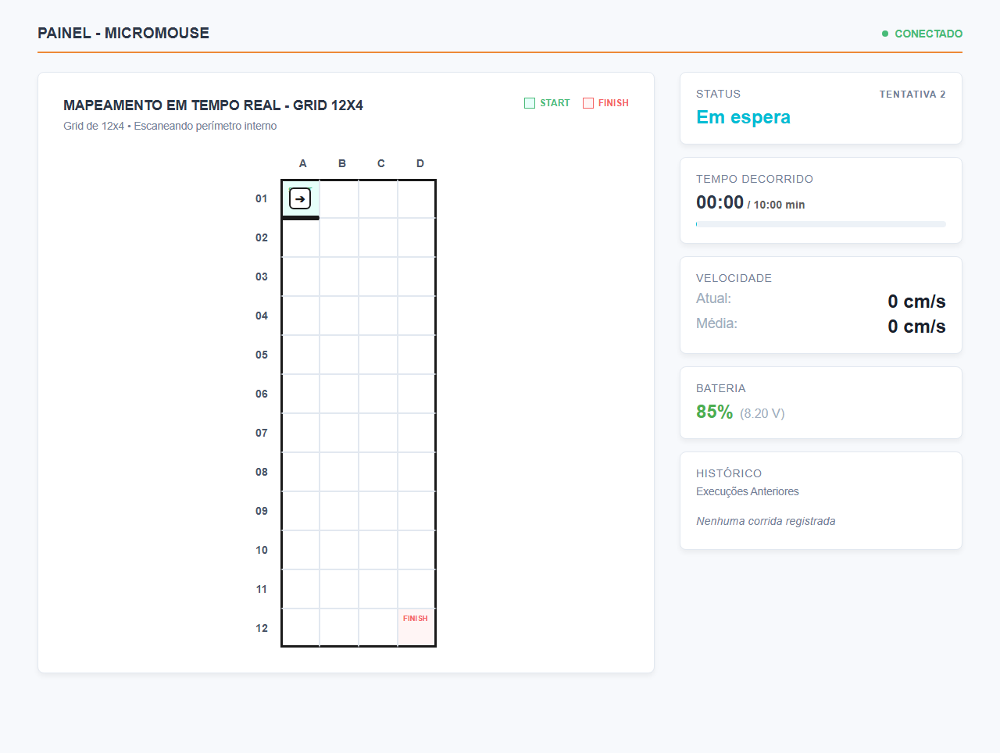

*CT-08, backend de volta: indicador CONECTADO; o novo backend inicia outra corrida, por isso aparece a Tentativa 2.*

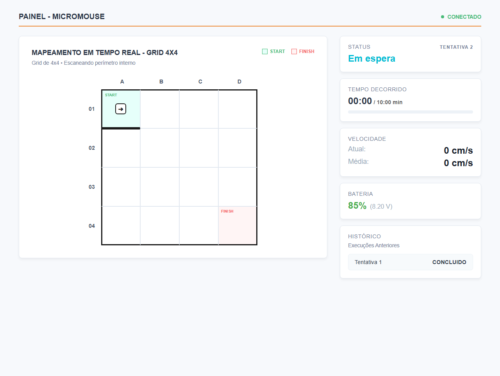

*Recomeço do mapa: na largada da Tentativa 2, o mapa está limpo e o robô em A1, e a Tentativa 1 aparece no histórico como concluída.*

**Casos não automatizados em E2E.**

- **CT-10, CT-11 e CT-12 com dados reais:** dependem da persistência das corridas (HU-12) e da API do histórico (#142). A lógica dos filtros e da reprodução já é testada sobre dados em memória (seção 2).
- **Aviso "Conexão RF perdida" do CT-08:** depende da HU-09.
- **Critérios físicos de CT-04, CT-06, CT-07, CT-09 e CT-15:** botão real, tempo de parada, enlace de 60 s, atraso entre a pista e o painel e tempo de corte dos motores dependem do robô montado (seção 7).

---

### 5. Validação de ponta a ponta com o simulador

Como o robô ainda não está montado, o sistema foi validado de ponta a ponta com o simulador de corridas do backend ([#141](https://github.com/fcte-pi1/2026.2_PI1_Grupo1_Lui/issues/141)). O simulador emula o robô explorando as três pistas de exemplo dos slides do tema e gera, a cada segundo, a mesma linha JSON que o *gateway* escreve na serial. Cinco linhas geradas foram comparadas byte a byte com as produzidas pelo código do *gateway* compilado nativamente. O backend difunde cada mensagem pelo WebSocket, e o painel desenha o mapa e os indicadores. O mesmo simulador alimenta os testes E2E da seção 4.

**Procedimento** (detalhado na seção "Rodando o sistema com o simulador" de [`src/README.md`](https://github.com/fcte-pi1/2026.2_PI1_Grupo1_Lui/blob/main/src/README.md)):

1. Em `src/backend`, escolher a geometria e o cenário pelas variáveis `TELEMETRIA_FONTE=simulador`, `SIMULADOR_LABIRINTO` (`4x4`, `8x4` ou `12x4`) e `SIMULADOR_CENARIO` (`completa`, `travado` ou `perda_conexao`), e subir o backend com `.\.venv\Scripts\python -m uvicorn app.main:app`.
2. Em `src/frontend`, subir o painel com `npm run dev` e abrir o endereço no navegador.
3. O simulador fica em espera na largada até o painel conectar e então dá a largada, de modo que a corrida aparece inteira, desde A1.

**Verificações realizadas.** Em 17/10/2026, durante o [PR #165](https://github.com/fcte-pi1/2026.2_PI1_Grupo1_Lui/pull/165), as três geometrias foram executadas nos três cenários (9 combinações), com repetição das corridas. Um verificador no navegador leu a tela do painel a cada 150 ms (1.289 leituras) e comparou as paredes desenhadas com as paredes reais de cada pista. Resultados:

| Geometria | `completa` | `travado` | `perda_conexao` |
|:---|:---|:---|:---|
| 4x4 | "Concluído" em D4 | "Travado" em D3 | Para em "Explorando" em D3 |
| 8x4 | "Concluído" em D8 | "Travado" em B3 | Para em "Explorando" em B3 |
| 12x4 | "Concluído" em D12 | "Travado" em C8 | Para em "Explorando" em C8 |

- Nenhuma parede desenhada divergiu da pista real nas células visitadas.
- A cada nova corrida o mapa recomeçou limpo, com o rastro saindo de A1.
- O indicador mostrou CONECTADO durante as corridas e DESCONECTADO com o backend parado, e o painel reconectou sozinho nas 9 vezes.

Os prints a seguir foram refeitos em 25/10/2026, com o painel atual (que passou a exibir a tentativa, o histórico da sessão e o destaque de "Travado"), com o simulador a 4 vezes a velocidade normal, ao fim de cada corrida. As posições e os tempos finais coincidem com os da verificação de 17/10/2026.

**Cenário `completa`:**


*Painel com o simulador, pista 4x4, corrida completa.*

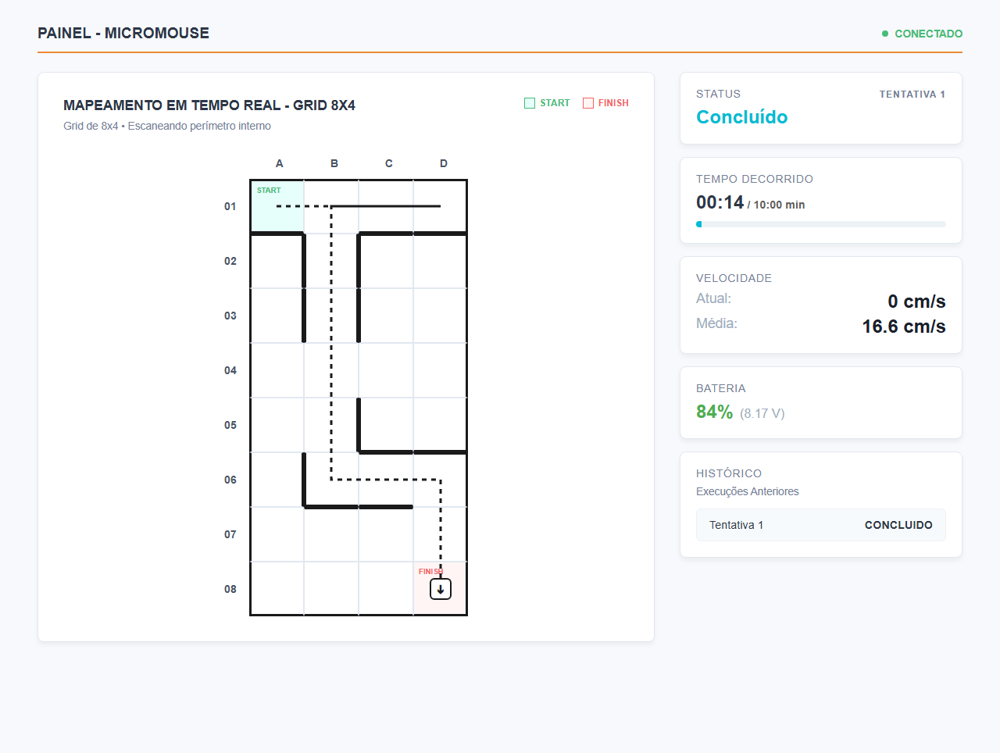

*Painel com o simulador, pista 8x4, corrida completa.*

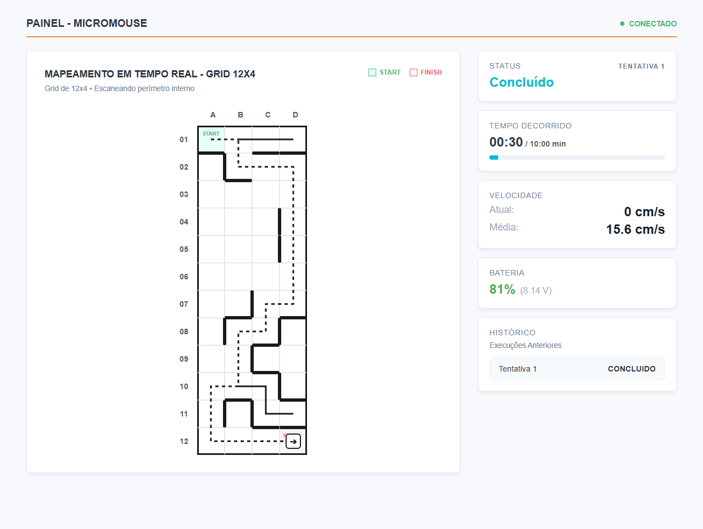

*Painel com o simulador, pista 12x4, corrida completa.*

**Cenário `travado`:**

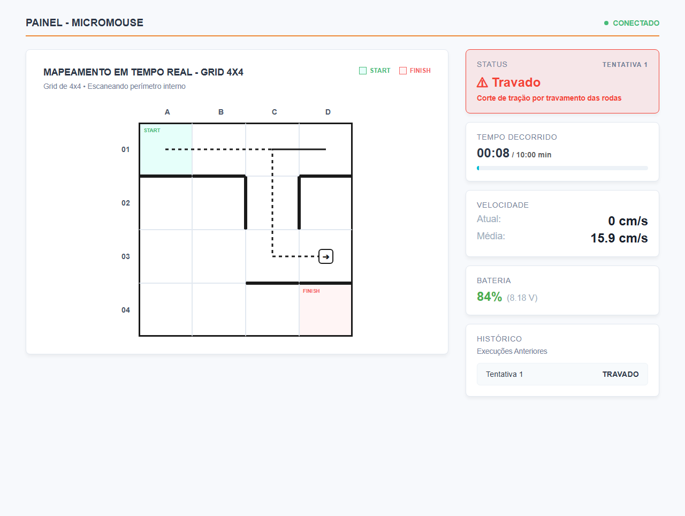

*Painel com o simulador, pista 4x4, robô travado.*

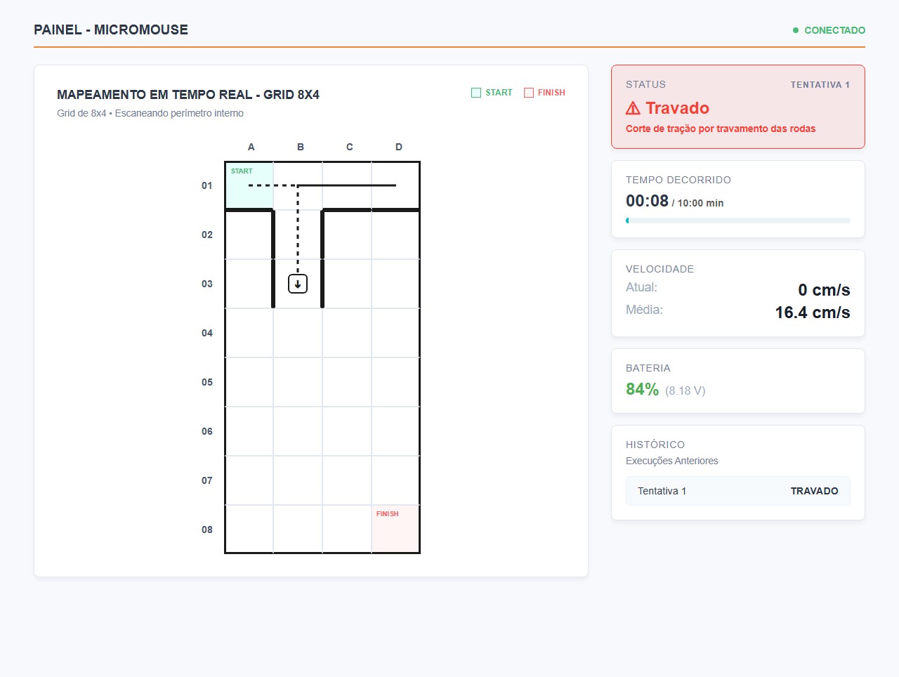

*Painel com o simulador, pista 8x4, robô travado.*

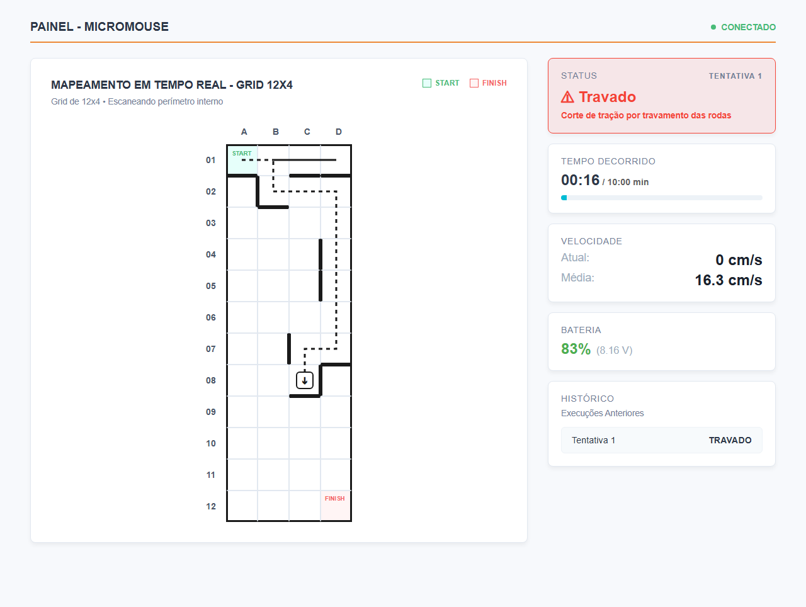

*Painel com o simulador, pista 12x4, robô travado.*

**Limitações desta validação.**

- O simulador substitui o robô e o *gateway*, mas não o rádio: atrasos e perdas reais do ESP-NOW não são reproduzidos.
- O cenário `perda_conexao` apenas para de enviar mensagens; o aviso correspondente no painel depende da HU-09.
- No cenário `travado`, o simulador apenas informa o status TRAVADO; a detecção pelos encoders e o corte dos motores (HU-18) são verificados pelos testes do firmware (`test_travamento`).

---

### 6. Roteiro de testes atualizado

A tabela compara cada caso de teste da seção 7 do doc 4.4 com o que foi implementado e indica o que muda no roteiro.

| CT | Alterações em relação ao doc 4.4 |
|:---|:---|
| CT-01 | Sem mudança nos critérios. O controle implementado é proporcional e derivativo sobre a diferença das paredes laterais e, sem parede de referência, mantém o rumo pelo IMU ou, na falta dele, pelos encoders. Pode ser antecipado por simulação do modelo (`test_controle`) antes do ensaio físico |
| CT-02 | Sem mudança nos critérios. O controle de curvas mira um rumo ideal absoluto, para que o erro de uma curva não se some ao da seguinte, e o critério de ±3° é antecipado por simulação em malha fechada (`test_curva`, com 24 curvas seguidas, ruído no IMU, erro de ganho dos motores e patinagem dos encoders). O procedimento físico precisa ser detalhado: a sequência curva, realinhamento pelos ToF e ressincronização do IMU deve ser a mesma da navegação |
| CT-03 | Passo 1: a geometria é selecionada pelo toque triplo no botão (ver CT-04). Acrescenta-se a etapa de validação com o simulador nas três pistas dos slides antes da pista física. As pistas de 8x4 e 12x4 dos slides têm regiões fechadas (7 e 8 células), que não são visitadas; a comparação vale para as células alcançáveis |
| CT-04 | Passo 1: a seleção é feita por **toque triplo** no botão, só no estado AGUARDANDO; cada toque triplo alterna 4x4, 8x4 e 12x4, e o LED pisca em ciano 1, 2 ou 3 vezes. O painel recomeça o mapa quando a geometria muda. A grade de cada geometria é verificada pelos testes E2E |
| CT-05 | Passo 2: a largada é **segurar o botão por pelo menos 2 s e soltar**; ao completar 2 s o LED fica branco, indicando que pode soltar, e soltar antes de 2 s não faz nada. O cronômetro começa na soltura. O status passa a MAPEANDO e o painel mostra "Explorando" em até 1 s. Depois da largada, o botão não tem efeito |
| CT-06 | Sem mudança nos critérios. A latência de *software* entre detectar a chegada e cortar a tração é medida automaticamente (`test_latencia_de_software_abaixo_de_200ms`); o ensaio físico mede a parada mecânica. O cronômetro congela no mesmo ciclo da parada |
| CT-07 | Passo 2: os pacotes trazem dois campos acrescentados pelo *gateway*, `seq` (contador de pacotes válidos) e `rssi` (dBm). Como o robô não numera os pacotes, a perda no enlace é estimada pela taxa fixa de 1 Hz e pelo `seq` |
| CT-08 | Acrescenta-se a distinção entre os dois indicadores: CONECTADO/DESCONECTADO (painel e backend, já implementado e verificado em E2E) e "Conexão RF perdida" (3 s sem pacotes, HU-09, pendente). Pode ser antecipado com o cenário `perda_conexao` do simulador |
| CT-09 | Passo 1 pode ser executado com o simulador antes da prova física; o painel recomeça o mapa a cada nova corrida. A exibição dos indicadores, das paredes e do rastro é verificada pelos testes E2E (seção 4); a medição do atraso entre a pista e o painel continua física |
| CT-10 | Sem mudança; HU-12 pendente |
| CT-11 | Sem mudança nos critérios; o teste automatizado verifica o filtro com mais de 500 registros em menos de 50 ms, sobre dados em memória. A medição no navegador depende da API do histórico (#142) |
| CT-12 | Sem mudança nos critérios. A reprodução está implementada e o cálculo das estatísticas para 600 leituras é verificado automaticamente; a carga de uma corrida salva em menos de 2 segundos depende da API do histórico (#142) |
| CT-13 | Sem mudança; HU-15 e HU-16 pendentes. No firmware, a largada direto em SPEED_RUN ainda não existe: toda largada inicia em MAPEANDO |
| CT-14 | Sem mudança; HU-17 pendente |
| CT-15 | Sem mudança nos critérios. A detecção considera cada roda separadamente, de modo que o bloqueio de uma só roda também corta a tração. Com a verificação a cada 50 ms e o limiar de 1000 ms sem pulsos, o corte ocorre entre 1000 e 1050 ms após o bloqueio, dentro do limite de 1,2 s (`test_travamento`). A exibição de "Travado" no painel é verificada pelos testes E2E |

---

### 7. Casos de teste que ficam para a AP18

Os casos abaixo dependem do robô montado e não podem ser concluídos só com *software*. A lógica envolvida já está, em grande parte, implementada e testada com dados simulados (seções 2 a 5). O que falta se divide em quatro frentes:

1. **Drivers de sensores e motores:** sensores ToF, IMU e encoders, e a ponte H dos motores, implementando as interfaces já usadas pela lógica (`SensoresParedes` e `ExecutorMovimento` do navegador, as leituras do `ControleReta` e do `ControleCurva` e a fonte de pulsos do `MonitorTravamento`).
2. **Integração no `loop()` do `main.cpp`:** hoje o laço principal só trata o botão, o cronômetro e a telemetria. `ControleReta`, `ControleCurva`, `ParadaObjetivo` e `MonitorTravamento` estão testados, mas ainda não são chamados.
3. **Calibração:** ganhos dos controles de reta e de curva, zona morta dos motores, milímetros por pulso dos encoders, limiar de parede dos ToF (130 mm, doc 4.3) e leitura da bateria (com erro de até 0,1 V).
4. **Validação no robô montado:** as medições físicas de cada caso, listadas abaixo.

| CT | O que falta medir | Frentes |
|:---|:---|:---|
| CT-01 | Desvio lateral em 3 células de reta, com filmagem e régua | 1, 2, 3 e 4 |
| CT-02 | Erro angular após 8 rotações de 90° em cada sentido | 1, 2, 3 e 4 |
| CT-03 | Mapa final comparado com a pista física nas três geometrias | 1, 2, 3 e 4 |
| CT-04 | Seleção da geometria no botão real, conferida no painel | 4 (a lógica está validada) |
| CT-05 | Corrida completa sem intervenção em pista 4x4 em menos de 3 minutos | 1, 2, 3 e 4 |
| CT-06 | Tempo entre entrar na chegada e parar, medido em vídeo | 1, 2 e 4 |
| CT-07 | Pacotes registrados por pelo menos 60 s, com a perda calculada | 3 (bateria) e 4, com o teste de enlace da EAP 3.1.5.1 |
| CT-09 | Atraso entre a pista e o painel, medido em vídeo (menor que 1 s) | 1, 2 e 4 |
| CT-13, CT-14 | Tempo do speed run e das curvas contínuas | HU-15, HU-16 e HU-17, além das frentes 1 a 4 |
| CT-15 | Tempo entre o bloqueio das rodas e o corte dos motores | 1, 2 e 4 |

Os casos CT-08, CT-10, CT-11 e CT-12 dependem de funcionalidades de *software* ainda pendentes (HU-09, HU-12 e a API do histórico), e não do robô. Eles podem ser concluídos com o simulador e automatizados em E2E assim que essas funcionalidades forem entregues.

---

### 8. Como reproduzir

| Parte | Pasta | Comando |
|:---|:---|:---|
| Firmware (robô) | `src/firmware/robo` | `pio test -e native` |
| Firmware (gateway) | `src/firmware/gateway` | `pio test -e native` |
| Backend | `src/backend` | `.\.venv\Scripts\python -m pytest --cov=app` |
| Frontend | `src/frontend` | `npx vitest run --coverage` |
| Testes E2E | `src/frontend` | `npm run test:e2e` (passo a passo na seção "Testes E2E" do `src/frontend/README.md`) |
| Sistema com o simulador | `src/backend` e `src/frontend` | Passo a passo em "Rodando o sistema com o simulador", no `src/README.md` |

Os mesmos testes rodam no GitHub Actions a cada PR que altera a pasta correspondente, com a cobertura publicada no resumo de cada execução e o relatório dos testes E2E publicado como artefato.
