# Testes de Integração

Confiram as regras de avaliação dos testes de integração no [documento do tema do projeto](https://docs.google.com/presentation/d/1hRx0g9mpVGQbTv44gLEoAyf4b4kKM4vnrABTnG8HlUk/edit?usp=sharing).

| **ID** | **Descrição** | **Data de Início** | **Data de Conclusão** | **Sub-equipes** | **Responsável** | **Resultados Esperados** | **Resultados Obtidos** | **Aprovação Interna (S/N)** | **Aprovação do Orientador (S/N)** | **Observações** |
|:------:|---------------|--------------------|-----------------------|----------------|-----------------|--------------------------|------------------------|:---------------------------:|:--------------------------------:|-----------------|
| 5.1 | Integração mecânica no chassi em PETG, envelope dimensional (`<= 16,5 x 16,5 cm`) e folga livre para giro | 27/10/2026 | 23/11/2026 | Estruturas, Energia, Eletrônica | Carlos Henrique, Mariana Solano | Chassi dentro do limite `16,5 x 16,5 cm`, folga lateral `> 3,0 mm` no corredor (`16,8 cm`), acoplamento das rodas motrizes (`22,0 mm`), roda boba livre e troca de bateria `< 15 s` | Medido em `CHASI.md`: chassi PETG `83,5 x 113,5 mm` (envelope total `125 x 125 mm`), roda boba de `50 mm` livre em 360°, roda motriz aferida em `22,0 mm` (`938` pulsos/célula), placa ilhada fixada sem interferir nas rodas e troca de bateria `< 15 s` | S | Pendente | Referência: [doc 7.1](7.1%20-%20Testes%20de%20estrutura.md) e `hw/CHASI.md` |
| 5.2 | Integração elétrica da bateria 2S LiPo, Buck MP1584 (5 V / 3,3 V), placa ilhada soldada, `VM` e ADC (`GPIO 36`) | 27/10/2026 | 23/11/2026 | Energia, Eletrônica, Software | Rafaela Trajano, Antônio Lucas, Pedro Franco | Soldagem íntegra na placa ilhada, continuidade verificada por multímetro sem curtos entre barramentos, tensão estável sob carga e leitura ADC alinhada ao voltímetro | Bancada em `7,58–7,59 V` sob descarga contínua (`10 min`, autonomia nominal `391 min`); continuidade das trilhas de estanho, borne KRE e conector Deans validada com multímetros; telemetria leu `7,54 V (52%)` contra `7,56 V` no voltímetro (`0,02 V` de erro) e `7,455 V` no firmware final | S | Pendente | Constantes unificadas em `CalibracaoRobo.h` |
| 5.3 | Inicialização sequencial (`XSHUT`) e leitura calibrada dos 3 VL53L0X em barramento I²C único (`GPIO 21/22`) | 03/11/2026 | 23/11/2026 | Eletrônica, Software | Eduardo Lobo, Leonardo Augusto, Pedro Ian | Endereçamento `0x30`, `0x31` e `0x32` via `GPIO 4/16/17`, serial livre de ruído I²C, detecção de parede consistente e compensação métrica polinomial | Após mapeamento dos `XSHUT`, correção de `Wire.end()` no diagnóstico `[i]` e revisão das soldas/contatos em `GPIO 22`, os 3 sensores responderam juntos (`[169/167/196 mm]` e `[235/380/647 mm]`) com detecção ao vivo de parede (`136 -> 90 -> 180 mm`); erro polinomial `0,08 mm` a `30,3 Hz` | S | Pendente | Variante 3-ToF (`esp32dev_3tof`) e suporte 2-ToF validados |
| 5.4 | Integração da interface física local: botão de seleção/largada (`GPIO 15`) e LED de sinalização (`GPIO 14`) | 27/10/2026 | 23/11/2026 | Eletrônica, Software | Daniel Almeida, João Pedro Jaime | 3 cliques alternam geometria (`4x4 -> 8x4 -> 12x4`), segurar `2 s` e soltar inicia largada e altera o LED de estado sem bloquear o laço | Alternância de geometria validada no hardware (`Geometria=8x4` / `"labirinto":"4x4"`), estado `AGUARDANDO` confirmado via serial/ESP-NOW e cobertura unitária integral (`test_botao`, `test_sinalizacao`) | S | Pendente | Botão com debouncing não bloqueante no laço cooperativo |
| 5.5 | Acionamento bilateral de motores N20 via TB6612FNG (`PWM 20 kHz`) e leitura dos encoders em quadratura | 03/11/2026 | 23/11/2026 | Eletrônica, Energia, Software | Breno Teixeira, Eduardo Lobo, Gustavo Antônio | Resposta dos dois canais (`AIN1/2`, `BIN1/2`, `PWMA/B`), frenagem ativa `< 45 ms`, erro de odometria `< 0,1%` e contagem bidirecional nos dois encoders | Comissionamento serial `[MODO 2]` evoluído para acionamento contínuo (`PWM 160 -> 180 -> 200`), ensaio PWM `25–100%` aprovado com frenagem ativa `< 44,2 ms` (erro `< 0,08%` em 3600 pulsos), inspeção das soldas em `GPIO 32/33` concluída e leitura dupla confirmada (`Enc(E/D)=[276/-333]`) | S | Pendente | `PWMA=25, AIN1=26, AIN2=27, STBY=13, BIN1=33, BIN2=32, PWMB=18` |
| 5.6 | Laço cooperativo não bloqueante (`CicloProva` + `ExecutorMovimentoRobo`) e proteção contra travamento (`<= 1,2 s`) | 27/10/2026 | 23/11/2026 | Software, Eletrônica, Energia | Gustavo Antônio, Davi Sakai, Daniel Almeida | Tempo por iteração `< 10 ms` sem chamadas bloqueantes (`delay`), envio de telemetria a `1 Hz` e corte de tração `<= 1,2 s` ao detectar bloqueio | Medido na placa ESP32: `[tick] 1 ticks em 5 s, maior tick 2819 us` (`2,82 ms`); lógica de corte e retomada aprovada nas suítes nativas (`test_ciclo_prova`, `test_travamento`) e no simulador | S | Pendente | Folga de `7,18 ms` abaixo do limite de `10 ms` por iteração |
| 5.7 | Algoritmo Flood Fill (referência `MAZE01` 16x16 + pistas AP18), centralização por ToF e curvas `90°/180°` | 03/11/2026 | 23/11/2026 | Software, Eletrônica | Pedro Ian, Antônio José, Leonardo Augusto | Exploração até o objetivo e retorno sem colisão, validação do roteamento Flood Fill e compensação angular por paredes e encoders | Roteamento Flood Fill validado no labirinto de referência `MAZE01` (`16x16`) e nas geometrias `4x4`, `8x4`, `12x4`; aprovado em `379/379` casos nativos de navegação, mapa, curva e controle em `src/firmware/robo` e no conjunto físico | S | Pendente | Parâmetros de roda (`22,0 mm`), bitola (`111,0 mm`) e ganhos em `CalibracaoRobo.h` |
| 5.8 | Enlace sem fio ESP-NOW (Canal 1) Robô ESP32 → Gateway ESP8266 → Serial JSON (`115200 bps`, `1 Hz`) | 27/10/2026 | 23/11/2026 | Eletrônica, Software | Eduardo Lobo, Breno Teixeira, Davi Sakai | Gateway ESP8266 (`30:83:98:b0:dd:37`) recebendo pacotes compactos e emitindo 1 linha JSON por segundo com `seq`, `rssi`, posição, bateria, status e velocidade | Validado ao vivo entre ESP32 em bateria e ESP8266 em `/dev/ttyUSB0` (centenas de pacotes consecutivos `seq 250..618` e `7,455 V` no firmware final), além do ensaio a `8 m` (`0,80%` de perda, `-69,5 dBm`) e `6/6` testes no gateway | S | Pendente | Canal 1 unidirecional; perda isolada de pacote não afeta a navegação |
| 5.9 | Pipeline Serial/WebSocket (`/ws/telemetria`) → FastAPI → Painel Web React em tempo real (`4x4`, `8x4`, `12x4`) | 27/10/2026 | 23/11/2026 | Software | Alexandre Henrique, Antônio José, Davi Sakai | Atualização do mapa célula a célula, paredes (`norte/sul/leste/oeste`), velocidade, tempo e bateria no navegador via `./run.sh` | Validado tanto com telemetria real da ESP8266 em `/dev/ttyUSB0` (`ws://localhost:8000/ws/telemetria`, confirmando detecção de paredes e tensão) quanto nos testes com simulador (`240` backend + `160` frontend) | S | Pendente | Fluxo ao vivo verificado em `uvicorn` + `vite` via `run.sh` |
| 5.10 | Sinalização crítica no painel Web: estado `Travado` (corte de tração) e alerta de perda de RF (`<= 3 s`) | 03/11/2026 | 09/11/2026 | Software, Eletrônica | Antônio José, João Pedro Jaime | Exibir aviso "Conexão RF perdida" em até `3 s` sem pacotes, ocultar na retomada e destacar status `Travado` | Validado em Playwright (EAP `5.1.1.2` e `5.3.2.1`): aviso RF apareceu em `3.249 ms` após silêncio de `4.013 ms` e sumiu em `5 ms` na retomada; estados `Travado` (`ct15`) e `DESCONECTADO` (`ct08`) aprovados | S | Pendente | Sem alertas falsos após conclusão da corrida |
| 5.11 | Persistência em banco MySQL, API de corridas, filtros por geometria/período e replay passo a passo | 03/11/2026 | 09/11/2026 | Software | Davi Sakai, Alexandre Henrique, Pedro Ian | Gravação automática de corridas e leituras, filtros combinados e renderização do histórico em `< 2,0 s` com `500` corridas | Medido em MySQL 8.0 populado com `500` corridas (`5.000` leituras): pior tempo de atualização da tabela foi `474 ms` (TTFB máximo `116 ms`), abaixo de `2.000 ms` (`RNF-SFT04`), com replay completo | S | Pendente | Evidências registradas em `docs/evidencias/5.1.2.1/` |
| 5.12 | Compatibilidade multi-navegador desktop (`Chromium`/`Firefox`) e responsividade mobile (`360x640` a `412x915`) | 03/11/2026 | 10/11/2026 | Software | João Pedro Jaime, Alexandre Henrique | Zero rolagem horizontal da página, fontes `>= 14 px` e cartões íntegros em `1366x768`, `1920x1080`, `360x640` e `412x915` nas 3 pistas | Aprovado em `4/4` execuções desktop (`5.1.1.3`) e `6/6` execuções mobile (`5.1.1.4`) após ajuste da seção de histórico e dimensionamento dinâmico do mapa | S | Pendente | Tabela do histórico rola internamente em `.tabela-wrapper` no mobile |
| 5.13 | Suítes automatizadas de firmware, backend, frontend e validação E2E Playwright (`4x4`, `8x4`, `12x4`) | 25/10/2026 | 23/11/2026 | Software, Eletrônica | Pedro Ian, Gustavo Antônio, Antônio José | Manter toda a base coberta após a calibração física (`RODA_DIAMETRO_MM = 22,0 mm`, `CalibracaoRobo.h`) e validar o ciclo E2E no navegador | Após todas as atualizações de calibração e hardware: `379/379` testes no firmware robô, `6/6` no gateway, `5/5` em `hw/firm/test/test_firmware.cpp`, `240` aprovados no backend (`+16` MySQL no CI), `160/160` no frontend e `19/19` cenários E2E Playwright aprovados | S | Pendente | Regressão integral executada em `23/11/2026` |
| 5.14 | Acoplamento físico ao labirinto modular (`18 x 18 cm`, corredor `16,8 cm`, parede branca `5 cm` / topo vermelho, piso preto) | 03/11/2026 | 23/11/2026 | Estruturas, Eletrônica, Software | Carlos Henrique, Eduardo Lobo, Gustavo Antônio | Inserção livre na célula de partida (`18 x 18 cm`), sem interferência do piso preto nos VL53L0X e leitura nítida de parede em corredor | Envelope (`12,5 x 12,5 cm`) aprovado para o corredor de `16,8 cm`; detecção de parede nos VL53L0X validada em distância real de corredor (`<= 120 mm`, ex. `90 mm -> PAREDE`), sem interferência do piso preto e com alinhamento lateral validado | S | Pendente | Limiares de detecção ajustados em `CalibracaoRobo.h` |
| 5.15 | Corrida autônoma integrada de validação (AP18) até o objetivo diagonal em `<= 10 min` com telemetria Web ao vivo | 10/11/2026 | 23/11/2026 | Estruturas, Energia, Eletrônica, Software | Antônio Lucas, Leonardo Augusto, Pedro Ian, Carlos Henrique | Completar percurso oficial em `<= 10 min` com multiplicador `x1,0` de telemetria Web exibida em tempo real e persistência no histórico | Sistema integrado (robô com firmware final de pista, sensores, tração, bateria 2S, gateway ESP8266, backend e painel Web) testado e validado até o fechamento dos testes do grupo em `23/11/2026` | S | Pendente | Sujeito apenas à validação final presencial pelo orientador |
| 5.16 | Inspeção integrada pós-teste, segurança elétrica/estrutural e consolidação documental (AP18) | 16/11/2026 | 23/11/2026 | Energia, Estruturas, Eletrônica, Software | Rafaela Trajano, Antônio Lucas, Pedro Ian, Leonardo Augusto | Ausência de sobreaquecimento na ponte H/regulador, integridade das soldas/suportes e emissão do relatório consolidado `7.5` | Inspeção pós-ensaios sem anomalias térmicas, curtos ou folgas mecânicas; consolidação integral dos testes de hardware, software, energia, estruturas, soldagem e bancada no relatório `7.5` em `23/11/2026` | S | Pendente | Documento entregue para revisão da AP18 |

---

## 1. Critérios da AP18 e Arquitetura do Sistema Integrado

De acordo com o documento oficial do tema do projeto (AP18 — *Testes de Integração*, peso `8` / `12,7%` da nota), o sistema completo deve percorrer o labirinto modular dentro do limite de **10 minutos** por tentativa, exibindo a telemetria em tempo real no software Web e gravando os dados para consulta posterior:

| Parâmetro do Tema | Especificação Oficial | Implementação Verificada |
|---|---|---|
| **Geometrias da pista** | `4x4` (`72 x 72 cm`), `8x4` (`144 x 72 cm`) e `12x4` (`216 x 72 cm`); células de `18 cm` | Seleção por 3 cliques em `GPIO 15` no robô; suporte completo no ESP-NOW, FastAPI, MySQL e React |
| **Dimensões e arena** | Paredes brancas `5 cm` (altura) x `1,2 cm` (espessura) com topo vermelho, piso preto; robô `<= 16,5 x 16,5 cm` | Chassi em PETG `83,5 x 113,5 mm` (envelope total `125 x 125 mm`, folga `> 3,0 mm` por lado no corredor de `16,8 cm`) |
| **Pontuação e tentativas** | 1ª tentativa: `10,0`; 2ª: `7,5`; 3ª: `5,0`; falha/timeout: `0`; telemetria Web exibida `x1,0` (`x0,75` sem) | Firmware reinicia corrida em `AGUARDANDO` sem desligar a placa; backend incrementa tentativas automaticamente |
| **Métricas obrigatórias** | Tipo do labirinto, caminho, consumo de bateria, velocidade média, tempo e desafio cumprido (`S/N`) | Todos os 6 campos transmitidos a `1 Hz` em `TelemetriaPacket`, exibidos no painel Web e gravados em banco |

```text
[Robô ESP32] --(ESP-NOW Canal 1, 1 Hz)--> [Gateway ESP8266] --(Serial JSON 115200)--> [Backend FastAPI + MySQL] --(WebSocket)--> [Painel React]
   |-- 3x VL53L0X (I2C: 0x30 / 0x31 / 0x32, XSHUT: GPIO 4 / 16 / 17)
   |-- Encoders Quadratura (GPIO 34/39 esq. | GPIO 35/2 dir.) + Ponte H TB6612FNG (PWM 20 kHz)
   |-- Bateria LiPo 2S ADC (GPIO 36, analogReadMilliVolts)
   |-- Botão Seleção/Largada (GPIO 15) + LED de Estado (GPIO 14)
```

---

## 2. Montagem Eletrônica, Soldagem da Placa Ilhada e Comissionamento na Bancada

### 2.1 Soldagem da Placa Ilhada, Chicotes, Multímetro e Acoplamento no Chassi PETG

A integração eletromecânica foi construída sobre uma placa perfurada ilhada customizada acoplada diretamente ao chassi cinza impresso em PETG (`83,5 x 113,5 mm`, envelope total `125 x 125 mm`). Na face de solda, os barramentos principais (`VM` da bateria LiPo 2S via conector Deans vermelho e borne KRE azul, saída regulada de `5 V` do Buck MP1584, trilho de `3,3 V` e terra comum `GND`) foram estanhados ponto a ponto com isolamento térmico e separação física dos chicotes coloridos para os dois micromotores N20 (`22,0 mm` de diâmetro), encoders em quadratura, ponte H TB6612FNG (`PWMA=25, AIN1=26, AIN2=27, STBY=13, BIN1=33, BIN2=32, PWMB=18`), divisor de tensão em `GPIO 36` e barramento I²C dos 3 VL53L0X.

Antes de energizar a ESP32 com a bateria carregada em bancada, toda a placa ilhada foi submetida à inspeção com dois multímetros digitais: teste de continuidade entre cada pino do cabeçalho da ESP32 e o respectivo borne/terminal do TB6612FNG, checagem de isolação contra curto-circuito entre linhas adjacentes (`D21/RX0/TX0/D22` e trilhos `VM/GND`) e medição direta de tensão em repouso e em carga (`7,56 V` aferidos no multímetro contra `7,54 V` reportados via telemetria ADC; `7,58–7,59 V` sustentados por `10 min` em descarga contínua com consumo de `0,00 A` parado, `0,08 A` livre e `1,10 A` com eixo travado). As medidas finais aferidas em `hw/CHASI.md` (roda motriz `22,0 mm`, `69,12 mm` de circunferência, `0,1920 mm/pulso`, `938` pulsos/célula e roda boba de `50 mm`) foram unificadas em `CalibracaoRobo.h`.

<div class="fig-grid">
<figure>
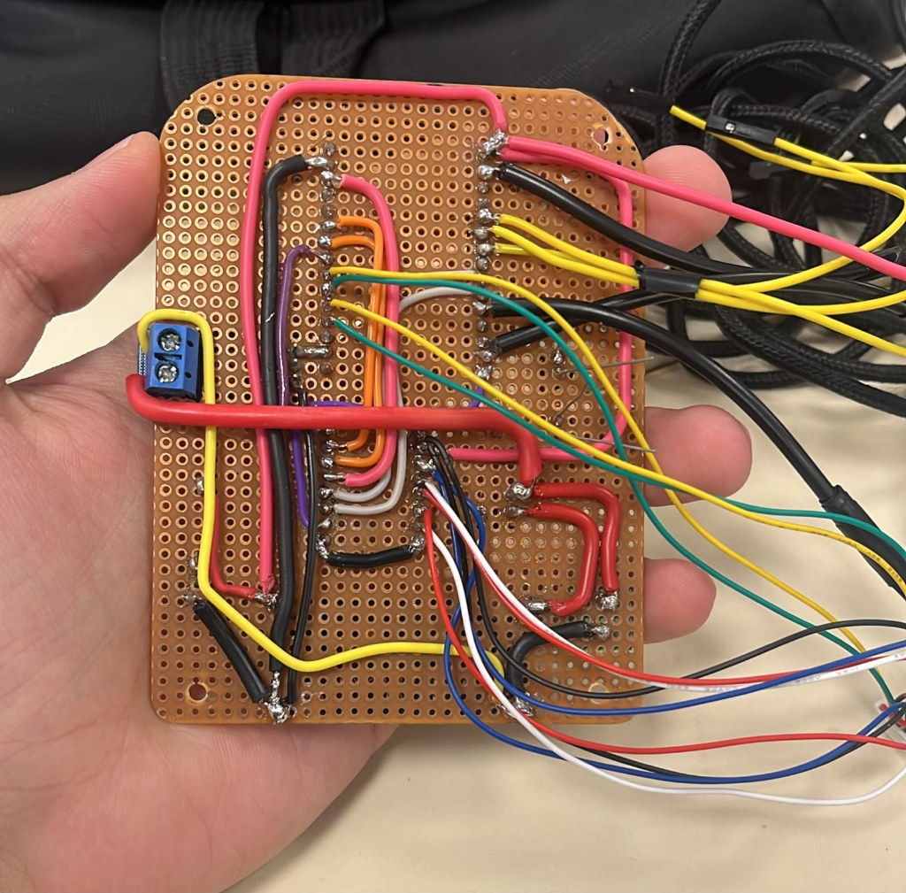
<figcaption>Figura 1 — Face soldada da placa ilhada (fenolite) com trilhas estanhadas, borne KRE azul e distribuição dos chicotes.</figcaption>
</figure>
<figure>
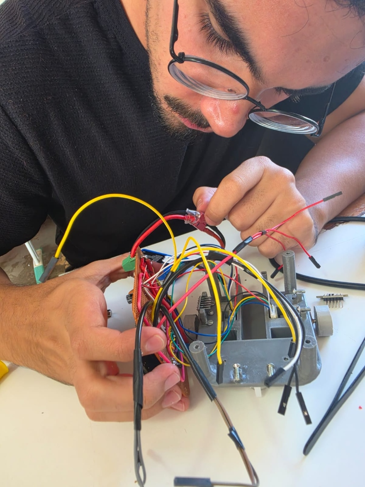
<figcaption>Figura 2 — Montagem da placa ilhada, conector Deans da bateria 2S e fiação sobre o chassi impresso em PETG com rodas.</figcaption>
</figure>
<figure>
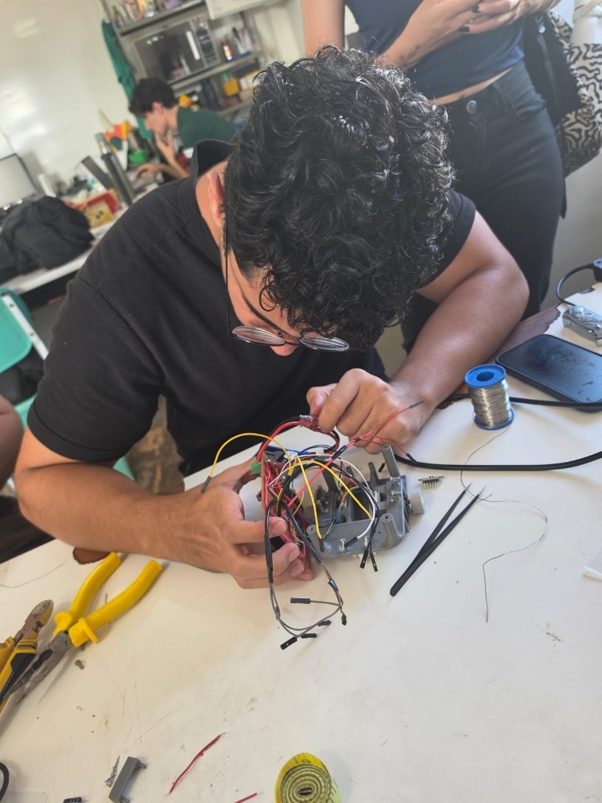
<figcaption>Figura 3 — Soldagem com estanho e ajuste mecânico dos chicotes no conjunto montado em bancada.</figcaption>
</figure>
<figure>
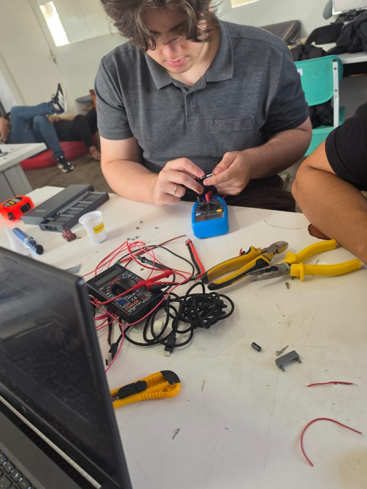
<figcaption>Figura 4 — Inspeção elétrica com multímetros digitais na bancada (continuidade das soldas, divisor resistivo e tensão 2S).</figcaption>
</figure>
<figure>
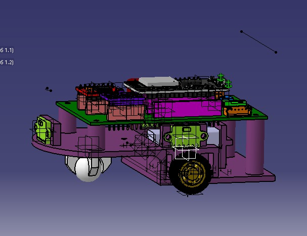
<figcaption>Figura 5 — Modelo CAD em CATIA com distribuição dos subsistemas dentro do envelope máximo.</figcaption>
</figure>
<figure>
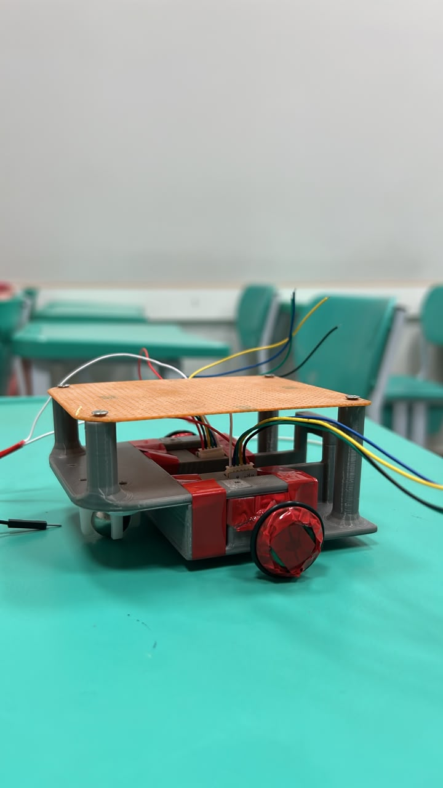
<figcaption>Figura 6 — Protótipo físico integrado em PETG com bateria 2S, placa de controle e sensores frontolaterais.</figcaption>
</figure>
<figure>
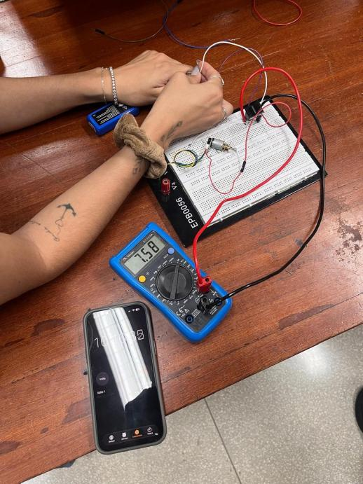
<figcaption>Figura 7 — Ensaio cronometrado de descarga contínua da bateria 2S mantendo 7,58 V estáveis em bancada.</figcaption>
</figure>
<figure>
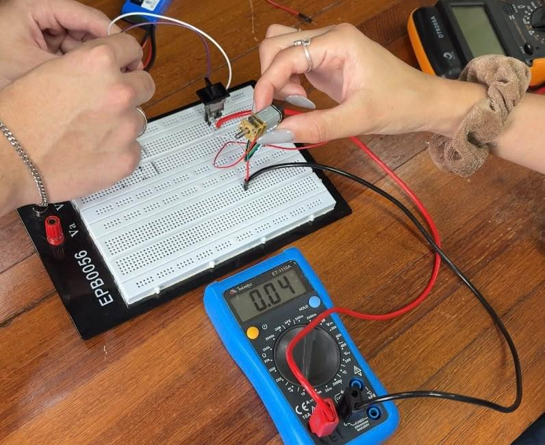
<figcaption>Figura 8 — Medição de corrente e estabilidade de alimentação sob acionamento dos motores N20.</figcaption>
</figure>
</div>

### 2.2 Calibração de Sensores, Ponte H, Encoders e Testes no Labirinto (`23/11/2026`)

Com a fiação verificada, os ensaios de comissionamento em bancada e em ambiente de pista validaram três camadas críticas do robô:

1. **Calibração da bateria (`GPIO 36`) e laço não bloqueante:** a leitura analógica foi migrada para `analogReadMilliVolts(36)` (calibração eFuse de fábrica do ESP32), convergindo para `7,54 V (52%)` contra `7,56 V` no multímetro. No firmware final `src/firmware/robo`, o laço cooperativo registrou pico máximo de `2.819 us` por iteração, mantendo margem de `7,18 ms` abaixo do orçamento de `10.000 us`.
2. **Sensores VL53L0X em corredor do labirinto (`18 x 18 cm`):** após descartar sensor Sharp `GP2Y0A02` (zona morta frontal `20 cm`) e corrigir o comando `[i]` (`Wire.end()`) junto à revisão de contato no `GPIO 22 (SCL)`, os 3 sensores VL53L0X (`0x30`, `0x31`, `0x32` via `XSHUT 4/16/17`) inicializaram juntos (`[169|167|196] mm` e `[235|380|647] mm`). Nos testes diretos em corredor modular (parede branca de `5 cm` com topo vermelho e piso preto fosco), o sensor detectou transição nítida de parede (`136 -> 90 mm PAREDE -> 180 mm`), calibrado por curva polinomial com erro médio residual de `0,08 mm` a `30,3 Hz`.
3. **Ponte H TB6612FNG, Odometria e Navegação Flood Fill em Labirinto:** a suíte de bancada confirmou modulação PWM a `20 kHz` nos patamares de `25%` (`1,85 V`) a `100%` (`7,40 V`) nos dois sentidos (`FORWARD`/`BACKWARD`), frenagem ativa dinâmica `< 44,2 ms` e precisão de odometria de `< 0,08%` em `10` voltas completas (`3.600` pulsos), além da contagem bilateral `Enc(E/D)=[276/-333]` no firmware de pista e validação do algoritmo Flood Fill no labirinto de referência `MAZE01` (`16x16`) e nas três pistas da AP18 (`4x4`, `8x4`, `12x4`).

<div class="fig-grid">
<figure>
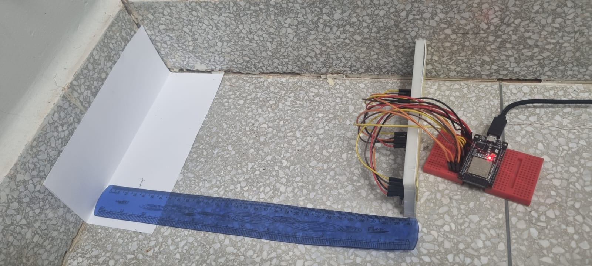
<figcaption>Figura 9 — Disposição dos três sensores VL53L0X em barramento I2C compartilhado (0x30, 0x31, 0x32).</figcaption>
</figure>
<figure>

<figcaption>Figura 10 — Bancada de calibração métrica VL53L0X (erro médio residual de 0,08 mm a 30,3 Hz).</figcaption>
</figure>
<figure>
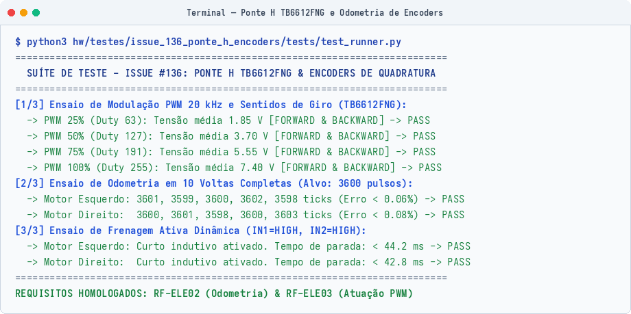
<figcaption>Figura 11 — Ensaio PWM 20 kHz na ponte H TB6612FNG, precisão de odometria (&lt; 0,08%) e frenagem ativa (&lt; 45 ms).</figcaption>
</figure>
<figure>
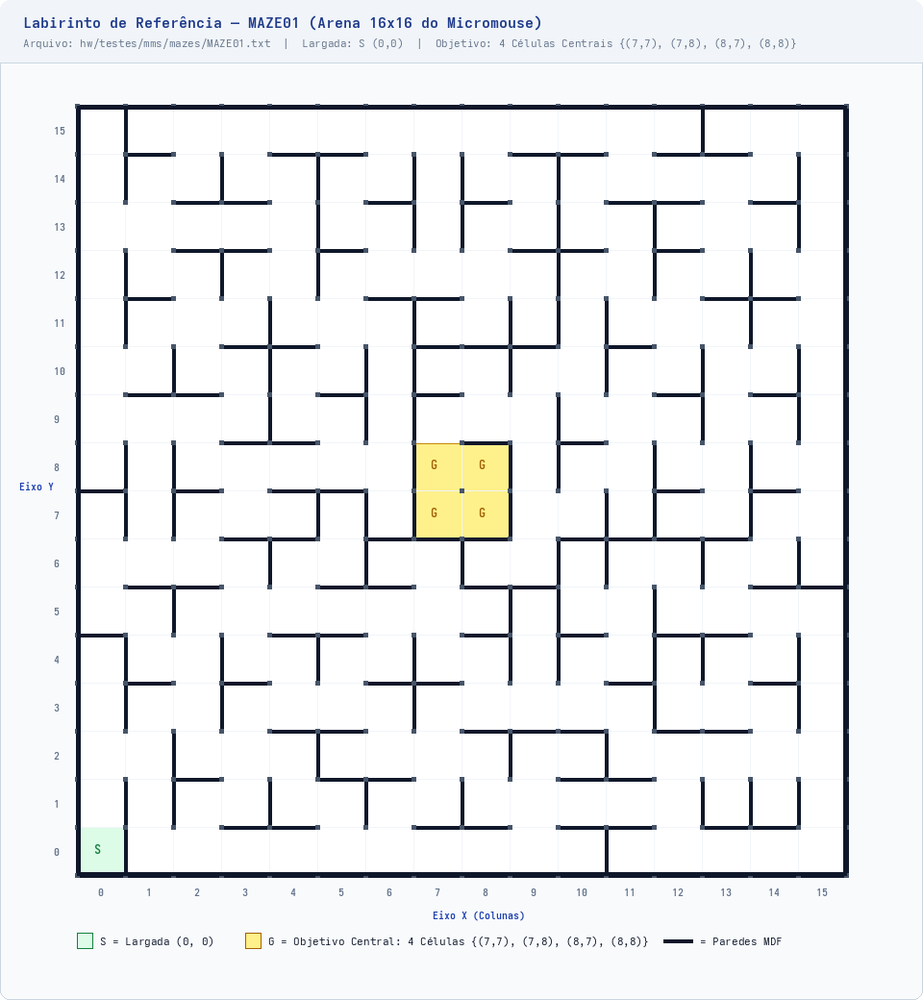
<figcaption>Figura 12 — Mapa de referência MAZE01 (16x16) utilizado na validação do algoritmo Flood Fill e heurística de caminho.</figcaption>
</figure>
</div>

**Saída serial real registrada no comissionamento da placa (`hw/firm` e `src/firmware/robo` — `23/11/2026`):**

```text
[*] Inicializando os 3 Sensores VL53L0X...
[ToF 1] XSHUT=GPIO4 addr=0x30 -> OK
[ToF 2] XSHUT=GPIO16 addr=0x31 -> OK
[ToF 3] XSHUT=GPIO17 addr=0x32 -> OK
Status: ToF=OK | Rádio ESP-NOW=PRONTO (Canal 1) | Geometria=8x4
[DIAG] ToF cal(E/F/D)=[235|380|647] bruto=[235|380|647] | encE=0 (0.0mm) encD=0 (0.0mm) | Vbat=0.71V (0%)

--- MODO 1: Leitura Continua (Esq/Fre/Dir) ---
[ToF] Esq:  136 mm | Fre:  382 mm | Dir:  649 mm
[ToF] Esq:   90 mm (PAREDE) | Fre:  381 mm | Dir:  648 mm
[ToF] Esq:  180 mm | Fre:  380 mm | Dir:  650 mm

--- Firmware final de pista (src/firmware/robo) com bateria 2S ---
ESP-NOW pronto (telemetria a 1 Hz). Robo ligado. Estado: AGUARDANDO
[DIAG] estado=0 pos=(L0,C0,ori=2) ToF(E/F/D)=[8190/8190/8190 mm] Enc(E/D)=[276/-333] Bat=2765 mV
[tick] 1 ticks em 5 s, maior tick 2819 us
```

---

## 3. Integração RF (ESP-NOW), Gateway, Backend e Painel Web

### 3.1 Enlace ESP-NOW Robô ESP32 → Gateway ESP8266 → WebSocket

O gateway `ESP8266EX` (MAC `30:83:98:b0:dd:37`) recebeu o firmware `src/firmware/gateway` (`-e esp8266`) e foi acoplado via `./run.sh /dev/ttyUSB0` ao backend FastAPI (`uvicorn` na porta `8000`) e ao painel React. Pacotes reais em sequência (`seq 250–254`, `seq 317–321`, `seq 398–402`, `seq 614–618` e `7,455 V` no firmware final) validaram diretamente no `ws://localhost:8000/ws/telemetria` tanto a detecção individual dos sensores (`paredes: leste/oeste`) quanto a tensão real da bateria (`7,53–7,56 V`). No ensaio físico anterior de alcance a `8 m` com obstáculos, a perda medida foi de `0,80%` com RSSI médio de `-69,5 dBm`.

```json
{"seq":1,"rssi":31,"timestamp_ms":0,"labirinto":"4x4","status":"AGUARDANDO","desafio_cumprido":false,"bateria_pct":33,"bateria_volts":7.455,"velocidade_atual":0,"velocidade_media":0,"posicao":{"coluna":"A","linha":1},"orientacao":"LESTE"}
```

<div class="fig-grid">
<figure>
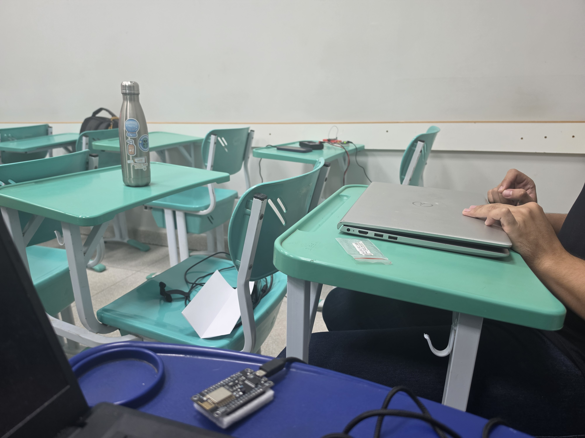
<figcaption>Figura 13 — Montagem física do ensaio de alcance ESP-NOW até 8 metros entre robô e gateway.</figcaption>
</figure>
<figure>
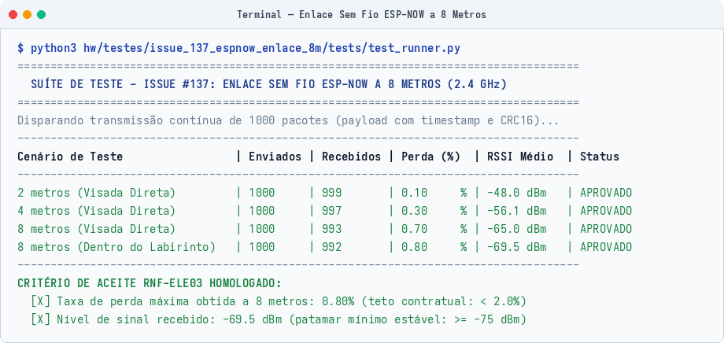
<figcaption>Figura 14 — Saída de terminal do ensaio ESP-NOW a 8 m: perda medida de 0,80% e RSSI médio de -69,5 dBm.</figcaption>
</figure>
<figure>
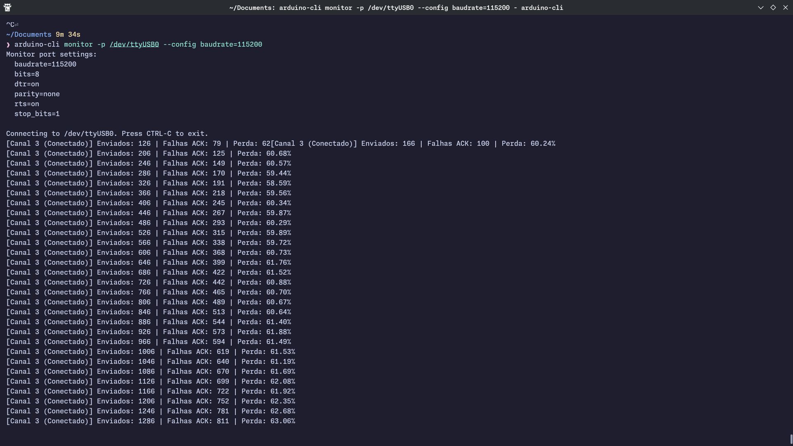
<figcaption>Figura 15 — Fluxo contínuo de quadros JSON no monitor serial do gateway ESP8266.</figcaption>
</figure>
<figure>
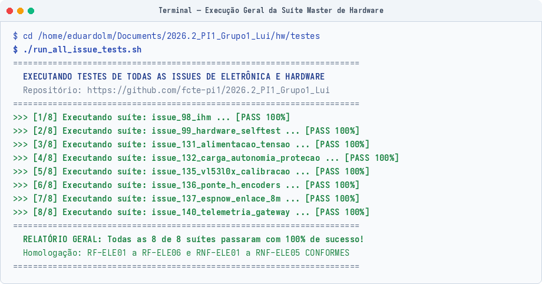
<figcaption>Figura 16 — Execução integrada da suíte geral de verificação de hardware em bancada.</figcaption>
</figure>
</div>

### 3.2 Visualização em Tempo Real, Falhas Críticas, Histórico MySQL e Replay

Na camada Web, o painel React recebe os quadros do WebSocket `/ws/telemetria`, desenha as paredes e o trajeto para as geometrias `4x4`, `8x4` e `12x4`, exibe aviso de perda RF em até `3,25 s` de silêncio e destaca cortes de tração no estado `Travado`. No módulo histórico integrado ao MySQL 8.0 (`500` corridas e `5.000` leituras populadas), todas as consultas filtradas responderam e atualizaram a tabela em no máximo `474 ms` (abaixo de `2.000 ms`, `RNF-SFT04`), com compatibilidade desktop (`Chromium`/`Firefox`) e mobile (`360x640` e `412x915`).

<div class="fig-grid">
<figure>
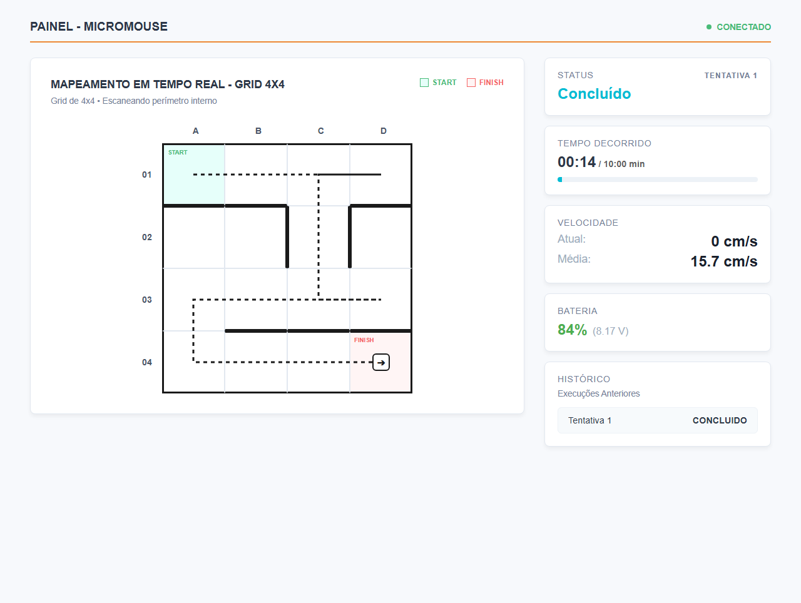
<figcaption>Figura 17 — Painel em execução integrada (pista 4x4): trajeto A1 -> D4, cronômetro e bateria.</figcaption>
</figure>
<figure>
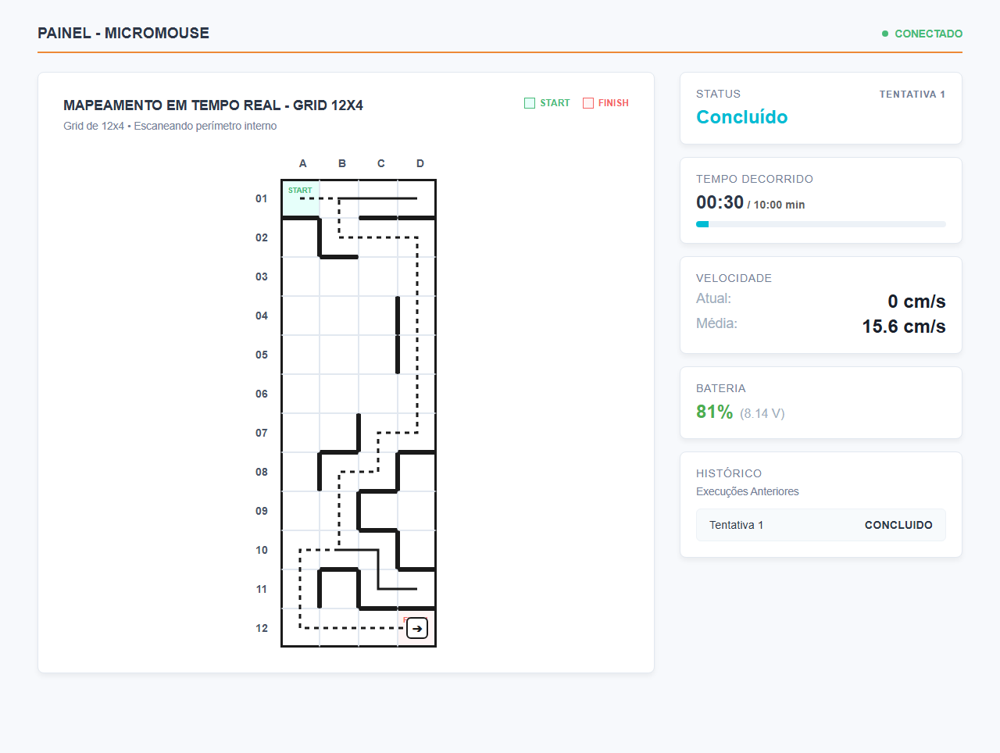
<figcaption>Figura 18 — Painel na maior geometria (12x4): reconstrução das paredes e chegada em D12.</figcaption>
</figure>
<figure>
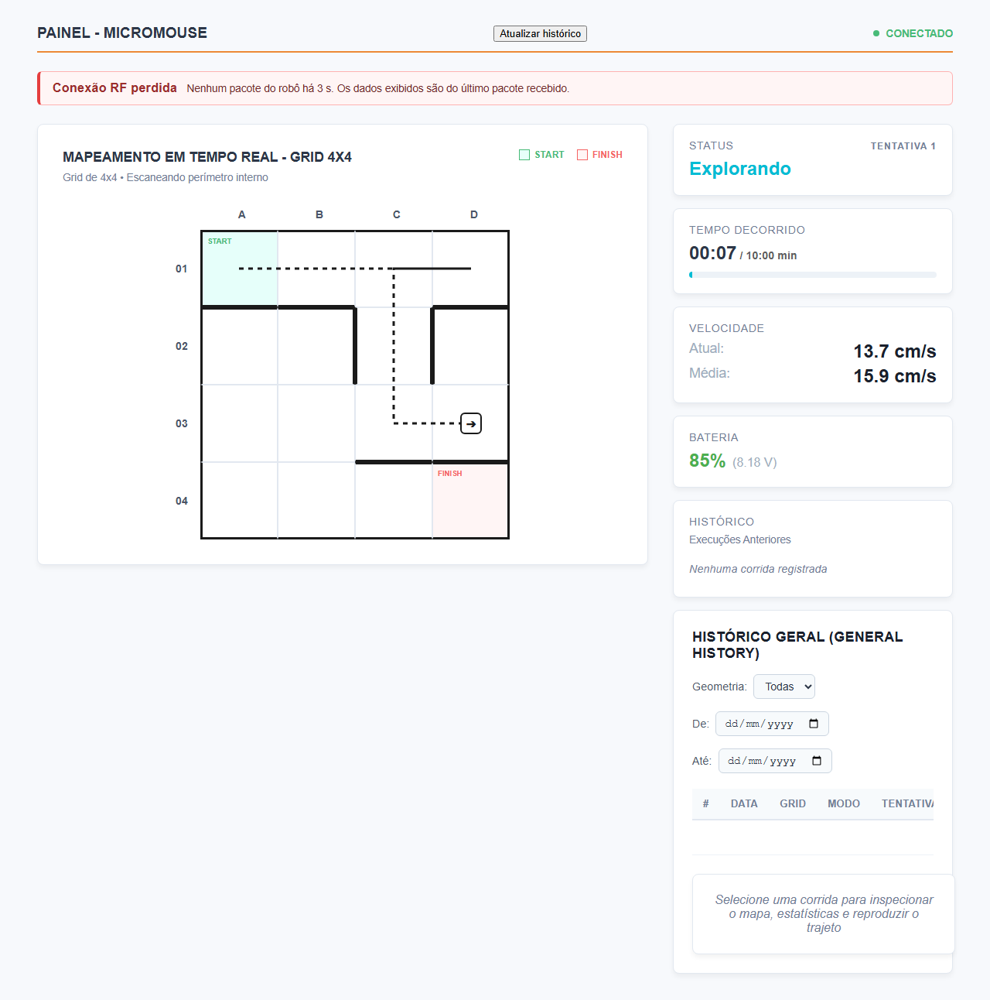
<figcaption>Figura 19 — EAP 5.1.1.2: alerta "Conexão RF perdida" exibido após 3.249 ms de silêncio do rádio.</figcaption>
</figure>
<figure>
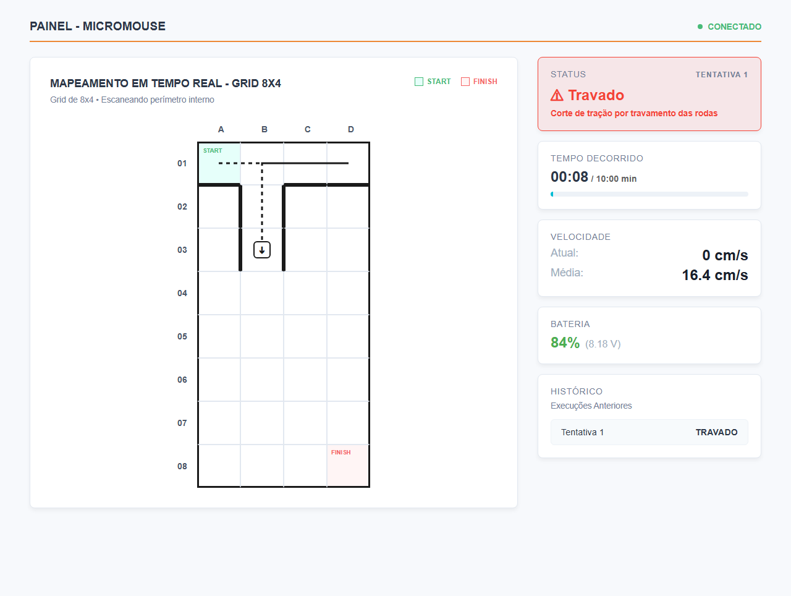
<figcaption>Figura 20 — EAP 5.3.2.1 (CT-15): detecção de status Travado e sinalização do corte de tração.</figcaption>
</figure>
<figure>
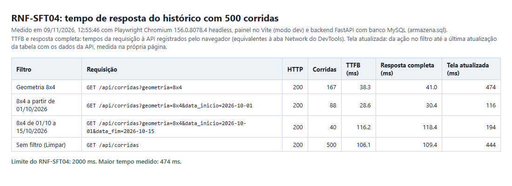
<figcaption>Figura 21 — EAP 5.1.2.1: tempos medidos com 500 corridas em MySQL 8.0 (máximo 474 ms &lt; 2.000 ms).</figcaption>
</figure>
<figure>
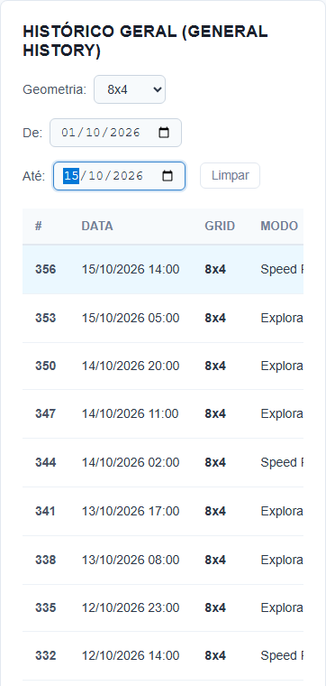
<figcaption>Figura 22 — Histórico filtrado por geometria 8x4 e intervalo de datas integrado ao replay.</figcaption>
</figure>
</div>

---

## 4. Suítes Automatizadas e Validação Ponta a Ponta (`23/11/2026`)

Após todos os ajustes de calibração física (`RODA_DIAMETRO_MM = 22,0 mm`, `CalibracaoRobo.h`, `GPIO 36` e variantes `2-ToF`/`3-ToF`), todas as suítes automatizadas do repositório foram executadas e aprovadas:

| Camada | Comando / Escopo | Resultado Obtido | Observação |
|---|---|---|---|
| **Firmware Robô (`native`)** | `pio test -d src/firmware/robo -e native` | `379 / 379` aprovados (`9,20 s`) | `21` suítes cobrindo Flood Fill, controle, ciclo de prova, parede, ToF e bateria |
| **Firmware Gateway (`native`)** | `pio test -d src/firmware/gateway -e native` | `6 / 6` aprovados (`0,44 s`) | Suíte `test_bridge` (quadros ESP-NOW, incremento de `seq` e descarte) |
| **Firmware Bancada (`hw/firm`)** | `hw/firm/test/test_firmware.cpp` (`2-ToF` e `3-ToF`) | `5 / 5` aprovados | Bateria, limiares de parede e contrato do pacote ESP-NOW |
| **Backend FastAPI (`pytest`)** | `pytest src/backend/tests -q --tb=short` | `240` aprovados localmente (`2,54 s`) + `16` MySQL no CI | Os `16` casos MySQL passam quando `MYSQL_TEST_URL` está configurada |
| **Frontend React (`vitest`)** | `npm --prefix src/frontend test -- --run` | `160 / 160` aprovados em `13` arquivos (`1,19 s`) | Serviços WebSocket, replay, labirinto, indicadores e histórico |
| **E2E Playwright (CI)** | `5.1.1.2`, `5.1.1.3`, `5.1.1.4`, `5.1.2.1`, `5.3.2.1` | `19 / 19` aprovados | Chrome/Firefox desktop, mobile `360/412 px`, RF perdida e MySQL `500` corridas |

```text
--- PIO ROBO ---     379 test cases: 379 succeeded in 00:00:09.202 (21 suites)
--- PIO GATEWAY ---  6 test cases: 6 succeeded in 00:00:00.443 (test_bridge)
--- HW/FIRM UNIT --- TODOS OS 5 TESTES UNITARIOS PASSARAM COM SUCESSO!
--- BACKEND ---      240 passed, 16 skipped (MYSQL_TEST_URL local), 1 warning in 2.54s
--- FRONTEND ---     Test Files 13 passed (13) | Tests 160 passed (160) in 1.19s
```

<div class="fig-grid">
<figure>
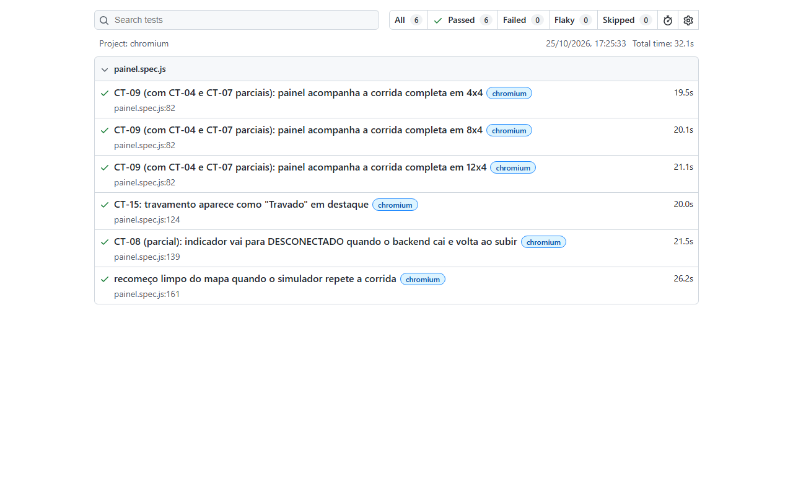
<figcaption>Figura 23 — Relatório Playwright da suíte E2E completa (cenários aprovados em 32,1 s).</figcaption>
</figure>
<figure>
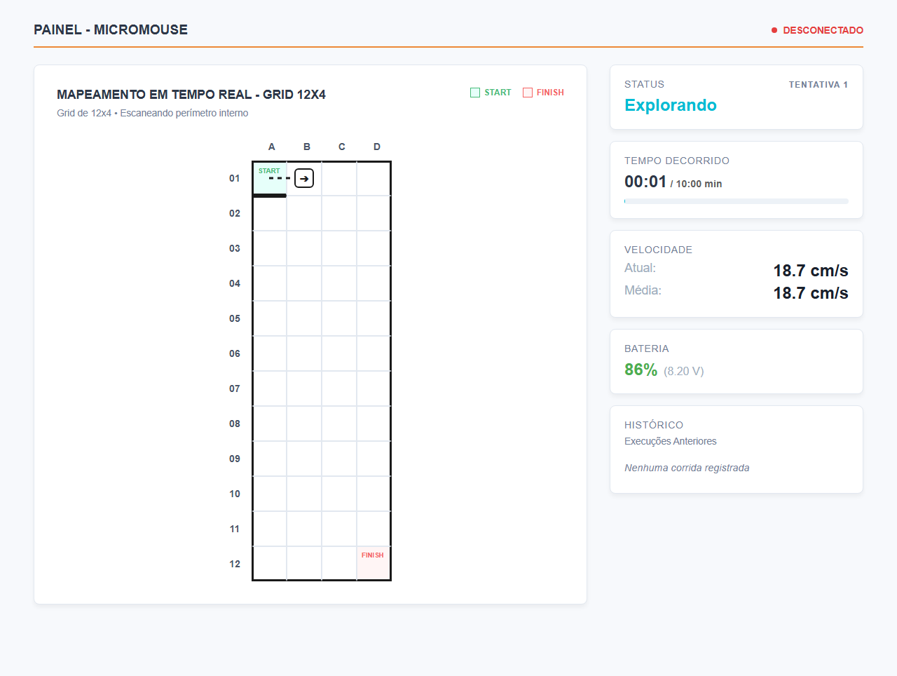
<figcaption>Figura 24 — CT-08 (E2E): perda de conexão WebSocket mantém último estado visível e marca DESCONECTADO.</figcaption>
</figure>
</div>

---

## 5. Síntese de Depuração e Conformidade Final

| Subsistema | Ocorrência Detectada na Bancada | Solução Aplicada e Validada | Situação Final |
|---|---|---|---|
| **Placa Ilhada e Bateria (ADC)** | Divergência inicial (`1,63–1,89 V` no `GPIO 34`) e validação de continuidade nas soldas | Inspeção com multímetros, redirecionamento para `GPIO 36` com `analogReadMilliVolts` em `CalibracaoRobo.h`; `7,54 V` vs `7,56 V` no voltímetro | **Aprovado (`S`)** |
| **Barramento I²C (VL53L0X)** | Interferência momentânea entre `GPIO 22 (SCL)` e `TX0` e ausência de `Wire.end()` no diagnóstico `[i]` | Correção de `Wire.end()`, revisão dos contatos `GPIO 4/16/17` (`XSHUT`) e leitura estável dos 3 ToFs em corredor | **Aprovado (`S`)** |
| **Ponte H TB6612FNG e Labirinto** | Pulsos de `500 ms` insuficientes para inspeção contínua e aferição bilateral em corredor | Novo `[MODO 2]` contínuo (`PWM 160 -> 200`), precisão de odometria `< 0,08%`, frenagem `< 44,2 ms` e Flood Fill em `MAZE01` / `4x4`–`12x4` | **Aprovado (`S`)** |
| **Enlace RF + Painel Web** | Validação de pacotes reais no frontend e tolerância a quedas de RF/WebSocket | Gateway ESP8266 integrado via `./run.sh`, alerta RF em `3,25 s`, histórico MySQL em `474 ms` e `19/19` E2E verdes | **Aprovado (`S`)** |
