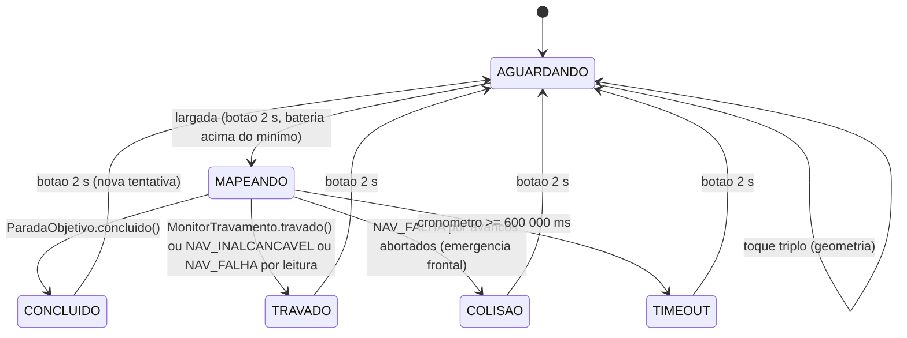
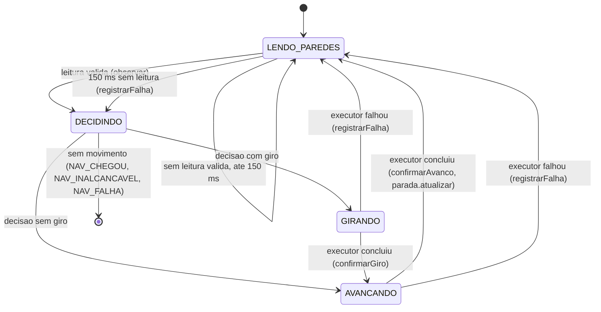

# Integração do laço principal do firmware do robô

Issue [#149](https://github.com/fcte-pi1/2026.2_PI1_Grupo1_Lui/issues/149) (EAP 5.3.1.3). Auditoria do código existente e desenho do `loop()` que liga navegação, controle, segurança, parada e telemetria aos drivers do robô. Base: `main` em `2a9630b` (10/11/2026), com `pio test -e native` em 227 casos aprovados e `pio run -e esp32dev` compilando (RAM 13,5 %, flash 57,2 %).

Escopo de escrita deste trabalho: `src/firmware/robo`, `src/firmware/lib/telemetria` (só se indispensável, sem mudar o contrato) e `docs/firmware/`. O firmware da Eletrônica (`hw/firm`), o gateway e os documentos das outras áreas são referência e não são alterados; o que depende deles está listado na seção 5.

## Sumário

1. [Situação atual](#1-situação-atual)
2. [Auditoria](#2-auditoria)
3. [Desenho do laço principal](#3-desenho-do-laço-principal)
4. [Plano de execução](#4-plano-de-execução)
5. [Pendências para as outras áreas](#5-pendências-para-as-outras-áreas)
6. [Roteiro preliminar do primeiro dia de bancada](#6-roteiro-preliminar-do-primeiro-dia-de-bancada)

---

## 1. Situação atual

### 1.1 O que existe e está testado no ambiente nativo

| Módulo | Arquivo | HU | Estado na `main` |
|:---|:---|:---|:---|
| `Direcao`, `Mapa` | `src/mapa/` | HU-03 | Usados pelo `Navegador` e pela telemetria |
| `Botao`, `Cronometro` | `src/botao/`, `src/cronometro/` | HU-05 | Ligados no `loop()` |
| `Navegador`, `SensoresParedes`, `ExecutorMovimento` | `src/navegacao/` | HU-06 | Instanciado no `main`, mas `iniciar()` e `passo()` nunca são chamados |
| `ParadaObjetivo`, `AdaptadorCronometro` | `src/parada/` | HU-07 | Não instanciados |
| `ControleReta` | `src/controle/ControleReta.h` | HU-01 | Não instanciado |
| `ControleCurva` | `src/controle/ControleCurva.h` | HU-02 | Não instanciado |
| `DetectorTravamento`, `MonitorTravamento` | `src/seguranca/` | HU-18 | Não instanciados |
| `Bateria`, `BateriaConversao`, `VelocidadeMedia` | `src/sensores/`, `src/navegacao/` | HU-08 | Ligados na telemetria |
| `RadioTelemetria` | `src/radio/` | HU-08 | Ligado na telemetria |
| `Pinos.h` | `src/hardware/Pinos.h` | #149 | Pinagem e constantes da Eletrônica, usado por bateria e controles |
| Contrato de dados | `lib/telemetria` | #139 | Pacote de 18 bytes, codec, JSON, `TemporizadorPeriodico` |

O `main.cpp` de hoje trata botão, cronômetro, LED e telemetria a 1 Hz. Não há drivers de motores, encoders nem sensores ToF em `src/firmware/robo`; eles existem, funcionando no robô, em `hw/firm` (ponte H TB6612FNG com freio, encoders por interrupção, três VL53L0X com XSHUT e bateria), junto com um menu de testes de bancada.

### 1.2 Hipótese sobre a IMU

O doc 4.3 lista a MPU6050 no orçamento e na tabela de conectores, mas o firmware da Eletrônica que roda no robô não tem driver de IMU, `pinout.h` não reserva pino nem endereço I2C para ela e nenhum ensaio do 7.3 a utiliza. A hipótese de trabalho é que **o robô não tem IMU**. O desenho abaixo funciona sem ela (os dois controles já aceitam `imuValido = false`) e deixa um ponto de entrada caso ela apareça. A confirmação está na seção 5.

---

## 2. Auditoria

### 2.1 Método

Leitura integral de `src/firmware/robo` (fonte e testes), `src/firmware/lib/telemetria`, `src/firmware/gateway/src/main.cpp` e `hw/firm` (fonte, testes e README), com os docs 4.3, 4.4 e 7.3 como referência. Cada achado traz arquivo e linha na `main` em `2a9630b`, o motivo e a correção proposta, com a etapa em que ela entra (seção 4). A classificação é:

- **Bloqueia**: sem a correção o `loop()` integrado não funciona, ou funciona errado no robô.
- **Risco**: pode falhar no robô ou na bancada; a correção é barata e entra junto com a integração.
- **Melhoria**: não impede a integração; fica registrada para depois, se houver tempo.

### 2.2 Achados que bloqueiam a integração

| Id | Onde | Problema | Correção proposta | Etapa |
|:---|:---|:---|:---|:---|
| B1 | `controle/ControleCurva.h:48` (`enum Orientacao`), `:142` (`definirOrientacao`), `:212` (`girar`), `:221` (`orientacao_`); `navegacao/Navegador.h:63` (`Direcao orientacao_`); `mapa/Direcao.h:9` | **Três representações de orientação.** `Direcao` e `Orientacao` são dois enums com os mesmos valores e funções de giro duplicadas, e dois objetos guardam estado de orientação: o `Navegador` (atualizado em `confirmarGiro`) e o `ControleCurva` (atualizado em `CURVA_CONCLUIDA`). O rumo ideal contínuo do `ControleCurva` (`rumoIdealGraus_`) é uma terceira forma. Basta uma curva falhar ou ser abortada para as duas cópias divergirem, e a telemetria pode publicar uma orientação diferente da que o mapa usa. | O `Navegador::orientacao()` (tipo `Direcao`) passa a ser a única fonte da orientação de grade. O `ControleCurva` deixa de guardar orientação: saem `enum Orientacao`, `definirOrientacao()`, `orientacao()`, a tabela `girar()` e o parâmetro `inicial` do construtor. A classe passa a controlar só o ângulo. Os testes de `test_curva` que conferem a orientação após as curvas passam a conferir o estado `CURVA_CONCLUIDA` e o erro final (a conferência de N/L/S/O já é coberta por `test_direcao` e `test_navegador`). Mudança de interface justificada: elimina a duplicação de estado e deixa o `ControleCurva` reutilizável no speed run. | 3 |
| B2 | `navegacao/Navegador.h:155` (`NAV_CHEGOU`) e `parada/ParadaObjetivo.h:106` (`atualizar`) | **Chegada detectada em dois lugares.** Os dois calculam o destino do mesmo jeito (última linha da coluna D), mas são dois critérios independentes; se divergirem (por exemplo geometria trocada sem reconfigurar o `ParadaObjetivo`), o robô pode parar de navegar sem parar os motores ou o contrário. O `main` ainda não configura o objetivo do `ParadaObjetivo` ao trocar a geometria. | Dividir papéis sem mudar interfaces: o `Navegador` detecta a célula (é quem sabe onde o robô está) e o `ParadaObjetivo` é o único a agir (parar tração e congelar cronômetro) e o único que autoriza o estado `CONCLUIDO`. O laço chama `parada.atualizar(nav.linha(), nav.coluna())` logo depois de `confirmarAvanco()` e só muda o estado para `CONCLUIDO` quando `parada.concluido()`. O objetivo é reconfigurado por `configurarObjetivoPorGeometria()` a cada largada. `desafio_cumprido` vem de `parada.desafioCumprido()`. O `Navegador::estadoRobo()` não é usado para o estado publicado. | 5 |
| B3 | `navegacao/Navegador.h:169` (`passo`); `navegacao/InterfacesNavegacao.h:36-37` | **`passo()` bloqueia durante o movimento.** O contrato de `ExecutorMovimento` é "retorna quando o movimento terminou", ou seja, 1 a 2 s por célula no robô. Nesse intervalo o `loop()` não roda telemetria (1 Hz), botão, LED nem o monitor de travamento (50 ms), e o corte por travamento perderia o prazo de 1,2 s. | O robô não usa `passo()`: o laço usa as três camadas que o `Navegador` já expõe (`observar`, `decidir`, `confirmarGiro`, `confirmarAvanco`, `registrarFalha`) a partir de uma máquina de estados sem bloqueio (seção 3). `passo()` e `ExecutorMovimento` ficam como estão, para os testes e o `SimuladorLabirinto`. Entra uma interface nova, não bloqueante, para o executor real (`iniciarGiro`/`iniciarAvanco`/`atualizar`), e um adaptador que embrulha um `ExecutorMovimento` bloqueante nela, para o robô virtual reaproveitar o simulador. Nenhuma assinatura existente muda. | 3 e 5 |
| B4 | `hw/firm/src/encoder_driver.cpp:16,24,39-40`; `hw/firm/include/pinout.h:55`; `hardware/Pinos.h` (`ENCODER_PULSOS_POR_VOLTA = 360`) | **Forma de contar pulsos vs. 360 pulsos por volta.** A ISR conta só a borda de subida do canal A (decodificação 1x). O comentário diz "12 CPR x 30:1 = 360": 12 CPR nos encoders magnéticos de N20 costuma ser a contagem em 4x (3 pulsos por canal por volta do motor); em 1x daria 90 pulsos por volta da roda. O relatório 7.3 fala em disco de 7 pares de polos com "borda simples", o que daria 210. As fontes são incoerentes e o ensaio de 3600 pulsos do 7.3 foi feito com a pinagem antiga e outro firmware. Se a constante estiver errada por 4x, "avançar 180 mm" vira 720 mm. | A constante fica única em `Pinos.h` e todos os cálculos (odometria, alvo de avanço, giro por encoders, velocidade) a usam. **Medir no primeiro dia de bancada** com o teste 3 do menu do `hw/firm` (uma volta da roda na mão) e corrigir `ENCODER_PULSOS_POR_VOLTA` e o `test_pinos`. O firmware não deve depender de 360 estar certo: o executor usa o alvo em pulsos derivado da constante, e o robô virtual roda com qualquer valor. | 4 (código) e bancada |
| B5 | `controle/ControleCurva.h:120-124,165` | **Sem IMU, a curva seguinte mira 180°.** `iniciar()` guarda o yaw recebido como referência só na primeira curva e depois soma ±90° ao rumo ideal acumulado; `atualizar()` com `imuValido = false` calcula o ângulo atual como `yawInicio + giroPorEncoders`. Se o laço passar sempre o mesmo yaw (0, por não ter IMU), na segunda curva o erro começa em 180° e o robô gira meia volta. | O executor mantém o rumo nominal da grade a partir da orientação do `Navegador` (fonte única, B1): antes de cada curva chama `ressincronizar(rumoNominal)` e passa esse mesmo valor em `iniciar()`, com `imuValido = false`. Assim cada curva é relativa (erro inicial ±90°) e o `ControleCurva` não muda. Se uma IMU aparecer, basta passar o yaw real e `imuValido = true`. | 5 |
| B6 | `src/main.cpp` (sem conversão); `hw/firm/include/tb6612_driver.h` (`int16_t speed` de -255 a 255); `controle/*.h` (saídas em mm/s) | **Falta a conversão de velocidade em PWM.** Os controles entregam mm/s por roda; a ponte H recebe PWM de 8 bits. Não existe essa camada em lugar nenhum. | Módulo puro `ConversorVelocidadePwm` (testável no nativo): mapa linear com zona morta (`pwmMinimo` e `pwmPorMmS`, em `Pinos.h` como valores provisórios a calibrar), saturação e sinal. Primeiro dia: malha aberta com o PWM 90 do `hw/firm` como referência (35 %); se sobrar tempo, PI de velocidade por roda sobre os encoders, sem mudar a interface. | 4 |
| B7 | `parada/ParadaObjetivo.h:48` (`ITracao::parar`); `seguranca/MonitorTravamento.h:95-110`; executor (a criar) | **O corte de segurança pode ser desfeito no ciclo seguinte.** `parar()` é chamado de dentro do `ParadaObjetivo` ou do `MonitorTravamento`, mas o executor continua rodando o controle e no próximo tick reaplica PWM. | O driver de motores tem um trinco: `parar()` freia e marca `bloqueado`; qualquer `comandar()` posterior é ignorado até `liberar()` na próxima largada. O executor, ao ver `bloqueado`, vai para um estado terminal. Testado no nativo. | 4 e 5 |
| B8 | `src/main.cpp:185-192` (estados terminais vazios); `cronometro/Cronometro.h` (só satura em 600 000 ms) | **Não existe a transição para `TIMEOUT`** (10 min, doc 4.4 seção 4.3) nem para `COLISAO`. O cronômetro satura e o robô continuaria andando com o painel mostrando 10:00. | Na máquina de estados: `decorridoMs >= TELEMETRIA_TIMESTAMP_MAX_MS` em `MAPEANDO` corta a tração e vai para `TIMEOUT`. `COLISAO` fica definido na seção 3.7 (parada de emergência frontal repetida). | 5 |
| B9 | `src/main.cpp:46-56` | **Campos da telemetria sem origem**: `desafio_cumprido` nunca é preenchido (sempre 0) e `velocidade_atual` é fixa em 0. O painel e o encerramento da corrida no backend usam os dois. | `desafio_cumprido = parada.desafioCumprido()`, `velocidade_atual` da odometria (média das duas rodas em uma janela de 200 ms, como o `hw/firm` já faz). Tabela completa na seção 3.8. | 5 |
| B10 | `hw/firm/src/vl53l0x_manager.cpp:37,53,69` (`setTimeout(500)`) e `:93,102,111` (`readRangeContinuousMillimeters`) | **Leitura dos ToF bloqueante.** `readRangeContinuousMillimeters()` espera a amostra ficar pronta: até 33 ms por sensor em operação normal e **até 500 ms por sensor** se um deles parar de responder no meio da prova, o que trava o laço por 1,5 s e fura o prazo do corte por travamento. | No driver portado, consultar o registrador de "amostra pronta" (`RESULT_INTERRUPT_STATUS`, via `readReg`, que a biblioteca Pololu expõe) e só então ler; sensor sem amostra nova por mais de 100 ms é marcado inválido naquele ciclo, sem bloquear. Timeout da biblioteca reduzido a 20 ms como segunda barreira. | 4 |

### 2.3 Riscos

| Id | Onde | Problema | Correção proposta | Etapa |
|:---|:---|:---|:---|:---|
| R1 | `seguranca/DetectorTravamento.h:57`; `seguranca/MonitorTravamento.h:32` (`tracaoAtiva()` único) | **Tração ativa única para as duas rodas.** Os pulsos são monitorados por roda, mas a tração é um único booleano. Se o controle deixar uma roda parada de propósito por mais de 1 s enquanto a outra gira (hoje não acontece: a reta satura em `base - 60` mm/s e a curva usa velocidade mínima nas duas rodas), essa roda seria dada como travada. O caso real é a zona morta: a velocidade mínima da curva (12 mm/s, `ControleCurva.h:100`) abaixo da zona morta deixa as duas rodas sem pulsos e dispara o corte em 1 s. | Acrescentar sobrecarga com tração por roda (`verificar(bool tracaoEsq, bool tracaoDir, ...)`) no detector e `tracaoEsqAtiva()/tracaoDirAtiva()` em `IFonteTracao` com implementação padrão delegando a `tracaoAtiva()`. As assinaturas atuais continuam valendo e os 350 testes de `test_travamento` não mudam. A zona morta é calibração de bancada (`pwmMinimo`, B6); o conversor nunca emite PWM entre 0 e `pwmMinimo`. | 3 |
| R2 | `hw/firm/include/pinout.h:59` (`CELL_SIZE_MM 168`); `navegacao/VelocidadeMedia.h:11` (`TAMANHO_CELULA_MM 180`) | **Dois tamanhos de célula.** 180 mm é o passo entre centros de células (regulamento); 168 mm é o vão livre entre paredes de 12 mm. O avanço de uma célula é 180 mm de centro a centro; o `hw/firm` avança 168. | `Pinos.h` ganha `CELULA_MM = 180` e `VAO_CORREDOR_MM = 168`; `VelocidadeMedia` passa a usar a primeira. Validar na pista real (a pista da AP18 pode ter outra medida; vira constante única). | 3 |
| R3 | `hw/firm/include/pinout.h:84` (110 mm); doc 4.3 seção sobre sensores (120 mm com histerese de 5 mm); `controle/ControleReta.h:88` (100 mm para "parede válida") | **Três limiares de parede.** Com o robô centrado, a parede lateral fica a cerca de 40 mm do sensor e a ausência de parede mostra pelo menos 200 mm, então qualquer limiar entre 90 e 150 mm funciona; o problema é ter três valores em três lugares. | Classificador puro de paredes (`ClassificadorParedes`) com um limiar e histerese em `Pinos.h`, usado tanto para o `SensoresParedes` quanto como `distMaxParedeMm` do `ControleReta`. Valor inicial 110 mm, a confirmar na bancada com o teste 1 do menu do `hw/firm`. | 4 |
| R4 | `hw/firm/src/battery_monitor.cpp:25-35`; `sensores/Bateria.cpp`; `sensores/BateriaConversao.h:19` | **Duas leituras de bateria diferentes.** O `hw/firm` usa `analogRead` bruto vezes 3,3/4095 (sem calibração do ADC) e porcentagem de 6,6 a 8,4 V; o robô usa `analogReadMilliVolts` (calibrado de fábrica) com divisor 5:1 e porcentagem de 7,0 a 8,4 V (igual ao simulador do backend). O divisor montado ainda não foi confirmado (5:1 do módulo ou 100 k/47 k do doc 4.3). | Manter a `Bateria` do robô (mais exata). Confirmar o divisor com multímetro no primeiro dia e ajustar `BATERIA_R_*` em `Pinos.h`. Definir `BATERIA_MINIMA_LARGADA_MV` (6 800 mV, o alarme do `hw/firm`) para recusar a largada; durante a prova não há corte automático (ver 3.7). | 4 e bancada |
| R5 | `hardware/Pinos.h` (`PINO_LED_ESTADO = 14`, provisório); `hw/firm/include/pinout.h:104` (`PIN_STATUS_LED 14`, LED comum com `digitalWrite`); `src/main.cpp` (NeoPixel) | **LED de estado indefinido.** O robô aciona um WS2812B no GPIO 14; a Eletrônica trata o 14 como LED comum ou pino livre. Se o LED montado for comum, o firmware do robô não acende nada e o operador perde a indicação de "pode soltar" da largada. | Implementar `ISinalizacaoEstado` com duas variantes selecionadas por uma constante em `Pinos.h` (`LED_WS2812B` ou LED comum com padrões de piscada). Confirmar com a Eletrônica. | 4 |
| R6 | `seguranca/MonitorTravamento.h:36-42` (`IFontePulsos` pede o instante do último pulso); `hw/firm/src/encoder_driver.cpp` (só contagem) | **O driver de encoders não registra instante de pulso.** | A parte pura `Odometria` (testável) recebe as contagens a cada tick e registra o instante em que cada contagem mudou; isso implementa `IFontePulsos` sem tocar na ISR. | 4 |
| R7 | `hw/firm/src/encoder_driver.cpp:16,24`; `hw/firm/src/tb6612_driver.cpp` (sentido) | **Sinais de sentido a confirmar.** As ISRs usam convenções espelhadas para os dois motores e a ponte H define "frente" pela fiação. `ControleReta` e `DetectorTravamento` assumem que as duas contagens crescem ao avançar. | Constantes `ENCODER_ESQ_INVERTIDO`, `ENCODER_DIR_INVERTIDO`, `MOTOR_ESQ_INVERTIDO`, `MOTOR_DIR_INVERTIDO` em `Pinos.h`, aplicadas nos drivers; conferência no primeiro dia (testes 2 e 3 do menu). | 4 e bancada |
| R8 | `src/main.cpp:62-71` (`piscarFeedbackLED` com `delay(150)`, até 900 ms) e `:195` (`delay(10)`) | **Bloqueios no laço.** Só ocorrem em `AGUARDANDO`, mas atrasam telemetria e debounce e o `delay(10)` limita o laço a 100 Hz. | Piscadas por temporizador (`TemporizadorPeriodico`) e laço sem `delay` fixo, com ritmos explícitos (seção 3.4). | 5 |
| R9 | `navegacao/Navegador.h:78-88` (`iniciar()` não limpa o mapa); `src/main.cpp:157-160` (`darLargada`) | **Segunda tentativa sem reiniciar.** O doc 4.4 prevê `CONCLUIDO -> AGUARDANDO` ("robô reposicionado"); hoje os estados terminais ignoram o botão e o mapa só é limpo em `setGeometria`. | Em qualquer estado terminal, segurar 2 s e soltar volta a `AGUARDANDO`: `mapa.setGeometria(geo)` (limpa), `cronometro.zerar()`, `parada.iniciarProva()`, `monitor.iniciarProva()`, `motores.liberar()`. A telemetria volta a `AGUARDANDO` com `timestamp_ms = 0`, que é o que o backend usa para abrir nova tentativa. Não viola o RNF-SFT01, pois a prova já terminou. | 5 |
| R10 | `parada/AdaptadorCronometro.h:16` (`uint32_t (*)()`) | `millis()` do Arduino-ESP32 devolve `unsigned long`, tipo distinto de `uint32_t` no ESP32; o ponteiro não casa sem um invólucro. | Função `static uint32_t agoraMs() { return (uint32_t)millis(); }` no `main`. Sem mudança de interface. | 5 |
| R11 | `hw/firm/src/vl53l0x_manager.cpp:40` (33 ms de orçamento, cerca de 30 Hz) | **Ritmo dos ToF vs. 20 Hz mínimos do doc 4.4.** A 30 Hz, com o laço a 100 Hz, cada amostra é usada por 3 ticks. O controle de reta deriva o erro por amostra nova. | O controle só chama `ControleReta::atualizar()` quando há amostra nova dos laterais (a classe avisa que chamar mais rápido gera derivada nula seguida de picos). Encoders e segurança rodam em todo tick. | 5 |
| R12 | `test/test_navegador/SimuladorLabirinto.h` | O simulador vive dentro de um diretório de teste; o robô virtual (outro diretório) precisa dele. | Mover para `test/comum/SimuladorLabirinto.h` e ajustar o `#include` do `test_navegador`. Sem mudança de código do simulador. | 6 |

### 2.4 Melhorias

| Id | Onde | Observação | Proposta |
|:---|:---|:---|:---|
| M1 | `seguranca/MonitorTravamento.h:138` | `estadoRobo()` devolve `MAPEANDO` quando não há travamento, o que induz a usar o monitor como fonte de estado. | Não usar; o estado é do laço. Comentário no código. |
| M2 | `navegacao/Navegador.h` (`estadoRobo()`) | Mapeia `NAV_INALCANCAVEL` e `NAV_FALHA` para `TRAVADO`. | Não usar para publicar; o laço decide (3.7). |
| M3 | `src/main.cpp` | `telemetria.labirinto_id` é atualizado em dois lugares. | Preencher tudo em um único `montarTelemetria()`. |
| M4 | `platformio.ini` (`build_src_filter = -<*>` no nativo) | O laço só é testável no nativo se a lógica dele não depender do Arduino. | Lógica do laço em cabeçalhos puros (`src/app/`), com o `main.cpp` reduzido ao invólucro Arduino (3.2). |
| M5 | doc 4.4 seções 4.1 e 4.3 | O documento prevê tarefas FreeRTOS com mutex; o desenho aprovado usa um laço cooperativo (3.1). | Atualizar o 4.4 na etapa 3 (justificativa em 3.1); os tempos de tick medidos no robô entram no relatório 7.5. |
| M6 | `hw/firm/src/main.cpp:71` (`PWM_TESTE = 90`, avanços e curvas em malha aberta por contagem de pulsos) | Rotinas de bancada úteis como referência de parâmetros (PWM de partida, alvos em pulsos, freio e 200 ms de assentamento). | Reaproveitar os valores como padrão inicial do executor e manter o `hw/firm` gravável para diagnóstico. |

### 2.5 Impacto de não ter IMU

| Onde a IMU era usada | O que acontece sem ela | Mitigação no desenho |
|:---|:---|:---|
| `ControleReta` em `MODO_RUMO` (sem parede em um dos lados) | O rumo vem da diferença dos encoders desde `iniciar()`; derrapagem vira erro de rumo. | A reta é de uma célula (180 mm) e `iniciar()` é chamado em toda célula com o robô parado e, quando há paredes, centrado. O erro não acumula entre células. |
| `ControleCurva` (medida do giro e alvo absoluto) | Giro só por encoders; o alvo absoluto não existe (B5). | Curva relativa com `ressincronizar(rumoNominal)` antes de cada curva; `discrepanciaGraus` fica 0 na telemetria de depuração. |
| Critério de ±3° do RF-SFT01 | Não há como medir o ângulo absoluto a bordo. | Realinhamento passivo pelas paredes: o controle de reta com duas paredes corrige o rumo na célula seguinte; com parede frontal, o avanço termina a uma distância fixa dela ("encosto frontal"), o que zera o erro longitudinal da odometria. A medição do ±3° fica para a bancada com câmera (CT-02). |
| `IFontePulsos`/odometria do doc 4.4 ("encoders e IMU") | Só encoders. | A `Odometria` pura expõe deslocamento por roda, velocidade e rumo odométrico; se uma IMU aparecer, entra como `IFonteRumo` opcional sem mudar o restante. |

### 2.6 Drivers do `hw/firm` frente às interfaces da lógica

| O que a lógica espera | Interface / tipo | O que o `hw/firm` oferece | Lacuna e adaptação (etapa 4) |
|:---|:---|:---|:---|
| Parede à frente, esquerda e direita da célula | `SensoresParedes::lerParedes(bool&, bool&, bool&)` → `false` se leitura inválida | `vl53l0x_manager_read()` → distâncias (`uint16_t`, 8190 = inválida), flags `*_valid` e `wall_*` com limiar fixo de 110 mm; leitura bloqueante | Driver `SensoresToF` (hardware, leitura não bloqueante, B10) + `ClassificadorParedes` puro (limiar e histerese, R3). `lerParedes` devolve `false` se algum sensor estiver inválido; o laço repete por até 150 ms antes de registrar falha. |
| Distâncias laterais para centrar | `EntradaControleReta::distEsqMm/distDirMm` (`float`, negativo = inválida) | Idem | Conversão `uint16_t` + `valid` → `float` ou -1. |
| Yaw | `EntradaControleReta::yawGraus/imuValido`, `EntradaControleCurva` idem | Nada | `imuValido = false` sempre; `yawGraus` = rumo nominal da grade (B5). |
| Contagem acumulada por roda | `EntradaControleReta::encEsq/encDir` (`int32_t`, cresce ao avançar), `EntradaControleCurva` idem | `encoder_get_ticks_left/right()` (`int32_t`, ISR 1x, sentido a confirmar) | Driver `Encoders` (hardware) → `Odometria` pura (contagens, mm, velocidade, instante do último pulso, rumo odométrico) usando `Pinos.h`. Inversão por constante (R7). |
| Velocidade desejada por roda | `SaidaControleReta/Curva::velEsqMmS/velDirMmS` (mm/s, curva pode ser negativa) | `tb6612_set_motors(int16_t, int16_t)` em PWM -255..255 | `ConversorVelocidadePwm` puro (B6) + driver `Motores` (hardware) com trinco (B7). |
| Parar a tração em menos de 200 ms | `ITracao::parar()` | `tb6612_brake()` (freio ativo) e `tb6612_stop()` (roda livre) | `Motores::parar()` = freio ativo imediato; roda livre e standby só na volta a `AGUARDANDO`. |
| Saber se há tração | `IFonteTracao::tracaoAtiva()` | Nada (o driver não guarda estado) | `Motores` guarda o último comando por roda; tração ativa = PWM diferente de zero (por roda, R1). |
| Instante do último pulso por roda | `IFontePulsos::getUltimoPulsoEsqMs/DirMs()` | Nada | `Odometria` registra quando cada contagem mudou (R6). |
| Congelar o cronômetro | `ICronometro::congelar()` | Não se aplica | `AdaptadorCronometro` + invólucro de `millis()` (R10). |
| Relógio em µs para a latência da parada | `IRelogioUs::agoraUs()` | Não se aplica | `micros()` no invólucro Arduino. |
| Mostrar estado | `ISinalizacaoEstado::mostrarEstado(EstadoRobo)` | `digitalWrite` em LED comum no 14 | `SinalizacaoLed` com variante WS2812B ou LED comum (R5). |
| Tensão da bateria | `Bateria::lerMilivolts()` (já existe no robô) | `battery_monitor_read()` (menos exato) | Manter a do robô; confirmar divisor (R4). |
| Rádio | `radioTelemetriaInit/Enviar` (já existe no robô) | `radio_telemetria_*` equivalente | Manter a do robô. |
| Botão | `Botao::atualizar(bool, ms)` (já existe) | `delay(50)` bloqueante | Manter a do robô. |
| Avançar uma célula, girar 90° e 180° | `ExecutorMovimento` (bloqueante) e a nova interface não bloqueante | Testes 4 a 7 do menu: malha aberta a PWM 90, alvo em pulsos (`168 / 100,53 x 360` e `pi x bitola / 4`), espera por contagem, freio e 200 ms | Referência de parâmetros iniciais do `ExecutorMovimentoRobo` (3.5). |
| Parada de emergência frontal | Não existe na lógica | Teste 8: freia a 100 mm | Limiar de segurança de 30 mm (`DIST_MINIMA_SEGURA_MM`) durante o avanço e distância-alvo de encosto frontal (3.5). |

---

## 3. Desenho do laço principal

### 3.1 Abordagens para a estrutura do `loop()`

**A. Bloqueante com tarefas de fundo durante o movimento.** Mantém `Navegador::passo()`. O `ExecutorMovimento` real roda um `while` por movimento e, a cada volta, chama uma função `servicosDeFundo(agora)` que atende telemetria, botão, LED e monitor de travamento.

- Prós: menor mudança; reaproveita `passo()` tal como testado; fácil de ler.
- Contras: inversão de controle (os serviços são chamados de dentro do driver); timeout de 10 min, bateria e corte de segurança precisam interromper o `while` de dentro do executor; a lógica da prova fica espalhada entre o `main` e o executor; não dá para testar o laço completo no nativo tick a tick (o teste teria que furar o `while`); o speed run futuro repetiria a estrutura.

**B. Máquina de estados sem bloqueio (recomendada).** O `loop()` executa um tick: lê entradas, roda as tarefas periódicas vencidas (controle, segurança, telemetria, botão, LED) e avança duas máquinas de estados: `CicloProva` (estados da prova, iguais ao `EstadoRobo` do contrato, com subfases da exploração) e `ExecutorMovimentoRobo` (um giro ou um avanço por vez). O `Navegador` é usado por `observar`/`decidir`/`confirmar*`.

- Prós: nada bloqueia; cada serviço roda no seu ritmo; o corte de segurança é um estado terminal natural; timeout, bateria e falhas ficam em um único lugar; o laço inteiro roda no nativo com drivers falsos e relógio falso (robô virtual), que é a prova pedida; o speed run entra como mais um estado.
- Contras: mais código (duas máquinas de estados e uma interface nova de executor); `passo()` não é usado no robô, então existem dois caminhos de orquestração (um nos testes, outro no robô). Mitigação: o robô virtual testa o caminho do robô sobre o mesmo `SimuladorLabirinto`, e os cenários do `test_navegador` continuam cobrindo o algoritmo.

**C. Tarefas FreeRTOS (como o doc 4.4 seção 4.3).** Controle e navegação em uma tarefa no núcleo 1, telemetria em outra no núcleo 0, estado compartilhado sob mutex.

- Prós: aderente ao documento; a telemetria nunca atrasa o controle.
- Contras: concorrência e mutex em código que hoje é todo sequencial e testado sem RTOS; o ambiente nativo não tem FreeRTOS, então o laço não seria testável como um todo; o ganho é pequeno, porque `esp_now_send` é assíncrono e a montagem do pacote custa poucos milissegundos (a leitura da bateria com 16 amostras é o item mais caro, cerca de 2 ms).

**Recomendação: B.** Se a bancada mostrar que a telemetria atrapalha o controle (não é o esperado), a tarefa de telemetria da abordagem C pode ser acrescentada depois sem mudar as máquinas de estados: ela só lê um instantâneo do estado.

**Por que B substitui as tarefas FreeRTOS do doc 4.4 (seções 4.1 e 4.3).** O documento previu tarefas concorrentes quando ainda não havia código; a premissa era que a telemetria pudesse atrasar o controle. Na implementação isso não se confirma:

1. **Custo da telemetria.** `esp_now_send()` só enfileira o quadro e volta; montar o pacote custa microssegundos e a única leitura de hardware (16 amostras do ADC da bateria) custa cerca de 2 ms a cada 1 s. Isso é 0,2 % de um tick de controle de 10 ms, sem efeito perceptível na malha.
2. **Tudo o que a lógica faz é curto e cooperativo.** Nenhum módulo existente bloqueia; o único ponto de espera, a leitura dos ToF, passa a ser por "amostra pronta" (B10). Com isso o tick mais longo fica bem abaixo de 10 ms, e o laço atende os ritmos de 10 ms, 50 ms e 1 s sem preempção.
3. **Exclusão mútua deixa de ser necessária.** Com uma só linha de execução, a telemetria lê o estado entre dois ticks e nunca vê um estado parcialmente atualizado, que é exatamente o problema que o mutex do 4.4 resolveria.
4. **Testabilidade no nativo.** O ambiente `native` não tem FreeRTOS. A prova de ponta a ponta pedida nesta issue (robô virtual rodando o `loop()` completo sobre o `SimuladorLabirinto`) só é possível se o laço for uma função pura chamada tick a tick com relógio falso. Tarefas e mutex tirariam essa possibilidade e deixariam a integração para ser depurada só no robô, com uma semana de bancada.
5. **Risco.** Concorrência em código escrito por quatro pessoas e testado como sequencial introduz uma classe de erro (corrida de dados) que o cronograma até a AP18 não comporta.

O que se preserva do 4.4: a máquina de estados com os estados do contrato, os três ritmos (controle, segurança e telemetria) e a regra de que a telemetria nunca atrasa o controle, agora garantida por medição de tempo de tick em vez de por preempção. A atualização da seção 4.3 do doc 4.4 (e da frase da seção 4.1 sobre tarefas FreeRTOS) entra na **etapa 3**, junto com as demais mudanças preparatórias, já que o 4.4 é documento de Software.

### 3.2 Estrutura de módulos

Arquivos novos em `src/firmware/robo/src`, mantendo a convenção do projeto (lógica em cabeçalhos puros, hardware em `.cpp` com Arduino):

| Pasta | Arquivo | Tipo | Responsabilidade |
|:---|:---|:---|:---|
| `hardware/` | `Pinos.h` | puro | Já existe; ganha constantes novas (seção 3.10) |
| `drivers/` | `Motores.h` | puro | Trinco de parada, tração por roda e inversão de montagem sobre a interface `IPonteH`; implementa `IFonteTracao` (testado no nativo) |
| `drivers/` | `PonteHTb6612.h/.cpp` | hardware | Ponte H (porte do `tb6612_driver`); implementa `IPonteH` |
| `drivers/` | `Encoders.h/.cpp` | hardware | ISRs e contagens (porte do `encoder_driver`) |
| `drivers/` | `SensoresToF.h/.cpp` | hardware | Três VL53L0X com XSHUT (porte do `vl53l0x_manager`), leitura não bloqueante |
| `drivers/` | `SinalizacaoLed.h/.cpp` | hardware | `ISinalizacaoEstado` (WS2812B ou LED comum) |
| `odometria/` | `Odometria.h` | puro | Contagens → mm, velocidade, último pulso por roda, rumo odométrico; implementa `IFontePulsos` |
| `sensores/` | `LeituraToF.h` | puro | Validade de cada leitura ToF pela idade da amostra (100 ms) e marca de amostra nova |
| `sensores/` | `ClassificadorParedes.h` | puro | Distâncias → paredes com histerese; implementa `SensoresParedes` a partir de uma amostra |
| `controle/` | `ConversorVelocidadePwm.h` | puro | mm/s → PWM com zona morta e saturação |
| `sinalizacao/` | `PadraoLed.h` | puro | Cor (WS2812B) ou padrão de piscada (LED comum) de cada estado |
| `movimento/` | `ExecutorMovimentoRobo.h` | puro | Máquina de estados de giro e avanço sobre `ControleReta`, `ControleCurva`, `Odometria`, conversor e interfaces de motores e ToF |
| `movimento/` | `InterfacesMovimento.h` | puro | Interface não bloqueante do executor e adaptador para `ExecutorMovimento` |
| `app/` | `CicloProva.h` | puro | Máquina de estados da prova; recebe todas as dependências por interface |
| `app/` | `InterfacesHardware.h` | puro | Interfaces mínimas do hardware que o `CicloProva` e o executor usam (`IMotores`, `ISensoresToF`, `IRelogio`) |
| | `main.cpp` | Arduino | Instancia drivers reais, relógio e rádio, e chama `ciclo.tick(agoraMs)` |

A lógica inteira do laço (tudo que é "puro") compila no ambiente nativo e é o que o robô virtual executa.

### 3.3 Estados e transições

Os estados da prova são os do contrato (`EstadoRobo`), publicados como estão no campo `status_id`. Dentro de `MAPEANDO` há subfases internas, não publicadas.



Subfases de `MAPEANDO`:



Regras:

- A largada faz, nesta ordem: `mapa.setGeometria(geo)`, `parada.configurarObjetivoPorGeometria(geo)`, `parada.iniciarProva()`, `monitor.iniciarProva()`, `motores.liberar()`, `navegador.iniciar()`, `cronometro.iniciar(agora)`, estado `MAPEANDO`, subfase `LENDO_PAREDES`.
- Em `GIRANDO` e `AVANCANDO`, a cada tick de controle o laço chama `executor.atualizar(agora)`; o resultado `CONCLUIDO` ou `FALHOU` é o que autoriza `confirmarGiro`/`confirmarAvanco` ou `registrarFalha`. A posição lógica só muda aí, como hoje.
- Depois de `confirmarAvanco()`, `parada.atualizar(nav.linha(), nav.coluna())`; se `parada.concluido()`, estado `CONCLUIDO` (a tração já foi parada pelo `ParadaObjetivo`).
- Os guardas de segurança (travamento, timeout) são avaliados em todo tick de segurança, em qualquer subfase, antes do executor.
- Estados terminais: motores em freio por 300 ms e depois roda livre; o cronômetro fica congelado; a telemetria continua a 1 Hz com o estado terminal (o backend precisa dele para fechar a corrida).

### 3.4 Ritmos

| Tarefa | Período | O que faz | Observações |
|:---|:---|:---|:---|
| Entradas | todo tick (laço livre, cerca de 1 kHz) | `botao.atualizar()`, amostra dos encoders na `Odometria`, verifica amostra nova dos ToF | Sem `delay()` |
| Controle | 10 ms (100 Hz) | `executor.atualizar(agora)`: `ControleCurva` por tick; `ControleReta` só com amostra nova dos laterais (cerca de 30 Hz); conversão e comando dos motores | Atende o mínimo de 20 Hz do doc 4.4 |
| Segurança | 50 ms (`PERIODO_SEGURANCA_MS`) | `monitor.verificar(agora)`; timeout de 10 min; emergência frontal durante o avanço | Corte em 1 000 a 1 050 ms, dentro dos 1 200 ms do RF-SFT11 |
| Telemetria | 1 000 ms (`TELEMETRIA_PERIODO_MS`) | Monta o pacote a partir do estado e envia | Única leitura de hardware: bateria (16 amostras, cerca de 2 ms) |
| LED | 100 ms | Padrões por estado (piscadas por temporizador) | Sem `delay()` |
| Botão | todo tick | Gestos só têm efeito em `AGUARDANDO` e, para reiniciar, nos estados terminais | |

Ordem dentro do tick: entradas, segurança, máquina da prova (que chama o controle), telemetria, LED. Assim um corte de segurança é visto pela máquina da prova no mesmo tick.

### 3.5 Executor de movimento

Interface não bloqueante (nova, em `movimento/InterfacesMovimento.h`):

```cpp
enum ResultadoMovimento : uint8_t { MOV_OCIOSO, MOV_EM_ANDAMENTO, MOV_CONCLUIDO, MOV_FALHOU };

enum MotivoFalhaMovimento : uint8_t {
    FALHA_NENHUMA, FALHA_TEMPO, FALHA_EMERGENCIA_FRONTAL, FALHA_TRACAO_CORTADA
};

class ExecutorMovimentoNaoBloqueante {
public:
    virtual ~ExecutorMovimentoNaoBloqueante() {}
    virtual bool iniciarGiro(Giro giro, Direcao orientacaoAtual, uint32_t agoraMs) = 0;
    virtual bool iniciarAvanco(uint32_t agoraMs) = 0;
    virtual ResultadoMovimento atualizar(uint32_t agoraMs) = 0;  // chamado no ritmo de controle
    virtual void abortar() = 0;                                   // para e volta a ocioso
    virtual bool ocioso() const = 0;
    virtual MotivoFalhaMovimento motivoUltimaFalha() const = 0;   // lido depois de MOV_FALHOU
};
```

Um pedido recusado por `iniciarGiro()` ou `iniciarAvanco()` (movimento em andamento ou giro nulo) só devolve `false`: não muda o motivo da última falha, que o laço pode ainda não ter lido.

`ExecutorMovimento` (bloqueante) não muda. Um adaptador `ExecutorImediato` embrulha um `ExecutorMovimento` na interface nova, concluindo no primeiro `atualizar()`; é o que o robô virtual usa sobre o `SimuladorLabirinto`. Se o executor embrulhado também implementar `InformanteMotivoFalha`, o adaptador repassa o motivo de cada falha; sem isso, toda falha é `FALHA_TEMPO`. O dublê `ExecutorTemporizado` (em `test/comum/`) faz o mesmo com duração configurável, devolvendo `MOV_EM_ANDAMENTO` por alguns ciclos, para exercitar as subfases com tempo.

`ExecutorMovimentoRobo` (puro, testável) implementa a interface sobre `ControleReta`, `ControleCurva`, `Odometria`, `ConversorVelocidadePwm` e as interfaces `IMotores` e `ISensoresToF`:

**Giro** (`GIRO_DIREITA`, `GIRO_ESQUERDA`, `GIRO_MEIA_VOLTA` como duas curvas seguidas no mesmo sentido):

1. `controleCurva.ressincronizar(rumoNominal(orientacaoAtual))` e `iniciar(sentido, rumoNominal, encEsq, encDir, agora)` (B5).
2. A cada tick: `atualizar()` com `imuValido = false` e as contagens; converte as duas velocidades em PWM; `CURVA_CONCLUIDA` → `MOV_CONCLUIDO`; `CURVA_FALHOU` (3 s) → freio e `MOV_FALHOU`.
3. Assentamento de 100 ms já está no `ControleCurva`.

**Avanço de uma célula**:

1. `controleReta.iniciar(0, encEsq, encDir, agora)`; alvo em pulsos = `CELULA_MM / RODA_MM_POR_PULSO` (645 pulsos a 360 por volta).
2. A cada tick com amostra nova dos laterais: `atualizar()` → velocidades → PWM. Entre amostras, mantém o último comando.
3. Término por odometria (média das duas rodas ≥ alvo) ou por **encosto frontal**: se há parede à frente e a distância frontal ≤ `DIST_ENCOSTO_FRONTAL_MM` (valor inicial 45 mm, a calibrar: é a distância sensor-parede com o robô centrado na célula), termina ali, o que corrige o erro longitudinal acumulado.
4. Emergência: distância frontal ≤ `DIST_MINIMA_SEGURA_MM` (30 mm) antes de atingir 60 % do alvo, ou tempo acima de `TEMPO_LIMITE_AVANCO_MS` (3 s) → freio, `MOV_FALHOU` com motivo `FALHA_EMERGENCIA_FRONTAL` ou `FALHA_TEMPO`.
5. Freio ativo e 150 ms de assentamento antes de `MOV_CONCLUIDO`, para as leituras de parede da célula nova serem feitas com o robô parado.

Parâmetros iniciais vêm do `hw/firm` (PWM 90 como partida, 3 s de limite de avanço, 2 s de curva, 200 ms de freio) e dos padrões dos controles; todos ficam em um `ParametrosExecutor` com `parametrosPadrao()`, no estilo das classes de Davi e João Pedro.

### 3.6 Fonte única da orientação e da chegada

- **Orientação**: `Navegador::orientacao()` (`Direcao`). O executor recebe a orientação atual só para calcular o rumo nominal da curva; não guarda cópia. O `ControleCurva` deixa de ter orientação (B1). A telemetria publica `navegador.orientacao()` via `preencherPosicao()`.
- **Posição**: `Navegador::linha()/coluna()`, atualizadas só em `confirmarAvanco()`.
- **Chegada**: detectada pelo `Navegador` (a célula de destino é alcançada em `confirmarAvanco()`), executada pelo `ParadaObjetivo` (parar e congelar, na ordem já testada) e publicada pelo laço somente a partir de `parada.concluido()` (B2). `desafio_cumprido = parada.desafioCumprido()`.
- **Estado da prova**: só o `CicloProva` escreve `estadoAtual`; `Navegador::estadoRobo()` e `MonitorTravamento::estadoRobo()` não são usados para publicar.

### 3.7 Falhas

| Situação | Detecção | Ação | Estado publicado |
|:---|:---|:---|:---|
| Sensor ToF sem leitura válida na célula | `lerParedes()` devolve `false` por 150 ms | `navegador.registrarFalha()` e nova tentativa de leitura; na terceira falha seguida o `Navegador` vai a `NAV_FALHA` | `TRAVADO` (não há estado melhor no contrato; a distinção fica no log serial) |
| Sensor ToF morre no meio da prova | Driver não bloqueante marca inválido (B10) | Idem acima; o `ControleReta` sem laterais válidas cai em `MODO_RUMO` por encoders | |
| Travamento (roda sem pulsos por 1 s com tração) | `MonitorTravamento` a 50 ms | O monitor freia e congela o cronômetro; o executor vê `motores.bloqueado()` e encerra o movimento com `FALHA_TRACAO_CORTADA` | `TRAVADO` |
| Emergência frontal durante o avanço | Executor (frontal ≤ 30 mm antes de 60 % do avanço) | Freio, `MOV_FALHOU`; `registrarFalha()`; o laço relê as paredes e decide de novo; na terceira seguida o `Navegador` vai a `NAV_FALHA` | `COLISAO` quando a causa das falhas é `FALHA_EMERGENCIA_FRONTAL`; o laço guarda o motivo da última falha do executor |
| Curva não converge em 3 s | `CURVA_FALHOU` | Freio, `MOV_FALHOU` com `FALHA_TEMPO`, `registrarFalha()`; o `ControleCurva` é ressincronizado antes da próxima curva, então o rumo ideal não fica deslocado | `TRAVADO` na terceira seguida |
| Destino inalcançável | `decidir()` devolve sem movimento e `NAV_INALCANCAVEL` | Freio, cronômetro congelado | `TRAVADO` |
| Tempo esgotado (10 min) | `cronometro.decorridoMs(agora) >= TELEMETRIA_TIMESTAMP_MAX_MS` no tick de segurança | Freio, cronômetro já saturado | `TIMEOUT` |
| Bateria baixa antes da largada | `bateria < BATERIA_MINIMA_LARGADA_MV` (6 800 mV) em `AGUARDANDO` | Largada recusada; LED vermelho piscando 3 vezes; log serial | `AGUARDANDO` |
| Bateria baixa durante a prova | Idem, em `MAPEANDO` | Nenhuma ação automática: sob carga dos motores a tensão afunda e um corte geraria falsos encerramentos; o painel destaca a bateria (HU-11) e a prova de 4x4 dura menos de 1 min | inalterado |
| Rádio falhou no `setup()` | `radioTelemetriaInit()` falso | A prova roda sem telemetria (RNF-SFT01: a navegação não depende do rádio); log serial a 1 Hz | |
| `parar()` chamado por dois lugares no mesmo tick | Trinco em `Motores` | Primeiro `parar()` vence; os demais são inócuos | |

### 3.8 Origem de cada campo da telemetria

| Campo | Origem | Observação |
|:---|:---|:---|
| `timestamp_ms` | `cronometro.decorridoMs(agora)` | 0 antes da largada; congelado na chegada, no travamento e no timeout |
| `labirinto_id` | `mapa.getGeometria()` | Alterado só em `AGUARDANDO` |
| `status_id` | `estadoAtual` do `CicloProva` | Única fonte (3.6) |
| `desafio_cumprido` | `parada.desafioCumprido()` | Hoje sempre 0 (B9) |
| `bateria_pct`, `bateria_mv` | `bateria.lerMilivolts()` + `porcentagemBateria()` | Única leitura de hardware da telemetria |
| `velocidade_atual` | `odometria.velocidadeMmS()` (média das rodas, janela de 200 ms) | Hoje fixa em 0 (B9); 0 quando parado |
| `velocidade_media` | `velocidadeMediaMmS(navegador.deslocamentos(), timestamp_ms)` | Como hoje, com `CELULA_MM` (R2) |
| `coluna`, `linha` | `navegador.coluna()/linha()` via `preencherPosicao()` | 0,0 antes de `iniciar()` |
| `orientacao` | `navegador.orientacao()` via `preencherPosicao()` | `DIR_LESTE` (2) na largada |
| `paredes` | `mapa.getParedes(linha, coluna)` via `preencherPosicao()` | Lados ainda não observados aparecem sem parede, como hoje |

O pacote é montado em uma única função `montarTelemetria()` e validado com `telemetriaValidar()` antes do envio, como o `hw/firm` faz; um pacote inválido é um erro de programação e vai para o log serial.

### 3.9 Constantes e calibrações

Entram em `Pinos.h` (constantes físicas, sem Arduino), com o `test_pinos` conferindo coerência. Critério para os parâmetros de hardware: o `hw/firm` é o único código que já rodou no robô montado, então os valores que funcionaram nele são o ponto de partida, e não valores calculados aqui. As exceções são a célula de 180 mm (o 168 do `hw/firm` é o vão do corredor, R2) e os 360 pulsos por volta, que continuam a confirmar na bancada (B4).

| Constante | Valor inicial | Origem | Como calibrar na bancada |
|:---|:---|:---|:---|
| `ENCODER_PULSOS_POR_VOLTA` | 360 (a confirmar, B4) | `hw/firm` | Uma volta da roda na mão (teste 3 do menu) |
| `CELULA_MM` / `VAO_CORREDOR_MM` | 180 / 168 | regulamento | Trena na pista da AP18 |
| `BITOLA_MM` | 80 | `hw/firm` | Curva de 90°: ajustar até o giro bater (teste 5 e 6) |
| `LIMIAR_PAREDE_MM` / `HISTERESE_PAREDE_MM` | 110 / 5 | `hw/firm` e doc 4.3 | Leituras com e sem parede (teste 1) |
| `DIST_ENCOSTO_FRONTAL_MM` | 45 | geometria | Robô centrado na célula com parede à frente |
| `DIST_MINIMA_SEGURA_MM` | 30 | `hw/firm` | Mantido |
| `PWM_MAXIMO_MOVIMENTO` | 90 (provisório) | PWM dos avanços e curvas do `hw/firm` | Só sobe depois da rampa de PWM (passo 5 da seção 6) |
| `PWM_MINIMO` / `PWM_POR_MM_S` | 40 / cerca de 0,33 (provisórios) | zona morta de 10 a 15 % do doc 4.3; inclinação que põe os 150 mm/s da reta no PWM 90 | Rampa de PWM com leitura dos encoders (velocidade em função do PWM) |
| `MOTOR_*_INVERTIDO`, `ENCODER_*_INVERTIDO` | false | | Testes 2 e 3 do menu |
| `BATERIA_R_SERIE_OHM` / `BATERIA_R_GND_OHM` | 30 000 / 7 500 | `hw/firm` | Multímetro na bateria vs. leitura |
| `BATERIA_MINIMA_LARGADA_MV` | 6 800 | `hw/firm` | Mantido |
| `PINO_LED_ESTADO` e tipo do LED | 14, WS2812B | provisório (R5) | Confirmar com a Eletrônica |

### 3.10 Estratégia de testes

**Nível 1, unitário no nativo (cada PR).** Todos os módulos puros novos ganham `test_*` próprios: `Odometria` (mm, velocidade, último pulso por roda, rumo), `ClassificadorParedes` (limiar, histerese, inválidos), `ConversorVelocidadePwm` (zona morta, saturação, sinal), `ExecutorMovimentoRobo` com motores e ToF falsos (giro conclui pelos encoders, avanço termina por odometria e por encosto, emergência frontal, limite de tempo, trinco), `CicloProva` com todas as dependências falsas (largada, geometria, timeout, bateria, reinício). As mudanças de interface do B1 e do R1 atualizam `test_curva` e `test_travamento`.

**Nível 2, robô virtual no nativo (etapa 6).** `test/test_robo_virtual/` compila o `CicloProva` com drivers falsos e relógio falso avançando 1 ms por tick:

- `MundoVirtual` sobre o `SimuladorLabirinto` (movido para `test/comum/`): guarda a posição real do robô dentro da célula (progresso em mm e ângulo em graus), gera pulsos de encoder a partir do PWM comandado (com um modelo simples PWM → mm/s, incluindo zona morta), devolve distâncias ToF a partir das paredes verdadeiras e da posição na célula, e bloqueia as rodas quando o robô encosta em uma parede (para o cenário de travamento).
- As três pistas dos slides são as mesmas de `src/backend/app/simulador/pistas.txt`: o teste traz um leitor do mesmo formato de texto, com as três pistas copiadas em um cabeçalho, para a prova no nativo ser fiel à pista do painel.
- Casos: largada por botão (segurar 2 s e soltar, geometria por toque triplo), navegação até `CONCLUIDO` em D4, D8 e D12, motores parados e cronômetro congelado após a chegada, `desafio_cumprido` e todos os campos preenchidos e válidos em cada pacote de 1 Hz, corte em até 1 200 ms com `TRAVADO` quando as rodas são bloqueadas, `TIMEOUT` aos 10 min com o relógio acelerado, `COLISAO` com uma parede inesperada à frente, recusa de largada com bateria baixa, e reinício para nova tentativa.
- Envio ao painel: a `FonteSerial` do backend aceita URLs do pyserial como `socket://localhost:7777`. O robô virtual, em um ambiente `native_virtual` (ou um teste com variável de ambiente), roda em tempo real e escreve as linhas JSON geradas pelo `GatewayBridge` (a mesma conversão do gateway) em um servidor TCP local. Isso não exige mudança no backend nem no frontend; a decisão de implementar como servidor TCP no próprio binário ou como um utilitário Python em `src/firmware/robo/tools` fica para a etapa 6, conforme o que ficar mais simples no Windows.

**Nível 3, bancada e pista (seção 6).** Testes do menu do `hw/firm` para calibrar as constantes, depois o firmware integrado em etapas: uma célula, uma curva, corredor de três células (CT-01), curvas seguidas (CT-02), pista 4x4 completa (CT-05 e CT-06) com o painel (CT-07 e CT-09), travamento provocado (CT-15).

---

## 4. Plano de execução

| Etapa | Branch | Conteúdo | Base |
|:---|:---|:---|:---|
| 2 | `docs/149-desenho-integracao` | Este documento (PR) | `main` |
| 3 | `refactor/149-preparacao-integracao` | B1 (orientação única no `ControleCurva`), R1 (tração por roda no detector e no monitor), R2 (`CELULA_MM` e `VAO_CORREDOR_MM` em `Pinos.h` e `VelocidadeMedia`), interface não bloqueante do executor e adaptador (B3), R12 (simulador em `test/comum`), testes atualizados; atualização das seções 4.1 e 4.3 do doc 4.4 para o laço cooperativo (M5) | etapa 2 |
| 4 | `feat/149-drivers` | Porte dos drivers do `hw/firm` para `src/drivers/` com `Pinos.h` (motores com trinco, encoders, ToF não bloqueante, LED), partes puras (`Odometria`, `ClassificadorParedes`, `ConversorVelocidadePwm`) com testes; constantes novas em `Pinos.h`; nada em `hw/` | etapa 3 |
| 5 | `feat/149-executor-loop` | `ExecutorMovimentoRobo`, `CicloProva`, `main.cpp` novo, telemetria completa, falhas, reinício; pausa da interrupção do encoder esquerdo durante a leitura da bateria (pendência 9 da seção 5); testes do executor e do ciclo | etapa 4 |
| 6 | `test/149-robo-virtual` | `MundoVirtual`, leitor de pistas, testes de ponta a ponta nas três pistas, envio opcional ao backend | etapa 5 |

Mudanças de interface previstas, todas justificadas acima: remoção de `Orientacao`, `definirOrientacao()`, `orientacao()` e do parâmetro `inicial` do `ControleCurva` (B1); sobrecargas novas em `DetectorTravamento::verificar` e `MonitorTravamento::verificar` e métodos novos com implementação padrão em `IFonteTracao` (R1, compatível); interface nova `ExecutorMovimentoNaoBloqueante` sem alterar `ExecutorMovimento` (B3); `TAMANHO_CELULA_MM` passa a vir de `Pinos.h` (R2). Nada muda em `lib/telemetria`.

### 4.1 Registro da etapa 4 (drivers)

Decisões tomadas na implementação, dentro do desenho acima:

- **Motores divididos em lógica e hardware (B7).** O trinco precisa ser testado no nativo, então a lógica (`drivers/Motores.h`: trinco, tração por roda e inversão) fala com a ponte H por uma interface `IPonteH`, e o porte do `tb6612_driver` fica em `drivers/PonteHTb6612.cpp`. `Motores` tem três formas de parar: `parar()` é o corte de segurança e fecha o trinco, `frear()` é o freio do fim de um movimento e `soltar()` deixa as rodas livres. As duas últimas não abrem o trinco.
- **Sem alvo ao alcance não é leitura inválida (B10, R3).** O VL53L0X devolve 8190 mm quando não enxerga nada, como num corredor longo. Para a classificação isso é "não há parede"; para o controle de reta é distância inválida (-1). Inválido para os dois é só o sensor sem amostra nova há mais de 100 ms ou a leitura 0.
- **Erro de I2C não pode travar o laço (B10).** Além da consulta de "amostra pronta", o timeout do barramento cai para 5 ms e um sensor com erro fica 50 ms sem ser consultado. No pior caso (barramento travado), o laço perde cerca de 15 ms a cada 50 ms, em vez de 1,5 s.
- **Modelo do conversor (B6).** `|PWM| = PWM_MINIMO + |v| x PWM_POR_MM_S`, saturado em `PWM_MAXIMO_MOVIMENTO` e sem nunca emitir PWM entre 1 e `PWM_MINIMO - 1`. Até a rampa de PWM, o teto é 90, o PWM dos avanços e curvas do `hw/firm`. A resolução de 255 da ponte H continua valendo só para o freio ativo, que no `hw/firm` também usa o duty máximo. A inclinação passou de 0,6 para cerca de 0,33, para os 150 mm/s da reta caírem em PWM 90. Com 0,6 e o teto em 90, toda a faixa da reta, de 90 a 210 mm/s, saturaria nas duas rodas e o controle de reta perderia a correção lateral. Com 0,33, a roda que acelera satura, mas a que desacelera desce até PWM 70, e a correção continua.
- **Limiar de parede no controle de reta (R3).** O padrão do `ControleReta` (`distMaxParedeMm = 100`) não foi alterado. O executor da etapa 5 é quem configura `distMaxParedeMm = LIMIAR_PAREDE_MM`, para o controle e o classificador concordarem.
- **Bateria (R4).** `bateriaPermiteLargada()` em `BateriaConversao.h` compara com `BATERIA_MINIMA_LARGADA_MV`; o `CicloProva` da etapa 5 é quem recusa a largada.

Interfaces novas da etapa 4, todas em arquivos novos: `IPonteH` e `Motores`, `LeituraToF`, `ClassificadorParedes` e `AmostraParedes`, `ConversorVelocidadePwm`, `Odometria`, `PadraoLed`, os quatro drivers de hardware e `bateriaPermiteLargada()`. Nenhuma assinatura existente muda.

Se qualquer etapa revelar algo que mude este desenho (por exemplo, a contagem dos encoders ser 4x diferente, ou o robô ter IMU), o trabalho para e o documento é revisto antes de seguir.

---

## 5. Pendências para as outras áreas

Itens fora do escopo do Software, para levar à Eletrônica e ao responsável pelos documentos (o doc 4.4, que é de Software, é atualizado na etapa 3 e não entra aqui):

1. **Pulsos por volta do encoder (B4).** `hw/firm/include/pinout.h:55` diz "12 CPR x 30:1 = 360" com decodificação 1x; o 7.3 (seção 2.5) diz "7 pares de polos, borda simples, 360 pulsos por volta". Pedir a medição com o firmware atual e a pinagem atual, ou a folha de dados do motor (CPR do disco e redução).
2. **IMU (1.2).** Confirmar que não há MPU6050 montada. Se houver, informar pino INT, endereço e orientação do eixo Z.
3. **Tamanho da célula no `hw/firm` (R2).** `CELL_SIZE_MM 168` em `pinout.h:59` e o teste 4 avançam 168 mm; o passo entre centros é 180 mm. Sugerir a correção no `hw/firm` e em `hw/firm/test/test_firmware.cpp`.
4. **Leitura dos ToF (B10).** `vl53l0x_manager_read()` bloqueia até 500 ms por sensor ausente; sugerir leitura por "amostra pronta" também no `hw/firm`, para o menu de testes não travar com um sensor solto.
5. **LED de estado (R5).** Qual LED está montado e em qual pino: WS2812B (doc 4.3, antes no GPIO 2) ou LED comum no GPIO 14.
6. **Divisor da bateria (R4).** Módulo 5:1 (30 k/7,5 k) ou resistores 100 k/47 k do doc 4.3.
7. **Doc 4.3.** A tabela de pinagem continua com a pinagem antiga (já apontado no PR [#188](https://github.com/fcte-pi1/2026.2_PI1_Grupo1_Lui/pull/188)); o relatório 7.3 cita os GPIOs antigos dos encoders (27/26 e 25/33).
8. **GPIO 2 e pull-ups dos encoders.** Já registrados no PR #188: GPIO 2 (canal B do encoder direito) é pino de boot e os GPIO 35, 36 e 39 não têm pull-up interno.
9. **GPIO 36 e 39 com o ADC ligado.** A errata do ESP32 (item 3.11) informa que, quando o ADC1 é ligado, as entradas dos GPIO 36 e 39 são puxadas para baixo por cerca de 80 ns. Os dois canais do encoder esquerdo estão nesses pinos, e a interrupção na borda de subida do canal A pode contar pulsos falsos a cada leitura da bateria, que tem 16 amostras por segundo. Na bancada, conferir se a contagem esquerda muda com o robô parado e a telemetria ligada (passo 4 da seção 6). A mitigação do lado do Software está decidida para a etapa 5: o próprio laço pausa a interrupção do encoder esquerdo durante os cerca de 2 ms da leitura da bateria, a cada segundo, ao custo de no máximo um ou dois pulsos reais perdidos. A conferência na bancada continua no autoteste. Se a contagem ainda andar com o robô parado, a Eletrônica pode trocar o encoder esquerdo para pinos sem essa limitação.

---

## 6. Roteiro preliminar do primeiro dia de bancada

Versão inicial, a ser refinada ao fim da etapa 6. Tudo com o robô sobre um apoio (rodas no ar) até o passo 6, bateria carregada, monitor serial a 115200 bps e câmera ligada (a issue pede registro).

1. **Pulsos por volta da roda, antes de qualquer movimento.** Com o `hw/firm` gravado (o que já está no robô), teste 3 do menu: girar cada roda exatamente uma volta na mão, três vezes, e anotar os pulsos. Esse número define `ENCODER_PULSOS_POR_VOLTA` (B4); se não for 360, nenhum teste de movimento faz sentido antes de corrigir a constante. Aproveitar para conferir o sinal: a contagem deve crescer girando a roda no sentido de avanço.
2. **Demais medições com o `hw/firm`:** teste 9 (bateria: anotar a tensão lida e a do multímetro), teste 1 (ToF: leituras com a mão a 5, 10 e 20 cm de cada sensor; anotar leitura sem obstáculo), teste 2 (sentido de cada motor).
3. **Atualizar `Pinos.h`** com pulsos por volta, inversões e divisor da bateria; rodar `pio test -e native` e `pio run -e esp32dev`; gravar o firmware integrado.
4. **Autoteste sem andar:** `AGUARDANDO` com LED verde; toque triplo troca a geometria com as piscadas; telemetria chegando no painel a 1 Hz com bateria e `AGUARDANDO`; segurar 2 s acende o branco. Com o robô parado e a telemetria ligada por 1 min, as contagens dos encoders não podem mudar (item 9 da seção 5).
5. **Rampa de PWM** (modo de calibração acionado pela serial): medir mm/s em função do PWM com rodas no ar e definir `PWM_MINIMO` e `PWM_POR_MM_S`. Até este passo, nenhum movimento passa do PWM 90 do `hw/firm` (`PWM_MAXIMO_MOVIMENTO`); só depois da rampa o teto pode subir, com a inclinação refeita a partir das medidas.
6. **Travamento no ar:** largada com as rodas livres e depois segurar uma roda; o corte deve vir em até 1,2 s e o painel mostrar "Travado".
7. **No chão, corredor reto:** uma célula (deve parar a 180 mm, ou encostado à parede frontal na distância configurada); três células seguidas (CT-01, desvio lateral menor que 15 mm).
8. **Curvas:** 90° direita, 90° esquerda e 180° isoladas; ajustar `BITOLA_MM` até o giro bater; quatro curvas seguidas para medir o acúmulo (CT-02).
9. **Pista 4x4 completa** com o painel ao vivo (CT-05, CT-06, CT-07, CT-09): anotar tempo, deslocamentos, retornos e giros reportados na serial e comparar com a simulação.
10. **Registrar** os valores finais das constantes e as divergências entre o robô virtual e o real (tarefa da issue #149).
