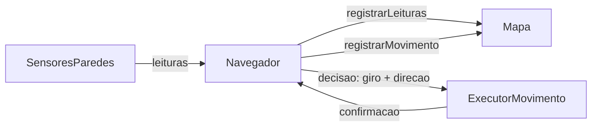

# Navegação autônoma (HU-06)

## 1. Visão geral

O Micromouse é um robô que percorre sozinho um labirinto de células quadradas, da largada em A1 até a chegada no canto oposto, na última linha da coluna D. Este módulo implementa a HU-06 (*Decidir o caminho de forma autônoma*, prioridade Must have, rastreada por RF-SFT03 e RNF-SFT01): a escolha, sem intervenção externa, da próxima célula a visitar a partir do mapa descoberto durante a exploração.

## 2. Objetivo da implementação

O robô não conhece o labirinto antecipadamente. O módulo precisa decidir o próximo movimento usando apenas as paredes já observadas (HU-03), contornar becos sem saída, voltar por caminhos conhecidos, nunca repetir indefinidamente o mesmo trajeto e parar ao chegar ao destino ou ao concluir que ele é inalcançável.

## 3. Arquitetura da solução

| Componente | Arquivo | Responsabilidade |
| --- | --- | --- |
| `Navegador` | `navegacao/Navegador.h` | Decisão (`decidir`) e atualização lógica (`confirmarGiro`, `confirmarAvanco`, `registrarFalha`); orquestra um ciclo em `passo`. |
| `SensoresParedes`, `ExecutorMovimento` | `navegacao/InterfacesNavegacao.h` | Interfaces que isolam o hardware. O `Navegador` não depende de motores ou sensores reais. |
| `SimuladorLabirinto` | `test/test_navegador/SimuladorLabirinto.h` | Implementa as duas interfaces sobre um labirinto verdadeiro, usado só nos testes. |

As três camadas ficam separadas: **decisão** (`decidir` apenas planeja e não altera a posição), **execução** (interfaces implementadas pelo hardware ou pelo simulador) e **atualização** (posição, orientação, mapa e histórico mudam somente depois que o executor confirma o movimento). `Mapa::registrarMovimento()` é chamado apenas em `confirmarAvanco()`.



## 4. Algoritmo de navegação

Foi adotada exploração por fronteiras com planejamento em largura (BFS) sobre as passagens confirmadas.

| Critério | DFS | BFS / fronteiras | Flood Fill | Guloso (Manhattan) |
| --- | --- | --- | --- | --- |
| Tempo por decisão | O(V) | O(V), V ≤ 48 | O(V) por atualização | O(1) |
| Memória extra | pilha O(V) | O(V) bytes (3 vetores de 48 B na pilha) | O(V) | O(1) |
| Explora mapa desconhecido | sim | sim | precisa de adaptação | sim |
| Garantia de término | sim | sim | sim | não (ciclos) |
| Beco sem saída | retrocede, em ordem fixa | retorno pelo menor caminho conhecido | depende da reatribuição | pode travar |

A DFS pura retorna sempre pelo caminho de entrada, o que desperdiça deslocamentos quando há atalhos já conhecidos. O Flood Fill é desenhado para o planejamento sobre mapa completo (speed run, fora do escopo). A estratégia gulosa foi descartada porque não contorna obstáculos que afastam o robô do destino. A BFS sobre fronteiras reaproveita diretamente `ladoConhecido`, `temParede` e `foiVisitada` da HU-03, gasta poucos bytes e tem término demonstrável.

Funcionamento, a cada decisão:

1. Uma célula visitada tem os quatro lados conhecidos (três lidos e o de trás gravado por `registrarMovimento`). Uma passagem confirmada que leva a uma célula não visitada é uma fronteira.
2. Uma BFS a partir da célula atual percorre apenas passagens confirmadas entre células visitadas. Lado desconhecido nunca é tratado como livre.
3. Entre as fronteiras, escolhe-se a de menor custo, definido como a distância percorrida mais a distância de Manhattan ao destino. O destino, quando é uma fronteira, tem prioridade. Empates são resolvidos por chave fixa (distância ao destino, linha, coluna), e a BFS expande na ordem frente, direita, esquerda, trás; o comportamento é determinístico.
4. A primeira etapa do menor caminho é a decisão. Se a fronteira não é vizinha, a etapa é um retorno por células já visitadas (`DecisaoNavegacao::retorno`).
5. Sem fronteiras, o estado passa a `NAV_INALCANCAVEL`.

**Término.** Em um labirinto finito e estático, com leituras corretas e movimentos bem-sucedidos, o alvo escolhido permanece o mesmo enquanto o robô o persegue: seu custo diminui 1 por passo, o dos demais diminui no máximo 1, e o desempate usa uma chave que não depende da posição do robô. Logo, cada fronteira é alcançada em até (células − 1) passos e a célula passa a visitada. O conjunto de células não visitadas é finito e diminui a cada alcance, portanto a exploração termina com chegada ou sem fronteiras. Como salvaguarda adicional contra divergências reais (sensores, derrapagem), há o limite `Navegador::LIMITE_PASSOS` (4096) e o limite de falhas consecutivas `LIMITE_FALHAS` (3), que levam a `NAV_FALHA`.

## 5. Inicialização e chegada

`iniciar()` define A1 (0, 0), orientação `DIR_LESTE` e o destino `(getMaxLinhas() - 1, getMaxColunas() - 1)`, ou seja, D4, D8 ou D12 conforme a geometria. Não limpa o mapa: a geometria é escolhida antes da largada com `Mapa::setGeometria()`. Ao entrar na célula de destino, o estado passa a `NAV_CHEGOU`, nenhuma nova decisão é emitida e o mapa é preservado. `preencherPosicao()` copia linha, coluna, orientação e paredes para o `TelemetriaPacket`, sem alterar o contrato.

## 6. Integração com a HU-03

O `Navegador` não altera `Mapa.h` nem `Direcao.h`. Ele usa `registrarLeituras` (leituras relativas convertidas para direções absolutas), `registrarMovimento` (lado de trás e marcação da célula), `vizinha`, `ladoConhecido`, `temParede` e `foiVisitada`. Leituras incoerentes (passagem no perímetro) continuam sendo ignoradas pelo mapa.

## 7. Estrutura de arquivos

| Arquivo | Alteração |
| --- | --- |
| `src/firmware/robo/src/navegacao/Navegador.h` | Criado |
| `src/firmware/robo/src/navegacao/InterfacesNavegacao.h` | Criado |
| `src/firmware/robo/src/navegacao/README.md` | Criado |
| `src/firmware/robo/test/test_navegador/test_navegador.cpp` | Criado |
| `src/firmware/robo/test/test_navegador/SimuladorLabirinto.h` | Criado |
| `src/firmware/robo/src/main.cpp` | Modificado: instancia o `Navegador` e publica a posição na telemetria quando iniciado |

## 8. Requisitos atendidos

| Critério | Situação |
| --- | --- |
| CA-01, menos de 3 min na 4x4 | Parcial: simulação mostra poucos deslocamentos e giros; o tempo real depende de velocidade, giros e sensores, ainda não medidos. Pendente de validação em hardware. |
| CA-02, autonomia (RNF-SFT01) | Atendido no software: o ciclo usa só sensores e executor; não há entrada de comandos nem mapa pré-carregado. Falta a demonstração física. |
| CA-03, sem ciclos | Atendido em simulação e por argumento de término (seção 4). |

## 9. Testes realizados

Resultado obtido com `pio test -e native` em `src/firmware/robo`: 86 casos, 86 aprovados (51 anteriores da HU-03, telemetria e direção, mais 35 novos). Os 35 novos cobrem: inicialização, objetivos nas três geometrias, caminho livre, parede à frente, beco sem saída, caminho alternativo, uso do histórico de visitas, ciclos, limites, lados desconhecidos, chegada, encerramento, independência de comandos externos, falhas de avanço, giro e leitura, labirinto impossível, determinismo, integração com `Mapa` e telemetria, oito cenários de labirinto completo e medição de desempenho.

Nos cenários o simulador guarda o labirinto verdadeiro e o robô só recebe as leituras da célula em que está. Métricas obtidas:

| Cenário | Término | Visitadas | Deslocamentos | Retornos | Giros | Movimentos inválidos |
| --- | --- | --- | --- | --- | --- | --- |
| 4x4 sem paredes | chegada | 7 | 6 | 0 | 1 | 0 |
| 4x4 com becos | chegada | 7 | 6 | 0 | 1 | 0 |
| 4x4 alternativas | chegada | 9 | 10 | 2 | 3 | 0 |
| 4x4 com ciclos | chegada | 7 | 6 | 0 | 3 | 0 |
| 4x4 afastar do destino | chegada | 9 | 8 | 0 | 5 | 0 |
| 8x4 | chegada | 15 | 18 | 4 | 8 | 0 |
| 12x4 | chegada | 22 | 26 | 5 | 11 | 0 |
| 4x4 destino inacessível | inalcançável | 6 | 5 | 0 | 1 | 0 |

Desempenho medido no PC (não representativo do ESP32): cerca de 40 µs por decisão no 12x4. Memória: `sizeof(Navegador)` = 24 B (mais 152 B do `Mapa` já existente) e três vetores de 48 B na pilha durante o planejamento. Compilação `esp32dev`: RAM 13,4% (43896 B) e flash 56,6% (741721 B). A cobertura (gcovr) não foi gerada localmente por a ferramenta não estar instalada; ela é gerada pelo CI.

## 10. Execução dos testes

```
pio test -d src/firmware/robo -e native
pio run  -d src/firmware/robo -e esp32dev
```

Para ver as métricas dos cenários: `pio test -d src/firmware/robo -e native -f test_navegador -v`.

## 11. Limitações conhecidas

- Não há drivers de sensores, motores nem odometria no repositório; `SensoresParedes` e `ExecutorMovimento` precisam ser implementados pelas issues de hardware.
- O gatilho de largada (HU-05) não está nesta base; o `Navegador` ainda não é chamado de `loop()`.
- O tempo de 3 minutos não foi validado fisicamente.
- Falhas de avanço são apenas contadas e repetidas; não há recalibração de posição por divergência entre estimada e real.
- A HU-03 (branch `feat/35-hu-03-registrar-paredes`) ainda não está na `main`; esta branch parte dela.
- Cenários de speed run estão fora do escopo.
- `estadoRobo()` converte `NAV_INALCANCAVEL` e `NAV_FALHA` em `TRAVADO`. Na telemetria, o painel mostra "Travado" nos dois casos, sem distinguir destino inalcançável de falha de movimento ou leitura.

### Pontos para a integração

- **Detecção de chegada.** A chegada é detectada aqui (`NAV_CHEGOU`) e também no `ParadaObjetivo` da HU-07. Sugere-se que o `main` passe a posição do `Navegador` ao `ParadaObjetivo`, que para a tração e congela o cronômetro, de modo que o estado `CONCLUIDO` seja definido em um único lugar.
- **Chamadas bloqueantes.** `passo()` bloqueia durante o giro e o avanço. Ao implementar o `ExecutorMovimento`, é preciso garantir que a telemetria a 1 Hz e a leitura do botão continuem sendo atendidas durante o movimento.

## 12. Considerações finais

A solução entrega decisão determinística, separada da execução física, com memória estática pequena e testável sem hardware. Os resultados em simulação mostram término correto nas três geometrias e em labirintos com becos, ciclos e destino inacessível, sem movimentos inválidos. A comprovação do tempo de prova e da autonomia em pista depende da integração com o hardware.
